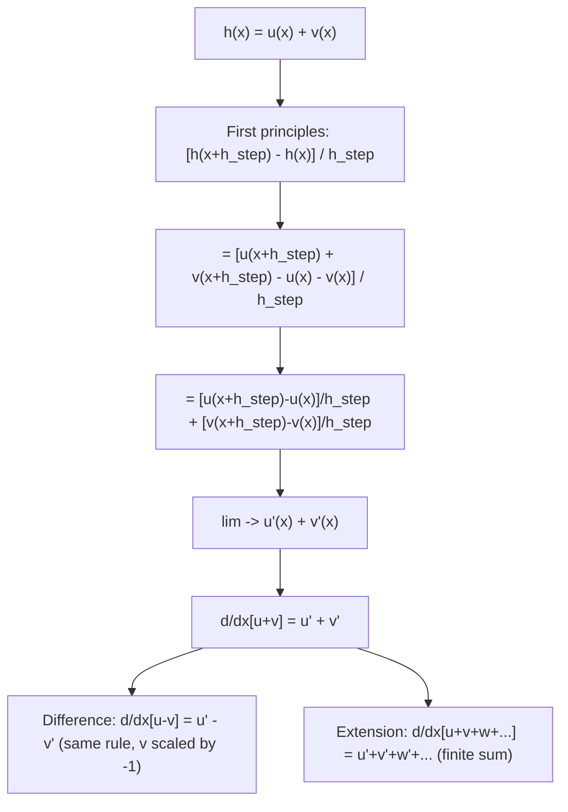

# Sum Rule

$$
\frac{d}{dx}[u \pm v] = \frac{du}{dx} \pm \frac{dv}{dx}
$$

## Deep Breakdown

What it tells me *(Situation Awareness)*:
The sum (and difference) rule states that differentiation distributes over addition: the derivative of a sum is the sum of the derivatives. Together with the scalar multiplication rule, this establishes that $d/dx$ is a linear operator. In DA/DS: every multi-term loss function (MSE + regularization, cross-entropy + label smoothing, primary task loss + auxiliary task loss) has its gradient computed as the sum of the individual gradients; parameter update formulas like $\nabla L = \nabla L_{\text{data}} + \nabla L_{\text{reg}}$ use this rule directly; differentiating polynomial features like $x^3 + 2x^2 - x + 5$ applies the sum rule term by term.

## Flowchart



## Real-world use

### Where it is used

Gradient of regularized loss: $\nabla_w[L_{\text{data}} + \lambda R(w)] = \nabla_w L_{\text{data}} + \lambda \nabla_w R(w)$; gradient of polynomial regression model output $\hat{y} = w_0 + w_1 x + w_2 x^2$; gradient of cross-entropy with label smoothing: $\nabla[(1-\epsilon)H + \epsilon H_{\text{uniform}}] = (1-\epsilon)\nabla H + \epsilon \nabla H_{\text{uniform}}$; any situation where a loss combines multiple components.

### Problem it solves

When a function is built from a sum of simpler functions, it would be tedious to differentiate the combined expression from scratch each time. The sum rule allows each term to be differentiated independently and the results added together.

### How it solves the problem

From first principles: $[(u(x+h)+v(x+h)) - (u(x)+v(x))]/h = [u(x+h)-u(x)]/h + [v(x+h)-v(x)]/h$. The limit distributes over the sum (the limit of a sum is the sum of the limits, when both limits exist).

### Example in a business

A DS uses a composite loss: $L = L_{\text{MSE}} + 0.1 L_{\text{MAE}}$, where $L_{\text{MSE}} = (1/N)\|y - \hat{y}\|^2$ and $L_{\text{MAE}} = (1/N)\sum_i |y_i - \hat{y}_i|$. The gradient: $\nabla L = \nabla L_{\text{MSE}} + 0.1 \nabla L_{\text{MAE}}$. Each component's gradient is computed independently, then added. The sum rule is the justification.

## The formula, piece by piece

- $u$: first differentiable function of $x$
- $v$: second differentiable function of $x$
- $u \pm v$: their sum or difference
- $du/dx \pm dv/dx$: the derivative of the sum equals the sum of the derivatives
- Proof mechanism: limit distributes over addition
- Extension to $n$ terms: $d/dx[u_1 + u_2 + \ldots + u_n] = u_1' + u_2' + \ldots + u_n'$
- Combined linearity: $d/dx[au + bv] = au' + bv'$ (sum + scalar rules together)
- Note: does NOT hold for products ($d/dx[uv] \ne u'v'$) — that needs the product rule

## The formula in words

"The derivative of a sum is the sum of the derivatives. You can break a function into pieces, differentiate each piece separately, and add the results. This works because differentiation is a linear operation." Tiny examples:
$d/dx(x^3 + x^2) = 3x^2 + 2x$.
$d/dx(\sin x + e^x) = \cos x + e^x$.
$d/dx(x^2 - \ln x) = 2x - 1/x$.
$d/dx(2x^3 + 5x - 7) = 6x^2 + 5 - 0 = 6x^2 + 5$ (constant rule used too).

## Critical Concepts

- **Linearity of the derivative:** sum rule + scalar rule = linearity. $d/dx[af + bg] = af' + bg'$ for constants $a$, $b$. This is one of the most important structural properties of the derivative, shared by integrals, expectations, and many other operators in mathematics.
- **Every multi-term loss gradient uses this:** if $L = L_1 + L_2 + L_3$, then $\nabla L = \nabla L_1 + \nabla L_2 + \nabla L_3$. No approximation, no interaction terms. This additivity is why gradient computation can be parallelized across loss components.
- **Difference rule is the same rule:** $d/dx[u - v] = d/dx[u + (-1)v] = u' + (-1)v' = u' - v'$. The minus sign is just the scalar $k = -1$ case.
- **Infinite sums (series) require more care:** the sum rule holds for finite sums. For infinite sums (power series, Fourier series), additional conditions (uniform convergence) are needed before differentiating term by term.
- **Gradient additivity in code:** the automatic differentiation engines (PyTorch, TensorFlow/JAX) exploit the sum rule.

When a computation graph adds two tensors, the backward pass routes the upstream gradient to both branches unchanged. This is the sum rule implemented in reverse mode AD.

## Step-by-step calculation (tiny example)

*Differentiate $f(x) = 5x^4 - 3x^2 + 2x - 1$.*

*Step 1: Apply sum rule — differentiate each term.*
$f'(x) = d/dx(5x^4) - d/dx(3x^2) + d/dx(2x) - d/dx(1)$.

*Step 2: Scalar + power rule on each term.*
$d/dx(5x^4) = 20x^3$.
$d/dx(3x^2) = 6x$.
$d/dx(2x) = 2$.
$d/dx(1) = 0$.

*Step 3: Combine.*
$f'(x) = 20x^3 - 6x + 2$. At $x = 1$: $f'(1) = 20 - 6 + 2 = 16$.

## Code examples

### Beginner example (Python)

```python
import numpy as np

def f(x: float) -> float:
    """f(x) = 5x^4 - 3x^2 + 2x - 1."""
    return 5*x**4 - 3*x**2 + 2*x - 1

def f_prime(x: float) -> float:
    """f'(x) = 20x^3 - 6x + 2 (sum rule applied term by term)."""
    return 20*x**3 - 6*x + 2   # Verify numerically
h = 1e-7
x_vals = [-2.0, -1.0, 0.0, 1.0, 2.0]
print(f"{'x':>6} {'Analytic f\\'(x)':>16} {'Numerical':>12} {'Match':>7}")
for x in x_vals:
    analytic = f_prime(x)
numerical = (f(x + h) - f(x - h)) / (2 * h)
match = abs(analytic - numerical) < 1e-5
print(f"{x:>6.1f} {analytic:>16.6f} {numerical:>12.6f} {str(match):>7}")   # Multi-component loss gradient: sum rule
print("\nSum rule for multi-component loss gradient:")
y = np.array([1.0, 2.0, 3.0, 4.0])
y_pred = np.array([1.2, 1.8, 3.3, 3.7])
grad_mse = 2 * np.mean(y_pred - y)   # d/dpred(MSE)
grad_mae = np.mean(np.sign(y_pred - y))   # d/dpred(MAE) via subgradient
ALPHA, BETA = 0.7, 0.3
grad_combined = ALPHA * grad_mse + BETA * grad_mae
print(f" grad_MSE = {grad_mse:.4f}")
print(f" grad_MAE = {grad_mae:.4f}")
print(f" grad_combined (0.7*MSE + 0.3*MAE) = {grad_combined:.4f}")
print(f" Key: sum rule gives grad = alpha*grad_A + beta*grad_B")
```

### Beginner example (R)

```r
# Sum rule: d/dx[u + v] = u' + v'
f <- function(x) 5*x^4 - 3*x^2 + 2*x - 1
f_prime <- function(x) 20*x^3 - 6*x + 2
h <- 1e-7
x_vals <- c(-2, -1, 0, 1, 2)
cat(sprintf("%-6s %-16s %-12s\n", "x", "Analytic f'(x)", "Numerical"))
for (x in x_vals) { numerical <- (f(x + h) - f(x - h)) / (2 * h)
  cat(sprintf("%-6.1f %-16.6f %-12.6f\n", x, f_prime(x), numerical))
}  # Regularized loss gradient: sum rule
cat("\nRegularized loss gradient = gradient_data + lambda * gradient_reg\n")
w <- c(1.0, -0.5, 2.0)
grad_data <- c(-0.3, 0.1, -0.2)  # hypothetical data gradient
grad_reg <- 2 * w  # L2 gradient
lambda <- 0.1
grad_total <- grad_data + lambda * grad_reg
cat(sprintf("grad_data: %.4f %.4f %.4f\n", grad_data[1], grad_data[2], grad_data[3]))
cat(sprintf("grad_reg: %.4f %.4f %.4f\n", grad_reg[1], grad_reg[2], grad_reg[3]))
cat(sprintf("grad_total: %.4f %.4f %.4f\n", grad_total[1], grad_total[2], grad_total[3]))
```

### Professional example (Python)

```python
import numpy as np
from sklearn.datasets import make_regression, make_classification
from sklearn.preprocessing import StandardScaler
import functools
np.random.seed(42)   # -- Sum rule: gradient of composite loss (regression + auxiliary classification) --
# Use case: a DS trains a model with a primary MSE loss and an auxiliary
# binary classification loss. Gradient uses sum rule component-by-component.
N, D = 400, 5
X_raw = np.random.randn(N, D)
scaler = StandardScaler()
X = scaler.fit_transform(X_raw)
w_true = np.array([2.0, -1.5, 0.5, 1.0, -0.3])
y_reg = X @ w_true + np.random.randn(N) * 0.5   # regression target
y_cls = (X @ w_true > np.median(X @ w_true)).astype(float)   # classification target

def sigmoid(z: np.ndarray) -> np.ndarray:
    return np.where(z >= 0, 1 / (1 + np.exp(-z)), np.exp(z) / (1 + np.exp(z)))

def mse_gradient(w: np.ndarray, X: np.ndarray, y: np.ndarray) -> np.ndarray:
    """Gradient of (1/N)||y - Xw||^2 with respect to w."""
    residuals = y - X @ w
    return -2.0 / N * X.T @ residuals

def bce_gradient(w: np.ndarray, X: np.ndarray, y: np.ndarray) -> np.ndarray:
    """Gradient of binary cross-entropy loss with respect to w."""
    p = sigmoid(X @ w)
    return X.T @ (p - y) / N

def composite_gradient( w: np.ndarray, X: np.ndarray, y_reg: np.ndarray, y_cls: np.ndarray, alpha: float, beta: float,
) -> np.ndarray:
    """grad(alpha*MSE + beta*BCE) = alpha*grad_MSE + beta*grad_BCE (sum rule)."""
    g_mse = mse_gradient(w, X, y_reg)
    g_bce = bce_gradient(w, X, y_cls)
    return alpha * g_mse + beta * g_bce   # Compare: gradient descent with only MSE vs composite loss
ALPHA = 0.6
BETA = 0.4
LR = 0.05
N_ITER = 500
w_mse_only = np.zeros(D)
w_composite = np.zeros(D)
for _ in range(N_ITER):
    w_mse_only -= LR * mse_gradient(w_mse_only, X, y_reg)
w_composite -= LR * composite_gradient(w_composite, X, y_reg, y_cls, ALPHA, BETA)
print("Sum Rule: gradient of composite loss (MSE + BCE)")
print(f"\nalpha={ALPHA}, beta={BETA}")
print(f"grad(alpha*L_MSE + beta*L_BCE) = alpha*grad_MSE + beta*grad_BCE\n")
print(f"{'Param':>8} {'w_true':>10} {'w_mse_only':>12} {'w_composite':>13}")
for j in range(D):
    print(f"{'w['+str(j)+']':>8} {w_true[j]:>10.4f} {w_mse_only[j]:>12.4f} {w_composite[j]:>13.4f}")   # Final gradient decomposition at composite solution
g_mse_final = mse_gradient(w_composite, X, y_reg)
g_bce_final = bce_gradient(w_composite, X, y_cls)
g_total = ALPHA * g_mse_final + BETA * g_bce_final
print(f"\nFinal gradient norm: {np.linalg.norm(g_total):.6f}")
print(f"MSE component norm: {np.linalg.norm(g_mse_final):.6f}")
print(f"BCE component norm: {np.linalg.norm(g_bce_final):.6f}")
```

---

*Source: 1300 p. 218*
