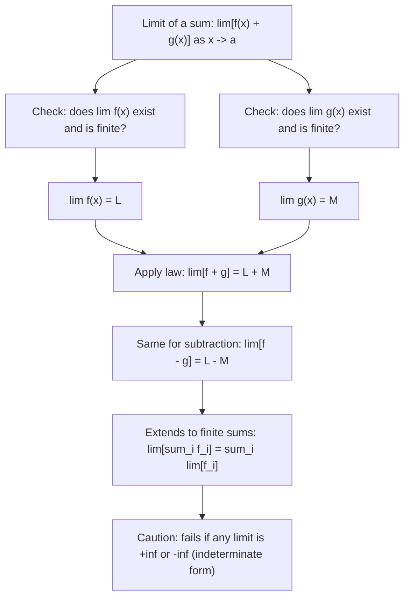

# Addition/Subtraction

$$
\lim_{x \to a} [f(x) \pm g(x)] = \lim_{x \to a} f(x) \pm \lim_{x \to a} g(x)
$$

## Deep Breakdown

What it tells me *(Situation Awareness)*:
The limit of a sum (or difference) is the sum (or difference) of the individual limits, provided both individual limits exist and are finite. This is one of the fundamental limit laws that underpin calculus. In practice it means you can decompose complex limit problems into simpler pieces: rather than computing $\lim (f + g)$ directly, compute $\lim f$ and $\lim g$ separately, then add. In DS/DA: when analyzing the convergence of loss functions composed of multiple terms (MSE + regularization), when taking limits of composite estimators (bias + variance decomposition in the limit), or when computing limiting distributions of test statistics involving sums. Critically, this law is used to prove that differentiation is linear: the derivative is defined as a limit, and linearity of differentiation follows from this addition law.

## Flowchart



## Real-world use

### Where it is used

Proving differentiability of composite loss functions (sum rule of derivatives follows from this); computing limits of MSE as sample size $n \to \infty$ (consistency proofs: $\text{MSE} = \text{Bias}^2 + \text{Variance}$, take limit of each term); analyzing convergence of gradient descent loss at each step (loss decreases by a sum of per-parameter contributions); evaluating limits of polynomial expressions by splitting into monomial limits; computing the expectation of sums of random variables as a limiting argument.

### Problem it solves

Directly computing $\lim_{x\to a}[f(x) + g(x)]$ when both functions are complex may require simplification. The addition law allows decomposition into simpler, independently computable pieces — without needing to evaluate $f(x) + g(x)$ as a single expression at the limit point.

### How it solves the problem

If you can evaluate $\lim_{x\to a} f(x) = L$ and $\lim_{x\to a} g(x) = M$ separately (both finite), then the combined limit is simply $L + M$ (or $L - M$ for subtraction). This works because the formal $\epsilon$-$\delta$ proof shows: if $|f(x)-L| < \epsilon/2$ and $|g(x)-M| < \epsilon/2$ within some neighborhood of $a$, then $|[f(x)+g(x)]-(L+M)| < \epsilon$.

### Example in a business

A DS proves that as training sample size $n \to \infty$, the MSE estimator is consistent. MSE $= \text{Bias}^2(\hat{\theta}) + \text{Var}(\hat{\theta})$. If $\lim_{n\to\infty}\text{Bias}^2 = 0$ and $\lim_{n\to\infty}\text{Var} = 0$ (both finite for unbiased, consistent estimators), then by the addition law: $\lim_{n\to\infty}\text{MSE} = 0 + 0 = 0$. No need to evaluate MSE as a single combined expression.

## The formula, piece by piece

- $\lim_{x \to a}$: "the limit as $x$ approaches $a$" — what value does the expression approach?
- $[f(x) \pm g(x)]$: a sum or difference of two functions
- $\lim_{x \to a} f(x)$: the limit of $f$ alone — call it $L$
- $\lim_{x \to a} g(x)$: the limit of $g$ alone — call it $M$
- $= L \pm M$: the law states the combined limit equals the combined individual limits
- Requirement: both $L$ and $M$ must exist (be finite). If either is $\pm\infty$, use L'Hôpital or algebraic simplification.
- Extension to $n$ terms: $\lim_{x\to a}[f_1(x) + f_2(x) + \cdots + f_n(x)] = \lim f_1 + \lim f_2 + \cdots + \lim f_n$, provided all individual limits exist.

## The formula in words

"If each part of a sum has a well-defined limit, then the limit of the whole sum is just the sum of the parts' limits. You can split a sum limit into separate limits and add the results." Tiny trace: $\lim_{x\to 2}[(3x + x^2)]$.
$\lim_{x\to 2}(3x) = 6$. $\lim_{x\to 2}(x^2) = 4$.
Sum law: $\lim_{x\to 2}[3x + x^2] = 6 + 4 = 10$. Direct: $(3 \cdot 2) + 4 = 10$. $\checkmark$

## Critical Concepts

- **Requires finite limits:** the addition law holds only when both $\lim f$ and $\lim g$ are finite real numbers. If $\lim f = +\infty$ and $\lim g = -\infty$, the combined limit is the indeterminate form $\infty - \infty$ and cannot be determined without further analysis (L'Hôpital, algebraic manipulation, or Taylor expansion).
- **Linearity of limits and differentiation:** the derivative is $f'(a) = \lim_{h\to 0}[f(a+h)-f(a)]/h$. The sum rule of derivatives $(f+g)' = f' + g'$ follows directly from applying the addition law of limits to $[f(a+h)+g(a+h)-f(a)-g(a)]/h = [f(a+h)-f(a)]/h + [g(a+h)-g(a)]/h$, then taking the limit. This is why differentiation is linear.
- **Finite vs. infinite sums:** the addition law extends to any finite number of terms. For infinite sums (series), the limit of a sum does NOT automatically equal the sum of limits — this requires uniform convergence. Example: the Taylor series $e^x = 1 + x + x^2/2! + \cdots$ is a limit of partial sums; term-by-term differentiation is valid because the series converges uniformly on compact sets.
- **Monte Carlo estimators:** the sample mean $\bar{X}_n = (1/n)\sum_i X_i$ converges to $\mathbb{E}[X]$ by the law of large numbers. The variance of the sum $(1/n^2)\sum \text{Var}(X_i) = \sigma^2/n \to 0$ by the addition law for limits of variances. Monte Carlo integration relies on this: $\lim_{n\to\infty}(1/n)\sum_i f(X_i) = \mathbb{E}[f(X)]$.
- **Numerically:** when computing limits numerically (e.g., checking gradient derivations), you can verify the addition law by computing $f(x)$ and $g(x)$ for $x$ near $a$ separately and adding.

If their individual limits agree with the combined limit, this is a sanity check that no cancellation or indeterminate form is present.

## Step-by-step calculation (tiny example)

*Evaluate $\lim_{x \to 3}[(2x^2 - 5) + \sqrt{x+1}]$.*

*Step 1: Identify the two parts.*
$f(x) = 2x^2 - 5$. $g(x) = \sqrt{x+1}$.

*Step 2: Compute each limit separately.*
$\lim_{x\to 3}(2x^2 - 5) = 2(9) - 5 = 18 - 5 = 13$.
$\lim_{x\to 3}\sqrt{x+1} = \sqrt{4} = 2$.

*Step 3: Apply the addition law.*
$\lim_{x\to 3}[(2x^2 - 5) + \sqrt{x+1}] = 13 + 2 = 15$. *Verify directly:* plug $x = 3$: $2(9) - 5 + 2 = 15$. $\checkmark$

## Code examples

### Beginner example (Python)

```python
import numpy as np

def numerical_limit(fn, a: float, h: float = 1e-6) -> float:
    """Approximate limit of fn as x -> a using a small h."""
    return 0.5 * (fn(a + h) + fn(a - h))

def verify_addition_law(f, g, a: float) -> dict:
    """Verify: lim[f+g] = lim[f] + lim[g]."""
    lim_f = numerical_limit(f, a)
    lim_g = numerical_limit(g, a)
    lim_sum = numerical_limit(lambda x: f(x) + g(x), a)
    law_result = lim_f + lim_g
    return { "lim_f": lim_f, "lim_g": lim_g, "lim(f+g)": lim_sum, "lim_f+lim_g": law_result, "error": abs(lim_sum - law_result), }
examples = [ {"name": "2x^2 - 5 + sqrt(x+1) at x=3", "f": lambda x: 2*x**2 - 5, "g": lambda x: np.sqrt(x + 1), "a": 3}, {"name": "sin(x) + x^2 at x=0", "f": np.sin, "g": lambda x: x**2, "a": 0.0}, {"name": "ln(x) + 1/x at x=1", "f": np.log, "g": lambda x: 1 / x, "a": 1.0}, {"name": "exp(x) - cos(x) at x=0", "f": np.exp, "g": lambda x: -np.cos(x), "a": 0.0},
]
print("Limit Addition Law: lim[f + g] = lim[f] + lim[g]")
print(f"\n{'Example':>36} {'lim f':>8} {'lim g':>8} {'lim(f+g)':>10} {'Sum law':>10} {'Error':>10}")
for ex in examples:
    result = verify_addition_law(ex["f"], ex["g"], ex["a"])
print(f"{ex['name']:>36} {result['lim_f']:>8.4f} {result['lim_g']:>8.4f} " f"{result['lim(f+g)']:>10.4f} {result['lim_f+lim_g']:>10.4f} " f"{result['error']:>10.2e}")
```

### Beginner example (R)

```r
# Limit addition law:
lim[f(x) + g(x)] = lim[f(x)] + lim[g(x)]
numerical_limit <- function(fn, a, h = 1e-6) { 0.5 * (fn(a + h) + fn(a - h))
}
verify_addition_law <- function(f, g, a) { lim_f <- numerical_limit(f, a)
  lim_g <- numerical_limit(g, a)
  lim_sum <- numerical_limit(function(x) f(x) + g(x), a)
  law_val <- lim_f + lim_g list(lim_f = lim_f, lim_g = lim_g, lim_sum = lim_sum, law_val = law_val, error = abs(lim_sum - law_val))
}
examples <- list( list(name = "2x^2-5+sqrt(x+1), a=3", f = function(x) 2*x^2 - 5, g = function(x) sqrt(x + 1), a = 3), list(name = "sin(x)+x^2, a=0", f = sin, g = function(x) x^2, a = 0), list(name = "exp(x)-cos(x), a=0", f = exp, g = function(x) -cos(x), a = 0)
) cat(sprintf("%-30s %-8s %-8s %-10s %-10s\n", "Example", "lim f", "lim g", "lim(f+g)", "Sum law"))
for (ex in examples) { r <- verify_addition_law(ex$f, ex$g, ex$a)
  cat(sprintf("%-30s %-8.4f %-8.4f %-10.4f %-10.4f\n", ex$name, r$lim_f, r$lim_g, r$lim_sum, r$law_val))
}
```

### Professional example (Python)

```python
import numpy as np
from sklearn.datasets import make_regression
from sklearn.preprocessing import StandardScaler
from sklearn.linear_model import Ridge
np.random.seed(42)   # -- Limit addition law: bias-variance decomposition as n -> infinity --
# Use case: A DS studies estimator consistency by decomposing MSE = Bias^2 + Var,
# then verifying numerically that lim(MSE) = lim(Bias^2) + lim(Var) as n grows.
# This demonstrates the limit addition law for statistical estimators.
N_VALUES = [10, 30, 100, 300, 1000, 3000, 10000]
N_TRIALS = 200
TRUE_COEF = np.array([2.0, -1.5, 0.5])
DIM = len(TRUE_COEF)
NOISE_STD = 1.0
LAMBDA = 0.1   # ridge regularization (introduces shrinkage bias)

def simulate_ridge_bias_variance(n_train: int, lam: float, n_trials: int) -> dict:
    """Estimate bias^2 and variance of ridge estimator over many trials."""
    estimates = np.zeros((n_trials, DIM))
    for trial in range(n_trials):
        X_tr = np.random.randn(n_train, DIM)
    y_tr = X_tr @ TRUE_COEF + np.random.randn(n_train) * NOISE_STD
    mdl = Ridge(alpha=lam * n_train, fit_intercept=False)
    mdl.fit(X_tr, y_tr)
    estimates[trial] = mdl.coef_
    mean_est = estimates.mean(axis=0)
    bias_sq = float(np.sum((mean_est - TRUE_COEF)**2))
    variance = float(np.sum(estimates.var(axis=0)))
    mse_sum = bias_sq + variance
    return {"bias_sq": bias_sq, "variance": variance, "mse_sum_law": mse_sum}
print("Limit Addition Law: MSE = Bias^2 + Variance (both limits -> 0 as n -> inf)")
print(f"\nModel: Ridge regression, lambda={LAMBDA}, DIM={DIM}, {N_TRIALS} trials each")
print(f"\n{'n':>7} {'Bias^2':>10} {'Variance':>10} {'Bias^2+Var':>12} {'MSE direct':>12}")
for n in N_VALUES:
    result = simulate_ridge_bias_variance(n, LAMBDA, N_TRIALS)   # Direct MSE estimate: mean squared deviation from true coef
direct_mse_estimates = []
for _ in range(N_TRIALS):
    X_tr = np.random.randn(n, DIM)
y_tr = X_tr @ TRUE_COEF + np.random.randn(n) * NOISE_STD
mdl = Ridge(alpha=LAMBDA * n, fit_intercept=False)
mdl.fit(X_tr, y_tr)
direct_mse_estimates.append(np.sum((mdl.coef_ - TRUE_COEF)**2))
mse_direct = float(np.mean(direct_mse_estimates))
print(f"{n:>7} {result['bias_sq']:>10.5f} {result['variance']:>10.5f} " f"{result['mse_sum_law']:>12.5f} {mse_direct:>12.5f}")
print(f"\nKey insight:")
print(f" lim_{{n->inf}} Bias^2 --> 0 (ridge shrinkage vanishes as lambda/n -> 0)")
print(f" lim_{{n->inf}} Variance --> 0 (estimator concentrates around true coef)")
print(f" By limit addition law: lim MSE = lim Bias^2 + lim Var = 0 + 0 = 0")
print(f" Estimator is consistent: MSE -> 0 as n -> infinity.")
```

---

*Source: 1300 p. 216*
