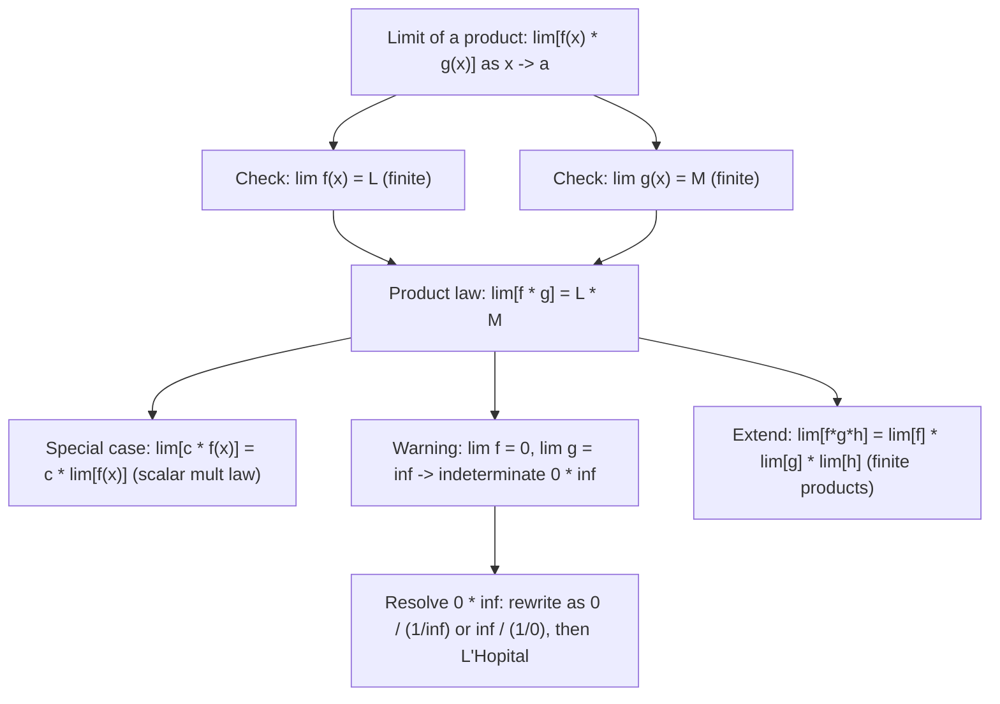

# Multiplication

$$
\lim_{x \to a} [f(x) \cdot g(x)] = \lim_{x \to a} f(x) \cdot \lim_{x \to a} g(x)
$$

## Deep Breakdown

What it tells me *(Situation Awareness)*:
The limit of a product equals the product of the individual limits, provided both limits exist and are finite. This is the product law of limits. It is used whenever you need to break a product into factors and compute each factor's limit separately. In DS/DA: analyzing the product of loss components as a hyperparameter goes to zero or infinity; deriving limits of product-form distributions; proving the consistency of maximum likelihood estimators (product likelihood factored into individual likelihoods); the limit form used when deriving the product rule of differentiation $(fg)' = f'g + fg'$ (the cross-terms in the expansion of $[f(x+h)g(x+h) - f(x)g(x)]/h$). Understanding this law prevents incorrect "factoring" of limits when factors diverge.

## Flowchart



## Real-world use

### Where it is used

Product rule of differentiation proof; limits of joint probability expressions $\lim_{n\to\infty} p_1 p_2 \cdots p_n$ where each factor converges; hyperparameter limit analysis (e.g., $\lim_{\lambda\to 0}[\lambda \cdot w^T w/n]$ in regularization — product of small $\lambda$ and bounded $w^T w/n$); proving the scalar multiplication limit law (special case with $g(x) = c$ constant); momentum update: $m_t = \beta m_{t-1} + (1-\beta)g_t$ — when $\beta^t \to 0$ as $t\to\infty$, the product $\beta^t m_0 \to 0$ uses the product limit law repeatedly.

### Problem it solves

When a function is expressed as a product of two simpler parts, evaluating the combined limit directly can be harder than evaluating each part independently. The product law allows splitting: compute each factor's limit separately, then multiply. This is the same kind of decomposition as the addition law but for products.

### How it solves the problem

Evaluate $\lim_{x\to a} f(x) = L$ and $\lim_{x\to a} g(x) = M$ independently. As long as both are finite real numbers, $\lim_{x\to a}[f(x)g(x)] = L \cdot M$. The $\epsilon$-$\delta$ proof: use the fact that bounded functions multiplied by small-error functions produce small errors; the errors in the product are controlled by $|f(x)||g(x)-M| + |M||f(x)-L|$, both of which can be made small.

### Example in a business

A DS computes the limit of the regularization contribution to the gradient as $\lambda \to 0$: $\lim_{\lambda\to 0}[\lambda \cdot 2w] = \lim_{\lambda\to 0}(\lambda) \cdot 2w = 0 \cdot 2w = 0$. The product law allows splitting the parameter $\lambda$ from $2w$. Similarly, when proving that $L1$ regularization shrinks coefficients to zero as $\lambda \to \infty$: $\lim_{\lambda\to\infty}[w^*(\lambda)] = 0$ involves a product structure in the optimality conditions.

## The formula, piece by piece

- $f(x) \cdot g(x)$: the product of two functions at $x$
- $\lim_{x\to a} f(x) = L$: the limit of the first factor
- $\lim_{x\to a} g(x) = M$: the limit of the second factor
- $= L \cdot M$: the product limit equals the product of limits
- Requirement: both $L$ and $M$ must be finite. If $L = 0$ and $M = \infty$: indeterminate form $0 \cdot \infty$. If $L = \infty$ and $M = \infty$: this is fine, the limit is $\infty$.
- Scalar case: $\lim_{x\to a}[c \cdot f(x)] = c \cdot L$ — this is why scaling a function by a constant scales its limit.
- Power case: $\lim_{x\to a}[f(x)]^n = L^n$ — applying the product law $n$ times for any positive integer $n$.

## The formula in words

"The limit of a product is the product of the limits, as long as each factor has a well-defined finite limit on its own. You can split a limit of a product into separate limits and multiply." Tiny trace: $\lim_{x\to 2}[(3x)(x+1)]$.
$\lim_{x\to 2}(3x) = 6$. $\lim_{x\to 2}(x+1) = 3$.
Product law: $6 \cdot 3 = 18$. Direct: $(6)(3) = 18$. $\checkmark$

## Critical Concepts

- **Indeterminate $0 \cdot \infty$:** if $\lim f = 0$ and $\lim g = \infty$, the product law does NOT apply. The result can be any finite number, $+\infty$, $-\infty$, or oscillate. Example: $\lim_{x\to 0^+} x \cdot (1/x) = 1$; $\lim_{x\to 0^+} x^2 \cdot (1/x) = 0$; $\lim_{x\to 0^+} x \cdot (1/x^2) = \infty$. Resolve by rewriting as $0/(1/g)$ or $\infty/(1/f)$ and applying L'Hôpital.
- **Power law for limits:** $\lim_{x\to a}[f(x)]^n = [\lim_{x\to a}f(x)]^n = L^n$, for any positive integer $n$, by applying the product law $n-1$ times. This is used when computing limits of polynomial terms (each term is $c_k x^k = c_k \cdot x \cdot x \cdots x$). Extends to rational exponents for positive $L$ via continuity of $u^{r}$.
- **Product rule derivation:** the product rule $(fg)'(x) = f'(x)g(x) + f(x)g'(x)$ is derived by expanding $[f(x+h)g(x+h) - f(x)g(x)]/h = [f(x+h)-f(x)]/h \cdot g(x+h) + f(x) \cdot [g(x+h)-g(x)]/h$ and then applying the product limit law to get $\lim_{h\to 0} f'(x) \cdot g(x) + f(x) \cdot g'(x)$, using $\lim_{h\to 0} g(x+h) = g(x)$ (continuity).
- **Consistent estimators:** if $\hat{\theta}_n \to \theta$ (parameter estimate converges) and $h(\hat{\theta}_n) = f(\hat{\theta}_n) \cdot g(\hat{\theta}_n)$ where both $f$ and $g$ are continuous, then $h(\hat{\theta}_n) \to f(\theta) \cdot g(\theta)$ by continuity + product limit law. The delta method for variance of product estimators uses this.
- **Numerical precision:** when computing $\lim_{x\to a} f(x) \cdot g(x)$ numerically near a singularity of $g$, be careful: if $f(x) \approx 0$ and $g(x) \approx \infty$, floating-point cancellation errors can dominate.

The limit may be a finite number even though individual factors diverge. Use log-domain computation: $\ln|f(x) \cdot g(x)| = \ln|f(x)| + \ln|g(x)|$ and check if the sum converges.

## Step-by-step calculation (tiny example)

*Evaluate $\lim_{x\to 0} \frac{\sin x}{x} \cdot e^x$.*

*Step 1: Split into two limits.*
$f(x) = \sin(x)/x$ and $g(x) = e^x$.

*Step 2: Compute each limit.*
$\lim_{x\to 0} \sin(x)/x = 1$ (standard sinc limit, shown in Standard Limit (Sine)).
$\lim_{x\to 0} e^x = e^0 = 1$.

*Step 3: Apply product law.*
$\lim_{x\to 0} \frac{\sin x}{x} \cdot e^x = 1 \cdot 1 = 1$. *Verify:* at $x = 0.001$: $(\sin(0.001)/0.001) \cdot e^{0.001} \approx 0.9999998 \cdot 1.001 \approx 1.001 \approx 1$. $\checkmark$

## Code examples

### Beginner example (Python)

```python
import numpy as np


def numerical_limit(fn, a: float, h: float = 1e-7) -> float:
    """Approximate lim_{x->a} fn(x)."""
    return 0.5 * (fn(a + h) + fn(a - h))


def verify_product_law(f, g, a: float) -> dict:
    """Verify lim[f*g] = lim[f] * lim[g]."""
    lim_f = numerical_limit(f, a)
    lim_g = numerical_limit(g, a)
    lim_product = numerical_limit(lambda x: f(x) * g(x), a)
    law_result = lim_f * lim_g
    return {
        "lim_f": lim_f,
        "lim_g": lim_g,
        "lim(f*g)": lim_product,
        "lim_f * lim_g": law_result,
        "error": abs(lim_product - law_result),
    }


examples = [
    {"name": "sin(x)/x * exp(x), a=0", "f": lambda x: np.sin(x) / x, "g": np.exp, "a": 0.0},
    {"name": "(x^2-4)/(x-2) * cos(x), a=2",
     "f": lambda x: (x**2 - 4) / (x - 2),  # -> 4 as x->2
     "g": np.cos, "a": 2.0},
    {"name": "x^3 * (1+x), a=1", "f": lambda x: x**3, "g": lambda x: 1 + x, "a": 1.0},
    {"name": "exp(x) * ln(x), a=1", "f": np.exp, "g": np.log, "a": 1.0},
]
print("Limit Product Law: lim[f * g] = lim[f] * lim[g]")
print(f"\n{'Example':>36} {'lim f':>8} {'lim g':>8} {'lim(fg)':>9} {'f*g law':>9} {'Error':>10}")
for ex in examples:
    res = verify_product_law(ex["f"], ex["g"], ex["a"])
    print(f"{ex['name']:>36} {res['lim_f']:>8.4f} {res['lim_g']:>8.4f} "
          f"{res['lim(f*g)']:>9.4f} {res['lim_f * lim_g']:>9.4f} {res['error']:>10.2e}")

# Power law: lim[f(x)^n] = [lim f(x)]^n
print("\n--- Power law: lim[f(x)^n] = [lim f(x)]^n ---")
f_eg = lambda x: 1 + x
a_eg = 2.0
lim_f_eg = numerical_limit(f_eg, a_eg)  # -> 3
for n in [2, 3, 4]:
    lim_power = numerical_limit(lambda x: f_eg(x)**n, a_eg)
    law_power = lim_f_eg**n
    print(f" n={n}: lim[(1+x)^{n}] at x->2 = {lim_power:.5f}, [lim(1+x)]^{n} = {law_power:.5f}")
```

### Beginner example (R)

```r
# Limit product law: lim[f(x) * g(x)] = lim[f(x)] * lim[g(x)]
numerical_limit <- function(fn, a, h = 1e-7) {
  0.5 * (fn(a + h) + fn(a - h))
}
verify_product_law <- function(f, g, a) {
  lim_f <- numerical_limit(f, a)
  lim_g <- numerical_limit(g, a)
  lim_prod <- numerical_limit(function(x) f(x) * g(x), a)
  law_val <- lim_f * lim_g
  list(lim_f = lim_f, lim_g = lim_g, lim_prod = lim_prod, law_val = law_val,
       error = abs(lim_prod - law_val))
}
examples <- list(
  list(name = "sin(x)/x * exp(x), a=0", f = function(x) sin(x) / x, g = exp, a = 0),
  list(name = "x^3 * (1+x), a=1", f = function(x) x^3, g = function(x) 1 + x, a = 1),
  list(name = "exp(x)*log(x), a=1", f = exp, g = log, a = 1)
)
cat(sprintf("%-36s %-8s %-8s %-10s %-10s\n", "Example", "lim f", "lim g", "lim(fg)", "f*g law"))
for (ex in examples) {
  r <- verify_product_law(ex$f, ex$g, ex$a)
  cat(sprintf("%-36s %-8.4f %-8.4f %-10.4f %-10.4f\n", ex$name, r$lim_f, r$lim_g, r$lim_prod, r$law_val))
}
```

### Professional example (Python)

```python
import numpy as np
from sklearn.datasets import make_regression
from sklearn.preprocessing import StandardScaler
np.random.seed(42)

# -- Limit product law: momentum term decay in Adam optimizer --
# Use case: a DS analyzes how the momentum term beta^t * m_0 in Adam
# decays to 0 as t -> infinity. Each step is a product: beta * previous moment.
# lim_{t->inf} beta^t = 0 for |beta| < 1. By repeated product law:
# beta^t = beta * beta * ... * beta (t times), and lim of each factor -> beta,
# but more precisely lim_{t->inf} beta^t = [lim_{t->inf} beta] ^ t -> 0.
#
# This confirms that the bias correction in Adam (1 - beta^t) -> 1 as t grows,
# meaning Adam's moment estimates become unbiased at large t.
BETA1 = 0.9    # Adam momentum parameter
BETA2 = 0.999  # Adam second moment parameter
EPS = 1e-8
LR = 0.01
N_STEPS = 200

# Synthetic regression task
X_raw, y = make_regression(n_samples=100, n_features=4, noise=0.5, random_state=42)
scaler = StandardScaler()
X = scaler.fit_transform(X_raw)
y = y / y.std()
w = np.zeros(X.shape[1])


def mse_and_gradient(w_vec: np.ndarray) -> tuple:
    """MSE loss and gradient."""
    residuals = y - X @ w_vec
    loss = float(np.mean(residuals**2))
    grad = -2.0 / len(y) * X.T @ residuals
    return loss, grad


# Adam optimizer tracking
m = np.zeros_like(w)  # first moment
v = np.zeros_like(w)  # second moment
losses = []
beta1_powers = []  # beta1^t -- track product law decay
beta2_powers = []  # beta2^t
for t in range(1, N_STEPS + 1):
    loss, grad = mse_and_gradient(w)
    losses.append(loss)
    m = BETA1 * m + (1 - BETA1) * grad
    v = BETA2 * v + (1 - BETA2) * grad**2

    # Bias correction: uses (1 - beta^t) -- dependent on product law decay
    beta1_t = BETA1**t
    beta2_t = BETA2**t
    beta1_powers.append(beta1_t)
    beta2_powers.append(beta2_t)
    m_hat = m / (1 - beta1_t)  # corrected: as t->inf, denominator -> 1
    v_hat = v / (1 - beta2_t)
    w = w - LR * m_hat / (np.sqrt(v_hat) + EPS)
print("Limit Product Law: Adam Optimizer Momentum Decay")
print(f"\nbeta1 = {BETA1}, beta2 = {BETA2}")
print(f"\nProduct law: lim_{{t->inf}} beta^t = 0 for |beta| < 1")
print(f" This makes the bias correction (1 - beta^t) -> 1 at large t")
print(f"\nStep beta1^t (product decay) beta2^t Bias-corr1 Bias-corr2 Loss")
for t in [1, 2, 5, 10, 20, 50, 100, 200]:
    b1t = BETA1**t
    b2t = BETA2**t
    print(f"{t:>5} {b1t:>22.6f} {b2t:>8.6f} "
          f"{1-b1t:>10.6f} {1-b2t:>10.6f} {losses[t-1]:>8.5f}")
print(f"\nlim_{{t->200}} beta1^t = {beta1_powers[-1]:.2e} (product law -> 0 confirmed)")
print(f"Final loss: {losses[-1]:.5f}")
```

---

*Source: 1300 p. 216*
