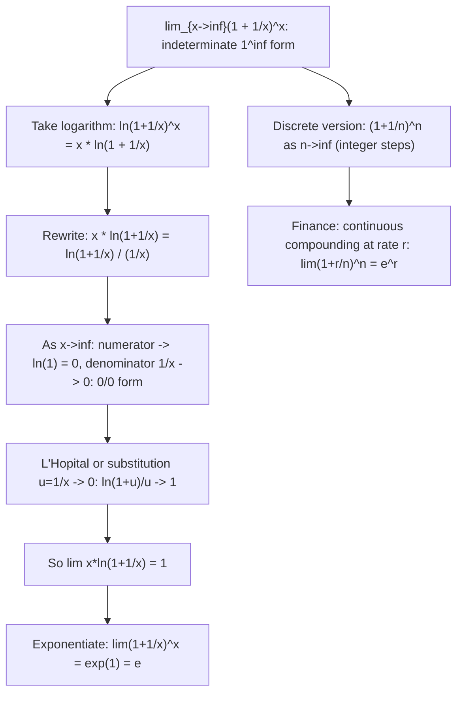

# Standard Limit (Euler's Number)

$$
\lim_{x \to \infty} \left(1 + \frac{1}{x}\right)^x = e
$$

## Deep Breakdown

What it tells me *(Situation Awareness)*:
This limit defines Euler's number $e \approx 2.71828$. It is the base of natural logarithms and the natural base for exponential growth/decay. The form $(1 + 1/x)^x$ represents $x$ steps of compounding a return of $1/x$, totaling an initial return of 1 — and as the number of compounding steps grows to infinity, the result converges to $e$. Equivalent form: $\lim_{n\to\infty}(1+1/n)^n = e$ (discrete version). This limit is foundational for continuous compounding in finance, the exponential distribution in ML (Poisson processes, survival analysis), and for proving that $d/dx[e^x] = e^x$ and $d/dx[\ln x] = 1/x$. In ML: the Boltzmann factor $e^{-E/kT}$ in softmax and simulated annealing; the normalization constant in Gaussian and exponential family distributions; the natural base of cross-entropy loss.

## Flowchart



## Real-world use

### Where it is used

Continuous compounding formula: $A = Pe^{rt}$, derived from $\lim_{n\to\infty}P(1+r/n)^{nt} = Pe^{rt}$; exponential distribution CDF $F(t) = 1 - e^{-\lambda t}$ — the base rate $e$ comes from this limit; softmax temperature: $\text{softmax}(z_i/T)$ as $T \to 0$ converges to argmax and as $T \to \infty$ to uniform — both via the exponential $e$; natural logarithm $\ln x$ has derivative $1/x$ because $\ln e = 1$; proof that $d/dx[e^x] = e^x$ is unique among all bases.

### Problem it solves

What happens when interest is compounded infinitely frequently? Or what is the "natural" base for exponential growth where the function equals its own derivative? Both questions lead to the number $e$, and this limit is its original definition.

### How it solves the problem

Each step: compound at rate $1/x$ for $x$ steps. Product of $x$ identical factors $(1+1/x)^x$. As $x\to\infty$ (infinitely many infinitesimally small compounding steps), the product converges to $e$. The limit resolves the $1^\infty$ indeterminate form by taking logs and applying L'Hôpital.

### Example in a business

A DS models customer churn using a survival function $S(t) = e^{-\lambda t}$ (exponential survival model). The rate $\lambda$ is estimated by MLE. The probability of surviving beyond $t$ steps when per-step hazard is $\lambda/n$ for $n$ steps is $(1-\lambda/n)^{nt} \to e^{-\lambda t}$ as $n\to\infty$ — directly using this limit (with $1/x$ replaced by $-\lambda/n$). The continuous-time model is the limit of the discrete model.

## The formula, piece by piece

- $(1 + 1/x)$: the growth factor per step (1 unit return of $1/x$)
- $x$: number of compounding periods (steps), going to $\infty$
- $(1 + 1/x)^x$: compound growth over $x$ steps
- $= e$: Euler's number, $e \approx 2.71828182845...$
- Equivalent forms: $\lim_{n\to\infty}(1+1/n)^n = e$; $\lim_{h\to 0}(1+h)^{1/h} = e$; $\lim_{x\to\infty}(1+r/x)^x = e^r$
- General: $\lim_{x\to\infty}(1 + a/x)^{bx} = e^{ab}$
- Indeterminate form: $1^\infty$ — the base $1 + 1/x \to 1$, but the exponent $x \to \infty$; neither alone gives the answer

## The formula in words

"If you compound a tiny growth rate $1/x$ over $x$ periods, and let the number of periods go to infinity (making each step infinitesimally small), the total growth converges to Euler's number $e$." Tiny trace: $n = 10$: $(1.1)^{10} = 2.594$. $n = 100$: $(1.01)^{100} = 2.705$. $n = 1000$: $(1.001)^{1000} = 2.7169$. $n \to \infty$: $\to e = 2.71828...$

## Critical Concepts

- **The natural base $e$ is unique:** $e$ is the unique base $a$ for which $d/dx[a^x] = a^x$ (derivative equals itself). For any other base $a$: $d/dx[a^x] = a^x \ln a$. The factor $\ln a = 1$ only when $a = e$. This is why $e$ is "natural" — it simplifies calculus.
- **Connection to the exponential function:** $e^x = \lim_{n\to\infty}(1+x/n)^n$. This is the same limit with $1$ replaced by $x$. It provides an alternative definition of the exponential function via iterated compounding. In numerical work: for very large or very small $x$, `np.exp(x)` is more stable than trying to compute $(1+x/n)^n$ for large $n$.
- **Continuous vs. discrete compounding:** discrete: $A = P(1+r/n)^{nt}$; continuous: $A = Pe^{rt} = P\lim_{n\to\infty}(1+r/n)^{nt}$. The difference: daily compounding ($n=365$) gives $(1+r/365)^{365}$, which is close to $e^r$ but not equal. Continuous compounding is the limit. In ML: exponential decay $e^{-\lambda t}$ is the continuous-time limit of geometric decay $(1-\lambda/n)^{nt}$.
- **The number $e$ appears naturally in probability:** for $n$ independent Bernoulli trials with $p=1/n$, the probability of zero successes is $(1-1/n)^n \to e^{-1} \approx 0.368$ as $n\to\infty$. This is the limiting probability in a Poisson process with rate 1 over unit time. Poisson distribution: $P(X=k) = e^{-\lambda}\lambda^k/k!$ — the $e^{-\lambda}$ normalization comes from this limit.
- **Numerical convergence:** the sequence $(1+1/n)^n$ converges to $e$ from below.

It converges slowly: even at $n=10^6$, the error is $\approx 1.4 \times 10^{-6}$. A better approximation: $(1+1/n)^n \approx e(1 - 1/(2n))$. In practice, always use `math.e` or `np.e` (or `exp(1)`) rather than computing this limit.

## Step-by-step calculation (tiny example)

*Evaluate $\lim_{x\to\infty}(1 + 3/x)^{2x}$.*

*Step 1: Recognize the general form.*
$(1 + 3/x)^{2x} = [(1 + 3/x)^x]^2$.

*Step 2: Use the standard limit with $a = 3$, $b = 2$.*
$\lim_{x\to\infty}(1 + 3/x)^x = e^3$ (from general form with $a=3$).

*Step 3: Apply power.*
$\lim_{x\to\infty}(1 + 3/x)^{2x} = (e^3)^2 = e^6 \approx 403.4$. *Verify:* at $x = 1000$: $(1 + 0.003)^{2000} = 1.003^{2000} \approx e^{6} \approx 403.4$. $\checkmark$

## Code examples

### Beginner example (Python)

```python
import numpy as np
E_VALUE = np.e   # 2.718281828459045
print("Standard Limit: lim_{x->inf}(1 + 1/x)^x = e")
print(f"\ne = {E_VALUE:.10f}")
print(f"\n{'n':>10} {'(1+1/n)^n':>14} {'Error from e':>14}")
for n in [1, 2, 5, 10, 100, 1_000, 10_000, 100_000, 1_000_000]:
    val = (1 + 1/n)**n
error = abs(val - E_VALUE)
print(f"{n:>10} {val:>14.9f} {error:>14.2e}")   # Generalization: lim(1 + a/x)^(bx) = e^(ab)
print(f"\n--- General form: lim_{{x->inf}}(1+a/x)^(bx) = e^(ab) ---")
print(f"{'a':>5} {'b':>5} {'e^(ab)':>10} {'(1+a/1e6)^(b*1e6)':>20}")
for a, b in [(1, 1), (2, 1), (1, 3), (-0.5, 2), (0.1, 10)]:
    x = 1_000_000
numerical = (1 + a/x)**(b*x)
analytic = np.exp(a * b)
print(f"{a:>5.2f} {b:>5.2f} {analytic:>10.5f} {numerical:>20.5f}")   # Continuous vs discrete compounding
print(f"\n--- Continuous compounding: A = P*e^(rt), P=1000, r=0.05, t=10 ---")
P, r, t_fin = 1000.0, 0.05, 10.0
continuous = P * np.exp(r * t_fin)
print(f"Continuous: A = {continuous:.4f}")
for n in [1, 4, 12, 52, 365, 8760]:
    discrete = P * (1 + r/n)**(n * t_fin)
print(f" n={n:>5} periods/year: A = {discrete:.4f} (diff from continuous: {continuous-discrete:.4f})")
```

### Beginner example (R)

```r
# Standard limit: lim_{n->inf}(1 + 1/n)^n = e
cat("Standard Limit: lim_{n->inf}(1 + 1/n)^n = e\n")
cat(sprintf("e = %.10f\n\n", exp(1)))
cat(sprintf("%-10s %-14s %-14s\n", "n", "(1+1/n)^n", "Error from e"))
for (n in c(1, 2, 5, 10, 100, 1000, 10000, 1000000)) { val <- (1 + 1/n)^n
  error <- abs(val - exp(1))
  cat(sprintf("%-10d %-14.9f %-14.2e\n", n, val, error))
}  # General form: lim(1 + a/x)^(bx) = e^(ab)
cat("\nGeneral form: lim_{x->inf}(1+a/x)^(bx) = e^(ab)\n")
cat(sprintf("%-5s %-5s %-10s %-20s\n", "a", "b", "e^(ab)", "numerical (x=1e6)"))
params <- list(c(1,1), c(2,1), c(1,3), c(-0.5,2), c(0.1,10))
for (ab in params) { a <- ab[1]; b <- ab[2]
  x <- 1e6
  numerical <- (1 + a/x)^(b*x)
  analytic <- exp(a * b)
  cat(sprintf("%-5.2f %-5.2f %-10.5f %-20.5f\n", a, b, analytic, numerical))
}
```

### Professional example (Python)

```python
import numpy as np
from sklearn.preprocessing import StandardScaler
from sklearn.datasets import make_classification
from sklearn.linear_model import LogisticRegression
np.random.seed(42)   # -- Euler's number limit: exponential survival analysis (Kaplan-Meier approximation) --
# Use case: A DS models customer churn with an exponential survival model.
# The continuous-time survival function S(t) = e^(-lambda*t) is the limit
# of discrete survival: (1 - lambda/n)^(n*t) as n -> infinity.
# We show numerically that increasingly fine discrete models converge to e^(-lambda*t).
LAMBDA = 0.3   # churn rate per unit time
T_VALS = [1.0, 2.0, 5.0]
N_STEPS = [1, 2, 5, 10, 50, 100, 1000]

def discrete_survival(lam: float, t: float, n: int) -> float:
    """(1 - lam/n)^(n*t): discrete survival with n sub-periods per unit time."""
    return (1.0 - lam / n) ** (n * t)

def continuous_survival(lam: float, t: float) -> float:
    """e^(-lam*t): continuous-time exponential survival."""
    return float(np.exp(-lam * t))
print("Euler's Number Limit: Discrete -> Continuous Survival Model")
print(f"\nExponential survival model: S(t) = e^(-lambda*t), lambda = {LAMBDA}")
print(f"Discrete model: (1 - lambda/n)^(n*t) --> e^(-lambda*t) as n -> inf")
print(f"\nThis uses: lim_{{n->inf}}(1 + a/n)^n = e^a with a = -lambda*t\n")
for t in T_VALS:
    s_continuous = continuous_survival(LAMBDA, t)
print(f"t = {t} --> S_continuous = e^(-{LAMBDA}*{t}) = e^(-{LAMBDA*t}) = {s_continuous:.6f}")
print(f" {'n':>8} {'S_discrete':>12} {'Error':>12}")
for n in N_STEPS:
    s_disc = discrete_survival(LAMBDA, t, n)
error = abs(s_disc - s_continuous)
print(f" {n:>8} {s_disc:>12.6f} {error:>12.2e}")
print()   # Error convergence: show O(1/n) convergence rate
print("Convergence rate: |S_discrete - S_continuous| ~ C/n (first-order in 1/n)")
t_demo = 1.0
s_cont = continuous_survival(LAMBDA, t_demo)
for n in [10, 100, 1000, 10000]:
    err = abs(discrete_survival(LAMBDA, t_demo, n) - s_cont)
print(f" n = {n:>6}: error = {err:.2e} (n*error = {n*err:.4f} should be approx const)")
```

---

*Source: 1300 p. 217*
