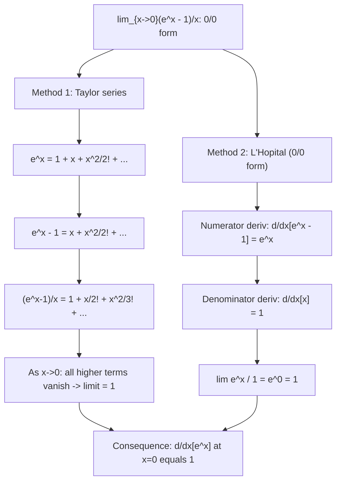

# Standard Limit (Exponential)

$$
\lim_{x \to 0} \frac{e^x - 1}{x} = 1
$$

## Deep Breakdown

What it tells me *(Situation Awareness)*:
This limit is the derivative of $e^x$ at $x = 0$: $d/dx[e^x]|_{x=0} = \lim_{h\to 0}(e^h - 1)/h = 1$. It says that $e^x - 1 \approx x$ for small $x$ — the exponential grows at rate 1 near 0. This is why $e$ is the "natural" base: it is the unique base where this derivative equals exactly 1. Equivalently: $\lim_{x\to 0}(e^x - 1)/x = 1$ confirms that $d/dx[e^x] = e^x$, since at $x=0$ the slope is $e^0 = 1$. In DS/DA: the numerically stable computation of $e^x - 1$ for small $x$ (use `np.expm1(x)` to avoid catastrophic cancellation); log-return approximation in finance ($\ln(1+r) \approx r$ for small $r$, derived from the companion limit $\lim_{x\to 0}\ln(1+x)/x = 1$); Taylor expansion of the exponential used in gradient approximations.

## Flowchart



## Real-world use

### Where it is used

Proving $d/dx[e^x] = e^x$ from first principles; numerical stability: `np.expm1(x)` computes $e^x - 1$ accurately for small $x$ (avoids catastrophic cancellation in $e^x - 1$ when $e^x \approx 1$); log-return approximation: for small return $r$, $\ln(1+r) \approx r$ (companion limit $\lim_{x\to 0}\ln(1+x)/x = 1$); soft-plus gradient: $d/dx[\ln(1+e^x)] = e^x/(1+e^x) = \sigma(x)$ — uses the fact that $(e^x-1)/x \to 1$ for the slope analysis; small-perturbation analysis of any system that uses $e^x$ as an activation or link function.

### Problem it solves

$(e^0 - 1)/0 = 0/0$ is undefined, yet the slope of $e^x$ at 0 is clearly well-defined. This limit provides that slope, confirming $e^x$ has slope 1 at $x=0$. It also drives numerically stable computation: for small $x$, $e^x \approx 1 + x$, so $e^x - 1 \approx x$ but the naive subtraction $e^x - 1$ loses precision due to floating-point cancellation.

### How it solves the problem

Taylor expansion: $e^x - 1 = x + x^2/2! + \ldots$. Divide by $x$: $(e^x-1)/x = 1 + x/2! + \ldots \to 1$ as $x\to 0$. Alternatively, L'Hôpital: $\lim (e^x-1)/x = \lim e^x/1 = 1$.

### Example in a business

A DS computes log-returns for a financial time series. For a price relative $R = P_t/P_{t-1} = 1 + r$ where $r$ is the simple return, the log-return is $\ln R = \ln(1+r)$. For small $r$ (e.g., daily returns $< 1\%$): $\ln(1+r) \approx r - r^2/2 + \ldots \approx r$. The approximation error is $O(r^2)$: at $r=0.01$ (1%), error $\approx 0.005\%$. This approximation is valid because $\lim_{r\to 0}\ln(1+r)/r = 1$ (the companion limit to the exponential standard limit).

## The formula, piece by piece

- $e^x$: exponential function base $e$
- $e^x - 1$: the exponential minus its value at $x=0$ (which is 1)
- $x$: the increment from 0
- $(e^x - 1)/x$: "how much does $e^x$ increase per unit of $x$ near 0?" — the slope at 0
- $= 1$: the slope of $e^x$ at $x = 0$ is 1, consistent with $d/dx[e^x]|_{x=0} = e^0 = 1$
- Generalization: $\lim_{x\to 0}(e^{ax} - 1)/x = a$; $\lim_{x\to 0}(e^{ax} - 1)/(ax) = 1$
- Companion: $\lim_{x\to 0}\ln(1+x)/x = 1$ (inverse relationship: $\ln$ and $\exp$ cancel near 0)
- Numerical note: `np.expm1(x)` is the numerically stable version of $e^x - 1$ for small $x$

## The formula in words

"For small $x$, $e^x$ is approximately $1 + x$. So $e^x - 1 \approx x$, and the ratio $(e^x - 1)/x$ approaches 1. This says the exponential function has slope 1 at the origin." Tiny trace: $x = 0.1$: $(e^{0.1}-1)/0.1 = (1.10517-1)/0.1 = 1.0517$. $x = 0.01$: $(1.01005-1)/0.01 = 1.005$. $x \to 0$: $\to 1$. $\checkmark$

## Critical Concepts

- **This is $d/dx[e^x]$ at $x=0$:** the derivative definition gives $d/dx[e^x]|_{x=0} = \lim_{h\to 0}(e^{0+h}-e^0)/h = \lim_{h\to 0}(e^h-1)/h = 1 = e^0$. Combined with the general formula $d/dx[e^x] = e^x \cdot d/dx[x] = e^x$ (chain rule with $f=e^x$), this limit confirms the entire derivative. It is the anchor point.
- **`np.expm1(x)` for numerical stability:** for small $x$, `np.exp(x) - 1` suffers catastrophic cancellation: $e^{10^{-10}} \approx 1 + 10^{-10}$, and subtracting 1 in float64 loses all significant digits. `np.expm1(x)` computes $e^x - 1$ via a Taylor series for small $x$, returning approximately $x$ with full precision. Always use `expm1` when computing $e^x - 1$ for potentially small $x$ (e.g., Poisson log-likelihood, option pricing, softplus gradient).
- **Log-return and log-sum-exp:** the companion limit $\lim_{x\to 0}\ln(1+x)/x = 1$ (proved by L'Hôpital: $\lim(1/(1+x))/1 = 1$) means log-returns $\approx$ simple returns for small returns. This is used in finance, information theory (relative entropy: $D_{KL}(p\|q) \approx \sum_i (p_i-q_i)^2/(2q_i)$ for small differences), and in log-sum-exp numerics.
- **Taylor expansion and ML activations:** $e^x \approx 1 + x + x^2/2$ for small $x$. The softplus function $f(x) = \ln(1 + e^x)$: for $x \approx 0$, $f(x) \approx \ln(2) + x/2 + x^2/8 - \ldots$. Its derivative $\sigma(x) = e^x/(1+e^x)$: at $x=0$, $\sigma(0) = 1/2 = f'(0)$. Both rely on the slope-1 property at 0.
- **Relationship to interest rate formulas:** for a fractional return $r$ per period, after $n$ periods the total is $(1+r)^n$.

For small $r$: $(1+r)^n \approx e^{rn}$ using $(e^x-1)/x \to 1$. This is why the rule of 72 works: at annual rate $r$, doubling time $\approx 72/r\%$ uses $e^{r\cdot t} = 2 \Rightarrow t = \ln 2/r \approx 0.693/r$; in percentage terms, $\approx 69.3/r \approx 72/r$ (rounded for convenience).

## Step-by-step calculation (tiny example)

*Evaluate $\lim_{x\to 0}(e^{3x} - 1)/x$.*

*Step 1: Introduce a factor of 3.*
$(e^{3x}-1)/x = 3 \cdot (e^{3x}-1)/(3x)$.

*Step 2: Let $u = 3x$; as $x\to 0$, $u\to 0$.*
$= 3 \cdot (e^u-1)/u$.

*Step 3: Apply the standard limit.*
$= 3 \cdot 1 = 3$. *Verify:* $x = 0.001$: $(e^{0.003}-1)/0.001 = 0.003004.../0.001 \approx 3.004 \approx 3$. $\checkmark$

## Code examples

### Beginner example (Python)

```python
import numpy as np
print("Standard Limit: lim_{x->0} (e^x - 1)/x = 1")
print(f"\n{'x':>12} {'(e^x-1)/x':>14} {'Error from 1':>14}")
for x in [0.5, 0.1, 0.01, 0.001, 0.0001, 1e-8]:
    ratio = np.expm1(x) / x   # numerically stable
error = abs(ratio - 1.0)
print(f"{x:>12.6e} {ratio:>14.9f} {error:>14.2e}")   # Generalization: lim(e^(ax) - 1)/x = a
print(f"\n--- Generalization: lim_{{x->0}} (e^(ax)-1)/x = a ---")
print(f"{'a':>6} {'Numerical (x=1e-8)':>20} {'Analytic (=a)':>14}")
for a in [0.5, 2.0, -1.0, np.pi]:
    x = 1e-8
numerical = np.expm1(a * x) / x
print(f"{a:>6.3f} {numerical:>20.8f} {a:>14.6f}")   # Numerical stability: expm1 vs naive subtraction
print(f"\n--- Numerical stability: expm1 vs exp(x)-1 for tiny x ---")
print(f"{'x':>12} {'exp(x)-1 (naive)':>20} {'expm1(x) (stable)':>20} {'True (approx x)':>18}")
for x in [1e-6, 1e-10, 1e-14, 1e-16]:
    naive = np.exp(x) - 1   # suffers cancellation for very small x
stable = np.expm1(x)   # uses Taylor series near 0
print(f"{x:>12.2e} {naive:>20.15e} {stable:>20.15e} {x:>18.15e}")
```

### Beginner example (R)

```r
# Standard limit: lim_{x->0} (e^x - 1)/x = 1
cat("Standard Limit: lim_{x->0} (e^x - 1)/x = 1\n\n")
cat(sprintf("%-12s %-14s %-14s\n", "x", "(e^x-1)/x", "Error from 1"))
for (x in c(0.5, 0.1, 0.01, 0.001, 1e-8)) { ratio <- expm1(x) / x  # expm1 is available in base R
  error <- abs(ratio - 1.0)
  cat(sprintf("%-12.2e %-14.9f %-14.2e\n", x, ratio, error))
}  # Log-return approximation: log(1+r) ≈ r for small r
cat("\n--- Log-return approximation: log(1+r) ≈ r for small r ---\n")
cat(sprintf("%-8s %-12s %-12s %-12s\n", "r (%)", "log(1+r)", "r (approx)", "Error"))
for (r_pct in c(10, 5, 1, 0.1, 0.01)) { r <- r_pct / 100
  lr <- log(1 + r)  # log1p is also available
  err <- abs(lr - r)
  cat(sprintf("%-8.2f %-12.6f %-12.6f %-12.4e\n", r_pct, lr, r, err))
}
```

### Professional example (Python)

```python
import numpy as np
from sklearn.datasets import make_classification
from sklearn.preprocessing import StandardScaler
np.random.seed(42)   # -- Standard Limit (exp): numerically stable Poisson log-likelihood --
# Use case: A DS fits a Poisson regression model manually and encounters
# the numerical stability issue with computing log(lambda) when lambda is
# very small. The expm1 function (based on the standard exponential limit)
# ensures stable computation of e^x - 1 for small x.
#
# Poisson log-likelihood: ell(w) = sum_i [y_i * (w^T x_i) - exp(w^T x_i)]
# For link: lambda_i = exp(w^T x_i)
# Gradient: d(ell)/dw = X^T (y - lambda)
# Key issue: when w^T x is large and negative, lambda ≈ 0, and computations
# like y*log(lambda) need care.
N = 200
DIM = 3
LR = 0.01
N_ITER = 300

def poisson_log_lambda(w: np.ndarray, X: np.ndarray) -> np.ndarray:
    """Log of Poisson rate: z = X @ w. lambda = exp(z)."""
    return X @ w   # log(lambda) directly

def stable_poisson_ll(w: np.ndarray, X: np.ndarray, y: np.ndarray) -> float:
    """ Numerically stable Poisson log-likelihood. ell = sum[y * log_lambda - exp(log_lambda)] = sum[y * z - exp(z)] Uses np.exp with clipping to avoid overflow. """
    z = poisson_log_lambda(w, X)
    lam = np.exp(np.clip(z, -30, 20))
    return float(np.sum(y * z - lam))

def poisson_gradient(w: np.ndarray, X: np.ndarray, y: np.ndarray) -> np.ndarray:
    """Gradient: d(ell)/dw = X^T(y - lambda)."""
    z = poisson_log_lambda(w, X)
    lam = np.exp(np.clip(z, -30, 20))
    return X.T @ (y - lam)   # Demonstrate expm1 precision for small-lambda regime
print("Standard Limit (exp): expm1 Precision for Small Lambda")
print(f"\nlim_{{x->0}} (e^x - 1)/x = 1 -> e^x - 1 ≈ x for small x")
print(f"\nNumerical stability of e^x - 1 in Poisson computations:")
print(f"{'z (log lambda)':>18} {'lambda':>12} {'naive exp(z)-1':>18} {'expm1(z)':>12} {'True ~ z':>10}")
for z in [-10, -5, -1, -0.1, -0.01, -0.001, -1e-6, -1e-10]:
    lam = np.exp(z)
naive = np.exp(z) - 1
stable = np.expm1(z)
print(f"{z:>18.4e} {lam:>12.6e} {naive:>18.10e} {stable:>12.10e} {z:>10.6e}")   # Fit Poisson regression via gradient ascent on log-likelihood
X_raw = np.random.randn(N, DIM)
scaler = StandardScaler()
X = scaler.fit_transform(X_raw)
true_w = np.array([0.5, -0.3, 0.2])
log_lam_true = X @ true_w
y = np.random.poisson(np.exp(np.clip(log_lam_true, -5, 5))).astype(float)
w = np.zeros(DIM)
ll_history = []
for step in range(N_ITER):
    ll = stable_poisson_ll(w, X, y)
ll_history.append(ll)
grad = poisson_gradient(w, X, y)
w = w + LR * grad / N
print(f"\nPoisson Regression via Gradient Ascent (max-likelihood)")
print(f"N={N}, DIM={DIM}, true_w={true_w}")
print(f"\nLog-likelihood: step 1={ll_history[0]:.2f}, step 100={ll_history[99]:.2f}, " f"final={ll_history[-1]:.2f}")
print(f"Fitted w: {np.round(w, 4)}")
print(f"True w: {true_w}")
print(f"\nKey: d/dw[exp(w^Tx)] = exp(w^Tx)*x -- uses d/dx[e^x] = e^x, anchored by lim(e^x-1)/x = 1")
```

---
