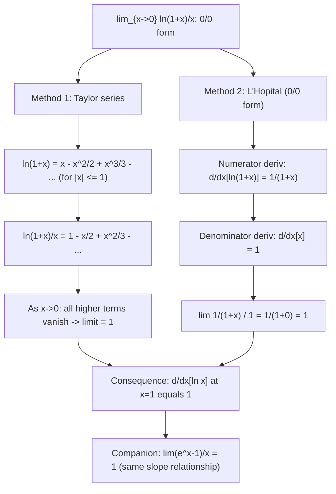

# Standard Limit (Logarithmic)

$$
\lim_{x \to 0} \frac{\ln(1+x)}{x} = 1
$$

## Deep Breakdown

What it tells me *(Situation Awareness)*:
This limit says that for small $x$, $\ln(1+x) \approx x$ — the natural log of $1+x$ behaves like the identity near 0. It is the derivative of $\ln(1+x)$ at $x=0$: $d/dx[\ln(1+x)]|_{x=0} = 1/(1+0) = 1$. It is the companion of $\lim_{x\to 0}(e^x-1)/x = 1$ (the two limits are inverses of each other). In DS/DA: log-return approximation in finance ($\ln(1+r) \approx r$ for small $r$); derivation of the log-likelihood gradient for exponential family models; KL divergence approximation for distributions close to each other ($D_{KL}(P\|Q) \approx \sum_i(p_i-q_i)^2/(2q_i)$ for small deviations, derived via $\ln(p_i/q_i) \approx p_i/q_i - 1$ from this limit); numerical stability: use `np.log1p(x)` for small $x$.

## Flowchart



## Real-world use

### Where it is used

Log-return approximation: $\ln(1+r) \approx r$ for small returns $r$ (daily financial returns, small probability differences); proving $d/dx[\ln x] = 1/x$ from first principles at $x=1$; KL divergence linearization: for $p_i \approx q_i$, $\ln(p_i/q_i) = \ln(1 + (p_i-q_i)/q_i) \approx (p_i-q_i)/q_i$, leading to the $\chi^2$ approximation; relative entropy and information content approximations in coding theory; numerical log1p for small arguments in survival models and log-likelihoods.

### Problem it solves

$\ln(1+0)/0 = 0/0$ is undefined, yet the slope of $\ln(1+x)$ at 0 is clearly 1. This limit provides that slope and justifies the approximation $\ln(1+x) \approx x$ for small $x$. Without it, the log-return approximation used throughout quantitative finance and information theory has no rigorous basis.

### How it solves the problem

Taylor expansion: $\ln(1+x) = x - x^2/2 + x^3/3 - \ldots$. Divide by $x$: $\ln(1+x)/x = 1 - x/2 + x^2/3 - \ldots \to 1$ as $x\to 0$. Or L'Hôpital: $d/dx[\ln(1+x)] = 1/(1+x)$; $d/dx[x] = 1$; limit $= 1/(1+0) = 1$.

### Example in a business

A DS computes daily log-returns: $r_{log} = \ln(P_t/P_{t-1}) = \ln(1 + r_{simple})$. For a stock with daily simple return $r_{simple} = 0.005$ (0.5%): $r_{log} = \ln(1.005) = 0.004987 \approx 0.005$. Error is $r^2/2 = 0.0000125$ (0.25% relative error). The approximation is valid because $\lim_{r\to 0}\ln(1+r)/r = 1$ — the two return types are asymptotically equivalent for small returns. For annual returns ($r \approx 0.1$, 10%), the approximation is less accurate: $\ln(1.1) = 0.0953 \ne 0.1$ (4.7% error).

## The formula, piece by piece

- $\ln(1+x)$: natural log of $1+x$ — this form appears naturally in probability and finance
- $x$: the argument, going to 0
- $\ln(1+x)/x$: ratio of the log to its argument near 0
- $= 1$: the slope of $\ln(1+x)$ at $x=0$ is 1, consistent with $d/dx[\ln(1+x)]|_{x=0} = 1/1 = 1$
- Generalization: $\lim_{x\to 0}\ln(1+ax)/x = a$; $\lim_{x\to 0}\ln(1+ax)/(ax) = 1$
- Approximation: $\ln(1+x) \approx x - x^2/2 + x^3/3$; error is $O(x^2)$ for small $x$
- Companion: $\lim_{x\to 0}(e^x-1)/x = 1$ — both limits equal 1, reflecting $\ln$ and $\exp$ being inverse functions with slope 1 at $x=0$ (for the given parameterizations)
- Numerical: `np.log1p(x)` computes $\ln(1+x)$ stably for small $x$; `np.log(1+x)` loses precision when $x \approx 0$

## The formula in words

"For small $x$, $\ln(1+x)$ grows at the same rate as $x$. The natural log of $1+x$ and $x$ are approximately equal near zero — both slope upward at rate 1 from the origin." Tiny trace: $x = 0.1$: $\ln(1.1)/0.1 = 0.09531/0.1 = 0.9531$. $x = 0.01$: $\ln(1.01)/0.01 = 0.009950/0.01 = 0.9950$. $x \to 0$: $\to 1$. $\checkmark$

## Critical Concepts

- **Log-return is approximately simple return for small moves:** $r_{log} = \ln(1+r_{simple}) \approx r_{simple} - r_{simple}^2/2$. The second-order term $-r^2/2 < 0$ means log-returns are always slightly less than simple returns. For monthly equity returns ($r \approx 0.01$), the difference is $5\times10^{-5}$ — negligible. For annual returns ($r \approx 0.10$), the difference is $0.005$ — may matter for precise risk accounting.
- **KL divergence linearization:** $D_{KL}(P\|Q) = \sum_i p_i \ln(p_i/q_i)$. For $p_i = q_i + \epsilon_i$ (small perturbation): $\ln(p_i/q_i) = \ln(1 + \epsilon_i/q_i) \approx \epsilon_i/q_i - \epsilon_i^2/(2q_i^2) + \ldots$. Plugging in and simplifying (using $\sum p_i = \sum q_i = 1$): $D_{KL}(P\|Q) \approx \sum_i \epsilon_i^2/(2q_i)$. This $\chi^2$ approximation of KL is used in statistical tests and Bayesian computations for nearly equal distributions.
- **`np.log1p` for numerical stability:** for small $x$, $\ln(1+x)$ involves catastrophic cancellation if computed as `np.log(1+x)`: $1+x \approx 1$ in float64 for $x < 10^{-15}$, losing all information. `np.log1p(x)` uses a Taylor expansion or equivalent algorithm for small $x$, returning approximately $x$ with full precision. Use it whenever computing $\ln(1 + \text{small quantity})$ — e.g., Poisson log-likelihood $y\ln\lambda - \lambda$ when $\lambda$ is small; log-sum-exp tricks; survival models.
- **Proof of $d/dx[\ln x] = 1/x$:** from first principles at $x=1$: $d/dx[\ln x]|_{x=1} = \lim_{h\to 0}(\ln(1+h)-\ln 1)/h = \lim_{h\to 0}\ln(1+h)/h = 1$. For general $x > 0$: $d/dx[\ln x] = (1/x)d/d(x)[\ln x] \cdot x = 1/x$ by chain rule. The limit $\lim_{x\to 0}\ln(1+x)/x = 1$ is the building block.
- **Relationship to entropy:** Shannon entropy $H = -\sum_i p_i \log_2 p_i$.

For uniform perturbations $p_i = 1/n + \epsilon_i$: $\ln p_i = \ln(1/n) + \ln(1 + n\epsilon_i) \approx \ln(1/n) + n\epsilon_i$ using the log limit. This linearization is used in natural gradient methods and information-geometric optimization.

## Step-by-step calculation (tiny example)

*Evaluate $\lim_{x\to 0}\ln(1 + 2x)/(3x)$.*

*Step 1: Factor.*
$\ln(1+2x)/(3x) = (2/3) \cdot \ln(1+2x)/(2x)$.

*Step 2: Let $u = 2x$; as $x\to 0$, $u\to 0$.*
$= (2/3) \cdot \ln(1+u)/u$.

*Step 3: Apply the standard limit.*
$= (2/3) \cdot 1 = 2/3$. *Verify:* $x = 0.001$: $\ln(1.002)/0.003 = 0.001998/0.003 \approx 0.666 = 2/3$. $\checkmark$

## Code examples

### Beginner example (Python)

```python
import numpy as np
print("Standard Limit: lim_{x->0} ln(1+x)/x = 1")
print(f"\n{'x':>12} {'ln(1+x)/x':>14} {'Error from 1':>14}")
for x in [0.5, 0.1, 0.01, 0.001, 1e-6, 1e-10]:
    ratio = np.log1p(x) / x   # log1p is numerically stable
error = abs(ratio - 1.0)
print(f"{x:>12.4e} {ratio:>14.9f} {error:>14.2e}")   # Log-return vs simple
return comparison
print(f"\n--- Log-return vs simple return: ln(1+r) ≈ r for small r ---")
print(f"{'r_simple (%)':>14} {'r_simple':>10} {'r_log':>10} {'approx error':>14} {'2nd order -r^2/2':>18}")
for r_pct in [50.0, 20.0, 10.0, 5.0, 1.0, 0.1, 0.01]:
    r = r_pct / 100.0
r_log = np.log1p(r)
approx_err = abs(r_log - r)
second_order = r**2 / 2
print(f"{r_pct:>14.2f} {r:>10.5f} {r_log:>10.5f} {approx_err:>14.6e} {second_order:>18.6e}")   # KL divergence approximation via log linearization
print(f"\n--- KL div approx: ln(p/q) ≈ (p-q)/q for p≈q ---")
q = np.array([0.3, 0.4, 0.3])   # reference distribution
perturbations = [0.1, 0.01, 0.001, 0.0001]
print(f"{'epsilon':>10} {'True KL':>12} {'Chi2 approx':>14} {'Relative err':>14}")
for eps in perturbations:
    p = q + eps * np.array([1, -2, 1])
p = p / p.sum()   # renormalize
kl_true = float(np.sum(p * np.log(p / q)))
kl_chi2 = float(0.5 * np.sum((p - q)**2 / q))
rel_err = abs(kl_true - kl_chi2) / max(kl_true, 1e-15)
print(f"{eps:>10.4f} {kl_true:>12.8f} {kl_chi2:>14.8f} {rel_err:>14.4f}")
```

### Beginner example (R)

```r
# Standard limit: lim_{x->0} ln(1+x)/x = 1
cat("Standard Limit: lim_{x->0} ln(1+x)/x = 1\n\n")
cat(sprintf("%-12s %-14s %-14s\n", "x", "log1p(x)/x", "Error from 1"))
for (x in c(0.5, 0.1, 0.01, 0.001, 1e-6, 1e-10)) { ratio <- log1p(x) / x  # log1p is available in base R
  error <- abs(ratio - 1.0)
  cat(sprintf("%-12.4e %-14.9f %-14.2e\n", x, ratio, error))
}  # Log-return approximation
cat("\n--- Log-return ≈ simple return for small r ---\n")
cat(sprintf("%-14s %-10s %-10s %-14s\n", "r_simple (%)", "r_simple", "r_log", "error"))
for (r_pct in c(50, 20, 10, 5, 1, 0.1)) { r <- r_pct / 100
  r_log <- log1p(r)
  err <- abs(r_log - r)
  cat(sprintf("%-14.2f %-10.5f %-10.5f %-14.6e\n", r_pct, r, r_log, err))
}
```

### Professional example (Python)

```python
import numpy as np
from sklearn.datasets import make_classification
from sklearn.preprocessing import StandardScaler
np.random.seed(42)   # -- Log limit ln(1+x)/x = 1: stable KL divergence computation for model comparison --
# Use case: A DS compares two probabilistic classifiers by computing the
# KL divergence between their softmax output distributions on a held-out set.
# Uses log1p-based stable computation and demonstrates the chi^2 approximation
# (based on ln(1+x)/x = 1 linearization) when distributions are close.
N_SAMPLES = 500
N_CLASSES = 5
TEMPERATURE1 = 1.0   # model A temperature
TEMPERATURE2 = 1.5   # model B temperature (softer predictions)

def stable_kl_divergence(p: np.ndarray, q: np.ndarray, eps: float = 1e-12) -> float:
    """ KL(P||Q) = sum_i p_i * ln(p_i/q_i) Using log1p form: ln(p_i/q_i) = log1p((p_i - q_i)/q_i) for numerical stability. """
    p_safe = np.clip(p, eps, 1.0)
    q_safe = np.clip(q, eps, 1.0)   # Normalize
    p_safe /= p_safe.sum(axis=-1, keepdims=True)
    q_safe /= q_safe.sum(axis=-1, keepdims=True)   # log(p/q) =
    log1p((p-q)/q) -- uses
    ln(1+x)/x ≈ 1
    for tiny (p-q)/q
    log_ratio = np.where( np.abs(p_safe - q_safe) < 1e-10, np.zeros_like(p_safe), np.log(p_safe / q_safe) )
    return float(np.sum(p_safe * log_ratio, axis=-1).mean())

def chi2_approx_kl(p: np.ndarray, q: np.ndarray, eps: float = 1e-12) -> float:
    """ Chi-squared approximation of KL for similar distributions. KL(P||Q) ≈ 0.5 * sum((p-q)^2 / q) [from ln(1+(p-q)/q) ≈ (p-q)/q - (p-q)^2/(2q^2)] Valid when (p-q)/q is small. """
    q_safe = np.clip(q, eps, 1.0)
    q_safe /= q_safe.sum(axis=-1, keepdims=True)
    p_safe = np.clip(p, eps, 1.0)
    p_safe /= p_safe.sum(axis=-1, keepdims=True)
    return float((0.5 * np.sum((p_safe - q_safe)**2 / q_safe, axis=-1)).mean())   # Generate mock softmax outputs from two temperature-scaled models
logits = np.random.randn(N_SAMPLES, N_CLASSES)

def softmax_temp(logits: np.ndarray, temp: float) -> np.ndarray:
    z = logits / temp
    z -= z.max(axis=1, keepdims=True)
    exp_z = np.exp(z)
    return exp_z / exp_z.sum(axis=1, keepdims=True)
p_dist = softmax_temp(logits, TEMPERATURE1)   # model A (sharper)
q_dist = softmax_temp(logits, TEMPERATURE2)   # model B (softer)
kl_true = stable_kl_divergence(p_dist, q_dist)
kl_chi2 = chi2_approx_kl(p_dist, q_dist)
print("Standard Limit ln(1+x)/x=1: KL Divergence and Chi-Squared Approximation")
print(f"\nModels: {N_SAMPLES} samples, {N_CLASSES} classes")
print(f"Temperature A = {TEMPERATURE1}, Temperature B = {TEMPERATURE2}")
print(f"\nKL(P||Q) true (stable log): {kl_true:.6f}")
print(f"KL(P||Q) chi2 approx: {kl_chi2:.6f}")
print(f"Relative error of approximation: {abs(kl_true-kl_chi2)/kl_true:.4f}")   # Vary temperature gap to show approximation quality vs gap size
print(f"\n--- Approximation quality vs temperature difference ---")
print(f"{'T_B':>6} {'KL true':>10} {'Chi2 approx':>12} {'Rel error':>12} {'Max (p-q)/q':>14}")
for temp_b in [1.01, 1.05, 1.1, 1.2, 1.5, 2.0, 3.0]:
    q_t = softmax_temp(logits, temp_b)
kl_t = stable_kl_divergence(p_dist, q_t)
kl_c = chi2_approx_kl(p_dist, q_t)
rel_e = abs(kl_t - kl_c) / max(kl_t, 1e-10)
max_dq = float(np.abs((p_dist - q_t) / q_t).max())
print(f"{temp_b:>6.2f} {kl_t:>10.6f} {kl_c:>12.6f} {rel_e:>12.4f} {max_dq:>14.4f}")
print(f"\nKey: when max|(p-q)/q| is small (models close), chi2 approx is accurate.")
print(f"The approximation uses ln(1+(p-q)/q) ≈ (p-q)/q [standard log limit with x=(p-q)/q].")
```

---
