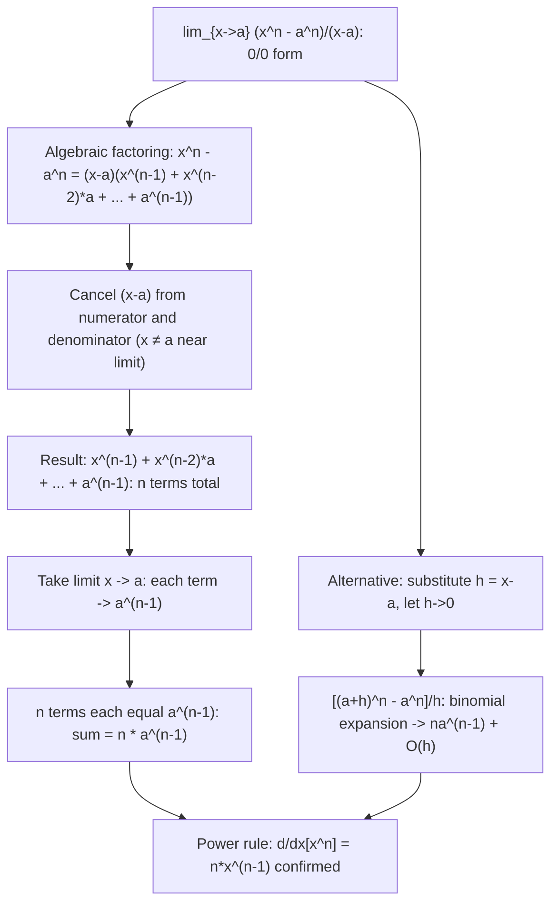

# Standard Limit (Power)

$$
\lim_{x \to a} \frac{x^n - a^n}{x - a} = n a^{n-1}
$$

## Deep Breakdown

What it tells me *(Situation Awareness)*:
This limit is the derivative of $x^n$ at $x = a$: $d/dx[x^n]|_{x=a} = na^{n-1}$. The form $(x^n - a^n)/(x-a)$ is the slope formula (rise over run) for the power function between the points $a$ and $x$, evaluated in the limit as $x \to a$. This is the first-principles derivation of the power rule. In DS/DA: it underlies every polynomial derivative used in ML (loss functions, regularizers, activation functions are often polynomial); the finite difference approximation used in gradient checking is this limit for the special case $a = x_0$, $x = x_0 + h$; polynomial feature transformations and their gradients; the Vandermonde matrix in polynomial regression; and numerical differentiation schemes.

## Flowchart



## Real-world use

### Where it is used

Proof of the power rule $d/dx[x^n] = nx^{n-1}$ from first principles (this limit IS the derivative at $a$); numerical differentiation: $(f(x+h) - f(x))/h \to f'(x)$ is this limit with $a=x$, $x=x+h$; gradient of polynomial features: $d/dw[w^T\phi(x)] = \phi(x)$ where $\phi(x) = [1, x, x^2, ..., x^p]^T$; gradient of $L^p$ norm: $d/dw[\|w\|_p^p] = p\text{sign}(w)|w|^{p-1}$; finite element methods and numerical PDE solvers use this limit form.

### Problem it solves

$(a^n - a^n)/(a-a) = 0/0$ — undefined at $x = a$. Yet the slope of $x^n$ at $a$ is clearly $na^{n-1}$. The limit resolves this by factoring out $(x-a)$ from $x^n - a^n$, cancelling the zero denominator, and evaluating what remains at $x = a$.

### How it solves the problem

Factor: $x^n - a^n = (x-a)(x^{n-1} + x^{n-2}a + \cdots + a^{n-1})$ (sum of $n$ terms). Cancel $(x-a)$ (valid for $x \ne a$). The remaining factor evaluated at $x = a$ gives $na^{n-1}$. This is the algebraic proof that the power rule holds for positive integer $n$.

### Example in a business

A DS computes the gradient of the $L^2$ penalty for ridge regression: $d/dw[\|w\|_2^2] = d/dw[\sum_j w_j^2]$. For each component: $d/dw_j[w_j^2] = 2w_j$ — by the power rule ($n=2$, $na^{n-1} = 2w_j$), which is confirmed by this standard power limit at $a = w_j$. The gradient is the vector $2w$, used in the ridge update $w \leftarrow w - \alpha(X^T(Xw-y)/N + 2\lambda w)$.

## The formula, piece by piece

- $x^n - a^n$: power function evaluated at $x$ minus its value at $a$ (the numerator of the slope formula)
- $x - a$: the run (horizontal distance from $a$ to $x$)
- $(x^n - a^n)/(x-a)$: slope of the chord from $(a, a^n)$ to $(x, x^n)$
- $na^{n-1}$: the slope of the tangent to $x^n$ at the point $x = a$ (the power rule result)
- For $n = 2$: $(x^2-a^2)/(x-a) = x+a \to 2a$. For $n = 3$: $(x^3-a^3)/(x-a) = x^2+xa+a^2 \to 3a^2$.
- General factoring: $x^n - a^n = (x-a)\sum_{k=0}^{n-1} x^{n-1-k}a^k$ (geometric series factoring)
- Holds for any real $n$ (not just integers) when defined, via the extended power rule.

## The formula in words

"The slope of $x^n$ from point $a$ to point $x$, in the limit as $x$ approaches $a$, equals the instantaneous rate of change $n$ times $a^{n-1}$. This is the power rule derived from scratch." Tiny trace ($n=3$, $a=2$): $(x^3-8)/(x-2)$ as $x\to 2$.
Factor: $(x-2)(x^2+2x+4)/(x-2) = x^2+2x+4$.
At $x=2$: $4+4+4=12 = 3 \cdot 2^2 = 3 \cdot 4 = 12$. $\checkmark$ Power rule: $d/dx[x^3]|_{x=2} = 12$.

## Critical Concepts

- **This IS the power rule:** $\lim_{x\to a}(x^n-a^n)/(x-a) = na^{n-1}$ is exactly the definition of the derivative of $f(x) = x^n$ at the point $x = a$. Every polynomial gradient, every MSE derivative, every $L^p$ penalty gradient traces back to this limit. It is the most-used limit in applied mathematics.
- **Finite difference as this limit with $h = x - a$:** set $x = a + h$, $a = x_0$: $(x_0+h)^n - x_0^n)/h \to nx_0^{n-1}$ as $h\to 0$. Forward difference approximation uses finite $h$ and incurs $O(h)$ error. Central difference $(x_0+h)^n - (x_0-h)^n)/(2h) \to nx_0^{n-1}$ with $O(h^2)$ error. These are the formulas used in numerical gradient checking in ML.
- **Extends to all real $n$:** for rational $n = p/q$ or real $n$, $d/dx[x^n] = nx^{n-1}$ via the chain rule and the exponential form $x^n = e^{n\ln x}$. This is why MSE gradient (power $n=2$), L1.5 penalty gradient (power $n=1.5$), and inverse regularization (power $n=-1$) all use the same formula $na^{n-1}$.
- **Geometric series factoring:** $x^n - a^n = (x-a)(x^{n-1} + x^{n-2}a + \cdots + a^{n-1})$. Each summand in the bracket converges to $a^{n-1}$ as $x\to a$, and there are exactly $n$ summands, giving $na^{n-1}$. This factoring also applies to the difference of squares ($n=2$: $x^2-a^2=(x-a)(x+a)$), difference of cubes ($n=3$), etc.
- **Polynomial regression Jacobian:** the design matrix $\Phi = [1, x, x^2, ..., x^p]$ has gradient $d\Phi_k/dx = kx^{k-1}$ for each feature $\Phi_k = x^k$ — directly from this limit.

In spline regression and kernel methods, the feature map gradient is always computed this way.

## Step-by-step calculation (tiny example)

*Evaluate $\lim_{x\to 3}(x^4 - 81)/(x - 3)$.*

*Step 1: Check the form.* $x^4 - 81 = x^4 - 3^4$. At $x=3$: $0/0$. Identify as standard power limit with $n=4$, $a=3$.

*Step 2: Apply the formula.* $\lim_{x\to 3}(x^4-3^4)/(x-3) = 4 \cdot 3^{4-1} = 4 \cdot 27 = 108$.

*Step 3: Verify by factoring.* $x^4 - 81 = (x-3)(x^3+3x^2+9x+27)$. At $x=3$: $27+27+27+27 = 108$. $\checkmark$ Power rule cross-check: $d/dx[x^4]|_{x=3} = 4 \cdot 3^3 = 108$. $\checkmark$

## Code examples

### Beginner example (Python)

```python
import numpy as np

def power_limit(n: int, a: float) -> float:
    """Standard power limit: lim_{x->a}(x^n - a^n)/(x-a) = n * a^(n-1)."""
    return n * a**(n - 1)

def power_limit_numerical(n: int, a: float, h: float = 1e-7) -> float:
    """Approximate the limit numerically."""
    x = a + h
    if abs(a) < 1e-12:
        # handle a=0 case
        return ((a + h)**n - a**n) / h
    return ((a + h)**n - a**n) / h


print("Standard Power Limit: lim_{x->a}(x^n - a^n)/(x-a) = n*a^(n-1)")
print(f"\n{'n':>4} {'a':>6} {'Analytic n*a^(n-1)':>22} {'Numerical':>14} {'Match':>7}")
test_cases = [(2, 3), (3, 2), (4, 3), (5, 1), (2, -2), (3, 0.5), (4, -1)]
for n, a in test_cases:
    analytic = power_limit(n, a)
    numerical = power_limit_numerical(n, a)
    match = abs(analytic - numerical) < 1e-3
    print(f"{n:>4} {a:>6.2f} {analytic:>22.6f} {numerical:>14.6f} {str(match):>7}")

# Demonstrate factoring for small n
print(f"\n--- Factoring: x^n - a^n = (x-a)(sum of n terms) ---")
print(f"n=2, a=3: (x^2-9)/(x-3) = x+3 -> at x=3: 6 = 2*3^1 = {power_limit(2, 3)}")
print(f"n=3, a=2: (x^3-8)/(x-2) = x^2+2x+4 -> at x=2: 12 = 3*2^2 = {power_limit(3, 2)}")
print(f"n=4, a=3: (x^4-81)/(x-3) -> at x=3: 108 = 4*3^3 = {power_limit(4, 3)}")

# Gradient checking demo: power rule as numerical limit
print(f"\n--- Gradient check: power rule via finite difference ---")
print(f"{'x0':>6} {'n':>4} {'Analytic':>12} {'Forward diff':>14} {'Central diff':>14}")
for x0, n in [(2.0, 3), (5.0, 2), (1.5, 4)]:
    analytic = power_limit(n, x0)
    h = 1e-5
    forward = ((x0 + h)**n - x0**n) / h
    central = ((x0 + h)**n - (x0 - h)**n) / (2 * h)
    print(f"{x0:>6.2f} {n:>4} {analytic:>12.6f} {forward:>14.6f} {central:>14.6f}")
```

### Beginner example (R)

```r
# Standard power limit: lim_{x->a}(x^n - a^n)/(x-a) = n*a^(n-1)
power_limit <- function(n, a) {
  n * a^(n - 1)
}
power_limit_numerical <- function(n, a, h = 1e-7) {
  ((a + h)^n - a^n) / h
}
cat("Standard Power Limit: lim_{x->a}(x^n - a^n)/(x-a) = n*a^(n-1)\n\n")
cat(sprintf("%-4s %-6s %-22s %-14s\n", "n", "a", "Analytic n*a^(n-1)", "Numerical"))
test_cases <- list(c(2,3), c(3,2), c(4,3), c(5,1), c(2,-2), c(3,0.5))
for (tc in test_cases) {
  n <- tc[1]; a <- tc[2]
  analytic <- power_limit(n, a)
  numerical <- power_limit_numerical(n, a)
  cat(sprintf("%-4d %-6.2f %-22.6f %-14.6f\n", n, a, analytic, numerical))
}

# Gradient check for polynomial
cat("\n--- Gradient check: power rule via finite differences ---\n")
h <- 1e-5
cat(sprintf("%-6s %-4s %-12s %-14s %-14s\n", "x0", "n", "Analytic", "Forward", "Central"))
for (params in list(c(2,3), c(5,2), c(1.5,4))) {
  x0 <- params[1]; n <- params[2]
  analytic <- power_limit(n, x0)
  forward <- ((x0+h)^n - x0^n) / h
  central <- ((x0+h)^n - (x0-h)^n) / (2*h)
  cat(sprintf("%-6.2f %-4d %-12.6f %-14.6f %-14.6f\n", x0, n, analytic, forward, central))
}
```

### Professional example (Python)

```python
import numpy as np
from sklearn.datasets import make_regression
from sklearn.preprocessing import StandardScaler
np.random.seed(42)

# -- Standard Power Limit: polynomial regression gradient verification --
# Use case: A DS implements polynomial feature regression from scratch.
# Each polynomial feature x^k has gradient k*x^(k-1) by the power rule.
# We verify analytically derived gradients against numerical finite differences.
N = 100
DEGREE = 4
LR = 0.01
N_ITER = 500

def polynomial_features(x: np.ndarray, degree: int) -> np.ndarray:
    """Design matrix: [1, x, x^2, ..., x^degree], shape (N, degree+1)."""
    return np.column_stack([x**k for k in range(degree + 1)])

def poly_feature_gradient(x: np.ndarray, degree: int) -> np.ndarray:
    """Gradient of each feature w.r.t. x: d(x^k)/dx = k*x^(k-1).

    Power limit: d/dx[x^k]|_{x=a} = k * a^(k-1).
    Shape: (N, degree+1).
    """
    grads = np.zeros((len(x), degree + 1))
    for k in range(1, degree + 1):
        grads[:, k] = k * x**(k - 1)  # k * x^(k-1): power limit at each x
    # grads[:, 0] = 0 (constant term has zero gradient)
    return grads

def mse_loss(w: np.ndarray, Phi: np.ndarray, y: np.ndarray) -> float:
    """MSE loss."""
    return float(np.mean((Phi @ w - y)**2))

def mse_gradient_w(w: np.ndarray, Phi: np.ndarray, y: np.ndarray) -> np.ndarray:
    """Gradient of MSE w.r.t. w: (2/N)*Phi^T(Phi*w - y)."""
    residuals = Phi @ w - y
    return 2.0 / len(y) * Phi.T @ residuals

def numerical_grad_w(w: np.ndarray, Phi: np.ndarray, y: np.ndarray, h: float = 1e-5) -> np.ndarray:
    """Finite difference gradient of MSE w.r.t. w."""
    grad = np.zeros_like(w)
    for i in range(len(w)):
        w_plus = w.copy()
        w_plus[i] += h
        w_minus = w.copy()
        w_minus[i] -= h
        grad[i] = (mse_loss(w_plus, Phi, y) - mse_loss(w_minus, Phi, y)) / (2 * h)
    return grad


# Generate 1D regression data
x_raw = np.linspace(-1, 1, N)
true_coef = np.array([0.5, 1.2, -0.8, 0.3, 0.1])  # degree 4
y = polynomial_features(x_raw, DEGREE) @ true_coef + 0.05 * np.random.randn(N)
Phi = polynomial_features(x_raw, DEGREE)

# Verify MSE gradient (uses power limit via power rule)
w0 = np.random.randn(DEGREE + 1) * 0.1
grad_analytic = mse_gradient_w(w0, Phi, y)
grad_numerical = numerical_grad_w(w0, Phi, y)
max_err = float(np.max(np.abs(grad_analytic - grad_numerical)))
print("Standard Power Limit: Polynomial Regression Gradient Verification")
print(f"\nDegree={DEGREE}, N={N}")
print(f"Power limit: d/dx[x^k] at x=a = k*a^(k-1) (verified for k=1..{DEGREE})")
print(f"\nMSE Gradient check:")
print(f" Analytic: {np.round(grad_analytic, 6)}")
print(f" Numerical: {np.round(grad_numerical, 6)}")
print(f" Max error: {max_err:.2e} --> {'PASS' if max_err < 1e-4 else 'FAIL'}")

# Fit with gradient descent
w = np.zeros(DEGREE + 1)
losses = []
for _ in range(N_ITER):
    loss = mse_loss(w, Phi, y)
    losses.append(loss)
    grad = mse_gradient_w(w, Phi, y)
    w -= LR * grad
print(f"\nGradient descent convergence:")
print(f" Loss step 1: {losses[0]:.4f}, step 50: {losses[49]:.4f}, "
      f"step 200: {losses[199]:.4f}, final: {losses[-1]:.4f}")
print(f"Fitted coefficients: {np.round(w, 4)}")
print(f"True coefficients: {true_coef}")

# Feature gradients via power limit
print(f"\nFeature gradients d(x^k)/dx = k*x^(k-1) at x=0.5:")
x_demo = 0.5
for k in range(DEGREE + 1):
    grad_power = k * x_demo**(k-1) if k > 0 else 0.0
    print(f" k={k}: d(x^{k})/dx|_{{x=0.5}} = {k}*0.5^{k-1} = {grad_power:.6f}")
```

---
