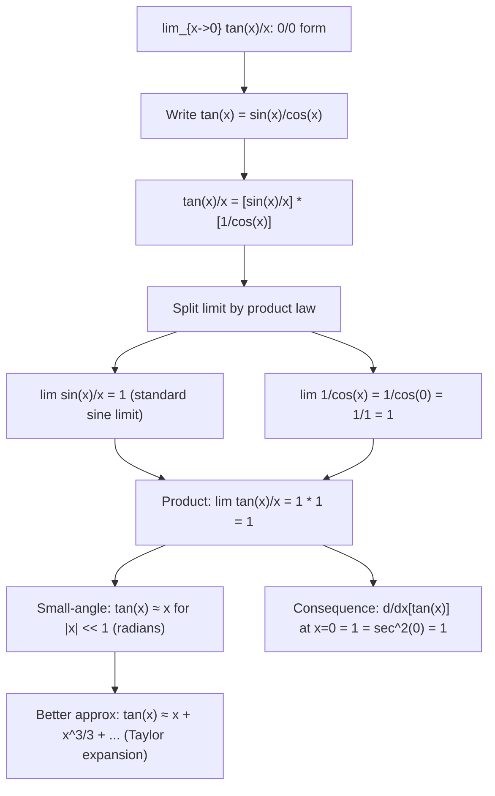

# Standard Limit (Tangent)

$$
\lim_{x \to 0} \frac{\tan x}{x} = 1
$$

## Deep Breakdown

What it tells me *(Situation Awareness)*:
This limit says that for small angles (in radians), $\tan x \approx x$ — the tangent function behaves like the identity near zero. It follows directly from the sine limit: $\tan x / x = (\sin x / x) \cdot (1/\cos x) \to 1 \cdot 1 = 1$ as $x\to 0$. This is the small-angle approximation for tangent. In DS/DA: the tangent function appears in trigonometric regressions, phase-space analysis, and certain probability distributions (the Cauchy distribution has density $1/(\pi(1+x^2))$, and $\tan$ parameterizes its quantile function); angle-based similarity metrics; optical flow and perspective transform gradients in computer vision; geodesic distance on Riemannian manifolds.

## Flowchart



## Real-world use

### Where it is used

Proof of $d/dx[\tan x] = \sec^2 x$ at $x=0$ (slope of tangent at origin is 1, confirmed by $\sec^2(0)=1$); small-angle approximations in physical sensors (gyroscopes, accelerometers) and robotics where angles are small; the Cauchy distribution quantile: $Q(p) = \tan(\pi(p-1/2))$ — near $p=1/2$, $Q(p) \approx \pi(p-1/2)$; stereographic projection coordinates; arctan link function in logistic-type models with fat tails.

### Problem it solves

$\tan(0)/0 = 0/0$ is undefined, but intuitively $\tan x$ behaves like $x$ near 0. This limit makes that precise and derives the small-angle approximation for tangent. It also confirms that $d/dx[\tan x]|_{x=0} = 1$ (consistent with $\sec^2(0) = 1/\cos^2(0) = 1$).

### How it solves the problem

Factor using the product rule for limits: $\tan(x)/x = (\sin x / x) \cdot (1/\cos x)$. As $x\to 0$: $\sin(x)/x \to 1$ (standard sine limit) and $1/\cos(x) \to 1/1 = 1$. Product of limits: $1 \cdot 1 = 1$.

### Example in a business

A DS processes smartphone accelerometer/gyroscope data for activity classification. The sensor returns pitch angle $\theta$ in radians. For angles less than 10 degrees ($\approx 0.175$ rad), the horizontal displacement approximation $d = r\tan(\theta) \approx r\theta$ is used, valid because $\lim_{\theta\to 0}\tan(\theta)/\theta = 1$. At $\theta = 0.1$ rad: $\tan(0.1)/0.1 = 1.003$ — 0.3% error, well within sensor noise.

## The formula, piece by piece

- $\tan x = \sin x / \cos x$: definition of tangent
- $\tan x / x = (\sin x / x) / \cos x$: restructure to use the known sine limit
- $\lim_{x\to 0}(\sin x / x) = 1$: standard sine limit
- $\lim_{x\to 0}(1/\cos x) = 1/\cos 0 = 1$: cosine is continuous at 0
- Product: $\lim_{x\to 0}\tan(x)/x = 1 \cdot 1 = 1$
- Taylor: $\tan x = x + x^3/3 + 2x^5/15 + \ldots$; so $\tan x/x = 1 + x^2/3 + \ldots \to 1$
- Generalization: $\lim_{x\to 0}\tan(ax)/(ax) = 1$; so $\lim_{x\to 0}\tan(ax)/x = a$
- Compare to sine: $\tan x > \sin x > 0$ for $0 < x < \pi/2$; both approach $x$ from below/above respectively, both with the same leading term

## The formula in words

"For small angles in radians, the tangent of an angle equals the angle itself, to first order. The ratio $\tan(x)/x$ approaches 1 as the angle shrinks to zero." Tiny trace: $x = 0.1$: $\tan(0.1)/0.1 = 0.10033/0.1 = 1.0033$. $x = 0.01$: $\tan(0.01)/0.01 = 0.010000333/0.01 = 1.0000333$. $x\to 0$: $\to 1$. $\checkmark$

## Critical Concepts

- **Tan grows faster than sin near 0:** $\sin x \le x \le \tan x$ for $0 < x < \pi/2$ (from the squeeze proof of the sine limit). Both have the same limit ratio to $x$ (both $\to 1$), but $\tan x > \sin x > 0$ in this interval, so $\tan x/x \ge \sin x / x \ge \cos x$. Both ratios sandwich toward 1 from above (tan) and within (sin/x from $\cos x$ below to 1 above).
- **Proof of $d/dx[\tan x] = \sec^2 x$:** this limit anchors the proof. From first principles: $d/dx[\tan x] = \lim_{h\to 0}[\tan(x+h)-\tan x]/h$. Using the addition formula and algebraic simplification, the key term $\lim_{h\to 0}(\tan h)/h = 1$ appears. Combined, the result is $\sec^2 x$.
- **Cauchy distribution and arctan:** the Cauchy distribution with location 0, scale 1 has PDF $f(x) = 1/[\pi(1+x^2)]$ and CDF $F(x) = (1/2) + \arctan(x)/\pi$. Near $x = 0$: $F(x) \approx 1/2 + x/\pi$ (since $\arctan(x) \approx x$ for small $x$, from the tangent limit). The Cauchy distribution is used in robust regression and as a heavy-tailed alternative to the Gaussian.
- **Small-angle error:** $\tan x - x = x^3/3 + O(x^5)$. At $x = 0.1$ rad ($5.7°$): error $\approx 0.001/3 = 0.00033$ (0.3%). At $x = 0.5$ rad ($28.6°$): error $\approx 0.125/3 = 0.042$ (8.4%). Beyond $\approx 15°$ ($0.26$ rad), the small-angle approximation starts breaking down noticeably for precision applications.
- **Relation to arctan derivative:** $d/dx[\arctan x]|_{x=0} = 1/(1+0^2) = 1$.

Combined with $d/dx[\tan x]|_{x=0} = \sec^2(0) = 1$: both are 1 at 0, consistent with $\arctan$ and $\tan$ being inverse functions (their derivatives at corresponding points must satisfy $d(\arctan)/dx \cdot d(\tan)/d\theta = 1$, and indeed $1 \cdot 1 = 1$ at 0).

## Step-by-step calculation (tiny example)

*Evaluate $\lim_{x\to 0}\tan(2x)/(3x)$.*

*Step 1: Factor.* $\tan(2x)/(3x) = (2/3) \cdot \tan(2x)/(2x)$.

*Step 2: Let $u = 2x$; as $x\to 0$, $u\to 0$.* $= (2/3) \cdot \tan(u)/u$.

*Step 3: Apply the standard limit.* $= (2/3) \cdot 1 = 2/3$. *Verify:* $x = 0.001$: $\tan(0.002)/0.003 \approx 0.002000.../0.003 \approx 0.6667 = 2/3$. $\checkmark$

## Code examples

### Beginner example (Python)

```python
import numpy as np
print("Standard Limit: lim_{x->0} tan(x)/x = 1")
print(f"\n{'x (rad)':>10} {'tan(x)/x':>12} {'Error from 1':>14} {'vs sin(x)/x':>14}")
for x in [0.5, 0.1, 0.05, 0.01, 0.001, 0.0001]:
    tan_ratio = np.tan(x) / x
    sin_ratio = np.sin(x) / x
    error = abs(tan_ratio - 1.0)
    diff_from_sin = tan_ratio - sin_ratio
    print(f"{x:>10.4f} {tan_ratio:>12.8f} {error:>14.2e} {diff_from_sin:>14.8f}")

# Small-angle approximation quality: tan(x) ≈ x
print(f"\n--- Small-angle accuracy: |tan(x) - x| / x ---")
print(f"{'x (deg)':>10} {'x (rad)':>10} {'tan(x)':>10} {'approx x':>10} {'rel error':>12}")
for deg in [1, 2, 5, 10, 15, 20, 30]:
    rad = np.radians(deg)
    tanx = np.tan(rad)
    err = abs(tanx - rad) / rad
    print(f"{deg:>10} {rad:>10.5f} {tanx:>10.5f} {rad:>10.5f} {err:>12.4f}")

# Generalization: lim tan(ax)/x = a
print(f"\n--- Generalization: lim_{{x->0}} tan(ax)/x = a ---")
print(f"{'a':>6} {'Numerical (x=1e-7)':>20} {'Analytic (=a)':>14}")
for a in [0.5, 2.0, np.pi, -1.0]:
    x = 1e-7
    numerical = np.tan(a * x) / x
    print(f"{a:>6.4f} {numerical:>20.8f} {a:>14.6f}")
```

### Beginner example (R)

```r
# Standard limit: lim_{x->0} tan(x)/x = 1
cat("Standard Limit: lim_{x->0} tan(x)/x = 1\n\n")
cat(sprintf("%-10s %-12s %-14s\n", "x (rad)", "tan(x)/x", "Error from 1"))
for (x in c(0.5, 0.1, 0.05, 0.01, 0.001)) {
  ratio <- tan(x) / x
  error <- abs(ratio - 1.0)
  cat(sprintf("%-10.4f %-12.8f %-14.2e\n", x, ratio, error))
}

# Small angle approximation
cat("\n--- Small-angle error: |tan(x)-x|/x ---\n")
cat(sprintf("%-10s %-10s %-10s %-12s\n", "deg", "rad", "tan(x)", "rel error"))
for (deg in c(1, 5, 10, 20, 30)) {
  rad <- deg * pi / 180
  tanx <- tan(rad)
  err <- abs(tanx - rad) / rad
  cat(sprintf("%-10d %-10.5f %-10.5f %-12.4f\n", deg, rad, tanx, err))
}
```

### Professional example (Python)

```python
import numpy as np
from sklearn.preprocessing import StandardScaler
from sklearn.datasets import make_regression
np.random.seed(42)

# -- Tangent limit: Cauchy distribution and heavy-tailed robust regression --
# Use case: A DS compares Gaussian and Cauchy noise assumptions in regression.
# The Cauchy location-scale model uses arctan/tan parameterization.
# Near the center (small residuals), lim tan(x)/x = 1 means the Cauchy
# loss gradient looks like the Gaussian (identity) gradient.
# At large residuals, the Cauchy loss is bounded (heavy tails), unlike L2.
#
# Cauchy log-likelihood: ell = -sum_i log(1 + (r_i/gamma)^2) - n*log(pi*gamma)
# Score (gradient of log-likelihood w.r.t. w):
# d(ell)/dw = -2/gamma^2 * X^T r / (1 + (r/gamma)^2)
# For small r: -2r/gamma^2 ≈ -(2/gamma^2)*r [Gaussian-like]
# For large r: -2gamma/|r| * sign(r) [bounded gradient]
N = 200
DIM = 4
GAMMA = 1.0   # Cauchy scale
X_raw, y_clean = make_regression(n_samples=N, n_features=DIM, noise=0.1, random_state=42)
scaler = StandardScaler()
X = scaler.fit_transform(X_raw)
y_clean /= y_clean.std()

# Add a few large outliers (Cauchy-like contamination)
y = y_clean.copy()
outlier_idx = np.random.choice(N, size=10, replace=False)
y[outlier_idx] += np.random.choice([-10, 10], size=10)

def cauchy_gradient(w: np.ndarray, X: np.ndarray, y: np.ndarray, gamma: float) -> np.ndarray:
    """
    Gradient of Cauchy log-likelihood w.r.t. w.

    d/dw[-log(1 + (r/gamma)^2)] = 2r / (gamma^2 + r^2) * X
    Summed: (2/N) * X^T [r / (gamma^2 + r^2)]
    For small r: r/(gamma^2+r^2) ≈ r/gamma^2 (tan limit: numerator ~ denominator*r for tiny r)
    """
    r = y - X @ w
    weights = r / (gamma**2 + r**2)   # bounded: max |weight| = 1/(2*gamma)
    return 2.0 / len(y) * X.T @ weights


def mse_gradient(w: np.ndarray, X: np.ndarray, y: np.ndarray) -> np.ndarray:
    """Standard L2 gradient (sensitive to outliers)."""
    r = y - X @ w
    return -2.0 / len(y) * X.T @ r


# Show gradient weight comparison at different residual sizes
w_demo = np.zeros(DIM)
print("Tangent Limit: Cauchy vs Gaussian Gradient Weights vs Residual Size")
print(f"\ngamma = {GAMMA}")
print(f"\nCauchy weight = r/(gamma^2 + r^2) vs Gaussian weight = r/gamma^2")
print(f"For small r: lim tan(r/gamma)/(r/gamma) = 1 (weights identical)")
print(f"For large r: Cauchy weight saturates, Gaussian diverges")
print(f"\n{'residual r':>12} {'Cauchy weight':>16} {'Gaussian weight':>18} {'Ratio C/G':>12}")
for r in [0.01, 0.1, 0.5, 1.0, 2.0, 5.0, 10.0, 50.0]:
    cw = r / (GAMMA**2 + r**2)
    gw = r / GAMMA**2
    print(f"{r:>12.3f} {cw:>16.8f} {gw:>18.4f} {cw/gw:>12.6f}")

# Fit both models via gradient ascent
w_cauchy = np.zeros(DIM)
w_gauss = np.zeros(DIM)
LR = 0.01
for _ in range(500):
    w_cauchy = w_cauchy + LR * cauchy_gradient(w_cauchy, X, y, GAMMA)
    w_gauss = w_gauss - LR * mse_gradient(w_gauss, X, y)

# Compare predictions on clean test data
X_test = scaler.transform(np.random.randn(100, DIM))
y_test = X_test @ np.linalg.lstsq(X[np.setdiff1d(range(N), outlier_idx)], y_clean[np.setdiff1d(range(N), outlier_idx)], rcond=None)[0][:DIM]
mse_c = float(np.mean((X_test @ w_cauchy - y_test)**2))
mse_g = float(np.mean((X_test @ w_gauss - y_test)**2))
print(f"\nWith {len(outlier_idx)} outliers contaminating training:")
print(f" Cauchy regression MSE (outlier-robust): {mse_c:.4f}")
print(f" Gaussian MSE regression (sensitive): {mse_g:.4f}")
print(f"\nKey: for small residuals, Cauchy gradient ≈ Gaussian (tan limit).")
print(f"For large residuals (outliers), Cauchy gradient saturates (bounded).")
```

---
