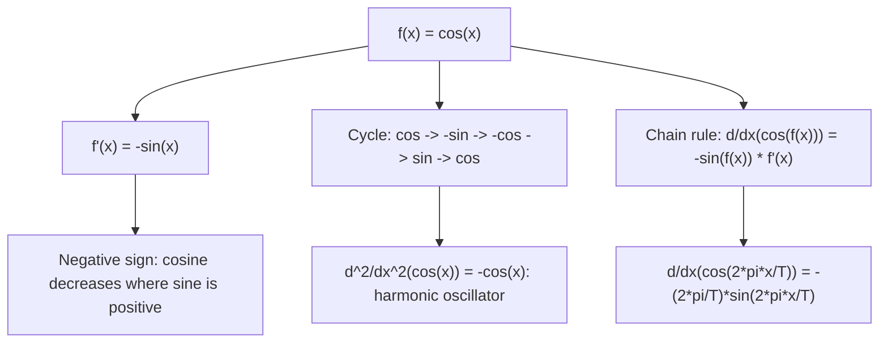

# Cosine

$$
\frac{d}{dx}(\cos x) = -\sin x
$$

## Deep Breakdown

What it tells me *(Situation Awareness)*:
The derivative of cosine is negative sine. The negative sign reflects that cosine decreases where sine is positive (on $[0, \pi/2]$: cosine decreases from 1 to 0 while sine is positive). Together with $d/dx(\sin x) = \cos x$, these two rules drive the complete $\sin \to \cos \to -\sin \to -\cos \to \sin$ 4-step differentiation cycle. In DA/DS: used whenever a model contains cosine terms — transformer positional encodings use both $\sin$ and $\cos$ components; Fourier series include $\cos$ terms; random Fourier features for kernel approximation combine $\sin$ and $\cos$; time series seasonal decomposition uses both.

## Flowchart



## Real-world use

### Where it is used

Transformer positional encoding odd dimensions ($\text{PE}(pos, 2i+1) = \cos(pos/10000^{2i/d})$); gradient backprop through cosine features; kernel SVM with random Fourier features ($\hat{k}(x,y) \approx z(x)^Tz(y)$ where $z$ uses $\cos(\omega^T x + b)$); decomposing time series with additive seasonal cosine terms.

### Problem it solves

Differentiating any function involving cosine — including gradient computation through cosine-based positional encodings and Fourier feature maps — requires $d/dx(\cos x) = -\sin x$.

### How it solves the problem

From first principles: $d/dx(\cos x) = \lim_{h\to0}[\cos(x+h)-\cos x]/h$. Using $\cos(x+h)=\cos x \cos h - \sin x \sin h$: the limit is $\cos x \cdot 0 - \sin x \cdot 1 = -\sin x$.

### Example in a business

A DS builds a time series model with explicit seasonal component: $s(t) = \sum_k [a_k \cos(2\pi kt/T) + b_k \sin(2\pi kt/T)]$. Gradient w.r.t. $a_k$: $\partial s/\partial a_k = \cos(2\pi kt/T)$. Gradient w.r.t. time (for forecasting horizon optimization): $ds/dt = \sum_k[-a_k(2\pi k/T)\sin(2\pi kt/T) + b_k(2\pi k/T)\cos(2\pi kt/T)]$ — uses both $d/dx(\cos) = -\sin$ and $d/dx(\sin) = \cos$.

## The formula, piece by piece

- $\cos x$: cosine; period $2\pi$; even function ($\cos(-x) = \cos x$); range $[-1, 1]$
- $-\sin x$: derivative; the negative sign distinguishes it from $d/dx(\sin x) = +\cos x$
- Mnemonic: "Co-functions differentiate to the other with a sign flip for cos": $\sin \to +\cos$, $\cos \to -\sin$
- Chain rule: $d/dx(\cos f(x)) = -\sin(f(x)) \cdot f'(x)$
- Examples: $d/dx(\cos(3x)) = -3\sin(3x)$; $d/dx(\cos(e^x)) = -e^x\sin(e^x)$
- Second derivative: $d^2/dx^2(\cos x) = -\cos x$; so $\cos x + (d^2/dx^2)\cos x = 0$ (same ODE as sine)
- Relationship to sine: $\cos x = \sin(x + \pi/2)$; differentiating: $-\sin x = \cos(x+\pi/2) \cdot 1 = -\sin x$. $\checkmark$

## The formula in words

"The slope of the cosine curve at any point equals the negative sine value at that point. At the top of the cosine wave ($x=0$, $\cos=1$), the slope is zero (sine is zero). As the cosine falls ($x > 0$), the slope is negative (sine is positive)." Tiny examples:
$d/dx(\cos x)|_{x=0} = -\sin(0) = 0$ (flat top of cosine wave).
$d/dx(\cos x)|_{x=\pi/2} = -\sin(\pi/2) = -1$ (steepest descent of cosine).
$d/dx(4\cos(2x)) = 4 \cdot (-\sin(2x)) \cdot 2 = -8\sin(2x)$.

## Critical Concepts

- **Sine-cosine symmetry:** $d/dx(\sin x) = \cos x$ and $d/dx(\cos x) = -\sin x$. The pair is related by the identity $\cos x = \sin(x + \pi/2)$ and $\sin x = \cos(x - \pi/2)$. Differentiating shifts phase by $\pi/2$.
- **Even/odd function preservation under differentiation:** $\cos$ is even ($f(-x) = f(x)$), $\sin$ is odd. Derivative of an even function is odd: $d/dx(\cos x) = -\sin x$ (odd). Derivative of odd is even: $d/dx(\sin x) = \cos x$ (even).
- **Product rule with sin/cos:** $d/dx(\sin x \cos x) = \cos^2 x - \sin^2 x = \cos(2x)$ (use product rule). This identity arises in Fourier series manipulation.
- **Random Fourier features gradient:** $\phi(x) = \cos(\omega^T x + b)$; $d\phi/dx = -\sin(\omega^T x + b) \cdot \omega$; used in training kernel approximation models.

## Step-by-step calculation (tiny example)

*Differentiate $f(x) = 3\cos(2x) + \cos^2(x)$.*

*Step 1: First term* — chain rule:
$d/dx(3\cos(2x)) = 3 \cdot (-\sin(2x)) \cdot 2 = -6\sin(2x)$.

*Step 2: Second term* — $\cos^2(x) = (\cos x)^2$; power rule + chain rule:
$d/dx(\cos^2 x) = 2\cos x \cdot (-\sin x) = -2\sin x \cos x = -\sin(2x)$.

*Step 3: Combine*:
$f'(x) = -6\sin(2x) - \sin(2x) = -7\sin(2x)$.

## Code examples

### Beginner example (Python)

```python
import numpy as np

def cosine_deriv(x: float) -> float:
    """d/dx(cos(x)) = -sin(x)."""
    return -np.sin(x)


# Numerical verification
x_vals = np.linspace(0, 2 * np.pi, 9)
h = 1e-7
print(f"{'x (rad)':>10} {'-sin(x)':>10} {'numerical':>12} {'match':>7}")
for x in x_vals:
    analytic = cosine_deriv(x)
    numerical = (np.cos(x + h) - np.cos(x - h)) / (2 * h)
    match = abs(analytic - numerical) < 1e-5
    print(f"{x:>10.4f} {analytic:>10.5f} {numerical:>12.5f} {str(match):>7}")

# Random Fourier feature gradient
print("\n--- Random Fourier feature gradient ---")
np.random.seed(42)
d_in = 4
omega = np.random.randn(d_in)  # random frequency vector
b = np.random.uniform(0, 2 * np.pi)
x = np.array([1.0, 0.5, -0.3, 0.8])

# phi(x) = cos(omega^T x + b)
phi = np.cos(omega @ x + b)
# d(phi)/dx = -sin(omega^T x + b) * omega
d_phi_dx = -np.sin(omega @ x + b) * omega
print(f"phi(x) = cos(omega^T x + b) = {phi:.5f}")
print(f"d(phi)/dx = -sin(omega^T x + b) * omega = {d_phi_dx}")
```

### Beginner example (R)

```r
# d/dx(cos(x)) = -sin(x)
cosine_deriv <- function(x) -sin(x)
x_vals <- seq(0, 2 * pi, length.out = 9)
h <- 1e-7
cat(sprintf("%-10s %-10s %-12s\n", "x (rad)", "-sin(x)", "numerical"))
for (x in x_vals) {
  analytic <- cosine_deriv(x)
  numerical <- (cos(x + h) - cos(x - h)) / (2 * h)
  cat(sprintf("%-10.4f %-10.5f %-12.5f\n", x, analytic, numerical))
}
```

### Professional example (Python)

```python
import numpy as np
from sklearn.kernel_approximation import RBFSampler
from sklearn.preprocessing import StandardScaler
np.random.seed(42)

# -- Random Fourier Features: cosine derivative in kernel approximation --------
# RBF kernel k(x,z) = exp(-gamma*||x-z||^2)
# Approx: k(x,z) ~ phi(x)^T phi(z) where phi_j(x) = sqrt(2/D)*cos(omega_j^T x + b_j)
# Gradient of feature map phi_j w.r.t. input: -sqrt(2/D)*sin(omega_j^T x + b_j)*omega_j
N, D_IN, D_FEAT = 300, 5, 100
GAMMA = 0.5
X = np.random.randn(N, D_IN)
scaler = StandardScaler()
X_scaled = scaler.fit_transform(X)

# Sample random Fourier frequencies
omegas = np.random.randn(D_FEAT, D_IN) * np.sqrt(2 * GAMMA)
biases = np.random.uniform(0, 2 * np.pi, D_FEAT)


def rff_features(x: np.ndarray) -> np.ndarray:
    """Random Fourier features: phi(x) = sqrt(2/D) * cos(omega^T x + b)."""
    projections = x @ omegas.T + biases[np.newaxis, :]  # (N, D_FEAT)
    return np.sqrt(2 / D_FEAT) * np.cos(projections)


def rff_gradient(x: np.ndarray) -> np.ndarray:
    """Gradient of RFF features: d phi_j/d x = -sqrt(2/D) * sin(omega_j^T x + b_j) * omega_j.

    Uses d/dx(cos(f(x))) = -sin(f(x)) * f'(x).
    """
    projections = x @ omegas.T + biases[np.newaxis, :]  # (N, D_FEAT)
    # d_phi_j / d_x_k = -sqrt(2/D) * sin(projection_j) * omega_j_k
    coeffs = -np.sqrt(2 / D_FEAT) * np.sin(projections)  # (N, D_FEAT)
    # Sum over feature dimensions: (N, D_FEAT) @ (D_FEAT, D_IN) -> (N, D_IN)
    return coeffs @ omegas


phi = rff_features(X_scaled)
d_phi = rff_gradient(X_scaled)
print("Random Fourier Features: d/dx(cos(x)) = -sin(x) in feature gradient")
print(f"RFF feature matrix shape: {phi.shape}")
print(f"Gradient matrix shape: {d_phi.shape} (d_phi/d_input for each sample)")

# Verify RBF kernel approximation quality
from sklearn.metrics.pairwise import rbf_kernel
K_exact = rbf_kernel(X_scaled[:50], X_scaled[:50], gamma=GAMMA)
K_approx = phi[:50] @ phi[:50].T
frobenius_error = np.linalg.norm(K_exact - K_approx, 'fro') / np.linalg.norm(K_exact, 'fro')
print(f"\nKernel approximation quality:")
print(f" Exact K range: [{K_exact.min():.3f}, {K_exact.max():.3f}]")
print(f" Approx K range: [{K_approx.min():.3f}, {K_approx.max():.3f}]")
print(f" Frobenius relative error: {frobenius_error:.4f}")
print(f"\nKey: phi gradient uses d/dx(cos(omega^T x + b)) = -sin(omega^T x + b) * omega")
```

---

*Source: 1300 p. 221*
