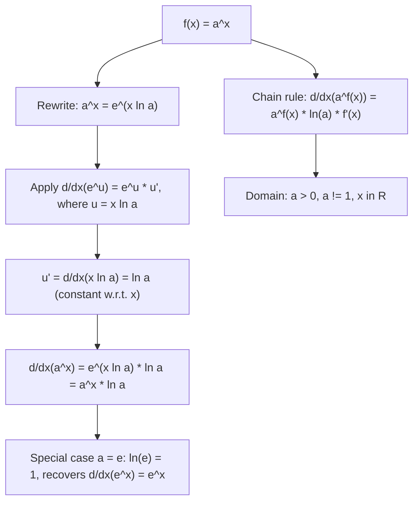

# Exponential (Base $a$)

$$
\frac{d}{dx}(a^x) = a^x \ln a
$$

## Deep Breakdown

What it tells me *(Situation Awareness)*:
The derivative of $a^x$ (exponential with arbitrary base $a > 0$, $a \ne 1$) is $a^x$ scaled by the natural log of the base: $d/dx(a^x) = a^x \ln a$. The factor $\ln a$ encodes how "fast" base $a$ grows relative to base $e$: when $a = e$, $\ln e = 1$ and you recover $d/dx(e^x) = e^x$. When $a = 2$, $\ln 2 \approx 0.693$, so $2^x$ grows at $69.3\%$ the rate of $e^x$. In DA/DS: this rule applies when differentiating learning rate schedules based on exponential decay ($\alpha_t = \alpha_0 \cdot \gamma^t$ where $\gamma < 1$), computing gradients through custom activation functions with non-$e$ bases, and differentiating log-probability expressions after change-of-base. The chain rule extension $d/dx(a^{f(x)}) = a^{f(x)} \ln(a) \cdot f'(x)$ applies in any case where the exponent is a function of $x$.

## Flowchart



## Real-world use

### Where it is used

Differentiating learning rate decay schedules of the form $\alpha_t = \alpha_0 \cdot \gamma^t$ (e.g., $\gamma = 0.95$ per epoch) to find the rate of LR change; computing gradients through log-base-2 entropy expressions (bits); differentiating any power function with a non-$e$ base that arises in custom ML architectures; proof that $e$ is the "natural" base because it is the unique $a$ for which the scaling factor $\ln a = 1$.

### Problem it solves

When the base of an exponential is not $e$, the derivative is not simply the function itself. Without this rule, one cannot correctly differentiate expressions like $2^x$, $10^x$, or $\gamma^t$ that appear in decay schedules and information-theoretic quantities.

### How it solves the problem

Rewrite $a^x = e^{x \ln a}$, then apply the chain rule: $d/dx(e^{x \ln a}) = e^{x \ln a} \cdot \ln a = a^x \ln a$. The key insight is that any base-$a$ exponential is just a base-$e$ exponential with a rescaled exponent, and the rescaling factor $\ln a$ enters as a constant multiplier.

### Example in a business

A DS implements a step decay learning rate schedule: $\alpha_t = \alpha_0 \cdot \gamma^t$ where $\gamma = 0.95$. To analyze how fast the LR drops per epoch, they compute $d\alpha_t/dt = \alpha_0 \cdot \gamma^t \cdot \ln \gamma = \alpha_0 \cdot 0.95^t \cdot \ln(0.95) \approx -0.0513 \cdot \alpha_0 \cdot 0.95^t$. The negative sign confirms decay; the magnitude $|\ln 0.95| \approx 0.0513$ means a $5.13\%$ per-step relative drop rate.

## The formula, piece by piece

- $a$: the base; any positive real $a > 0$, $a \ne 1$
- $a^x$: the exponential function; grows when $a > 1$, decays when $0 < a < 1$
- $\ln a$: natural log of the base; the constant multiplier introduced by differentiation
- $a^x \ln a$: the derivative; proportional to the original function, scaled by $\ln a$
- Derivation: $a^x = e^{x \ln a}$, so $d/dx(a^x) = e^{x \ln a} \cdot \ln a = a^x \ln a$
- Chain rule: $d/dx(a^{f(x)}) = a^{f(x)} \cdot \ln(a) \cdot f'(x)$
- Special cases: $a = e \Rightarrow \ln e = 1 \Rightarrow d/dx(e^x) = e^x$; $a = 2 \Rightarrow d/dx(2^x) = 2^x \ln 2$; $a = 10 \Rightarrow d/dx(10^x) = 10^x \ln 10$
- Note: $\ln a < 0$ when $0 < a < 1$ (decaying base), confirming derivative is negative

## The formula in words

"The derivative of $a^x$ is $a^x$ itself, multiplied by the natural log of the base. The factor $\ln a$ is constant — it does not depend on $x$. It scales the growth rate: larger $\ln a$ means faster growth. When $a = e$, this factor is 1, which is why $e$ is the natural base for calculus." Tiny examples:
$d/dx(2^x)|_{x=0} = 2^0 \cdot \ln 2 = 1 \cdot 0.6931 = 0.6931$.
$d/dx(10^x)|_{x=0} = 10^0 \cdot \ln 10 = 1 \cdot 2.3026 = 2.3026$.
$d/dx(0.95^t)|_{t=0} = 0.95^0 \cdot \ln(0.95) = 1 \cdot (-0.0513) = -0.0513$.
$d/dx(3^{2x}) = 3^{2x} \cdot \ln 3 \cdot 2 = 2 \ln 3 \cdot 3^{2x}$.

## Critical Concepts

- **Why $\ln a$ appears:** $a^x = e^{x \ln a}$. Differentiating $e^{x \ln a}$ via chain rule brings down $\ln a$ as the derivative of the inner function $x \ln a$. This is the fundamental reason the natural log is called "natural" — it is the constant that arises when differentiating exponentials.
- **$e$ as the natural base:** $e$ is the unique base for which $\ln a = 1$, so $d/dx(e^x) = e^x$ with no extra constant. Every other base introduces a $\ln a$ factor. This simplicity makes $e$ the default in calculus and ML.
- **Decaying bases ($0 < a < 1$):** $\ln a < 0$ for $a < 1$, so $d/dx(a^x) < 0$. The function is decreasing; its derivative correctly reflects this. Example: $d/dx(0.5^x) = 0.5^x \ln(0.5) = -0.5^x \cdot 0.693$.
- **Change of base formula connection:** $\log_a(e) = 1/\ln a$, so $\ln a = 1/\log_a(e)$. The derivative $a^x \ln a$ can also be written $a^x / \log_a(e)$.
- **Integral:** $\int a^x dx = a^x / \ln a + C$ (for $a \ne 1$), derived by reversing the derivative rule.

## Step-by-step calculation (tiny example)

*Differentiate $f(t) = \alpha_0 \cdot \gamma^t$ (learning rate decay schedule) and find the decay rate at $t = 5$. Use $\alpha_0 = 0.01$, $\gamma = 0.95$.*

*Step 1: Identify the form.*
$f(t) = \alpha_0 \cdot \gamma^t$. Here $a = \gamma = 0.95$, the base.

*Step 2: Apply the rule $d/dt(a^t) = a^t \ln a$.*
$f'(t) = \alpha_0 \cdot \gamma^t \cdot \ln \gamma = 0.01 \cdot 0.95^t \cdot \ln(0.95)$.

*Step 3: Compute $\ln(0.95)$.*
$\ln(0.95) \approx -0.05129$.

*Step 4: Evaluate at $t = 5$.*
$f'(5) = 0.01 \cdot 0.95^5 \cdot (-0.05129) = 0.01 \cdot 0.7738 \cdot (-0.05129) \approx -0.000397$. Interpretation: at epoch 5, the learning rate is decreasing at $\approx 3.97 \times 10^{-4}$ per epoch.

## Code examples

### Beginner example (Python)

```python
import numpy as np

def exp_base_a_deriv(a: float, x: float) -> float:
    """d/dx(a^x) = a^x * ln(a). Valid for a > 0, a != 1."""
    return a**x * np.log(a)

def exp_base_a_deriv_chain(a: float, x: float, f_x: float, f_prime_x: float) -> float:
    """d/dx(a^f(x)) = a^f(x) * ln(a) * f'(x)."""
    return a**f_x * np.log(a) * f_prime_x   # Verify numerically for several bases
h = 1e-7
x0 = 1.5
print(f"{'Base a':>8} {'Analytic':>12} {'Numerical':>12} {'Match':>7}")
for a in [2.0, np.e, 10.0, 0.5, 0.95]:
    analytic = exp_base_a_deriv(a, x0)
numerical = (a**(x0 + h) - a**(x0 - h)) / (2 * h)
match = abs(analytic - numerical) < 1e-5
print(f"{a:>8.4f} {analytic:>12.6f} {numerical:>12.6f} {str(match):>7}")   # Special case: a = e should match d/dx(e^x) = e^x
print(f"\nAt a=e, x=1: d/dx(e^x)={np.e**1:.6f}, rule gives={exp_base_a_deriv(np.e, 1):.6f}")
```

### Beginner example (R)

```r
# d/dx(a^x) = a^x * ln(a)
exp_base_a_deriv <- function(a, x) a^x * log(a)  # log() in R is natural log
x0 <- 1.5
h <- 1e-7
bases <- c(2, exp(1), 10, 0.5, 0.95)
cat(sprintf("%-8s %-12s %-12s\n", "Base a", "Analytic", "Numerical"))
for (a in bases) { analytic <- exp_base_a_deriv(a, x0)
  numerical <- (a^(x0 + h) - a^(x0 - h)) / (2 * h)
  cat(sprintf("%-8.4f %-12.6f %-12.6f\n", a, analytic, numerical))
}
```

### Professional example (Python)

```python
import numpy as np
np.random.seed(42)   # -- Learning rate schedule analysis: gamma^t decay and its derivative --
# Use case: a DS wants to understand how quickly LR decays under different gamma values
# and choose gamma so that LR reaches a target fraction after N epochs.
INITIAL_LR = 1e-3
TARGET_FRAC = 0.1   # want LR to reach 10% of initial after N_EPOCHS
N_EPOCHS = 50
GAMMAS = [0.99, 0.97, 0.95, 0.90, 0.85]

def lr_schedule(initial_lr: float, gamma: float, t: int) -> float:
    """LR at epoch t: alpha_0 * gamma^t. d/dt = alpha_0 * gamma^t * ln(gamma)."""
    return initial_lr * gamma**t

def lr_decay_rate(initial_lr: float, gamma: float, t: int) -> float:
    """d/dt of LR: alpha_0 * gamma^t * ln(gamma). Always <= 0 for gamma < 1."""
    return initial_lr * gamma**t * np.log(gamma)

def epochs_to_target(initial_lr: float, gamma: float, target_frac: float) -> float:
    """Solve gamma^t = target_frac: t = log(target_frac) / log(gamma)."""
    return np.log(target_frac) / np.log(gamma)
print("Learning Rate Decay Schedule Analysis: d/dt(alpha_0 * gamma^t) = alpha_0 * gamma^t * ln(gamma)")
print(f"\nInitial LR: {INITIAL_LR:.4f}, Target: {TARGET_FRAC*100:.0f}% of initial\n")
print(f"{'gamma':>7} {'LR@ep50':>10} {'Decay rate@ep0':>16} {'Decay rate@ep50':>16} {'Epochs to target':>18}")
for gamma in GAMMAS:
    lr_at_50 = lr_schedule(INITIAL_LR, gamma, N_EPOCHS)
rate_at_0 = lr_decay_rate(INITIAL_LR, gamma, 0)
rate_at_50 = lr_decay_rate(INITIAL_LR, gamma, N_EPOCHS)
t_target = epochs_to_target(INITIAL_LR, gamma, TARGET_FRAC)
print(f"{gamma:>7.2f} {lr_at_50:>10.6f} {rate_at_0:>16.6f} {rate_at_50:>16.8f} {t_target:>18.1f}")   # Verify derivative with finite difference
gamma_test = 0.95
t_test = 10.0
h = 1e-6
analytic = lr_decay_rate(INITIAL_LR, gamma_test, t_test)
numerical = (lr_schedule(INITIAL_LR, gamma_test, t_test + h) - lr_schedule(INITIAL_LR, gamma_test, t_test - h)) / (2 * h)
print(f"\nDerivative check (gamma={gamma_test}, t={t_test}): analytic={analytic:.8f}, numerical={numerical:.8f}")
print(f"Key: d/dt(gamma^t) = gamma^t * ln(gamma); ln({gamma_test}) = {np.log(gamma_test):.5f}")
```

---

*Source: 1300 p. 221*
