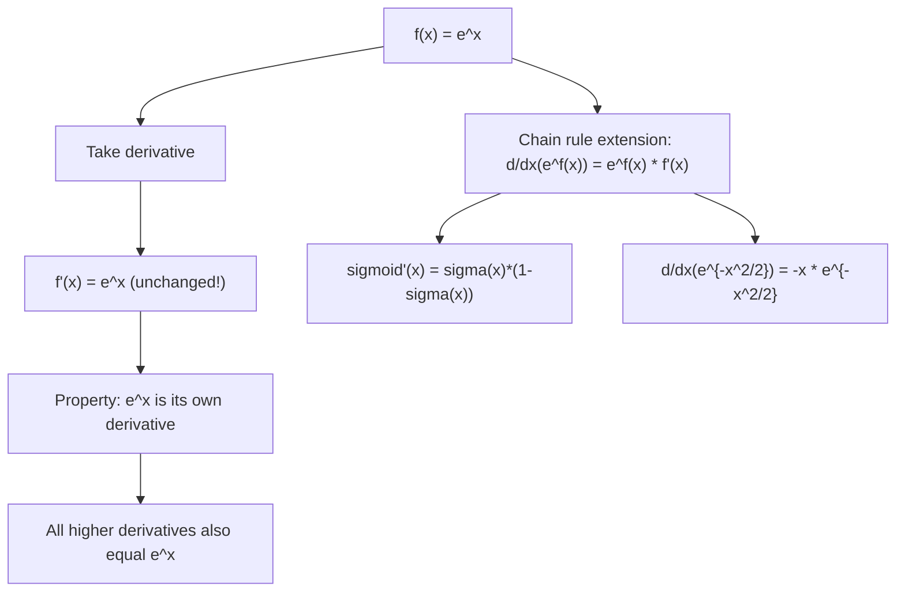

# Exponential (Natural)

$$
\frac{d}{dx}(e^x) = e^x
$$

## Deep Breakdown

What it tells me *(Situation Awareness)*:
The natural exponential function is its own derivative — the rate of change of $e^x$ at any point equals its current value. This self-referential property defines $e$ as a mathematical constant ($\approx 2.71828$) and makes $e^x$ the eigenfunction of the differentiation operator. In DA/DS: $e^x$ appears in softmax ($e^{z_j}/\sum_k e^{z_k}$), logistic sigmoid ($\sigma(x) = e^x/(1+e^x)$), and exponential family distributions (Gaussian, Poisson, Binomial). Differentiating these requires this rule. The chain rule extension $d/dx(e^{f(x)}) = e^{f(x)} f'(x)$ is used constantly in computing gradients through activation functions.

## Flowchart



## Real-world use

### Where it is used

Differentiating sigmoid and softmax (neural network activations); computing gradients through exponential family log-likelihoods; Poisson regression gradient; computing derivatives of entropy and KL divergence; softplus activation $\log(1+e^x)$ derivative; backpropagation through any exponential operation.

### Problem it solves

Any model using sigmoid, softmax, or exponential link functions requires the derivative $d/dx(e^x) = e^x$ during backpropagation. Without it, gradients cannot be computed for these ubiquitous functions.

### How it solves the problem

From first principles: $d/dx(e^x) = \lim_{h\to0}(e^{x+h}-e^x)/h = e^x \lim_{h\to0}(e^h-1)/h = e^x \cdot 1 = e^x$. The key limit $\lim_{h\to0}(e^h-1)/h = 1$ is one way to define $e$ itself.

### Example in a business

A DS computes the gradient of softmax cross-entropy during backpropagation. Softmax: $p_j = e^{z_j}/\sum_k e^{z_k}$. Taking $\partial p_j/\partial z_j$ requires differentiating $e^{z_j}$: $\partial e^{z_j}/\partial z_j = e^{z_j}$. Result: $\partial p_j/\partial z_j = p_j(1-p_j)$ (logistic gradient), using $d/dx(e^x)=e^x$ at each step.

## The formula, piece by piece

- $\frac{d}{dx}$: derivative with respect to $x$
- $e^x$: natural exponential; $e \approx 2.71828$; defined as $\lim_{n\to\infty}(1+1/n)^n$
- Result $e^x$: the derivative equals the function itself — unique among elementary functions
- Chain rule: $d/dx(e^{f(x)}) = e^{f(x)} \cdot f'(x)$; the exponential stays, multiply by inner derivative
- Sigmoid: $\sigma(x) = 1/(1+e^{-x})$; $\sigma'(x) = \sigma(x)(1-\sigma(x))$ (derived via chain rule on $e^{-x}$)
- Softplus: $d/dx\log(1+e^x) = e^x/(1+e^x) = \sigma(x)$; gradient of softplus is sigmoid
- Second and higher derivatives: $d^n/dx^n(e^x) = e^x$ for all $n \ge 0$; Taylor series exact: $e^x = \sum_{n=0}^\infty x^n/n!$

## The formula in words

"The natural exponential is unchanged by differentiation. Its slope at any point equals its height at that point. A function growing at a rate proportional to its current size is always an exponential." Tiny examples:
$d/dx(e^{3x}) = 3e^{3x}$ (chain rule: inner derivative = 3).
$d/dx(e^{-x}) = -e^{-x}$.
$d/dx(e^{x^2}) = 2x \cdot e^{x^2}$.
$d/dx(\sigma(x)) = d/dx\frac{1}{1+e^{-x}} = \sigma(x)(1-\sigma(x))$.

## Critical Concepts

- **Only function that is its own derivative:** $f = f'$ implies $f(x) = Ce^x$ for some constant $C$. This is what makes $e^x$ fundamental rather than just convenient.
- **Sigmoid gradient:** $\sigma'(x) = \sigma(x)(1-\sigma(x))$. Proof: let $u = -x$, $\sigma = 1/(1+e^u)$. $d\sigma/du = e^u/(1+e^u)^2 = \sigma(1-\sigma)$, then $d\sigma/dx = -d\sigma/du = -\sigma(1-\sigma)$... more carefully: $d/dx(1+e^{-x})^{-1} = -(1+e^{-x})^{-2} \cdot (-e^{-x}) = e^{-x}/(1+e^{-x})^2 = \sigma(x)(1-\sigma(x))$.
- **Vanishing gradient problem:** $\sigma'(x) = \sigma(x)(1-\sigma(x)) \le 0.25$, maximum at $x=0$. For large $|x|$, $\sigma'(x) \approx 0$: gradients vanish in deep networks, motivating ReLU.
- **$e$ vs $a^x$:** $d/dx(e^x) = e^x$; $d/dx(a^x) = a^x \ln a$.

The factor $\ln a$ appears because $a^x = e^{x \ln a}$, then chain rule gives $\ln a \cdot e^{x \ln a} = a^x \ln a$.

## Step-by-step calculation (tiny example)

*Differentiate $f(x) = 5e^{2x} - 3e^{-x} + e^{x^2}$.*

*Step 1: First term* $d/dx(5e^{2x}) = 5 \cdot e^{2x} \cdot 2 = 10e^{2x}$ (chain rule: inner derivative of $2x$ is $2$).

*Step 2: Second term* $d/dx(-3e^{-x}) = -3 \cdot e^{-x} \cdot (-1) = 3e^{-x}$.

*Step 3: Third term* $d/dx(e^{x^2}) = e^{x^2} \cdot 2x$ (chain rule: inner derivative of $x^2$ is $2x$).

*Step 4: Combine* $f'(x) = 10e^{2x} + 3e^{-x} + 2xe^{x^2}$.

## Code examples

### Beginner example (Python)

```python
import numpy as np

def sigmoid(x: float) -> float:
    """Logistic sigmoid: 1 / (1 + e^{-x})."""
    return 1 / (1 + np.exp(-x))

def sigmoid_derivative(x: float) -> float:
    """Sigmoid gradient: sigma(x) * (1 - sigma(x)); uses d/dx(e^x) = e^x."""
    s = sigmoid(x)
    return s * (1 - s)

def softplus(x: float) -> float:
    """Softplus: log(1 + e^x). Derivative = sigmoid(x)."""
    return np.log1p(np.exp(x))

def softplus_derivative(x: float) -> float:
    """d/dx log(1+e^x) = e^x / (1+e^x) = sigmoid(x)."""
    return sigmoid(x)   # Verify numerically
x_vals = np.linspace(-4, 4, 9)
h = 1e-7
print(f"{'x':>6} {'sigma(x)':>10} {'sigma_deriv':>12} {'numerical':>12} {'match':>7}")
for x in x_vals:
    analytic = sigmoid_derivative(x)
numerical = (sigmoid(x + h) - sigmoid(x - h)) / (2 * h)
match = abs(analytic - numerical) < 1e-6
print(f"{x:>6.1f} {sigmoid(x):>10.5f} {analytic:>12.6f} {numerical:>12.6f} {str(match):>7}")
print(f"\nNote: max sigma'(x) = 0.25 at x=0 -> vanishing gradient risk in deep nets")
```

### Beginner example (R)

```r
# d/dx(e^x) = e^x; applied to sigmoid and its derivative
sigmoid <- function(x) 1 / (1 + exp(-x))
sigmoid_deriv <- function(x) { s <- sigmoid(x); s * (1 - s)
}
x_vals <- seq(-4, 4, by = 1)
h <- 1e-7
cat(sprintf("%-6s %-10s %-12s %-12s\n", "x", "sigma(x)", "sigma'(x)", "numerical"))
for (x in x_vals) { analytic <- sigmoid_deriv(x)
  numerical <- (sigmoid(x + h) - sigmoid(x - h)) / (2 * h)
  cat(sprintf("%-6.1f %-10.5f %-12.6f %-12.6f\n", x, sigmoid(x), analytic, numerical))
}
```

### Professional example (Python)

```python
import numpy as np
from sklearn.datasets import make_classification
from sklearn.preprocessing import StandardScaler
np.random.seed(42)   # -- Manual backprop through sigmoid: shows d/dx(e^x)=e^x in action -----------
X_raw, y = make_classification(n_samples=500, n_features=4, n_informative=3, random_state=42)
scaler = StandardScaler()
X = scaler.fit_transform(X_raw)
N, D = X.shape

def sigmoid(z: np.ndarray) -> np.ndarray:
    return 1 / (1 + np.exp(-np.clip(z, -500, 500)))

def sigmoid_deriv(z: np.ndarray) -> np.ndarray:
    """Gradient of sigmoid: sigma(z)*(1-sigma(z)). Uses d/dx(e^x)=e^x."""
    s = sigmoid(z)
    return s * (1 - s)   # One hidden layer: X -> sigmoid -> output -> binary cross-entropy
W1 = np.random.randn(D, 8) * 0.1
W2 = np.random.randn(8, 1) * 0.1
LEARNING_RATE = 0.1
N_ITER = 500
losses = []
for step in range(N_ITER):
    # Forward pass
    z1 = X @ W1   # (N, 8) a1 = sigmoid(z1) # (N, 8) -- uses e^x
z2 = a1 @ W2   # (N, 1)
p = sigmoid(z2).ravel()   # (N,) # Binary cross-entropy loss
loss = -np.mean(y * np.log(p + 1e-9) + (1 - y) * np.log(1 - p + 1e-9))
losses.append(loss)   # Backprop -- d/dx(e^x)=e^x drives sigmoid_deriv at each layer
d_p = (p - y) / N   # (N,)
d_z2 = d_p * sigmoid_deriv(z2.ravel())   # (N,) <- sigma'(z2)
d_W2 = a1.T @ d_z2[:, None]   # (8, 1)
d_a1 = d_z2[:, None] @ W2.T   # (N, 8)
d_z1 = d_a1 * sigmoid_deriv(z1)   # (N, 8) <- sigma'(z1)
d_W1 = X.T @ d_z1   # (D, 8)
W1 -= LEARNING_RATE * d_W1
W2 -= LEARNING_RATE * d_W2
z1_final = X @ W1
a1_final = sigmoid(z1_final)
p_final = sigmoid(a1_final @ W2).ravel()
accuracy = np.mean((p_final > 0.5).astype(int) == y)
print("Neural net with sigmoid activations: d/dx(e^x)=e^x in backprop")
print(f"Loss: step 1={losses[0]:.4f}, step 100={losses[99]:.4f}, step 500={losses[-1]:.4f}")
print(f"Accuracy: {accuracy:.4f}")
print(f"\nKey: sigmoid_deriv(z) = sigma(z)*(1-sigma(z))")
print(f" This relies on d/dx(e^x) = e^x via chain rule on 1/(1+e^{{-x}})")
print(f" max gradient of sigmoid = {np.max(sigmoid_deriv(z1_final)):.4f} (theoretical max 0.25)")
```

---

*Source: 1300 p. 220*
