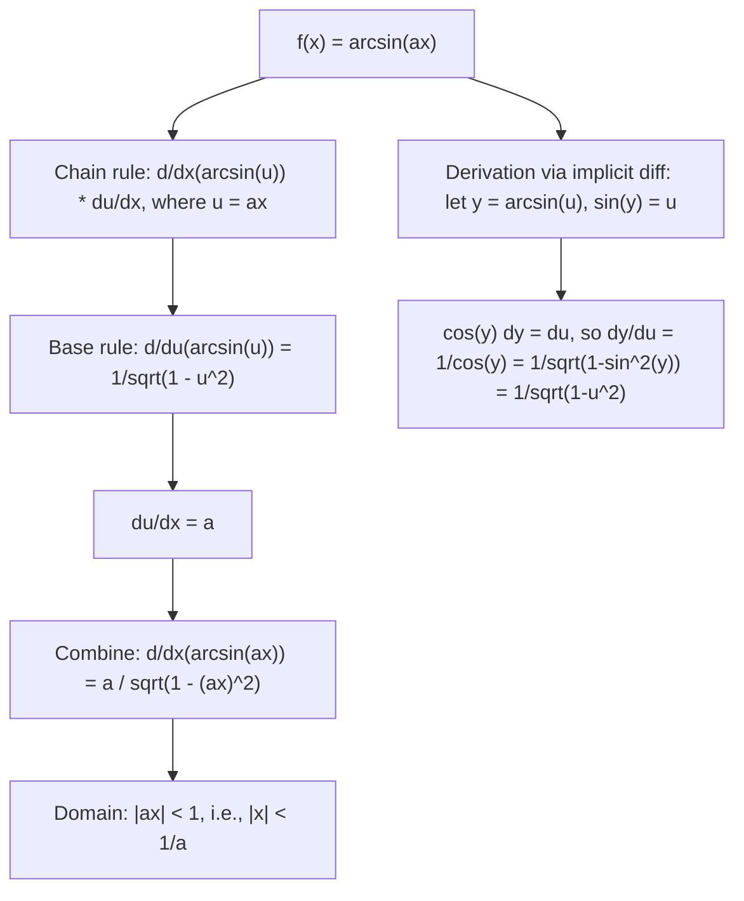

# Inverse Sine

$$
\frac{d}{dx}(\arcsin(ax)) = \frac{a}{\sqrt{1 - (ax)^2}}
$$

## Deep Breakdown

What it tells me *(Situation Awareness)*:
The derivative of $\arcsin(ax)$ is $a / \sqrt{1-(ax)^2}$. This is the chain-rule form of the base identity $d/dx(\arcsin x) = 1/\sqrt{1-x^2}$, with $u = ax$ giving the extra factor $a$ from $du/dx$. The domain is $|ax| < 1$, i.e., $|x| < 1/a$ — outside this range, $\arcsin$ is undefined. The derivative blows up as $x \to \pm 1/a$ (the derivative is infinite at the boundary of the domain), reflecting that $\arcsin$ has vertical tangents at $\pm 1$. In DA/DS: $\arcsin$ appears in angle-based feature engineering, in computing the gradient of the arcsine stabilizing variance transform ($\arcsin(\sqrt{p})$ for binomial proportions), and in deriving the gradient of metrics like cosine similarity used in embedding models.

## Flowchart



## Real-world use

### Where it is used

Variance-stabilizing transform for binomial proportions in A/B testing: $\phi(p) = \arcsin(\sqrt{p})$ has approximate constant variance; its derivative $d\phi/dp = 1/(2\sqrt{p(1-p)})$ uses the chain rule on $\arcsin$. Computing gradients through angle-based features in geospatial models ($\theta = \arcsin(\text{lat}/R)$). Deriving the gradient of the Pearson correlation through its arcsine transform. Normalizing flows with arcsine coupling layers.

### Problem it solves

When the derivative of a composition involving $\arcsin$ is needed — for backpropagation, for computing Fisher information, or for optimization of angle-based objectives — this rule provides the closed-form gradient.

### How it solves the problem

By implicit differentiation: let $y = \arcsin(u)$, so $\sin(y) = u$. Differentiate both sides: $\cos(y) \cdot dy/du = 1$, giving $dy/du = 1/\cos(y)$. Since $\sin(y) = u$, we have $\cos(y) = \sqrt{1-u^2}$ (taking the positive root, because $y \in [-\pi/2, \pi/2]$ where $\cos \ge 0$). So $d/du(\arcsin u) = 1/\sqrt{1-u^2}$. With $u = ax$: chain rule gives the factor $a$.

### Example in a business

A DS applies the arcsine variance-stabilizing transform to click-through rates $p_i$ from A/B test arms: $\phi_i = \arcsin(\sqrt{p_i})$. The gradient of $\phi_i$ with respect to $p_i$ is needed for delta-method confidence intervals. With $u = \sqrt{p}$, $a = 1/\sqrt{p}$: $d\phi/dp = d\arcsin(\sqrt{p})/dp = 1/(2\sqrt{p(1-p)})$. This uses the chain rule applied to $d/du(\arcsin u) = 1/\sqrt{1-u^2}$, which is the base formula with $a=1$.

## The formula, piece by piece

- $\arcsin$: inverse sine function; maps $[-1, 1] \to [-\pi/2, \pi/2]$; also written $\sin^{-1}$
- $ax$: the argument; $a$ is a constant scaling factor; controls the domain width $|x| < 1/a$
- $\sqrt{1-(ax)^2}$: the denominator; equals $\sqrt{1 - a^2 x^2}$; approaches 0 as $|ax| \to 1$
- $a/\sqrt{1-(ax)^2}$: the full derivative; has a factor $a$ from chain rule; blows up at domain boundary
- Base case ($a = 1$): $d/dx(\arcsin x) = 1/\sqrt{1-x^2}$
- General chain rule: $d/dx(\arcsin f(x)) = f'(x)/\sqrt{1-f(x)^2}$
- Implicit differentiation derivation: $\sin(y) = ax \Rightarrow \cos(y) \cdot y' = a \Rightarrow y' = a/\cos(y) = a/\sqrt{1-(ax)^2}$
- $\int 1/\sqrt{1-x^2} \, dx = \arcsin x + C$: arcsin is the antiderivative of $1/\sqrt{1-x^2}$

## The formula in words

"To differentiate $\arcsin(ax)$: put $a$ in the numerator (chain rule factor), and $\sqrt{1-\text{argument}^2}$ in the denominator. The result grows without bound as the argument approaches $\pm 1$, reflecting that $\arcsin$ has infinite slope at the edges of its domain." Tiny examples:
$d/dx(\arcsin x)|_{x=0} = 1/\sqrt{1-0} = 1$.
$d/dx(\arcsin x)|_{x=0.5} = 1/\sqrt{1-0.25} = 1/\sqrt{0.75} \approx 1.155$.
$d/dx(\arcsin(2x))|_{x=0} = 2/\sqrt{1-0} = 2$.
$d/dx(\arcsin(0.5x))|_{x=1} = 0.5/\sqrt{1-0.25} \approx 0.577$.
$d/dx(\arcsin(\sqrt{p}))|_{p=0.25}$: let $u=\sqrt{p}$, $du/dp = 1/(2\sqrt{p})$; result $= 1/(2\sqrt{p(1-p)}) = 1/(2\sqrt{0.25 \cdot 0.75}) \approx 1.155$.

## Critical Concepts

- **Domain restriction is essential:** $\arcsin$ is only defined on $[-1, 1]$, so the chain-rule derivative is only valid when $|ax| \le 1$. Inputs outside this range cause $\sqrt{1-(ax)^2}$ to become imaginary — a NaN in code. Always validate input range before computing.
- **Infinite derivative at boundary:** $d/dx(\arcsin x) \to \infty$ as $|x| \to 1$. This means the function changes extremely quickly near the edges of its domain. In optimization, this can cause gradient explosion if inputs approach the boundary. Clip inputs or use a softer approximation (e.g., $\arctan$) if this is a risk.
- **Connection to unit circle:** $\arcsin x = $ the angle $\theta$ such that $\sin\theta = x$. At $x = 0$, the tangent to the unit circle is vertical (sine changes fastest near 0), so the derivative is 1. At $x = 1$, the tangent is horizontal (sine barely changes), so the derivative is $\infty$.
- **Variance-stabilizing transform:** $\phi(p) = 2\arcsin(\sqrt{p})$ (the "arcsin square root transform") is used to make binomial proportion variance approximately constant ($\approx 1/n$). This is standard in epidemiology and A/B testing. The gradient $d\phi/dp$ uses this rule.
- **Arcsine vs arctan for ML:** $\arctan$ is generally preferred over $\arcsin$ in ML activations because $\arctan$ has no domain restriction (defined on all of $\mathbb{R}$) and no blowup at boundaries.

Use $\arcsin$ only when the argument is guaranteed bounded in $(-1, 1)$.

## Step-by-step calculation (tiny example)

*Differentiate $f(x) = \arcsin(3x)$ and find the slope at $x = 0.1$.*

*Step 1: Identify form.* $f(x) = \arcsin(ax)$ with $a = 3$.

*Step 2: Apply the formula.* $f'(x) = 3/\sqrt{1-(3x)^2} = 3/\sqrt{1-9x^2}$.

*Step 3: Evaluate at $x = 0.1$.*
$1 - 9(0.1)^2 = 1 - 0.09 = 0.91$.
$\sqrt{0.91} \approx 0.9539$.
$f'(0.1) = 3/0.9539 \approx 3.145$.

*Step 4: Check domain.* $|3 \cdot 0.1| = 0.3 < 1$. Valid.

*Step 5: Verify numerically.* $h = 10^{-6}$:
$[\arcsin(3(0.1+h)) - \arcsin(3(0.1-h))]/(2h) \approx 3.145$. $\checkmark$

## Code examples

### Beginner example (Python)

```python
import numpy as np

def arcsin_ax_deriv(a: float, x: float) -> float:
    """d/dx(arcsin(ax)) = a / sqrt(1 - (ax)^2). Requires |ax| < 1."""
    arg = a * x
    if abs(arg) >= 1.0:
        raise ValueError(f"|ax| = {abs(arg):.4f} >= 1: outside arcsin domain.")
    return a / np.sqrt(1.0 - arg**2)   # Verify numerically over several (a, x) pairs
h = 1e-7
test_cases = [(1.0, 0.5), (2.0, 0.3), (0.5, 0.8), (3.0, 0.1)]
print(f"{'a':>6} {'x':>6} {'Analytic':>12} {'Numerical':>12} {'Match':>7}")
for a, x in test_cases:
    analytic = arcsin_ax_deriv(a, x)
numerical = (np.arcsin(a * (x + h)) - np.arcsin(a * (x - h))) / (2 * h)
match = abs(analytic - numerical) < 1e-5
print(f"{a:>6.2f} {x:>6.3f} {analytic:>12.6f} {numerical:>12.6f} {str(match):>7}")   # Show blowup near domain boundary
print("\nDerivative growth near boundary (a=1):")
for x in [0.5, 0.9, 0.99, 0.999]:
    deriv = arcsin_ax_deriv(1.0, x)
print(f" x={x}: d/dx(arcsin(x)) = {deriv:.4f}")
```

### Beginner example (R)

```r
# d/dx(arcsin(ax)) = a / sqrt(1 - (ax)^2)
arcsin_ax_deriv <- function(a, x) { arg <- a * x
  if (abs(arg) >= 1) stop(sprintf("|ax| = %.4f >= 1: outside domain", abs(arg))) a / sqrt(1 - arg^2)
}  # arcsine variance-stabilizing transform and its derivative
arcsin_vstab <- function(p) asin(sqrt(p))
arcsin_vstab_deriv <- function(p) 1 / (2 * sqrt(p * (1 - p)))  # chain rule of arcsin(sqrt(p))
test_cases <- list(c(1.0, 0.5), c(2.0, 0.3), c(0.5, 0.8), c(3.0, 0.1))
cat(sprintf("%-6s %-6s %-12s\n", "a", "x", "Analytic"))
for (tc in test_cases) { a <- tc[1]; x <- tc[2]
  cat(sprintf("%-6.2f %-6.3f %-12.6f\n", a, x, arcsin_ax_deriv(a, x)))
}
cat("\nArcsine variance-stabilizing transform gradient:\n")
for (p in c(0.1, 0.25, 0.5, 0.75, 0.9)) { cat(sprintf(" p=%.2f: d/dp(arcsin(sqrt(p))) = %.4f\n", p, arcsin_vstab_deriv(p)))
}
```

### Professional example (Python)

```python
import numpy as np
from scipy import stats
np.random.seed(42)   # -- Arcsine variance-stabilizing transform for A/B test proportions --
# Use case: DA uses arcsin(sqrt(p)) to stabilize variance of click-through rates
# before applying t-test. Gradient is needed for delta-method CI computation.

def arcsin_vstab(p: np.ndarray) -> np.ndarray:
    """Arcsine variance-stabilizing transform: phi(p) = arcsin(sqrt(p))."""
    return np.arcsin(np.sqrt(p))

def arcsin_vstab_gradient(p: np.ndarray) -> np.ndarray:
    """d/dp(arcsin(sqrt(p))) = 1 / (2 * sqrt(p * (1-p))). Derived via chain rule: d/du(arcsin(u)) = 1/sqrt(1-u^2), u = sqrt(p), du/dp = 1/(2*sqrt(p)). """
    return 1.0 / (2.0 * np.sqrt(p * (1.0 - p)))

def delta_method_se(proportions: np.ndarray, n_obs: int) -> np.ndarray:
    """Delta method SE for arcsin-transformed proportions. Var[phi(p)] approx [phi'(p)]^2 * Var[p] = [1/(2*sqrt(p*(1-p)))]^2 * p*(1-p)/n = 1/(4n). """
    gradient = arcsin_vstab_gradient(proportions)
    var_p = proportions * (1 - proportions) / n_obs
    return np.sqrt(gradient**2 * var_p)   # Simulate A/B test: control (p=0.05) and variant (p=0.07), n=1000 each
n_per_arm = 1000
p_control = 0.05
p_variant = 0.07
N_BOOTSTRAP = 5000
p_hat_control = np.random.binomial(n_per_arm, p_control, N_BOOTSTRAP) / n_per_arm
p_hat_variant = np.random.binomial(n_per_arm, p_variant, N_BOOTSTRAP) / n_per_arm   # Transform
phi_control = arcsin_vstab(p_hat_control)
phi_variant = arcsin_vstab(p_hat_variant)   # Analytic SE via delta method
se_control_analytic = delta_method_se(np.array([p_control]), n_per_arm)[0]
se_variant_analytic = delta_method_se(np.array([p_variant]), n_per_arm)[0]
print("Arcsine Variance-Stabilizing Transform: d/dp(arcsin(sqrt(p))) = 1/(2*sqrt(p(1-p)))")
print(f"\n{'Arm':>10} {'p_true':>8} {'phi_mean':>10} {'phi_std(sim)':>14} {'phi_se(delta)':>14}")
for label, p_true, phi_samples, se_analytic in [ ("Control", p_control, phi_control, se_control_analytic), ("Variant", p_variant, phi_variant, se_variant_analytic),
]:
    print(f"{label:>10} {p_true:>8.4f} {phi_samples.mean():>10.4f} {phi_samples.std():>14.4f} {se_analytic:>14.4f}")
print(f"\nKey: gradient at p={p_control}: {arcsin_vstab_gradient(np.array([p_control]))[0]:.4f}")
print(f" gradient at p={p_variant}: {arcsin_vstab_gradient(np.array([p_variant]))[0]:.4f}")
print(f"\nNote: arcsin transform makes SE approximately 1/(2*sqrt(n)) = {1/(2*np.sqrt(n_per_arm)):.4f}")
print(f" Simulated SE control: {phi_control.std():.4f}, variant: {phi_variant.std():.4f}")
```

---

*Source: domain knowledge*
