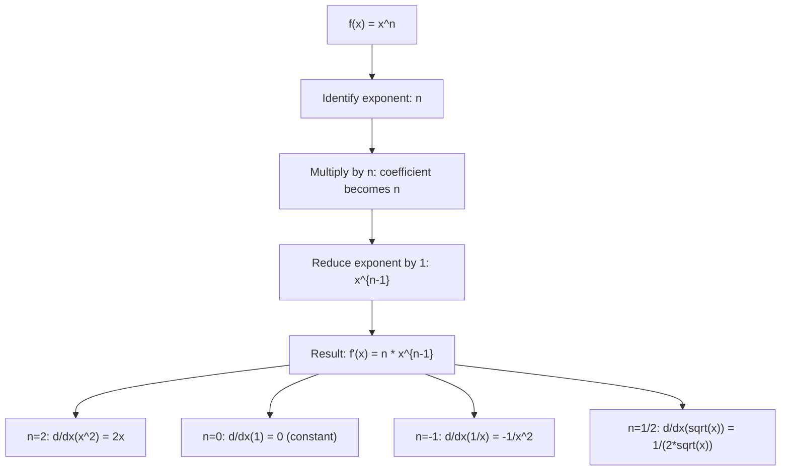

# Power Rule

$$
\frac{d}{dx}(x^n) = nx^{n-1}
$$

## Deep Breakdown

What it tells me *(Situation Awareness)*:
The power rule is the most fundamental differentiation formula: to differentiate $x^n$, multiply by the exponent $n$ and reduce the exponent by 1. It works for any real $n$ (positive integer, negative, fractional, irrational). This is the first rule every ML practitioner uses implicitly: computing gradients of polynomial loss terms, regularization penalties ($\|w\|^2$ gives $2w$), and activation functions. In DA/DS: gradient of MSE loss $f(w) = (y - wx)^2$ uses the power rule; the squared norm $\|w\|_2^2 = \sum_j w_j^2$ differentiates to $2w$ (power rule on each element); learning rate in gradient descent is applied to this derivative.

## Flowchart



## Real-world use

### Where it is used

Computing gradients of polynomial objectives (MSE, ridge regression penalty); differentiating activation functions element-wise (ReLU is piecewise power rule); computing partial derivatives of neural network parameters; deriving normal equations for linear regression.

### Problem it solves

Given a power function $x^n$, find its rate of change. This is the building block for differentiating any polynomial by linearity, and (via chain rule) any composite function involving powers.

### How it solves the problem

Proof from first principles: $\lim_{h \to 0}[(x+h)^n - x^n]/h$. Expanding $(x+h)^n$ by the binomial theorem: $x^n + nx^{n-1}h + O(h^2)$. Subtracting $x^n$, dividing by $h$: $nx^{n-1} + O(h) \to nx^{n-1}$.

### Example in a business

A DA optimizes ridge regression: $f(w) = \|y - Xw\|^2 + \lambda\|w\|^2$. The regularization gradient requires $\nabla_w \|w\|^2 = \nabla_w \sum_j w_j^2 = 2w$ (power rule: $d/dw_j(w_j^2) = 2w_j$). This drives the gradient descent update $w \leftarrow w - \gamma(\nabla_w\text{MSE} + 2\lambda w)$.

## The formula, piece by piece

- $\frac{d}{dx}$: differential operator; "derivative with respect to $x$"
- $x^n$: power function; $x$ is the variable, $n$ is the fixed exponent
- $n$: the exponent; can be any real number ($n \in \mathbb{R}$)
- $nx^{n-1}$: result; coefficient $n$ times $x$ raised to $n-1$
- Special cases: $n=1$: $d/dx(x) = 1$; $n=0$: $d/dx(1) = 0$; $n=-1$: $d/dx(x^{-1}) = -x^{-2}$; $n=1/2$: $d/dx(\sqrt{x}) = 1/(2\sqrt{x})$
- Generalized: applies for $x \ne 0$ when $n < 0$ or non-integer; requires $x > 0$ for fractional $n$ in reals
- Polynomial: $d/dx(a_nx^n + \cdots + a_1x + a_0) = na_nx^{n-1} + \cdots + a_1$ (by linearity)

## The formula in words

"To differentiate a power of $x$: bring the exponent down as a multiplier, then reduce the exponent by one." Tiny examples:
$d/dx(x^3) = 3x^2$.
$d/dx(x^{-2}) = -2x^{-3} = -2/x^3$.
$d/dx(\sqrt{x}) = d/dx(x^{1/2}) = \frac{1}{2}x^{-1/2} = \frac{1}{2\sqrt{x}}$.
$d/dx(5) = d/dx(5 \cdot x^0) = 0$.

## Critical Concepts

- **Applies for all real $n$:** integer, negative, rational, irrational. $d/dx(x^\pi) = \pi x^{\pi-1}$.
- **Requires chain rule for composite powers:** $d/dx(f(x)^n) = n f(x)^{n-1} f'(x)$ (the "blob function" extension).
- **Connection to $e^x$:** $d/dx(e^x) = e^x$ is NOT a power rule — it's the exponential rule. Power rule is for $x^n$ (variable base, constant exponent); exponential rule is for $a^x$ (constant base, variable exponent).
- **Gradient of $\|w\|_2^2$:** for $f(w) = \sum_j w_j^2$: $\partial f/\partial w_j = 2w_j$ for each $j$; in vector notation $\nabla_w \|w\|_2^2 = 2w$.

This appears in every L2-regularized model.

## Step-by-step calculation (tiny example)

*Differentiate $f(x) = 3x^4 - 2x^{-1} + 5\sqrt{x}$.*

*Step 1: Apply power rule term by term (sum rule + scalar multiplication)*
$d/dx(3x^4) = 3 \cdot 4x^3 = 12x^3$.
$d/dx(-2x^{-1}) = -2 \cdot (-1)x^{-2} = 2x^{-2} = 2/x^2$.
$d/dx(5x^{1/2}) = 5 \cdot \frac{1}{2}x^{-1/2} = \frac{5}{2\sqrt{x}}$.

*Step 2: Combine*
$f'(x) = 12x^3 + 2/x^2 + 5/(2\sqrt{x})$.

*Step 3: Verify at $x = 1$*
$f(1) = 3 - 2 + 5 = 6$. $f(1+h) \approx 6 + f'(1) \cdot h$. $f'(1) = 12 + 2 + 2.5 = 16.5$. Check: $(f(1.001)-f(1))/0.001 \approx 16.5$. $\checkmark$

## Code examples

### Beginner example (Python)

```python
import numpy as np

def power_rule(n: float) -> callable:
    """Return derivative function of x^n using the power rule."""
    def derivative(x: float) -> float:
        return n * x ** (n - 1)
    derivative.__doc__ = f"Derivative of x^{n}: d/dx(x^{n}) = {n}*x^{n-1}"
    return derivative


# Demonstrate power rule on common cases
cases = [
    ("x^2", 2),
    ("x^3", 3),
    ("x^(-1)", -1),
    ("x^(1/2)", 0.5),
    ("x^pi", np.pi),
]
x_val = 2.0
print(f"{'Function':>12} {'Analytical':>14} {'Numerical approx':>18} {'Match':>7}")
for name, n in cases:
    deriv_fn = power_rule(n)
    analytical = deriv_fn(x_val)
    h = 1e-7
    numerical = (x_val**n - (x_val - h)**n) / h
    match = abs(analytical - numerical) < 1e-5
    print(f"{name:>12} {analytical:>14.6f} {numerical:>18.6f} {str(match):>7}")

# L2 gradient in practice
print("\n--- L2 regularization gradient ---")
w = np.array([1.0, -2.0, 0.5, 3.0])
l2_gradient = 2 * w   # d/dw_j (w_j^2) = 2*w_j for each j
print(f"w = {w}")
print(f"grad L2 = 2*w = {l2_gradient}")
```

### Beginner example (R)

```r
# Power rule: d/dx(x^n) = n * x^(n-1)
power_rule_deriv <- function(n) {
  function(x) n * x^(n - 1)
}
x_val <- 2.0
cases <- list("x^2" = 2, "x^3" = 3, "x^(-1)" = -1, "x^(1/2)" = 0.5)
cat(sprintf("%-12s %-14s %-18s\n", "Function", "Analytical", "Numerical"))
for (name in names(cases)) {
  n <- cases[[name]]
  deriv_fn <- power_rule_deriv(n)
  analytical <- deriv_fn(x_val)
  h <- 1e-7
  numerical <- (x_val^n - (x_val - h)^n) / h
  cat(sprintf("%-12s %-14.6f %-18.6f\n", name, analytical, numerical))
}

# L2 gradient
cat("\n--- L2 gradient ---\n")
w <- c(1.0, -2.0, 0.5, 3.0)
cat(sprintf("w: %s\n", paste(w, collapse=", ")))
cat(sprintf("grad L2 = 2*w: %s\n", paste(2*w, collapse=", ")))
```

### Professional example (Python)

```python
import numpy as np
from sklearn.datasets import make_regression
from sklearn.preprocessing import StandardScaler
from sklearn.metrics import mean_squared_error
np.random.seed(42)

# -- Ridge regression: power rule drives gradient, closed form vs GD -----------
X_raw, y = make_regression(n_samples=300, n_features=6, noise=10.0, random_state=42)
scaler = StandardScaler()
X = scaler.fit_transform(X_raw)
N, D = X.shape
LAMBDA = 0.5   # L2 regularization strength

# MSE + L2: f(w) = (1/n)||y - Xw||^2 + lambda*||w||^2
# Gradient (power rule applied):
# d/dw MSE = -(2/n) X^T (y - Xw) (power rule on ||y - Xw||^2)
# d/dw L2 = 2*lambda*w (power rule: d/dw_j w_j^2 = 2w_j)

def ridge_loss(w: np.ndarray) -> float:
    residuals = y - X @ w
    return float(np.mean(residuals**2) + LAMBDA * np.sum(w**2))

def ridge_gradient(w: np.ndarray) -> np.ndarray:
    residuals = y - X @ w
    grad_mse = -2 / N * X.T @ residuals   # power rule on ||y - Xw||^2
    grad_l2 = 2 * LAMBDA * w              # power rule on lambda*||w||^2
    return grad_mse + grad_l2


# Closed form: w* = (X^T X + n*lambda*I)^{-1} X^T y
w_closed = np.linalg.solve(X.T @ X + N * LAMBDA * np.eye(D), X.T @ y)

# Gradient descent
LEARNING_RATE = 0.01
w_gd = np.zeros(D)
for _ in range(2000):
    w_gd -= LEARNING_RATE * ridge_gradient(w_gd)
print("Ridge Regression: Power Rule Gradient")
print(f"{'Method':<15} {'MSE':>10} {'L2 norm':>10} {'||w-w*||':>12}")
print(f"{'Closed form':<15} {mean_squared_error(y, X @ w_closed):>10.4f} {np.sum(w_closed**2):>10.4f} {'0.000000':>12}")
print(f"{'Gradient desc':<15} {mean_squared_error(y, X @ w_gd):>10.4f} {np.sum(w_gd**2):>10.4f} {np.linalg.norm(w_gd - w_closed):>12.6f}")
print(f"\nGradient uses power rule:")
print(f" d/dw ||y-Xw||^2 = -2 X^T(y-Xw) [power rule on (y-Xw)^2]")
print(f" d/dw lambda*||w||^2 = 2*lambda*w [power rule on w_j^2 per element]")
```

---

*Source: 1300 p. 220*
