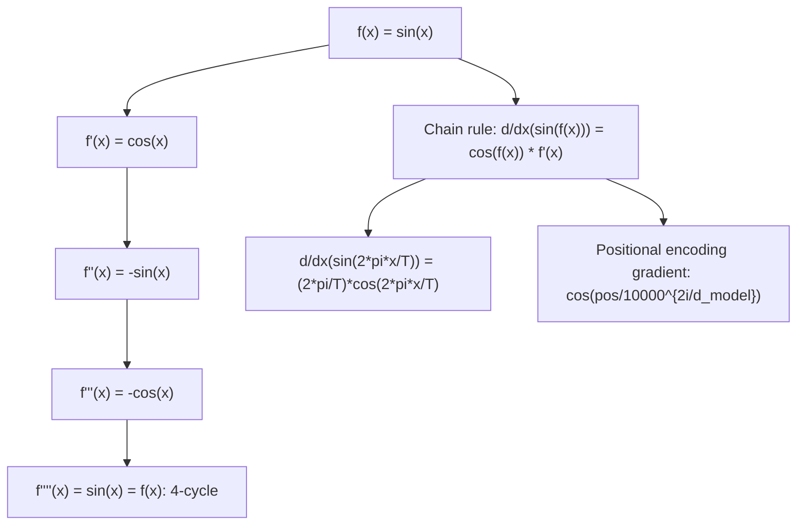

# Sine

$$
\frac{d}{dx}(\sin x) = \cos x
$$

## Deep Breakdown

What it tells me *(Situation Awareness)*:
The derivative of sine is cosine: the rate of change of a sine wave at any point is the value of the cosine at that same point. This creates the cycle $\sin \to \cos \to -\sin \to -\cos \to \sin$: differentiate four times and you're back to $\sin$. In DA/DS: sinusoidal features appear in time series (seasonal decomposition, Fourier features), positional encodings in transformers (sinusoidal PE in "Attention is All You Need"), signal processing, and physics-informed neural networks. The derivative is used when computing gradients through sinusoidal encodings or when differentiating Fourier-based loss functions.

## Flowchart



## Real-world use

### Where it is used

Fourier feature maps for tabular data (random Fourier features for kernel approximation); positional encoding in transformers (sinusoidal $\text{PE}_{pos,2i} = \sin(pos/10000^{2i/d})$); time series seasonality decomposition (differentiating $A\sin(2\pi ft + \phi)$); physics-informed neural networks (PDEs with sinusoidal solutions).

### Problem it solves

When a model includes sinusoidal terms (e.g., seasonal Fourier features, positional encodings), backpropagation through those terms requires the derivative $d/dx(\sin x) = \cos x$. Without it, gradients cannot flow through sinusoidal feature transformations.

### How it solves the problem

From first principles: $d/dx(\sin x) = \lim_{h\to0}[\sin(x+h)-\sin x]/h$. Using $\sin(x+h) = \sin x \cos h + \cos x \sin h$: the limit becomes $\sin x \cdot 0 + \cos x \cdot 1 = \cos x$, using $\lim_{h\to0}\cos h = 1$ and $\lim_{h\to0}\sin h / h = 1$.

### Example in a business

A DS uses sinusoidal Fourier features for a demand forecasting model: $\phi_k(t) = \sin(2\pi k t / T)$ where $T$ is the seasonal period. When fitting via gradient descent, the gradient w.r.t. time-shift parameter uses $d/dt \sin(2\pi k t/T) = (2\pi k/T)\cos(2\pi k t/T)$. This is the chain rule applied to $d/dx(\sin x) = \cos x$.

## The formula, piece by piece

- $\sin x$: sine function; $x$ in radians; period $2\pi$; range $[-1, 1]$
- $\cos x$: cosine function; result of differentiating sine; also period $2\pi$; range $[-1, 1]$
- The derivative is a phase shift: $\cos x = \sin(x + \pi/2)$; differentiating shifts the wave by $\pi/2$
- Chain rule: $d/dx(\sin f(x)) = \cos(f(x)) \cdot f'(x)$; keep the argument, multiply by inner derivative
- Examples: $d/dx(\sin(2x)) = 2\cos(2x)$; $d/dx(\sin(x^2)) = 2x\cos(x^2)$
- Second derivative: $d^2/dx^2(\sin x) = -\sin x$; so $\sin x$ satisfies $y'' + y = 0$ (simple harmonic oscillator ODE)
- Euler formula connection: $e^{ix} = \cos x + i \sin x$; differentiating: $ie^{ix} = -\sin x + i\cos x$; real part: $-\sin x = d/dx(\cos x)$; imaginary part: $\cos x = d/dx(\sin x)$

## The formula in words

"The slope of the sine curve at any point equals the cosine value at that point. Where sine is at its peak ($x=\pi/2$), cosine (and hence the slope) is zero — a horizontal tangent. Where sine crosses zero ($x=0$), cosine is 1 — the steepest positive slope." Tiny examples:
$d/dx(\sin x)|_{x=0} = \cos(0) = 1$ (maximum slope at origin).
$d/dx(\sin x)|_{x=\pi/2} = \cos(\pi/2) = 0$ (flat top of wave).
$d/dx(3\sin(5x)) = 15\cos(5x)$ (chain rule).

## Critical Concepts

- **4-cycle of derivatives:** $\sin \to \cos \to -\sin \to -\cos \to \sin$. This means $d^{4k}/dx^{4k}(\sin x) = \sin x$ for any integer $k \ge 0$.
- **Sinusoidal ODE:** $y'' = -y$ (simple harmonic oscillator). Solutions: $A\sin(x) + B\cos(x)$. Used in physics-informed neural networks modeling oscillatory systems.
- **Fourier series gradient:** $d/dx \sum_k [a_k\cos(kx) + b_k\sin(kx)] = \sum_k [-ka_k\sin(kx) + kb_k\cos(kx)]$. Differentiating a Fourier series swaps $\sin \leftrightarrow \cos$ and multiplies by frequency $k$.
- **Transformer positional encoding:** $\text{PE}(pos, 2i) = \sin(pos/10000^{2i/d_\text{model}})$.

Gradient w.r.t. position: $\cos(pos/10000^{2i/d_\text{model}}) / 10000^{2i/d_\text{model}}$. This allows attention patterns to generalize to unseen sequence positions.

## Step-by-step calculation (tiny example)

*Differentiate $f(x) = 2\sin(3x) - \sin(x^2)$.*

*Step 1: First term* — chain rule on $\sin(3x)$:
$d/dx(2\sin(3x)) = 2\cos(3x) \cdot 3 = 6\cos(3x)$.

*Step 2: Second term* — chain rule on $\sin(x^2)$:
$d/dx(-\sin(x^2)) = -\cos(x^2) \cdot 2x = -2x\cos(x^2)$.

*Step 3: Combine*:
$f'(x) = 6\cos(3x) - 2x\cos(x^2)$.

## Code examples

### Beginner example (Python)

```python
import numpy as np

def sine_deriv(x: float) -> float:
    """d/dx(sin(x)) = cos(x)."""
    return np.cos(x)   # Verify numerically
x_vals = np.linspace(0, 2 * np.pi, 9)
h = 1e-7
print(f"{'x (rad)':>10} {'cos(x)':>10} {'numerical':>12} {'match':>7}")
for x in x_vals:
    analytic = sine_deriv(x)
numerical = (np.sin(x + h) - np.sin(x - h)) / (2 * h)
match = abs(analytic - numerical) < 1e-5
print(f"{x:>10.4f} {analytic:>10.5f} {numerical:>12.5f} {str(match):>7}")   # Sinusoidal Fourier feature gradient
print("\n--- Fourier feature gradient example ---")
period = 12   # monthly seasonality
k_vals = [1, 2, 3]
t = 3   # month 3
for k in k_vals:
    feature = np.sin(2 * np.pi * k * t / period)
gradient = (2 * np.pi * k / period) * np.cos(2 * np.pi * k * t / period)
print(f"k={k}: sin(2pi*{k}*t/12) = {feature:.4f}, gradient = {gradient:.4f}")
```

### Beginner example (R)

```r
# d/dx(sin(x)) = cos(x)
sine_deriv <- function(x) cos(x)
x_vals <- seq(0, 2 * pi, length.out = 9)
h <- 1e-7
cat(sprintf("%-10s %-10s %-12s\n", "x (rad)", "cos(x)", "numerical"))
for (x in x_vals) { analytic <- sine_deriv(x)
  numerical <- (sin(x + h) - sin(x - h)) / (2 * h)
  cat(sprintf("%-10.4f %-10.5f %-12.5f\n", x, analytic, numerical))
}  # Fourier feature example
cat("\n--- Fourier feature gradient ---\n")
period <- 12
for (k in 1:3) { t <- 3
  grad <- (2 * pi * k / period) * cos(2 * pi * k * t / period)
  cat(sprintf("k=%d: gradient = %.4f\n", k, grad))
}
```

### Professional example (Python)

```python
import numpy as np
np.random.seed(42)   # -- Sinusoidal positional encoding gradient in transformer attention ----------
# PE(pos, 2i) = sin(pos / 10000^{2i/d_model})
# Gradient w.r.t. pos: cos(pos/10000^{2i/d_model}) / 10000^{2i/d_model}
D_MODEL = 16   # small for illustration
MAX_SEQ_LEN = 50

def positional_encoding(seq_len: int, d_model: int) -> np.ndarray:
    """Transformer sinusoidal positional encoding (Vaswani et al., 2017)."""
    pos = np.arange(seq_len)[:, np.newaxis]   # (seq_len, 1)
    i = np.arange(0, d_model, 2)[np.newaxis, :]   # (1, d_model/2)
    div_term = 10000 ** (2 * i / d_model)   # (1, d_model/2)
    pe = np.zeros((seq_len, d_model))
    pe[:, 0::2] = np.sin(pos / div_term)   # even dims: sin
    pe[:, 1::2] = np.cos(pos / div_term)   # odd dims: cos
    return pe

def positional_encoding_gradient(seq_len: int, d_model: int) -> np.ndarray:
    """Gradient of PE w.r.t. position (d_PE/d_pos). d/d_pos sin(pos/D) = cos(pos/D)/D (chain rule: d/dx(sin(x))=cos(x)) d/d_pos cos(pos/D) = -sin(pos/D)/D """
    pos = np.arange(seq_len)[:, np.newaxis]
    i = np.arange(0, d_model, 2)[np.newaxis, :]
    div_term = 10000 ** (2 * i / d_model)
    d_pe = np.zeros((seq_len, d_model))
    d_pe[:, 0::2] = np.cos(pos / div_term) / div_term   # d/d_pos(sin) = cos/D
    d_pe[:, 1::2] = -np.sin(pos / div_term) / div_term   # d/d_pos(cos) = -sin/D
    return d_pe
pe = positional_encoding(MAX_SEQ_LEN, D_MODEL)
d_pe = positional_encoding_gradient(MAX_SEQ_LEN, D_MODEL)
print("Sinusoidal Positional Encoding: d/dx(sin(x)) = cos(x) in action")
print(f"\nPE shape: {pe.shape} (seq_len={MAX_SEQ_LEN}, d_model={D_MODEL})")
print(f"\nPE values at selected positions (first 4 dims):")
print(f"{'pos':>5} {'dim0 (sin)':>12} {'dim1 (cos)':>12} {'dim2 (sin)':>12} {'dim3 (cos)':>12}")
for pos in [0, 5, 10, 25, 49]:
    print(f"{pos:>5} {pe[pos,0]:>12.5f} {pe[pos,1]:>12.5f} {pe[pos,2]:>12.5f} {pe[pos,3]:>12.5f}")
print(f"\nGradient d(PE)/d(pos) at pos=10 (chain rule: cos/div_term for sin dims):")
print(f"{'dim':>5} {'gradient':>12} {'div_term':>12}")
for dim_idx, (actual_dim, is_sin) in enumerate([(0, True), (2, True), (4, True)]):
    i_val = actual_dim // 2
div_t = 10000 ** (2 * i_val / D_MODEL)
grad = d_pe[10, actual_dim]
print(f"{actual_dim:>5} {grad:>12.8f} {div_t:>12.2f}")
print(f"\nKey: d/d_pos(sin(pos/D)) = cos(pos/D)/D -- uses d/dx(sin(x)) = cos(x)")
```

---

*Source: 1300 p. 221*
