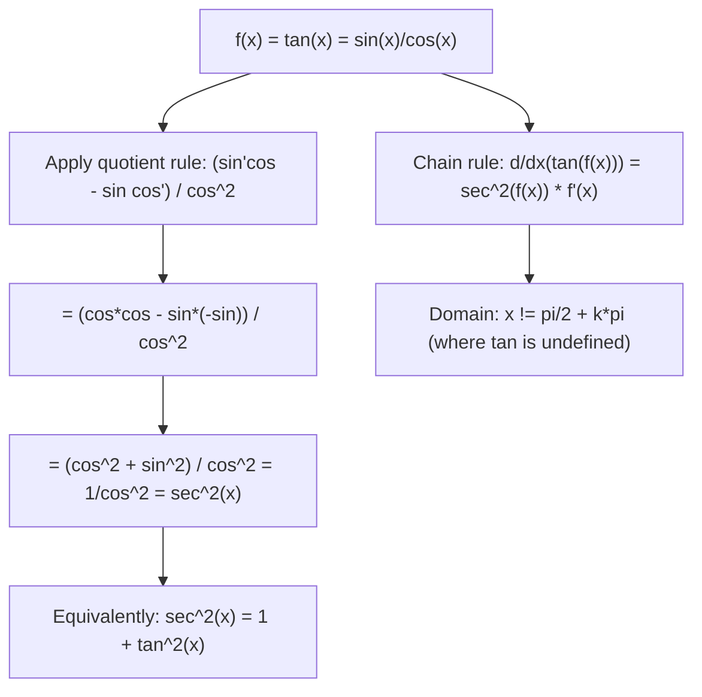

# Tangent

$$
\frac{d}{dx}(\tan x) = \sec^2 x
$$

## Deep Breakdown

What it tells me *(Situation Awareness)*:
The derivative of tangent is $\sec^2 x = 1/\cos^2 x$. This can equivalently be written as $1 + \tan^2 x$ (using the Pythagorean identity). $\sec^2 x \ge 1$ always, reflecting that tan is always strictly increasing. In DA/DS: $\tan$ and its inverse $\arctan$ appear in normalization layers, attention mechanisms, and activation function design. The derivative $d/dx(\arctan x) = 1/(1+x^2)$ (the inverse of $d/dx(\tan x) = \sec^2 x$) is used in computing gradients through Mish and similar activations, and in differentiating soft-max-pooling approximations. The identity $d/dx(\tan x) = 1 + \tan^2 x$ appears in ODE-based methods (e.g., continuous normalizing flows with tan-based coupling layers).

## Flowchart



## Real-world use

### Where it is used

Differentiating $\arctan$ (which appears in Mish activation function, soft-clamping, angle-based features); proving the derivative of $\arctan x = 1/(1+x^2)$ via implicit differentiation; computing gradients through tan-based coupling layers in normalizing flows; computing the Jacobian of angle-related feature transforms in robotics and sensor fusion.

### Problem it solves

Any model using $\tan$ or its inverse $\arctan$ in feature transformations or activations requires this derivative for gradient computation.

### How it solves the problem

Using the quotient rule on $\tan x = \sin x / \cos x$: $d/dx(\sin x / \cos x) = (\cos x \cdot \cos x - \sin x \cdot (-\sin x))/\cos^2 x = (\cos^2 x + \sin^2 x)/\cos^2 x = 1/\cos^2 x = \sec^2 x$.

### Example in a business

A DS uses $\arctan$-based feature scaling: $\phi(x) = \arctan(x/a)$ maps any real input to $(-\pi/2, \pi/2)$. The gradient: $d\phi/dx = 1/(1 + (x/a)^2) \cdot (1/a) = a/(a^2 + x^2)$. This uses the derivative of $\arctan$, which is derived from $d/dx(\tan x) = \sec^2 x$ via the inverse function theorem.

## The formula, piece by piece

- $\tan x = \sin x / \cos x$: defined for $x \ne \pi/2 + k\pi$
- $\sec x = 1/\cos x$: secant; so $\sec^2 x = 1/\cos^2 x$
- $\sec^2 x \ge 1$: always positive (tangent is always strictly increasing where defined)
- Alternate form: $\sec^2 x = 1 + \tan^2 x$ (from $\sin^2 + \cos^2 = 1$, divide by $\cos^2$)
- Chain rule: $d/dx(\tan f(x)) = \sec^2(f(x)) \cdot f'(x)$
- Inverse: $d/dx(\arctan x) = 1/(1+x^2)$ — derived from $d/dx(\tan x) = \sec^2 x$ via inverse function theorem: $d/dx(f^{-1}(x)) = 1/f'(f^{-1}(x)) = 1/\sec^2(\arctan x) = 1/(1 + x^2)$

## The formula in words

"The slope of the tangent function at any point is the squared secant — always at least 1, and growing rapidly near the vertical asymptotes at $\pm\pi/2$. Tangent has no flat regions; it always strictly increases." Tiny examples:
$d/dx(\tan x)|_{x=0} = \sec^2(0) = 1/1 = 1$.
$d/dx(\tan(2x)) = 2\sec^2(2x)$.
$d/dx(\arctan x)|_{x=0} = 1/(1+0) = 1$.
$d/dx(\arctan x)|_{x=1} = 1/(1+1) = 0.5$.

## Critical Concepts

- **Pythagorean identity in derivative form:** $\sec^2 x = 1 + \tan^2 x$. This ODE form $y' = 1 + y^2$ with $y = \tan x$ shows tan blows up in finite time — relevant when using tan-based activations (they can cause gradient explosion if inputs near $\pm\pi/2$).
- **$\arctan$ derivative connection:** $d/dx(\arctan x) = 1/(1+x^2)$. This is the probability density function (PDF) shape of the standard Cauchy distribution! Also the soft-clamping gradient for bounded regression outputs.
- **Gradient of $\arctan$ in attention:** soft angle-based attention: $\alpha(x) = \arctan(x)$; $d\alpha/dx = 1/(1+x^2)$; bounded gradient, no exploding gradient issue.
- **Integration:** $\int \sec^2 x \, dx = \tan x + C$ — tan is the antiderivative of $\sec^2$.

## Step-by-step calculation (tiny example)

*Differentiate $f(x) = \tan(x^2) + \arctan(3x)$.*

*Step 1: First term* — chain rule:
$d/dx(\tan(x^2)) = \sec^2(x^2) \cdot 2x$.

*Step 2: Second term* — $d/dx(\arctan(3x)) = 1/(1+(3x)^2) \cdot 3 = 3/(1+9x^2)$.

*Step 3: Combine*:
$f'(x) = 2x\sec^2(x^2) + 3/(1+9x^2)$.

## Code examples

### Beginner example (Python)

```python
import numpy as np

def tan_deriv(x: float) -> float:
    """d/dx(tan(x)) = sec^2(x) = 1/cos^2(x)."""
    return 1 / np.cos(x)**2

def arctan_deriv(x: float) -> float:
    """d/dx(arctan(x)) = 1/(1+x^2). Inverse of d/dx(tan)=sec^2."""
    return 1 / (1 + x**2)


# Verify numerically
x_vals = np.linspace(-1.2, 1.2, 7)   # avoid pi/2 singularity
h = 1e-7
print("d/dx(tan(x)) = sec^2(x) verification")
print(f"{'x':>8} {'sec^2(x)':>10} {'numerical':>12} {'match':>7}")
for x in x_vals:
    analytic = tan_deriv(x)
    numerical = (np.tan(x + h) - np.tan(x - h)) / (2 * h)
    match = abs(analytic - numerical) < 1e-4
    print(f"{x:>8.3f} {analytic:>10.5f} {numerical:>12.5f} {str(match):>7}")

print("\nd/dx(arctan(x)) = 1/(1+x^2) verification")
x_wide = np.linspace(-4, 4, 7)
print(f"{'x':>8} {'1/(1+x^2)':>12} {'numerical':>12}")
for x in x_wide:
    analytic = arctan_deriv(x)
    numerical = (np.arctan(x + h) - np.arctan(x - h)) / (2 * h)
    print(f"{x:>8.2f} {analytic:>12.6f} {numerical:>12.6f}")
```

### Beginner example (R)

```r
# d/dx(tan(x)) = sec^2(x) = 1/cos^2(x)
tan_deriv <- function(x) 1 / cos(x)^2
arctan_deriv <- function(x) 1 / (1 + x^2)
x_vals <- seq(-1.2, 1.2, length.out = 7)
h <- 1e-7
cat(sprintf("%-8s %-10s %-12s\n", "x", "sec^2(x)", "numerical"))
for (x in x_vals) {
  analytic <- tan_deriv(x)
  numerical <- (tan(x + h) - tan(x - h)) / (2 * h)
  cat(sprintf("%-8.3f %-10.5f %-12.5f\n", x, analytic, numerical))
}
```

### Professional example (Python)

```python
import numpy as np
from sklearn.datasets import make_regression
from sklearn.preprocessing import StandardScaler
np.random.seed(42)

# -- arctan feature scaling: bounded nonlinear transformation with known gradient
# Use case: bounded regression output feature phi(x) = arctan(x/scale)
# maps unbounded real -> (-pi/2, pi/2); gradient = scale/(scale^2 + x^2)
X_raw, y = make_regression(n_samples=400, n_features=4, noise=5.0, random_state=42)
scaler = StandardScaler()
X = scaler.fit_transform(X_raw)
N, D = X.shape
SCALE = 2.0   # controls sensitivity of arctan feature

def arctan_features(X_in: np.ndarray, scale: float = SCALE) -> np.ndarray:
    """Apply arctan transformation: phi_j(x_j) = arctan(x_j / scale)."""
    return np.arctan(X_in / scale)

def arctan_feature_gradient(X_in: np.ndarray, scale: float = SCALE) -> np.ndarray:
    """Element-wise gradient of the arctan feature.

    d/dx(arctan(x/scale)) = (1/scale) / (1 + (x/scale)^2) = scale / (scale^2 + x^2).
    Uses d/dx(tan(x)) = sec^2(x) via inverse function theorem.
    """
    return scale / (scale**2 + X_in**2)


X_phi = arctan_features(X)
d_phi_dx = arctan_feature_gradient(X)

# Simple linear model on arctan features
w = np.linalg.lstsq(np.hstack([np.ones((N, 1)), X_phi]), y, rcond=None)[0]
bias, weights = w[0], w[1:]
y_pred = bias + X_phi @ weights
mse = np.mean((y - y_pred)**2)
print("arctan Feature Scaling: d/dx(arctan)=1/(1+x^2) gradient")
print(f"\narctan transforms inputs to range: ({np.arctan(-1e9):.3f}, {np.arctan(1e9):.3f}) radians")
print(f"Feature magnitude stats:")
print(f" Raw X: mean={X.mean():.3f}, std={X.std():.3f}, range=[{X.min():.1f}, {X.max():.1f}]")
print(f" arctan phi: mean={X_phi.mean():.3f}, std={X_phi.std():.3f}, range=[{X_phi.min():.2f}, {X_phi.max():.2f}]")
print(f"\nLinear model on arctan features MSE: {mse:.4f}")
print(f"\nGradient stats d_phi/dx:")
print(f" min={d_phi_dx.min():.4f}, max={d_phi_dx.max():.4f}")
print(f" At x=0: gradient = {SCALE/(SCALE**2 + 0**2):.4f} = 1/scale = {1/SCALE:.4f}")
print(f" At x=+/-scale: gradient = {SCALE/(SCALE**2 + SCALE**2):.4f} = 0.5/scale")
print(f"\nKey: d/dx(arctan(x/scale)) uses d/dx(tan(x)) = sec^2(x) via inverse function theorem")
```

---

*Source: 1300 p. 221*
