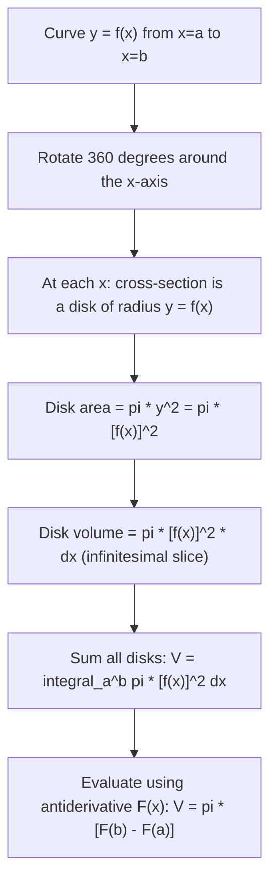

# Volume of solid of revolution (x-axis)

$$
V = \int_a^b \pi y^2\,dx
$$

## Deep Breakdown

What it tells me *(Situation Awareness)*:
When you rotate a curve $y = f(x) \geq 0$ around the x-axis through 360°, you sweep out a 3D solid. At each $x$-value, the cross-section is a disk of radius $y = f(x)$ and area $\pi y^2$. Stacking infinitely many such disks along the x-axis and summing their volumes gives $V = \int_a^b \pi [f(x)]^2\,dx$ — the "disk method." In DA/DS, this formula is rarely applied directly, but the geometric and probabilistic intuition it provides is essential. The disk method is the geometric interpretation of why the chi-squared distribution involves $x^2$ (each squared normal is a "radius" contribution to a sphere-like region). More concretely, it appears in: computing the normalizing constant of the multivariate normal distribution via solid of revolution in polar/spherical coordinates, visualizing how bell curves generate 3D probability masses, and in 3D data visualization tasks (e.g., building a rotational surface from a cross-sectional profile in scientific computing or visualization pipelines).

## Flowchart



## Real-world use

### Where it is used

Classical geometry: computing volumes of cones, spheres, paraboloids, and ellipsoids via the disk method. Scientific computing: generating 3D surfaces of revolution from 1D profiles (manufacturing, engineering simulations). Statistical insight: the chi-squared distribution's moment generating function involves Gaussian integrals over spherical shells, which are solid of revolution integrals in disguise. Visualization: 3D plots of rotated statistical curves (normal PDF revolved around its axis) to illustrate probability mass geometrically.

### Problem it solves

Computing the exact volume of an irregular 3D solid that can be described as a surface of revolution. Without integration, you are limited to geometric formulas that only apply to standard shapes (cylinders, cones, spheres). The disk method generalizes volume computation to any curve.

### How it solves the problem

At each $x$, the solid's cross-section is a disk with radius $y = f(x)$ and area $\pi y^2$. A thin slice of thickness $dx$ has volume $\pi [f(x)]^2\,dx$. Summing all slices via the integral gives the exact volume. The $\pi$ comes from the area formula for a circle ($A = \pi r^2$).

### Example in a business

A 3D data visualization engineer needs to render a "bell-shaped" container whose cross-section matches a Gaussian profile $f(x) = e^{-x^2/2}$ for $x \in [-3, 3]$. The volume of this container is $V = \pi\int_{-3}^{3} e^{-x^2}\,dx$. This involves the Gaussian integral $\int_{-\infty}^{\infty} e^{-x^2}\,dx = \sqrt{\pi}$, giving $V \approx \pi \cdot \sqrt{\pi} = \pi^{3/2}$ (for the infinite range). The exact volume for $[-3, 3]$ requires numerical integration, computed with `scipy.integrate.quad`.

## The formula, piece by piece

$$
V = \int_a^b \pi y^2\,dx = \pi\int_a^b [f(x)]^2\,dx
$$

Each symbol:
- $V$: the resulting volume (cubic units)
- $\int_a^b$: integrate along the x-axis from $a$ to $b$
- $\pi$: from the area of a circle ($A = \pi r^2$); constant, pulls out of the integral
- $y^2 = [f(x)]^2$: the squared radius of the circular cross-section at position $x$
- $dx$: the infinitesimal thickness of each disk slice **Washer method** (when there is a hole, inner radius $g(x)$, outer radius $f(x)$):

$$
V = \pi\int_a^b \left([f(x)]^2 - [g(x)]^2\right)dx
$$

**Shell method** (rotating around the y-axis instead, for $y$-axis revolution see the companion file):

$$
V = 2\pi\int_a^b x\,f(x)\,dx
$$

## The formula in words

"Imagine the curve $y = f(x)$ as the radius of a coin at each $x$-position. Stack infinitely many coins of radius $f(x)$ and thickness $dx$ along the x-axis. Each coin has volume $\pi [f(x)]^2\,dx$. Add all coins from $x = a$ to $x = b$: that sum is the volume of the 3D solid."

## Critical Concepts

- **Disk method**: only valid when the curve is non-negative ($y = f(x) \geq 0$) and there is no hole. For a hole, use the washer method.
- **Washer method**: $V = \pi\int_a^b ([f(x)]^2 - [g(x)]^2)\,dx$ where $f(x) \geq g(x) \geq 0$.
- **Shell method alternative**: for revolution around the y-axis, use $V = 2\pi\int_a^b x f(x)\,dx$. Sometimes easier depending on the region.
- **Sphere check**: revolving $y = \sqrt{r^2 - x^2}$ (upper semicircle) from $-r$ to $r$ around x-axis gives $V = \pi\int_{-r}^{r}(r^2 - x^2)\,dx = \frac{4}{3}\pi r^3$ ✓
- **Cone check**: revolving $y = \frac{r}{h}x$ from $0$ to $h$ gives $V = \pi\int_0^h \frac{r^2}{h^2}x^2\,dx = \frac{1}{3}\pi r^2 h$ ✓
- **DA/DS analogy**: the volume under a bivariate normal surface (rotating the 1D Gaussian around its axis) yields $\pi\int_{-\infty}^{\infty} e^{-x^2}\,dx = \pi^{3/2}$ — the same geometric structure as the normalizing constant of the multivariate normal.

## Step-by-step calculation (tiny example)

Compute the volume of the solid formed by revolving $y = \sqrt{x}$ from $x = 0$ to $x = 4$ around the x-axis.

*Step 1: Identify $f(x)$ and set up the integral*
$f(x) = \sqrt{x}$, so $[f(x)]^2 = x$.

$$
V = \pi\int_0^4 x\,dx
$$

*Step 2: Antiderivative*
$\int x\,dx = \frac{x^2}{2}$

*Step 3: Apply FTC*

$$
V = \pi\left[\frac{x^2}{2}\right]_0^4 = \pi\left(\frac{16}{2} - 0\right) = 8\pi \approx 25.13
$$

The solid (a paraboloid of revolution) has volume $8\pi \approx 25.13$ cubic units.

## Code examples

### Beginner example (Python)

```python
import numpy as np
from scipy import integrate


def f(x: float) -> float:
    """Curve to revolve: y = sqrt(x)."""
    return np.sqrt(x)


def disk_integrand(x: float) -> float:
    """Disk area at x: pi * [f(x)]^2 = pi * x."""
    return np.pi * f(x)**2


# Numerical integration
volume_numerical, error = integrate.quad(disk_integrand, 0, 4)

# Analytic: V = pi * integral_0^4 x dx = pi * [x^2/2]_0^4 = 8*pi
volume_analytic = 8 * np.pi
print(f"Volume (disk method, numerical): {volume_numerical:.6f}")
print(f"Volume (disk method, analytic): {volume_analytic:.6f}")
print(f"8*pi = {8 * np.pi:.6f}")
print(f"Match: {abs(volume_numerical - volume_analytic) < 1e-8}")

# Riemann disk sum (visual intuition)
N = 10_000
x_vals = np.linspace(0, 4, N)
dx = 4.0 / (N - 1)
disk_areas = np.pi * f(x_vals)**2
volume_riemann = float(np.sum(disk_areas) * dx)
print(f"\nRiemann disk sum (N={N}): {volume_riemann:.6f}")

# Sphere verification: revolve y = sqrt(r^2 - x^2) from -r to r
R = 3.0
volume_sphere_numerical, _ = integrate.quad(lambda x: np.pi * (R**2 - x**2), -R, R)
volume_sphere_analytic = (4.0 / 3.0) * np.pi * R**3
print(f"\nSphere (r={R}): numerical = {volume_sphere_numerical:.4f}, "
      f"analytic = {volume_sphere_analytic:.4f}")
```

### Beginner example (R)

```r
# Volume of solid of revolution: y = sqrt(x), x in [0, 4], around x-axis
f <- function(x) sqrt(x)
disk_integrand <- function(x) pi * f(x)^2  # pi * x

# Numerical integration
result <- integrate(disk_integrand, lower = 0, upper = 4)
cat("Volume (numerical):", result$value, "\n")  # ~25.1327
cat("8*pi = ", 8 * pi, "\n")  # ~25.1327

# Sphere verification: y = sqrt(r^2 - x^2)
r <- 3
vol_sphere <- integrate(function(x) pi * (r^2 - x^2), -r, r)$value
cat("Sphere volume (numerical):", vol_sphere, "\n")
cat("Sphere volume (4/3*pi*r^3):", (4/3) * pi * r^3, "\n")
```

### Professional example (Python)

```python
"""
Gaussian solid of revolution as intuition for multivariate normal normalizing constant.

The univariate standard normal PDF is:
    f(x) = (1/sqrt(2*pi)) * exp(-x^2/2).
Revolving f(x) around the x-axis generates a 3D solid.

    Volume = pi * integral_{-inf}^{inf} [f(x)]^2 dx
           = pi * (1/(2*pi)) * integral_{-inf}^{inf} exp(-x^2) dx
           = pi * (1/(2*pi)) * sqrt(pi)
           = sqrt(pi) / 2

This connects to the Gaussian integral: integral exp(-x^2) dx = sqrt(pi),
which underlies the bivariate normal normalizing constant.

We compute this numerically and compare to the analytic result,
then visualize the solid cross-sections as a matplotlib plot.
"""
import numpy as np
import matplotlib.pyplot as plt
from scipy import integrate


def normal_pdf(x: float, sigma: float = 1.0) -> float:
    """Univariate standard normal PDF."""
    return (1.0 / (sigma * np.sqrt(2 * np.pi))) * np.exp(-0.5 * (x / sigma)**2)


# Volume of Gaussian solid of revolution (improper integral)
SIGMA = 1.0
volume_num, err = integrate.quad(lambda x: np.pi * normal_pdf(x, SIGMA)**2, -np.inf, np.inf)
volume_analytic = np.sqrt(np.pi) / 2  # = pi * (1/(2*pi)) * sqrt(pi)
print("=== Gaussian Solid of Revolution ===")
print(f"f(x) = Normal PDF with sigma={SIGMA}")
print(f"Volume = pi * int_{{-inf}}^{{inf}} [f(x)]^2 dx")
print(f" Numerical: {volume_num:.8f}")
print(f" Analytic: {volume_analytic:.8f} [= sqrt(pi)/2]")
print(f" sqrt(pi)/2: {np.sqrt(np.pi)/2:.8f}")
print(f" Match: {abs(volume_num - volume_analytic) < 1e-8}")
print()

# Gaussian integral connection: int exp(-x^2) dx = sqrt(pi)
gaussian_integral, _ = integrate.quad(lambda x: np.exp(-x**2), -np.inf, np.inf)
print(f"Gaussian integral int exp(-x^2) dx = {gaussian_integral:.6f} (expected: sqrt(pi) = {np.sqrt(np.pi):.6f})")
print()

# Visualization: disk cross-sections
x_plot = np.linspace(-3, 3, 300)
y_plot = normal_pdf(x_plot, SIGMA)
fig, axes = plt.subplots(1, 2, figsize=(12, 4))

# Left: the curve being revolved
axes[0].plot(x_plot, y_plot, "b-", linewidth=2, label="Normal PDF")
axes[0].fill_between(x_plot, 0, y_plot, alpha=0.2, color="blue")
axes[0].set_title("Curve to revolve: Normal PDF", fontsize=11)
axes[0].set_xlabel("x")
axes[0].set_ylabel("y = f(x)")
axes[0].legend()

# Right: disk areas pi*y^2 vs x (integrand of volume formula)
disk_areas = np.pi * y_plot**2
axes[1].plot(x_plot, disk_areas, "r-", linewidth=2)
axes[1].fill_between(x_plot, 0, disk_areas, alpha=0.2, color="red")
axes[1].set_title(f"Disk areas: $\\pi [f(x)]^2$ (integral = volume ≈ {volume_num:.4f})", fontsize=11)
axes[1].set_xlabel("x")
axes[1].set_ylabel("$\\pi [f(x)]^2$")
plt.tight_layout()
plt.savefig("gaussian_solid_of_revolution.png", dpi=120, bbox_inches="tight")
plt.close()
print("Plot saved: gaussian_solid_of_revolution.png")
```

---

*Source: domain knowledge*
