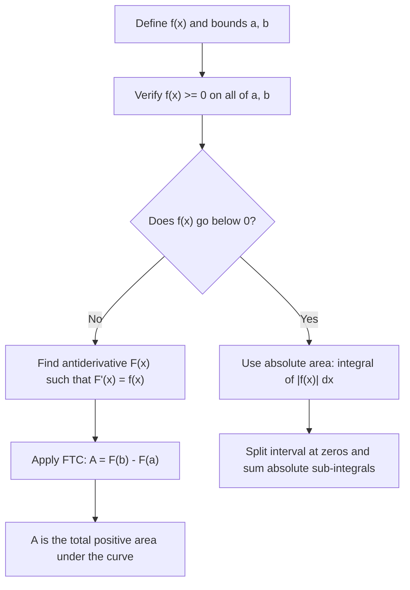

# Area under curve

$$
A = \int_a^b f(x)\,dx
$$

(for $f(x) > 0$)

## Deep Breakdown

What it tells me *(Situation Awareness)*:
The definite integral $\int_a^b f(x)\,dx$ computes the exact area enclosed between the curve $f(x)$ and the x-axis from $x = a$ to $x = b$, provided $f(x) \geq 0$ throughout. It is the limit of summing infinitely many thin rectangle strips of height $f(x_i)$ and width $\Delta x$ as $\Delta x \to 0$ (Riemann sum). The result is a single signed number: positive when $f \geq 0$, negative when $f < 0$, and a mix otherwise. In DA/DS, this appears whenever you need total accumulation over a continuous range: the probability that a random variable falls between two values (area under its PDF), the AUC of an ROC curve, total revenue over a time window, or the expected value of a continuous variable. Mastering this formula is the bridge from derivative calculus to probability, statistics, and the mathematics of expectations.

## Flowchart



## Real-world use

### Where it is used

Whenever a DA/DS problem requires the total amount accumulated over a continuous range. The most common cases are: computing probabilities from probability density functions (PDFs), calculating the Area Under the ROC Curve (AUC-ROC) for classifier evaluation, computing expected values ($E[X] = \int x\,f_X(x)\,dx$), and measuring cumulative KPIs (total sessions between two dates modeled as a continuous rate function).

### Problem it solves

Given a rate, density, or height function $f(x)$, we need a single number summarizing the total accumulation from $a$ to $b$. Discrete summation is limited by the number of data points; the definite integral gives the exact theoretical answer for any continuous function.

### How it solves the problem

By the Fundamental Theorem of Calculus (FTC): find any antiderivative $F$ (a function whose derivative is $f$), then $A = F(b) - F(a)$. This converts an infinite sum of infinitely thin strips into a two-step evaluation. The constant of integration $C$ cancels: $(F(b) + C) - (F(a) + C) = F(b) - F(a)$.

### Example in a business

A fraud detection model outputs predicted probabilities. The ROC curve plots True Positive Rate (TPR) vs. False Positive Rate (FPR) across all thresholds. The AUC-ROC is literally $\int_0^1 \text{TPR}(\text{FPR})\,d(\text{FPR})$: the area under the ROC curve. A random model gives AUC = 0.5 (area under the diagonal); a perfect model gives AUC = 1.0. `sklearn.metrics.roc_auc_score` computes this via the trapezoidal rule, which is a numerical approximation of the definite integral.

## The formula, piece by piece

$$
A = \int_a^b f(x)\,dx
$$

Each symbol:
- $A$: the resulting area, a real number (positive if $f \geq 0$ throughout)
- $\int$: the integral sign, an elongated "S" for "sum"
- $a$: lower limit of integration — where counting starts on the x-axis
- $b$: upper limit of integration — where counting ends ($b > a$)
- $f(x)$: the integrand, the height of the curve at position $x$
- $dx$: the infinitesimal width of each strip; tells us $x$ is the variable of integration Assembled: "The sum of infinitely many strips of height $f(x)$ and infinitesimal width $dx$, evaluated from $x = a$ to $x = b$, equals $F(b) - F(a)$."

## The formula in words

"Chop the interval $[a, b]$ into $n$ equal slices of width $\Delta x = (b-a)/n$. At each slice, the rectangle has height $f(x_i)$ and area $f(x_i)\Delta x$. Add all rectangles: $\sum_{i=1}^n f(x_i)\Delta x$. Take the limit as $n \to \infty$ (strips become infinitely thin). The result equals $F(b) - F(a)$, where $F$ is any antiderivative of $f$."

## Critical Concepts

- **Fundamental Theorem of Calculus (FTC Part 2)**: $\int_a^b f(x)\,dx = F(b) - F(a)$, where $F'(x) = f(x)$. This is the engine behind every definite integral calculation.
- **The $+C$ cancels**: In the definite integral, any antiderivative works because the constant drops out.
- **Signed area**: If $f(x) < 0$ on part of $[a, b]$, the integral subtracts that area. For total unsigned area, use $\int_a^b |f(x)|\,dx$ (see the "Area absolute" formula).
- **Reversing limits flips sign**: $\int_b^a f(x)\,dx = -\int_a^b f(x)\,dx$.
- **Splitting**: $\int_a^b f\,dx = \int_a^c f\,dx + \int_c^b f\,dx$ for any $c \in [a, b]$.
- **Probability connection**: If $f_X(x)$ is a PDF of a continuous random variable, then $P(a \leq X \leq b) = \int_a^b f_X(x)\,dx$.
- **Numerical methods**: When no closed-form antiderivative exists, use trapezoidal rule, Simpson's rule, or `scipy.integrate.quad`.

## Step-by-step calculation (tiny example)

Compute $A = \int_1^3 x^2\,dx$.

*Step 1: Identify the integrand and bounds*
$f(x) = x^2$, $a = 1$, $b = 3$. Check: $x^2 \geq 0$ everywhere, so this is a true area.

*Step 2: Find the antiderivative*
Power rule for integration: $\int x^n\,dx = \frac{x^{n+1}}{n+1}$.
$F(x) = \frac{x^3}{3}$ (we can ignore $+C$ here, it cancels).

*Step 3: Apply FTC — evaluate at bounds and subtract*
$A = F(3) - F(1) = \frac{3^3}{3} - \frac{1^3}{3} = \frac{27}{3} - \frac{1}{3} = \frac{26}{3} \approx 8.667$

*Step 4: Interpret*
The area of the region bounded by $f(x) = x^2$, the x-axis, $x = 1$, and $x = 3$ is exactly $\frac{26}{3} \approx 8.667$ square units.

## Code examples

### Beginner example (Python)

```python
import numpy as np
from scipy import integrate

def f(x: float) -> float:
    """The curve whose area we want: x^2."""
    return x**2   # Numerical integration via scipy (Gaussian quadrature under the hood)
area_numerical, error_estimate = integrate.quad(f, 1, 3)   # Analytic: F(x) = x^3 / 3 -> F(3) - F(1) = 27/3 - 1/3 = 26/3
area_analytic = 3**3 / 3 - 1**3 / 3   # = 8.6667
print(f"Numerical area (scipy.quad): {area_numerical:.6f}")   # 8.666667
print(f"Analytic area (FTC): {area_analytic:.6f}")   # 8.666667
print(f"Error estimate from quad: {error_estimate:.2e}")   # ~9.6e-14 # Riemann sum approximation (to see the strips idea)
N_STRIPS = 1_000
x_values = np.linspace(1, 3, N_STRIPS + 1)
delta_x = (3 - 1) / N_STRIPS
midpoints = (x_values[:-1] + x_values[1:]) / 2
riemann_sum = float(np.sum(f(midpoints) * delta_x))
print(f"Riemann sum (N={N_STRIPS}): {riemann_sum:.6f}")   # ~8.6667
```

### Beginner example (R)

```r
# Area under x^2 from 1 to 3
f <- function(x) x^2  # Numerical integration
result <- integrate(f, lower = 1, upper = 3)
cat("Numerical area:", result$value, "\n")  # 8.666667
cat("Absolute error:", result$abs.error, "\n")  # very small # Analytic: F(x) = x^3/3
ftc_result <- (3^3 / 3) - (1^3 / 3)
cat("Analytic (FTC):", ftc_result, "\n")  # 8.666667 # Riemann sum illustration
n_strips <- 1000L
x_left <- seq(1, 3, length.out = n_strips + 1L)[-(n_strips + 1L)]
delta_x <- (3 - 1) / n_strips
midpoints <- x_left + delta_x / 2
riemann_sum <- sum(f(midpoints) * delta_x)
cat("Riemann sum (N=1000):", riemann_sum, "\n")  # ~8.6667
```

### Professional example (Python)

```python
"""
AUC-ROC as a definite integral. The ROC curve is TPR as a function of FPR across thresholds.
AUC = integral_0^1
TPR(FPR)
d(FPR).
sklearn uses the trapezoidal rule (a numerical definite integral).
We verify that the trapezoidal result matches scipy.integrate.quad
on the interpolated ROC curve.
"""
import numpy as np
from scipy import integrate
from scipy.interpolate import interp1d
from sklearn.datasets import make_classification
from sklearn.linear_model import LogisticRegression
from sklearn.metrics import roc_auc_score, roc_curve
from sklearn.model_selection import train_test_split
RANDOM_SEED = 42   # Reproducible binary classification dataset
x_data, y_data = make_classification( n_samples=2_000, n_features=10, n_informative=6, random_state=RANDOM_SEED,
)
x_train, x_test, y_train, y_test = train_test_split( x_data, y_data, test_size=0.3, random_state=RANDOM_SEED )   # Fit model and get probability scores
model = LogisticRegression(random_state=RANDOM_SEED, max_iter=500)
model.fit(x_train, y_train)
y_scores = model.predict_proba(x_test)[:, 1]   # sklearn AUC (trapezoidal rule on discrete FPR/TPR points)
auc_sklearn = roc_auc_score(y_test, y_scores)   # Build continuous ROC curve and integrate with scipy.quad
fpr_vals, tpr_vals, _ = roc_curve(y_test, y_scores)
# Interpolate TPR as a function of FPR (piecewise linear)
tpr_of_fpr = interp1d(fpr_vals, tpr_vals, kind="linear", bounds_error=False, fill_value=(0.0, 1.0))   # Definite integral: A = int_0^1 TPR(fpr) d(fpr)
auc_quad, integration_error = integrate.quad(tpr_of_fpr, 0.0, 1.0)
print(f"AUC-ROC (sklearn trapz): {auc_sklearn:.6f}")
print(f"AUC-ROC (scipy.quad): {auc_quad:.6f}")
print(f"Difference: {abs(auc_sklearn - auc_quad):.2e}")
# Both should agree to ~4 decimal places (quad is more precise on the interpolant)
# Show what AUC means: probability that a random positive outscores a random negative
# This is the probabilistic interpretation of the area under the ROC curve
print(f"\nInterpretation: P(score_positive > score_negative) ≈ {auc_sklearn:.4f}")
```

---

*Source: domain knowledge*
