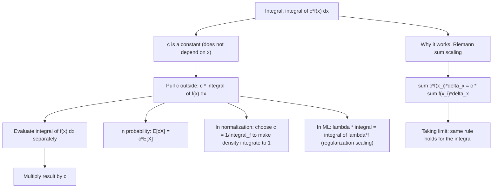

# Constant Multiple

$$
\int c \cdot f(x)\,dx = c \int f(x)\,dx
$$

## Deep Breakdown

What it tells me *(Situation Awareness)*:
The constant multiple rule for integrals says a constant scalar factor can be pulled outside the integral. This is a direct consequence of integration's linearity — specifically, the linearity of the limit of Riemann sums. Scaling every function value by $c$ scales the area by $c$. In DA/DS: this is used constantly and almost invisibly. Normalizing a probability density $f(x)$ to integrate to 1 means choosing $c = 1/\int f$ so that $c\int f(x)\,dx = 1$. Expected value computation $\mathbb{E}[cX] = c\mathbb{E}[X]$ is the continuous-domain constant multiple rule. In numeric integration (quadrature): `c * np.trapz(f_vals, x)` — the constant can be factored before or after the trapezoid sum. In ML: the regularization term $\lambda\|w\|^2$ scaled by $\lambda$ obeys this rule; the learning rate $\alpha$ in gradient descent is a constant factor on the gradient integral (in continuous-time gradient flow).

## Flowchart



## Real-world use

### Where it is used

Expected value linearity: $\mathbb{E}[cX] = c\mathbb{E}[X] = c\int xf(x)dx$; normalizing constant in probability: $p(x) = f(x)/Z$ where $Z = \int f(x)dx$ — computing $Z$ once and applying the constant; scaling loss functions ($L_2$ regularization: $\int \lambda w^2 dw = \lambda\int w^2 dw$); continuous-time gradient flow: $dw/dt = -\alpha\nabla L(w)$, integrating: $\Delta w = -\alpha\int_0^T \nabla L(w)dt$; scaling in Fourier transforms: $\mathcal{F}\{cf\} = c\mathcal{F}\{f\}$; computing cumulative distributions $F(x) = \int_0^x p(t)dt$ when $p$ includes a normalizing constant.

### Problem it solves

Without this rule, you would need to integrate $c \cdot f(x)$ from scratch each time you encounter a scaled function — recomputing the antiderivative entirely. The constant multiple rule lets you separate the "shape" (integral of $f$) from the "scale" ($c$), solving them independently and multiplying at the end.

### How it solves the problem

For any constant $c$ (not depending on $x$): $\int c\cdot f(x)dx = c\int f(x)dx$. Find the antiderivative $F(x)$ of $f(x)$, then the antiderivative of $cf(x)$ is $cF(x) + C$. Proof via differentiation: $d/dx[cF(x)] = c\cdot F'(x) = c\cdot f(x)$. $\checkmark$

### Example in a business

A DS computes the expected revenue per session from a fitted exponential distribution: $f(x) = \lambda e^{-\lambda x}$ for $x \geq 0$. Mean: $\mathbb{E}[X] = \int_0^\infty x \lambda e^{-\lambda x}dx = \lambda\int_0^\infty xe^{-\lambda x}dx$ — the constant $\lambda$ is factored out, then the integral $\int_0^\infty xe^{-\lambda x}dx = 1/\lambda^2$ (by integration by parts). So $\mathbb{E}[X] = \lambda \cdot 1/\lambda^2 = 1/\lambda$. Without the constant multiple rule, the $\lambda$ stays inside and complicates the integration. With it: factor $\lambda$, integrate the simpler $xe^{-\lambda x}$, multiply.

## The formula, piece by piece

- $c$: a constant — any real number that does NOT depend on the variable of integration $x$
- $f(x)$: an integrable function of $x$
- $\int c\cdot f(x)dx$: the integral of the product
- $= c\int f(x)dx$: the constant factors out; compute $\int f(x)dx$ then multiply by $c$
- Definite form: $\int_a^b c\cdot f(x)dx = c\int_a^b f(x)dx$
- Proof: $d/dx[cF(x)+C'] = c\cdot f(x)$ for any antiderivative $F$ of $f$
- Caveat: $c$ must be truly constant with respect to $x$; if $c = c(x)$, this rule does NOT apply (need product rule / integration by parts)
- Combination with addition: $\int[cf(x) + dg(x)]dx = c\int f(x)dx + d\int g(x)dx$ (full linearity of integration)

## The formula in words

"Scaling a function by a constant scales its area by the same constant. You can factor the constant out of the integral, compute the integral of the unscaled function, and then multiply the result by the constant." Tiny trace: $\int 3x^2 dx = 3\int x^2 dx = 3 \cdot x^3/3 + C = x^3 + C$. Verify: $d/dx[x^3] = 3x^2$. $\checkmark$

## Critical Concepts

- **Linearity of integration:** the constant multiple rule is one half of the linearity of the integral (the other half is the sum rule $\int[f+g] = \int f + \int g$). Together they give: $\int[af+bg]dx = a\int f dx + b\int g dx$ — integration is a linear operator, just like matrix-vector multiplication. This linearity is why expected value is linear: $\mathbb{E}[aX+bY] = a\mathbb{E}[X] + b\mathbb{E}[Y]$ for independent or jointly distributed $X, Y$.
- **Normalizing constants in probability:** a PDF must satisfy $\int p(x)dx = 1$. Often we can compute an unnormalized density $\tilde{p}(x) \propto p(x)$ and find the normalizing constant $Z = \int \tilde{p}(x)dx$. Then $p(x) = \tilde{p}(x)/Z$. The constant multiple rule ensures $\int p(x)dx = (1/Z)\int\tilde{p}(x)dx = (1/Z)\cdot Z = 1$. In Bayesian inference, computing $Z = \int p(X|\theta)p(\theta)d\theta$ (the evidence) is often intractable — this is why MCMC and variational inference work with unnormalized densities.
- **Variance formula uses the rule:** $\text{Var}[cX] = c^2\text{Var}[X]$, derived from $\int (cx-c\mu)^2 f(x)dx = c^2\int(x-\mu)^2 f(x)dx = c^2\text{Var}[X]$. The square makes it $c^2$, not $c$. In feature scaling: if you multiply a feature by $c$, the variance scales by $c^2$ and the standard deviation by $|c|$.
- **Numerical integration preserves the rule:** `c * scipy.integrate.quad(f, a, b)` gives the same result as `scipy.integrate.quad(lambda x: c * f(x), a, b)`. This matters for performance when $c$ is large: avoid scaling inside the integrand if possible (reduces floating-point issues and can be factored post-integration).
- **Gradient flow as integral of gradient:** continuous gradient descent solves $dw/dt = -\nabla L(w)$.

The weight update over a time period $[0,T]$ is $w(T) - w(0) = -\int_0^T \nabla L(w(t))dt$. Learning rate $\alpha$ corresponds to time $T = \alpha$ (step size), and the constant multiple rule applies: $\alpha \int_0^1 \nabla L dt = \int_0^1 \alpha\nabla L dt$ — scaling the learning rate is exactly scaling the gradient integral.

## Step-by-step calculation (tiny example)

*Evaluate $\int 5e^{3x}dx$.*

*Step 1: Identify the constant.*
The constant is $c = 5$ (does not depend on $x$). Factor it out: $5\int e^{3x}dx$.

*Step 2: Integrate $e^{3x}$.*
$\int e^{3x}dx = e^{3x}/3 + C$ (chain rule in reverse: $d/dx[e^{3x}/3] = 3e^{3x}/3 = e^{3x}$).

*Step 3: Multiply by the constant.*
$5\int e^{3x}dx = 5\cdot(e^{3x}/3) + C = (5/3)e^{3x} + C$. Verify: $d/dx[(5/3)e^{3x}] = (5/3)\cdot 3e^{3x} = 5e^{3x}$. $\checkmark$

## Code examples

### Beginner example (Python)

```python
import numpy as np
from scipy import integrate

def verify_constant_multiple_rule(f, c: float, a: float, b: float) -> None:
    """Numerically verify: integral(c*f) = c * integral(f) on [a, b].

    Uses scipy.integrate.quad for accurate numerical integration.
    """
    integral_cf, err_cf = integrate.quad(lambda x: c * f(x), a, b)
    integral_f, err_f = integrate.quad(f, a, b)
    c_times_integral = c * integral_f
    match = abs(integral_cf - c_times_integral) < 1e-8
    print(f" integral(c*f): {integral_cf:.8f}")
    print(f" c * integral(f): {c_times_integral:.8f}")
    print(f" Difference: {abs(integral_cf - c_times_integral):.2e} Match: {match}")


print("Constant Multiple Rule: integral(c*f) = c * integral(f)")

# Example 1: 5*e^(3x) from 0 to 1
print("\nf(x) = e^(3x), c = 5, [0, 1]")
print(f"Analytic: 5 * (e^3 - 1)/3 = {5 * (np.exp(3) - 1) / 3:.8f}")
verify_constant_multiple_rule(lambda x: np.exp(3 * x), c=5.0, a=0.0, b=1.0)

# Example 2: probability density normalization
print("\n--- Normalization: p(x) = (1/Z) * unnormalized density ---")
lam = 2.0  # exponential distribution rate
# Unnormalized density: f(x) = e^(-lam*x) on [0, inf)
z, _ = integrate.quad(lambda x: np.exp(-lam * x), 0, np.inf)
print(f"Unnormalized: f(x) = exp(-{lam}x)")
print(f"Normalizing constant Z = {z:.6f} (should be 1/lambda = {1/lam:.6f})")
integral_normalized, _ = integrate.quad(lambda x: (1/z) * np.exp(-lam * x), 0, np.inf)
print(f"integral(p(x)) = (1/Z)*Z = {integral_normalized:.8f} (should be 1.0)")

# Example 3: E[cX] = c*E[X] via numerical integration
print("\n--- E[cX] = c*E[X] ---")
MEAN_TRUE = 1 / lam  # exponential mean = 1/lambda
for c_scale in [0.5, 2.0, 10.0]:
    ex, _ = integrate.quad(lambda x: x * lam * np.exp(-lam * x), 0, 20)
    ecx, _ = integrate.quad(lambda x: c_scale * x * lam * np.exp(-lam * x), 0, 20)
    print(f" c = {c_scale}: E[X] = {ex:.5f}, E[{c_scale}X] = {ecx:.5f} "
          f"(c*E[X] = {c_scale * ex:.5f}) Match: {abs(ecx - c_scale * ex) < 1e-6}")
```

### Beginner example (R)

```r
# Constant Multiple Rule: integral(c*f) = c * integral(f)
verify_constant_multiple <- function(f, c, a, b) {
  int_cf <- integrate(function(x) c * f(x), lower = a, upper = b)$value
  int_f <- integrate(f, lower = a, upper = b)$value
  cat(sprintf(" integral(c*f) = %.8f\n", int_cf))
  cat(sprintf(" c*integral(f) = %.8f\n", c * int_f))
  cat(sprintf(" Difference = %.2e\n\n", abs(int_cf - c * int_f)))
}
cat("Constant Multiple Rule\n\n")

# f(x) = exp(3x), c = 5
cat("f(x) = exp(3x), c=5, [0,1]\n")
analytic <- 5 * (exp(3) - 1) / 3
cat(sprintf("Analytic: %.8f\n", analytic))
verify_constant_multiple(function(x) exp(3 * x), c = 5, a = 0, b = 1)

# Normalization
lam <- 2.0
Z <- integrate(function(x) exp(-lam * x), lower = 0, upper = Inf)$value
cat(sprintf("Normalization: Z = %.6f = 1/lambda = %.6f\n", Z, 1/lam))
int_norm <- integrate(function(x) (1/Z) * exp(-lam * x), lower = 0, upper = Inf)$value
cat(sprintf("integral(p(x)) = %.8f (should be 1)\n\n", int_norm))

# E[cX] = c*E[X]
cat("E[cX] = c*E[X]:\n")
for (c_val in c(0.5, 2, 10)) {
  ex <- integrate(function(x) x * lam * exp(-lam * x), lower = 0, upper = 20)$value
  ecx <- integrate(function(x) c_val * x * lam * exp(-lam * x), lower = 0, upper = 20)$value
  cat(sprintf(" c=%.1f: E[X]=%.5f, E[cX]=%.5f, c*E[X]=%.5f\n", c_val, ex, ecx, c_val * ex))
}
```

### Professional example (Python)

```python
import numpy as np
from scipy import integrate
from sklearn.datasets import make_regression
from sklearn.preprocessing import StandardScaler
np.random.seed(42)

# -- Constant Multiple Rule: gradient flow scaling and variance of scaled features --
# Two connected applications:
# (A) Feature scaling: Var[c*X] = c^2 * Var[X], integral form via constant multiple rule
# Scaling features by c scales variance by c^2 (not c) -- critical for LR selection
# (B) Continuous gradient flow: Delta_w = -alpha * integral(grad L dt)
# The learning rate alpha is a constant factor on the integrated gradient
# Analytic form: for quadratic loss L(w) = (1/2)||Xw-y||^2, gradient = X^T(Xw-y)
# Integral of gradient from 0 to alpha = alpha * grad(w_0) (first-order approx)
N = 200
DIM = 4
X_raw, y = make_regression(n_samples=N, n_features=DIM, noise=0.5, random_state=42)
y = y / y.std()
print("Constant Multiple Rule: Feature Scaling and Gradient Flow")

# Part A: Var[c*X] = c^2 * Var[X]
print("\n--- Part A: Var[c*X] = c^2 * Var[X] (constant multiple rule in variance) ---")
print(f"{'Feature':>10} {'Std(X)':>10} {'c':>6} {'Std(cX)':>10} {'c*Std(X)':>12} {'Match':>8}")
for i in range(DIM):
    feature = X_raw[:, i]
    std_x = feature.std()
    for c in [0.1, 2.0, 10.0]:
        std_cx = (c * feature).std()
        c_std_x = abs(c) * std_x
        match = abs(std_cx - c_std_x) < 1e-8
        print(f" feat[{i}] {std_x:>10.4f} {c:>6.1f} {std_cx:>10.4f} {c_std_x:>12.4f} {str(match):>8}")
    break  # just show first feature

# Part B: Gradient flow integral: Delta_w = -alpha * grad(w_0) + O(alpha^2)
print("\n--- Part B: Learning rate as constant in gradient flow integral ---")
scaler = StandardScaler()
X = scaler.fit_transform(X_raw)
w0 = np.zeros(DIM)
grad0 = X.T @ (X @ w0 - y) / N  # initial gradient
# For quadratic loss: w(T) = exp(-T * X^TX/N) * w0 + (I - exp(-T * X^TX/N)) * w*
# First-order: w(alpha) ≈ w0 - alpha * grad0 (constant multiple rule on gradient integral)
# Verify: numerical vs. analytic first-order approximation
print(f"Initial gradient norm: {np.linalg.norm(grad0):.6f}")
print(f"\n{'alpha':>8} {'|Delta_w| analytic':>20} {'|Delta_w| exact (GD1)':>22} {'Match':>8}")
for alpha in [0.001, 0.01, 0.05, 0.1, 0.5]:
    # First-order (constant multiple rule): Delta_w ≈ -alpha * grad0
    dw_analytic = alpha * np.linalg.norm(grad0)
    # Exact one-step gradient descent
    w1 = w0 - alpha * grad0
    dw_exact = np.linalg.norm(w1 - w0)
    # They should match (they are identical: dw_exact = alpha * ||grad0||)
    match = abs(dw_analytic - dw_exact) < 1e-10
    print(f"{alpha:>8.3f} {dw_analytic:>20.8f} {dw_exact:>22.8f} {str(match):>8}")
print(f"\nConclusion: gradient descent step = alpha * gradient is the constant multiple")
print(f"rule: scaling the gradient by alpha is equivalent to factoring alpha outside")
print(f"the integral of the gradient flow over step size alpha.")
```

---

*Source: 1300 p. 235*
