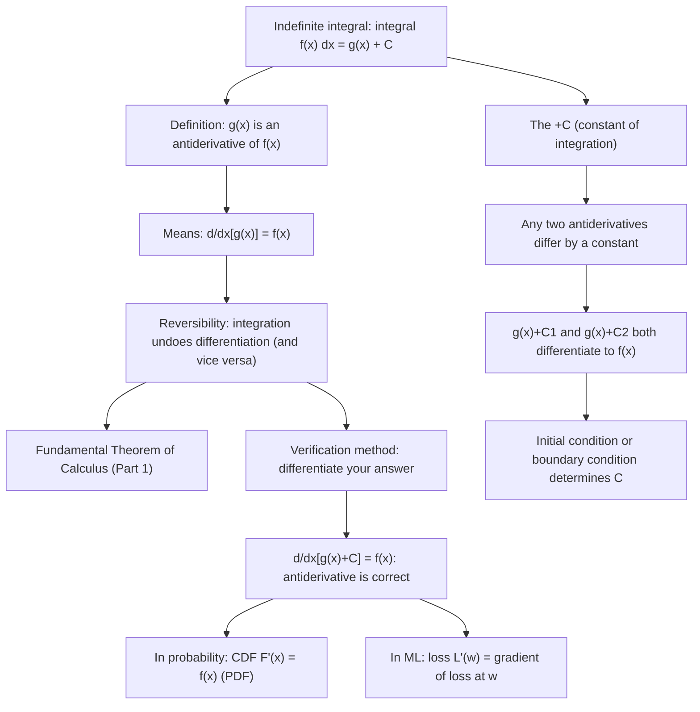

# Reversibility

$$
\int f(x)\,dx = g(x) + C \iff \frac{d}{dx}[g(x)+C] = f(x)
$$

## Deep Breakdown

What it tells me *(Situation Awareness)*:
This is the Fundamental Theorem of Calculus, Part 1 — but stated as the definition of the indefinite integral via antidifferentiation. It says: integration and differentiation are inverse operations. If you integrate $f(x)$ and get $g(x) + C$, then differentiating $g(x)+C$ returns $f(x)$. The "$+C$" (constant of integration) captures the fact that the antiderivative is not unique: any constant shifts a function without changing its derivative. This bidirectional implication is the foundation of the entire integration toolkit — every integral formula in the table is verifiable by differentiating the result. In DS/DA: verifying a computed antiderivative is always done by differentiating the answer. In numerical ML: the relationship between a loss function and its gradient is exactly this: $L = \int(\text{gradient output})$ — knowing the gradient fully determines the loss up to a constant. In probability: the CDF $F(x) = \int_{-\infty}^x f(t)dt$ satisfies $F'(x) = f(x)$ — the reversibility property is why the PDF is the derivative of the CDF.

## Flowchart



## Real-world use

### Where it is used

Verifying any antiderivative: differentiate $g(x)+C$ and check you get $f(x)$; CDF-PDF relationship: $F'(x) = f(x)$, used to compute probabilities from density; ODE solving: $dx/dt = f(t) \Rightarrow x(t) = \int f(t)dt + C$, with initial condition $x(0) = x_0$ fixing $C$; gradient-loss correspondence: $\nabla L(w) = f(w)$ means $L(w) = \int f(w)dw + C$ (potential function); gradient checking in neural networks: compare $\nabla L$ (analytic) against $[L(w+h)-L(w-h)]/(2h)$ — the reversibility test; cumulative distribution function $F(x) = \int_0^x \lambda e^{-\lambda t}dt = 1 - e^{-\lambda x}$, verified by $F'(x) = \lambda e^{-\lambda x} = f(x)$.

### Problem it solves

Integration is defined as "finding the function whose derivative is $f$." Without the reversibility property, there would be no systematic way to check integration answers or to translate between cumulative and marginal quantities (CDF/PDF, position/velocity, total loss/gradient).

### How it solves the problem

The definition makes verification trivial: to check if $g(x)$ is the antiderivative of $f(x)$, just differentiate $g(x)$ and confirm you get $f(x)$. This is why integration tables work: each entry is verified once by differentiation, then used forever. The constant $C$ is determined by additional information (boundary/initial condition).

### Example in a business

A DS is given the marginal revenue function $MR(q) = 100 - 2q$ (additional revenue from each unit sold) and needs the total revenue $TR(q)$. Integration: $TR(q) = \int(100-2q)dq = 100q - q^2 + C$. Reversibility check: $d/dx[100q - q^2 + C] = 100 - 2q = MR(q)$. $\checkmark$ Boundary condition: $TR(0) = 0$ (no revenue at zero sales) $\Rightarrow C = 0$. So $TR(q) = 100q - q^2$.

## The formula, piece by piece

- $\int f(x)dx$: the indefinite integral of $f(x)$ with respect to $x$ — the set of all antiderivatives
- $= g(x) + C$: the general antiderivative, where $g$ is any specific antiderivative and $C$ is an arbitrary constant
- $C$: constant of integration — encodes the non-uniqueness of antiderivatives; $d/dx[C] = 0$
- $\iff$: if and only if — the statement is bidirectional (reversibility)
- $d/dx[g(x)+C] = f(x)$: differentiating the antiderivative returns the original function
- Fundamental Theorem of Calculus (Part 1): $d/dx\int_a^x f(t)dt = f(x)$ — differentiation of a definite integral with variable upper limit
- Fundamental Theorem of Calculus (Part 2): $\int_a^b f(x)dx = g(b) - g(a)$ where $g' = f$ — evaluating definite integrals via antiderivatives
- Family of antiderivatives: $g_1(x)$ and $g_2(x)$ are both antiderivatives of $f(x) \Leftrightarrow g_1(x) - g_2(x) = \text{const}$

## The formula in words

"Integration means finding a function whose derivative is the given function. The answer is unique up to a constant — any constant vanishes under differentiation. To verify an integral, differentiate the result: if you get back the original function, the integral is correct." Tiny trace: Claim $\int 2x\,dx = x^2 + C$. Verify: $d/dx[x^2+C] = 2x$. $\checkmark$ Alternatively: $d/dx[x^2 + 5] = 2x$ — same verification holds for any $C$.

## Critical Concepts

- **The constant $C$ matters for ODEs and probability.** In a differential equation $dx/dt = v(t)$, integrating gives $x(t) = \int v(t)dt + C$, with $C$ determined by the initial position $x(0) = x_0$. Without $C$, you are asserting $x(0) = 0$, which is wrong in general. In probability: $F(x) = \int_{-\infty}^x f(t)dt$ — the lower limit $-\infty$ fixes $C = 0$ (since $F(-\infty) = 0$).
- **Gradient checking uses reversibility.** Neural network gradient checking computes the analytic gradient $\nabla L(w)$ via backpropagation, then verifies it against a numerical finite difference $[L(w+h\mathbf{e}_i) - L(w-h\mathbf{e}_i)]/(2h)$ for each parameter $w_i$. This is the reversibility test: if $L$ is the antiderivative of $\nabla L$, then the finite difference approximation of $L'$ should match $\nabla L$.
- **Uniqueness up to a constant.** All antiderivatives of $f$ on an interval differ by a constant. This is a corollary of the mean value theorem: if $G_1' = G_2' = f$, then $(G_1 - G_2)' = 0$, so $G_1 - G_2 = C$ on any connected interval. This matters in practice: `scipy.integrate.cumtrapz` starts from 0 (one particular choice of $C$); shift by $x_0$ to satisfy initial conditions.
- **CDF-PDF reversibility is foundational.** In statistics: PDF $f(x) = d/dx[F(x)]$ and CDF $F(x) = \int_{-\infty}^x f(t)dt$. This reversibility means: (a) computing probabilities $P(a < X < b) = F(b) - F(a) = \int_a^b f(x)dx$ (FTC Part 2); (b) transforming distributions via the change-of-variables formula $f_Y(y) = f_X(h^{-1}(y))\cdot|dh^{-1}/dy|$ — both sides are related by the reversibility of differentiation and integration.
- **Numerical antiderivatives via cumulative sum.** `np.cumsum(f_vals * dx)` is the discrete antiderivative of `f_vals`.

The reversibility check: `np.diff(np.cumsum(f_vals * dx)) / dx ≈ f_vals[:-1]` — differencing the cumulative sum recovers the original function (up to numerical errors). This is how survival functions and empirical CDFs are computed from empirical PDFs.

## Step-by-step calculation (tiny example)

*Compute $\int(3x^2 + 2x - 5)dx$ and verify by reversibility.*

*Step 1: Integrate term by term.*
$\int 3x^2 dx + \int 2x dx + \int(-5)dx = 3\cdot x^3/3 + 2\cdot x^2/2 - 5x + C = x^3 + x^2 - 5x + C$.

*Step 2: Verify by differentiation (reversibility).*
$d/dx[x^3 + x^2 - 5x + C] = 3x^2 + 2x - 5$. This matches the integrand. $\checkmark$

*Step 3: Determine $C$ from a boundary condition.*
If the total quantity is 4 at $x=1$: $f(1) = 1 + 1 - 5 + C = -3 + C = 4 \Rightarrow C = 7$.
Particular antiderivative: $g(x) = x^3 + x^2 - 5x + 7$.

## Code examples

### Beginner example (Python)

```python
import numpy as np
from scipy import integrate

def verify_antiderivative(g, f, x_test_points: list[float], tol: float = 1e-6) -> None:
    """ Reversibility check: verify integral g(x)+C by differentiating. Uses central finite difference to compute d/dx[g(x)]. """
    h = 1e-7
    print(f" {'x':>8} {'f(x)':>12} {'d/dx[g(x)]':>14} {'Match':>8}")
    all_match = True
    for x in x_test_points:
        dg_dx = (g(x + h) - g(x - h)) / (2 * h)
    fx = f(x)
    match = abs(dg_dx - fx) < tol
    all_match = all_match and match
    print(f" {x:>8.2f} {fx:>12.6f} {dg_dx:>14.6f} {str(match):>8}")
    print(f" All match (reversibility verified): {all_match}")
    print("Reversibility: integral f(x) dx = g(x) + C <=> d/dx[g(x)+C] = f(x)")   # Example 1: integral of 3x^2 + 2x - 5
f = lambda x: 3*x**2 + 2*x - 5
g = lambda x: x**3 + x**2 - 5*x   # antiderivative (C=0)
print("\nf(x) = 3x^2 + 2x - 5, g(x) = x^3 + x^2 - 5x")
verify_antiderivative(g, f, [-2.0, 0.0, 1.5, 3.0])   # CDF-PDF reversibility
print("\n--- CDF-PDF reversibility: F'(x) = f(x) ---")
lam = 2.0
pdf_exp = lambda x: lam * np.exp(-lam * x)   # f(x) = lambda * e^(-lam*x)
cdf_exp = lambda x: 1.0 - np.exp(-lam * x)   # F(x) = 1 - e^(-lam*x)
print("Exponential distribution: f(x) = lambda*exp(-lam*x), F(x) = 1 - exp(-lam*x)")
verify_antiderivative(cdf_exp, pdf_exp, [0.1, 0.5, 1.0, 2.0])   # Numerical antiderivative: cumsum as discrete integration
print("\n--- Numerical antiderivative: np.cumsum as discrete integral ---")
x_arr = np.linspace(0, 2 * np.pi, 500)
dx = x_arr[1] - x_arr[0]
f_sin = np.sin(x_arr)
g_cos = -np.cos(x_arr)   # analytic antiderivative (C=0) # Numerical antiderivative via cumsum
g_numerical = np.concatenate([[0.0], np.cumsum(f_sin[:-1] * dx)])
# Shift to match boundary condition g(0) = -cos(0) = -1
g_numerical += g_cos[0] - g_numerical[0]
print(f"Max error (cumsum vs analytic -cos(x)): {np.max(np.abs(g_numerical - g_cos)):.6f}")
print(f"Reversibility: diff(g_numerical)/dx ≈ f_sin")
residual = np.abs(np.diff(g_numerical) / dx - f_sin[:-1])
print(f"Max diff error: {residual.max():.6f}")
```

### Beginner example (R)

```r
# Reversibility: integral f
dx = g + C <=> d/dx[g] = f
verify_antiderivative <- function(g, f, x_points, h = 1e-7) { cat(sprintf(" %-8s %-12s %-14s %-8s\n", "x", "f(x)", "d/dx[g(x)]", "Match"))
  for (x in x_points) { dg_dx <- (g(x + h) - g(x - h)) / (2 * h)
    fx <- f(x)
    match <- abs(dg_dx - fx) < 1e-6
    cat(sprintf(" %-8.2f %-12.6f %-14.6f %-8s\n", x, fx, dg_dx, as.character(match)))
  }
}  # f(x) = 3x^2 + 2x - 5, antiderivative g(x) = x^3 + x^2 - 5x
f <- function(x) 3*x^2 + 2*x - 5
g <- function(x) x^3 + x^2 - 5*x
cat("Reversibility check: d/dx[g(x)] = f(x)\n\n")
verify_antiderivative(g, f, c(-2, 0, 1.5, 3))  # CDF-PDF reversibility for exponential distribution
cat("\nCDF-PDF reversibility (exponential):\n")
lam <- 2.0
pdf_fn <- function(x) lam * exp(-lam * x)
cdf_fn <- function(x) 1 - exp(-lam * x)
verify_antiderivative(cdf_fn, pdf_fn, c(0.1, 0.5, 1.0, 2.0))
```

### Professional example (Python)

```python
import numpy as np
from sklearn.datasets import make_regression
from sklearn.preprocessing import StandardScaler
np.random.seed(42)   # -- Reversibility: gradient checking as the antiderivative verification test --
# Use case: A DS implements a custom loss function and verifies the gradient
# via gradient checking -- the operationalized version of reversibility.
# The analytic gradient g = dL/dw should satisfy:
# L(w + h*e_i) - L(w - h*e_i) ≈ 2h * g_i (finite difference approximation)
# This is the discrete reversibility check: if L is the antiderivative of
grad(L),
# then (L(w+h) - L(w-h))/(2h) ≈ grad(L)(w) for small h.
N = 150
DIM = 5
X_raw, y = make_regression(n_samples=N, n_features=DIM, noise=1.0, random_state=42)
scaler = StandardScaler()
X = scaler.fit_transform(X_raw)
y = y / y.std()

def huber_loss(w: np.ndarray, X: np.ndarray, y: np.ndarray, delta: float = 1.0) -> float:
    """ Huber loss: quadratic for |r| <= delta, linear for |r| > delta. Robust to outliers; differentiable everywhere (unlike L1). """
    r = y - X @ w
    quadratic = 0.5 * r**2
    linear = delta * (np.abs(r) - 0.5 * delta)
    return float(np.mean(np.where(np.abs(r) <= delta, quadratic, linear)))

def huber_gradient(w: np.ndarray, X: np.ndarray, y: np.ndarray, delta: float = 1.0) -> np.ndarray:
    """Analytic gradient of Huber loss."""
    r = y - X @ w
    mask = (np.abs(r) <= delta).astype(float)   # For |r| <= delta: dL/dw = -X^T r / N (MSE-like) # For |r| > delta: dL/dw = -X^T
    sign(r) * delta / N (MAE-like)
    pseudo_residuals = np.where(np.abs(r) <= delta, r, delta * np.sign(r))
    return -X.T @ pseudo_residuals / len(y)

def numerical_gradient(loss_fn, w: np.ndarray, h: float = 1e-5) -> np.ndarray:
    """ Numerical gradient via central finite differences. This is the reversibility test: (L(w+h) - L(w-h))/(2h) ≈ dL/dw. """
    grad_num = np.zeros_like(w)
    for i in range(len(w)):
        e_i = np.zeros_like(w)
    e_i[i] = 1.0
    grad_num[i] = (loss_fn(w + h * e_i) - loss_fn(w - h * e_i)) / (2 * h)
    return grad_num
w_test = np.random.randn(DIM) * 0.5
loss_fn = lambda w: huber_loss(w, X, y)
grad_analytic = huber_gradient(w_test, X, y)
grad_numerical = numerical_gradient(loss_fn, w_test)   # Relative error between analytic and numerical gradients
rel_error = np.abs(grad_analytic - grad_numerical) / (np.abs(grad_analytic) + np.abs(grad_numerical) + 1e-12)
print("Reversibility: Gradient Checking as Antiderivative Verification")
print(f"\nHuber loss, N={N}, DIM={DIM}, delta=1.0")
print(f"\nReversibility test: d/dw[L(w)] ≈ (L(w+h*e_i) - L(w-h*e_i))/(2h)")
print(f"\n{'Param':>8} {'Analytic grad':>16} {'Numerical grad':>16} {'Rel error':>12} {'Pass':>6}")
all_pass = True
for i in range(DIM):
    passed = rel_error[i] < 1e-4
all_pass = all_pass and passed
print(f"w[{i}]: {grad_analytic[i]:>16.8f} {grad_numerical[i]:>16.8f} {rel_error[i]:>12.2e} {str(passed):>6}")
print(f"\nAll gradient checks passed: {all_pass}")
print(f"Max relative error: {rel_error.max():.2e}")
print(f"\nInterpretation: if analytic gradient = numerical gradient, then L is correctly")
print(f"the antiderivative of the gradient. This IS the reversibility of integration.")
```

---

*Source: 1300 p. 235*
