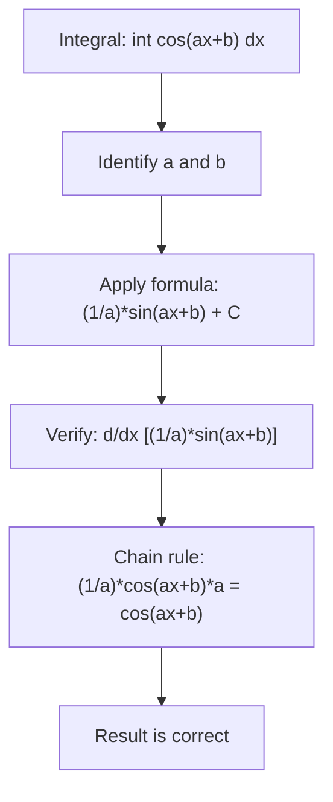

# Cosine

$$
\int \cos(ax+b)\,dx = \frac{1}{a}\sin(ax+b) + C
$$

## Deep Breakdown

What it tells me *(Situation Awareness)*:
The antiderivative of cosine is positive sine, the exact opposite pairing from the sine formula (which gives negative cosine). This is because $\frac{d}{dx}[\sin x] = \cos x$ — no sign change needed. The $1/a$ factor, as always, compensates for the chain rule when the argument is affine $ax+b$. In DA/DS, cosine integrals appear in all the same contexts as sine: Fourier coefficients (specifically the $a_n$ cosine coefficients of a Fourier series), modeling cosine cyclical features in time series, recovering phase information from oscillatory signals, and computing expected values under cosine-modulated distributions.

## Flowchart



## Real-world use

### Where it is used

Fourier series cosine coefficients $a_n = \frac{2}{T}\int_0^T f(t)\cos(n\omega t)\,dt$, cosine cyclical feature engineering in time series models, signal energy computation, deriving the expected value of a distribution with cosine-modulated density, and orthogonality proofs for trigonometric basis functions.

### Problem it solves

Same as the sine rule: provides the exact closed-form antiderivative for an oscillatory function, avoiding numerical integration errors when computing Fourier coefficients or total accumulations over oscillatory signals.

### How it solves the problem

From the derivative cycle: $\frac{d}{dx}[\sin(ax+b)] = \cos(ax+b)\cdot a$, so $\frac{d}{dx}\!\left[\frac{\sin(ax+b)}{a}\right] = \cos(ax+b)$. Therefore $\frac{\sin(ax+b)}{a} + C$ is the antiderivative.

### Example in a business

A sensor network records hourly energy consumption: $E(t) = 400 + 150\cos\!\left(\frac{2\pi t}{24}\right)$ kWh (daily cycle, $t$ in hours). Total energy over a full 24-hour day: $\int_0^{24} E(t)\,dt = 400\cdot 24 + 150\int_0^{24}\cos\!\left(\frac{2\pi t}{24}\right)\,dt = 9600 + 150\cdot\left[\frac{24}{2\pi}\sin\!\left(\frac{2\pi t}{24}\right)\right]_0^{24} = 9600 + 0 = 9600$ kWh. The cosine oscillation cancels over a full period.

## The formula, piece by piece

$$
\int \cos(ax+b)\,dx = \frac{1}{a}\sin(ax+b) + C
$$

Each symbol:
- $\cos(ax+b)$: the integrand, oscillating between $-1$ and $+1$
- $\frac{1}{a}$: chain rule compensation (same as all affine integral rules)
- $\sin(ax+b)$: the antiderivative switches from cosine to sine (no sign change!)
- $C$: constant of integration Contrast with sine: $\int \sin(ax+b)\,dx = -\frac{1}{a}\cos(ax+b) + C$ — note the extra negative sign.

Special cases:
- $a=1, b=0$: $\int \cos x\,dx = \sin x + C$
- $a=\omega$: $\int \cos(\omega t)\,dt = \frac{1}{\omega}\sin(\omega t) + C$

## The formula in words

"The antiderivative of $\cos(ax+b)$ is $\sin(ax+b)$ divided by $a$. No sign change is needed (unlike the sine formula) because the derivative of sine is positive cosine. The $1/a$ factor compensates for the chain rule from the linear argument."

## Critical Concepts

- **No sign flip** (unlike sine): $\int \cos x\,dx = \sin x + C$, not $-\sin x$.
- **Same chain rule compensation**: the $1/a$ is universal for all affine argument integrals.
- **Integral over full period is zero**: $\int_0^{2\pi/a} \cos(ax)\,dx = \left[\frac{\sin(ax)}{a}\right]_0^{2\pi/a} = \frac{\sin(2\pi) - \sin(0)}{a} = 0$.
- **Orthogonality**: $\int_0^T \cos(n\omega t)\cos(m\omega t)\,dt = 0$ for $n \neq m$, $= T/2$ for $n = m \neq 0$.
- **Power of cosine**: $\int \cos^2(x)\,dx = \frac{x}{2} + \frac{\sin(2x)}{4} + C$ (uses $\cos^2 = (1+\cos(2x))/2$).

## Step-by-step calculation (tiny example)

Compute $\int \cos(3x - \pi/2)\,dx$ and $\int_0^\pi \cos(x)\,dx$.

*Step 1: Identify a and b*
$a = 3$, $b = -\pi/2$.

*Step 2: Apply the formula*
$\int \cos(3x-\pi/2)\,dx = \frac{1}{3}\sin(3x-\pi/2) + C$.

*Step 3: Verify by differentiating*
$\frac{d}{dx}\!\left[\frac{1}{3}\sin(3x-\pi/2)\right] = \frac{1}{3}\cos(3x-\pi/2)\cdot 3 = \cos(3x-\pi/2)$ ✓

*Step 4: Evaluate a definite integral*
$\int_0^\pi \cos(x)\,dx = [\sin(x)]_0^\pi = \sin(\pi) - \sin(0) = 0 - 0 = 0$
(Half a full cycle: positive area $[0, \pi/2]$ cancels negative area $[\pi/2, \pi]$.)

## Code examples

### Beginner example (Python)

```python
import numpy as np
from scipy import integrate

def cos_antiderivative(x: float, a: float, b: float) -> float:
    """F(x) = (1/a)*sin(ax+b). Requires a != 0."""
    if abs(a) < 1e-12:
        raise ValueError("a = 0: integrand is constant cos(b).")
    return (1.0 / a) * np.sin(a * x + b)

def cos_definite(lo: float, hi: float, a: float, b: float) -> float:
    return cos_antiderivative(hi, a, b) - cos_antiderivative(lo, a, b)   # Test cases
cases = [ (0.0, np.pi/2, 1.0, 0.0),   # int cos(x) from 0 to pi/2 = 1
    (0.0, np.pi, 1.0, 0.0),   # int cos(x) from 0 to pi = 0
    (0.0, 2*np.pi, 3.0, -0.5),   # full period = 0
]
for lo, hi, a, b in cases:
    analytic = cos_definite(lo, hi, a, b)
numerical, _ = integrate.quad(lambda x, aa=a, bb=b: np.cos(aa*x+bb), lo, hi)
print(f"int_({lo:.3f},{hi:.4f}) cos({a}x+{b:.2f}): " f"analytic={analytic:.6f}, numerical={numerical:.6f}, " f"match={abs(analytic-numerical)<1e-8}")
```

### Beginner example (R)

```r
cos_antiderivative <- function(x, a, b) { if (abs(a) < 1e-12) stop("a = 0.") (1 / a) * sin(a * x + b)
}
cos_definite <- function(lo, hi, a, b) { cos_antiderivative(hi, a, b) - cos_antiderivative(lo, a, b)
}
cases <- list(c(0, pi/2, 1, 0), c(0, pi, 1, 0), c(0, 2*pi, 3, -0.5))
for (tc in cases) { lo <- tc[1]; hi <- tc[2]; a <- tc[3]; b <- tc[4]
  analytic <- cos_definite(lo, hi, a, b)
  numerical <- integrate(function(x) cos(a*x+b), lower=lo, upper=hi)$value
  cat(sprintf("int_(%5.3f,%6.4f) cos(%gx+%.2f): analytic=% .6f, num=% .6f, match=%s\n", lo, hi, a, b, analytic, numerical, isTRUE(all.equal(analytic, numerical, tol=1e-7))))
}
```

### Professional example (Python)

```python
"""
Fourier cosine coefficients
for time series decomposition. A periodic time series
f(t) can be written as: f(t) = a_0/2 + sum_{k=1}^K [a_k*cos(k*omega*t) + b_k*sin(k*omega*t)] Cosine
coefficient: a_k = (2/T) * int_0^T
f(t) * cos(k*omega*t) dt We generate a synthetic weekly sales signal with a known cosine component
and recover the coefficient, demonstrating the integral formula.
"""
import numpy as np
from scipy import integrate
OMEGA_WEEKLY = 2.0 * np.pi / 7.0   # weekly cycle (period = 7 days)
PERIOD = 7.0

def true_signal(t: np.ndarray) -> np.ndarray:
    """Weekly sales: base + morning peak (cosine, shifted)."""
    return (500.0 + 120.0 * np.cos(OMEGA_WEEKLY * t) + 60.0 * np.cos(2 * OMEGA_WEEKLY * t) - 30.0 * np.sin(OMEGA_WEEKLY * t))

def fourier_cosine_coefficient(signal_fn: object, k: int, period: float) -> float:
    """a_k = (2/T) * int_0^T f(t)*cos(k*omega*t) dt."""
    omega = 2.0 * np.pi / period
    result, _ = integrate.quad( lambda t: signal_fn(t) * np.cos(k * omega * t), 0, period )
    return 2.0 / period * result

def fourier_dc_component(signal_fn: object, period: float) -> float:
    """a_0 = (2/T) * int_0^T f(t) dt."""
    result, _ = integrate.quad(signal_fn, 0, period)
    return 2.0 / period * result
print("=== Fourier Cosine Coefficients ===")
print("True signal: 500 + 120*cos(w*t) + 60*cos(2w*t) - 30*sin(w*t)")
print()
a_0 = fourier_dc_component(true_signal, PERIOD)
print(f"a_0/2 = {a_0/2:.4f} (expected: 500)")
for k in range(1, 4):
    a_k = fourier_cosine_coefficient(true_signal, k, PERIOD)
print(f"a_{k} = {a_k:+.4f} (expected: k=1 -> +120, k=2 -> +60, k=3 -> 0)")   # Verify orthogonality of cosine basis
print("\n=== Cosine Orthogonality ===")
for k in range(1, 3):
    for m in range(1, 3):
        val, _ = integrate.quad( lambda t: np.cos(k*OMEGA_WEEKLY*t) * np.cos(m*OMEGA_WEEKLY*t), 0, PERIOD )
    expected = PERIOD / 2 if k == m else 0.0
print(f"int_0^7 cos({k}wt)*cos({m}wt) dt = {val:.6f} (expected: {expected:.4f})")
```

---

*Source: 1300 p. 246*
