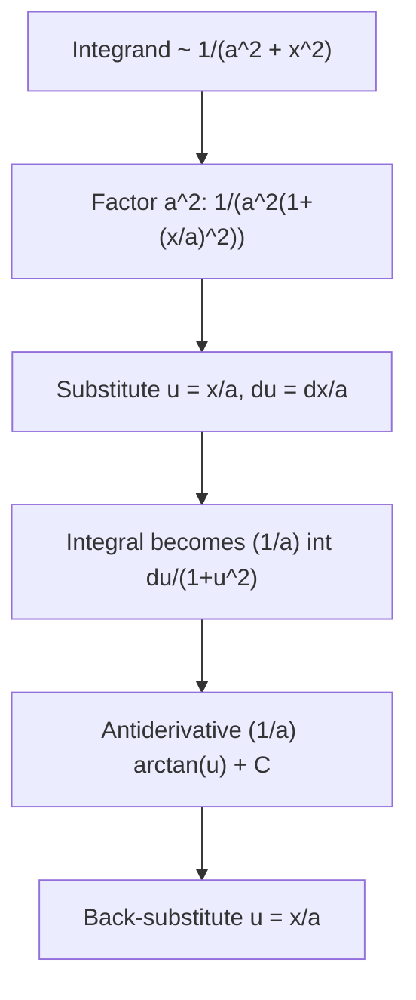

# Inverse Tangent Output

$$
\int \frac{1}{a^2 + x^2}\,dx = \frac{1}{a}\arctan\!\left(\frac{x}{a}\right) + C
$$

## Deep Breakdown

What it tells me *(Situation Awareness)*: This antiderivative is the **Lorentzian / Cauchy-shaped** pattern: denominator **sums** squares ($a^2+x^2$), not subtracts them. It is central in **probability** (Cauchy density), **signal processing** (frequency responses), and **ODE** solutions (arctan shows up in first-order rational flows). The scaling $1/a$ in front of $\arctan(x/a)$ is easy to drop; always differentiate to verify.

## Flowchart



## Real-world use

### Where it is used

Bayesian updating with certain conjugate structures, kernel-style rational features, and any model where **bell-like tails** appear as rational functions rather than Gaussians.

### Problem it solves

Turns a rational integrand into a **log-free** closed form (contrast with log rules for linear denominators).

### How it solves the problem

Uses $\dfrac{d}{dx}\arctan(x/a)=\dfrac{a}{a^2+x^2}$; adjust the prefactor $1/a$ to match your integrand.

### Example in a business

A **survival-analysis** derivation produces $\int \frac{1}{1+t^2}\,dt$ after nondimensionalizing time; the result is $\arctan(t)+C$, used to express a closed-form segment of a cumulative hazard in a prototype.

## The formula, piece by piece

| Symbol | Meaning |
| --- | --- |
| $a$ | Nonzero constant; usually $a>0$ |
| $x$ | Integration variable |
| $\arctan(x/a)$ | Inverse tangent, radians |

$$
\int \frac{1}{a^2 + x^2}\,dx = \frac{1}{a}\arctan\!\left(\frac{x}{a}\right) + C
\quad (a \neq 0)
$$

## The formula in words

The “$+x^2$” denominator pairs with **arctan**, just as the “$-x^2$” under a square root pairs with **arcsin**.

## Critical Concepts

- **Missing $1/a$ factor** is the most common algebra mistake.
- For $\int \frac{1}{x^2+1}\,dx$, take $a=1$: result is $\arctan(x)+C$.
- **Definite integrals** over $(-\infty,\infty)$ tie to $\pi$ (Cauchy normalization).

## Step-by-step calculation (tiny example)

*Step 1: Standardize* $\displaystyle \int \frac{1}{4+x^2}\,dx$: here $a=2$.

*Step 2: Apply formula*

$$
\int \frac{1}{4+x^2}\,dx = \frac{1}{2}\arctan\!\left(\frac{x}{2}\right) + C
$$

*Step 3: Derivative check* $\dfrac{d}{dx}\left[\frac{1}{2}\arctan(x/2)\right]
=\frac{1}{2}\cdot\frac{1}{1+(x/2)^2}\cdot\frac{1}{2}
=\frac{1}{4+x^2}$.

## Code examples

### Beginner example (Python)

```python
import numpy as np
a = 2.0
xs = np.linspace(-5, 5, num=11)
F = (1 / a) * np.arctan(xs / a)
dF = np.gradient(F, xs)
integrand = 1.0 / (a**2 + xs**2)
print(np.allclose(dF, integrand, rtol=0.03))
```

### Beginner example (R)

```r
a <- 2
xs <- seq(-5, 5, length.out = 11)
F <- (1 / a) * atan(xs / a)
dF <- diff(F) / diff(xs)
xmid <- xs[-1] - diff(xs) / 2
integrand <- 1 / (a^2 + xmid^2)
print(mean(abs(dF - integrand)) < 0.04)
```

### Professional example (Python)

```python
from __future__ import annotations
import numpy as np
RANDOM_SEED = 42

def arctan_antiderivative(x: np.ndarray, a: float) -> np.ndarray:
    if a == 0:
        raise ValueError("a must be nonzero")
    return (1.0 / a) * np.arctan(x / a)

if __name__ == "__main__":
    rng = np.random.default_rng(RANDOM_SEED)
    a = 1.5
    x = rng.normal(size=4)
    print(np.round(arctan_antiderivative(x, a), 4))
```

### Professional example (R)

```r
set.seed(42)
a <- 1.5
x <- rnorm(4)
print(round((1 / a) * atan(x / a), 4))
```

---

*Source: domain knowledge*
