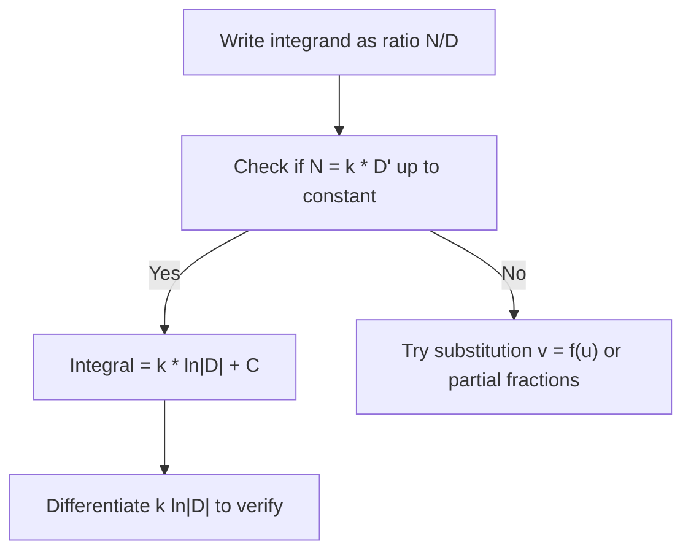

# Quotient-derived $ln$

$$
\int \frac{f'(u)}{f(u)}\,du = \ln|f(u)| + C
$$

## Deep Breakdown

What it tells me *(Situation Awareness)*: This is the **logarithmic antiderivative rule**: if the **numerator is the derivative of the denominator**, the integral is the **natural log of the absolute value** of that denominator. It is the reverse of the chain rule for $\ln|f(u)|$. In statistics it underpins **likelihood** manipulations; in calculus it collapses many **partial-fraction** setups after substitution.

## Flowchart



## Real-world use

### Where it is used

Maximum-likelihood score functions, survival **hazard** integrals, and symbolic simplification in scientific computing.

### Problem it solves

Avoids expanding complicated rational expressions when a **single log** captures the structure.

### How it solves the problem

Recognizes $\frac{d}{du}\ln|f(u)| = f'(u)/f(u)$ wherever $f(u)\neq 0$.

### Example in a business

A **conversion funnel** model integrates $\displaystyle \int \frac{\lambda'(t)}{\lambda(t)}\,dt$ after reparameterization; the result is $\ln|\lambda(t)|+C$, giving a closed-form log-odds segment for a slide deck.

## The formula, piece by piece

| Symbol | Meaning |
| --- | --- |
| $f(u)$ | Differentiable function, nonzero on the integration interval (piecewise) |
| $f'(u)$ | Derivative |
| $\ln|f(u)|

$ | Natural log of absolute value (handles sign changes on intervals) |

$$
\int \frac{f'(u)}{f(u)}\,du = \ln|f(u)| + C
$$

## The formula in words

“How fast $f$ changes” divided by “how big $f$ is” integrates to “log size of $f$,” like **log returns** compounding.

## Critical Concepts

- **Absolute value** matters when $f$ can be negative on an interval; on a single interval where $f>0$, drop the bars.
- **Constants:** $\int \frac{1}{u}\,du=\ln|u|+C$ is the case $f(u)=u$.
- **Not the same** as $\int f(u)/f'(u)\,du$ (roles reversed).

## Step-by-step calculation (tiny example)

*Step 1: Match pattern* $\displaystyle \int \frac{2x}{x^2+1}\,dx$. Here $f(x)=x^2+1$, $f'(x)=2x$.

*Step 2: Integrate*

$$
\int \frac{2x}{x^2+1}\,dx = \ln|x^2+1|+C = \ln(x^2+1)+C
$$

(since $x^2+1>0$ always).

*Step 3: Verify* $\dfrac{d}{dx}\ln(x^2+1)=\dfrac{2x}{x^2+1}$.

## Code examples

### Beginner example (Python)

```python
import numpy as np
xs = np.linspace(0.5, 3.0, num=6)
F = np.log(xs**2 + 1)
dF = np.gradient(F, xs)
integrand = 2 * xs / (xs**2 + 1)
print(np.allclose(dF, integrand, rtol=0.02))
```

### Beginner example (R)

```r
xs <- seq(0.5, 3, length.out = 6)
F <- log(xs^2 + 1)
dF <- diff(F) / diff(xs)
xmid <- xs[-1] - diff(xs) / 2
integrand <- 2 * xmid / (xmid^2 + 1)
print(mean(abs(dF - integrand)) < 0.03)
```

### Professional example (Python)

```python
import numpy as np

RANDOM_SEED = 42


def log_integral_check(x: np.ndarray, f: np.ndarray, fp: np.ndarray) -> float:
    """Mean abs error of d/dx ln|f| vs f'/f on interior points (finite diff)."""
    logf = np.log(np.abs(f))
    dlogf = np.gradient(logf, x)
    ratio = fp / f
    return float(np.mean(np.abs(dlogf - ratio)))


if __name__ == "__main__":
    rng = np.random.default_rng(RANDOM_SEED)
    x = np.linspace(0.2, 2.0, 50)
    f = x**3 - x + 1.0
    fp = 3 * x**2 - 1
    print("mean abs mismatch:", round(log_integral_check(x, f, fp), 6))
```

### Professional example (R)

```r
set.seed(42)
x <- seq(0.2, 2, length.out = 50)
f <- x^3 - x + 1
fp <- 3 * x^2 - 1
dlogf <- diff(log(abs(f))) / diff(x)
xmid <- x[-1] - diff(x) / 2
fm <- f[-1]; fpm <- fp[-1]
ratio <- fpm / fm
cat("mean abs mismatch:", mean(abs(dlogf - ratio)), "\n")
```

---

*Source: domain knowledge*
