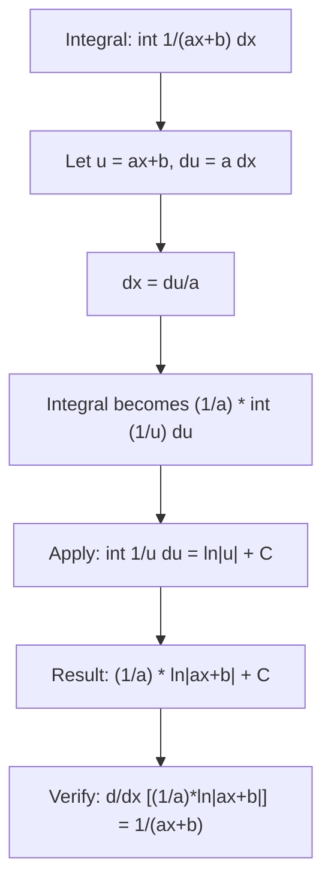

# Reciprocal Logarithmic

$$
\int \frac{1}{ax+b}\,dx = \frac{1}{a}\ln|ax+b| + C
$$

## Deep Breakdown

What it tells me *(Situation Awareness)*:
This is the missing case from the power rule: when $n = -1$, the power rule breaks down (division by zero), and the antiderivative is a logarithm, not a power. The formula $\int \frac{1}{ax+b}\,dx = \frac{1}{a}\ln|ax+b| + C$ handles all affine denominators with a single formula. In DA/DS, the log function appears naturally in likelihood functions: the derivative of $\ln L(\theta)$ is $L'(\theta)/L(\theta)$, so integrating the score function recovers the log-likelihood. This formula is also the foundation for integrating rational functions via partial fractions, computing entropy-related integrals, and evaluating normalizing constants in log-linear models.

## Flowchart



## Real-world use

### Where it is used

Maximum likelihood estimation (integrating the gradient of log-likelihood), partial fraction decomposition of rational functions, normalizing constants of log-linear models, the log-sum-exp identity in softmax derivations, and evaluating definite integrals of rates that are inversely proportional to size (e.g., marginal cost $\propto 1/(q + \text{fixed cost})$).

### Problem it solves

The power rule cannot handle $n = -1$ because $x^0/0$ is undefined. The antiderivative of $1/x$ is $\ln|x|$ — the absolute value is needed because the domain of $\ln$ is positive reals, but $1/x$ is defined for all $x \neq 0$. The formula extends this to any affine denominator $ax+b$.

### How it solves the problem

Substitution: $u = ax + b$, $du = a\,dx$, so $dx = du/a$:

$$
\int \frac{1}{ax+b}\,dx = \int \frac{1}{u}\cdot\frac{du}{a} = \frac{1}{a}\int \frac{du}{u} = \frac{1}{a}\ln|u| + C = \frac{1}{a}\ln|ax+b| + C
$$

Verification: $\frac{d}{dx}\!\left[\frac{1}{a}\ln|ax+b|\right] = \frac{1}{a}\cdot\frac{a}{ax+b} = \frac{1}{ax+b}$

### Example in a business

In a logistic regression, the log-likelihood for one observation is $\ell = y\ln p + (1-y)\ln(1-p)$ where $p = \sigma(w^T x)$. The gradient $\partial\ell/\partial w$ involves expressions of the form $\frac{1}{p}$ and $\frac{1}{1-p}$. Integrating over the weight space in a Laplace approximation requires integrals of $\frac{1}{p(1-p)}$ which are handled by partial fractions: $\frac{1}{p(1-p)} = \frac{1}{p} + \frac{1}{1-p}$, each piece integrating as $\ln|p| - \ln|1-p| = \ln\left|\frac{p}{1-p}\right|$ — the logit function.

## The formula, piece by piece

$$
\int \frac{1}{ax+b}\,dx = \frac{1}{a}\ln|ax+b| + C
$$

Each symbol:
- $\frac{1}{ax+b}$: the integrand, a reciprocal of a linear function; undefined at $x = -b/a$
- $\frac{1}{a}$: chain rule compensation (same denominator as all affine rules)
- $\ln$: natural logarithm, base $e$; appears because $\frac{d}{dx}[\ln|u|] = \frac{1}{u}$
- $|ax+b|$: absolute value ensures the log argument is positive; required because $\ln$ is only defined for positive inputs
- $C$: constant of integration Special cases:
- $a=1, b=0$: $\int \frac{1}{x}\,dx = \ln|x| + C$
- $a=1$: $\int \frac{1}{x+b}\,dx = \ln|x+b| + C$
- $a=-1, b=0$: $\int \frac{1}{-x}\,dx = -\ln|x| + C$ (equivalently $\ln(1/|x|) + C$)

## The formula in words

"The antiderivative of the reciprocal of a linear function is the natural logarithm of its absolute value, divided by the coefficient $a$ of $x$. The absolute value is necessary because the logarithm requires a positive argument, but the original function is defined on both sides of its zero."

## Critical Concepts

- **The power rule exception**: the power rule $\int x^n\,dx = x^{n+1}/(n+1)$ fails at $n = -1$ because the denominator $n+1 = 0$. This logarithm formula fills that gap.
- **Absolute value is required**: $\ln|x|$ is the antiderivative on $(0, \infty)$ AND on $(-\infty, 0)$ separately. Without the absolute value, the formula only works for $ax+b > 0$.
- **Partial fractions**: any rational function can be decomposed into partial fractions, each of which is either a polynomial (integrable by power rule) or a reciprocal-linear term (integrable by this rule).
- **Log properties apply**: $\frac{1}{a}\ln|ax+b| = \ln|ax+b|^{1/a}$, so the result can sometimes be simplified.
- **Definite integral**: $\int_\alpha^\beta \frac{1}{ax+b}\,dx = \frac{1}{a}\left[\ln|a\beta+b| - \ln|a\alpha+b|\right] = \frac{1}{a}\ln\left|\frac{a\beta+b}{a\alpha+b}\right|$.

## Step-by-step calculation (tiny example)

Compute $\int \frac{1}{3x+1}\,dx$ and $\int_1^4 \frac{1}{3x+1}\,dx$.

*Step 1: Identify a and b*
$a = 3$, $b = 1$.

*Step 2: Apply the formula*
$\int \frac{1}{3x+1}\,dx = \frac{1}{3}\ln|3x+1| + C$.

*Step 3: Verify by differentiating*
$\frac{d}{dx}\!\left[\frac{1}{3}\ln|3x+1|\right] = \frac{1}{3}\cdot\frac{3}{3x+1} = \frac{1}{3x+1}$

*Step 4: Evaluate the definite integral*
$\int_1^4 \frac{1}{3x+1}\,dx = \frac{1}{3}\left[\ln|3(4)+1| - \ln|3(1)+1|\right] = \frac{1}{3}\left[\ln 13 - \ln 4\right] = \frac{1}{3}\ln\frac{13}{4} \approx \frac{1}{3}\times 1.179 \approx 0.393$

## Code examples

### Beginner example (Python)

```python
import numpy as np
from scipy import integrate

def recip_antiderivative(x: float, a: float, b: float) -> float:
    """F(x) = (1/a)*ln|ax+b|. Requires ax+b != 0."""
    val = a * x + b
    if abs(val) < 1e-12:
        raise ValueError(f"Pole at x = {-b/a:.4f}")
    return (1.0 / a) * np.log(abs(val))

def recip_definite(lo: float, hi: float, a: float, b: float) -> float:
    return recip_antiderivative(hi, a, b) - recip_antiderivative(lo, a, b)


# Test cases (avoid the pole at x = -b/a)
cases = [
    (1.0, 4.0, 3.0, 1.0),    # int 1/(3x+1) from 1 to 4
    (1.0, 3.0, 1.0, 0.0),    # int 1/x from 1 to 3 = ln(3)
    (2.0, 5.0, -1.0, 6.0),   # int 1/(-x+6) from 2 to 5
]
for lo, hi, a, b in cases:
    analytic = recip_definite(lo, hi, a, b)
    numerical, _ = integrate.quad(lambda x, aa=a, bb=b: 1.0/(aa*x+bb), lo, hi)
    print(f"int_({lo},{hi}) 1/({a}x+{b}): "
          f"analytic={analytic:.6f}, numerical={numerical:.6f}, "
          f"match={abs(analytic-numerical)<1e-8}")

# Partial fraction: 1/(x*(1-x)) = 1/x + 1/(1-x), integrated from 0.1 to 0.9
# This gives: ln|x/(1-x)| = logit
print("\n=== Partial fraction: logit via integration ===")
logit_analytic = recip_definite(0.1, 0.9, 1.0, 0.0) + recip_definite(0.1, 0.9, -1.0, 1.0)
logit_numerical, _ = integrate.quad(lambda x: 1/(x*(1-x)), 0.1, 0.9)
print(f"int_0.1^0.9 [1/x + 1/(1-x)] dx = {logit_analytic:.6f}")
print(f"Numerical: {logit_numerical:.6f}")
print(f"ln(0.9/0.1) - ln(0.1/0.9) = {np.log(9) - np.log(1/9):.6f}")
```

### Beginner example (R)

```r
recip_antiderivative <- function(x, a, b) {
  val <- a * x + b
  if (abs(val) < 1e-12) stop("Pole.")
  (1 / a) * log(abs(val))
}
recip_definite <- function(lo, hi, a, b) {
  recip_antiderivative(hi, a, b) - recip_antiderivative(lo, a, b)
}
cases <- list(c(1, 4, 3, 1), c(1, 3, 1, 0), c(2, 5, -1, 6))
for (tc in cases) {
  lo <- tc[1]; hi <- tc[2]; a <- tc[3]; b <- tc[4]
  analytic <- recip_definite(lo, hi, a, b)
  numerical <- integrate(function(x) 1/(a*x+b), lower=lo, upper=hi)$value
  cat(sprintf("int_(%g,%g) 1/(%gx+%g): analytic=%.6f, num=%.6f, match=%s\n", lo, hi, a, b, analytic, numerical, isTRUE(all.equal(analytic, numerical, tol=1e-7))))
}
```

### Professional example (Python)

```python
"""
Reciprocal logarithmic rule in log-likelihood gradient integration.

The score function of the logistic model is:
    d/dw log p(y|x,w) = (y - sigma(w^T x)) * x
Integrating the score over a prior p(w) gives the expected gradient.
For a Gaussian prior on w, integrating involves 1/(sigma*(1-sigma))
which decomposes via partial fractions into two reciprocal-linear terms.

Here we demonstrate the partial-fraction decomposition that appears
in the Laplace approximation of the logistic model's evidence.
"""
import numpy as np
from scipy import integrate

def sigmoid(z: np.ndarray) -> np.ndarray:
    """Numerically stable sigmoid."""
    return np.where(z >= 0, 1.0 / (1.0 + np.exp(-z)), np.exp(z) / (1.0 + np.exp(z)))


# For logistic regression: the Fisher information at a single point is
# I(w) = sigma(w) * (1 - sigma(w))
# Its reciprocal 1/(sigma*(1-sigma)) = 1/sigma + 1/(1-sigma) (partial fractions)

# Verify partial fraction identity numerically
print("=== Partial fraction: 1/(p*(1-p)) = 1/p + 1/(1-p) ===")
p_values = np.linspace(0.1, 0.9, 9)
for p in p_values:
    lhs = 1.0 / (p * (1 - p))
    rhs = 1.0/p + 1.0/(1-p)
    print(f" p={p:.1f}: LHS={lhs:.4f}, RHS={rhs:.4f}, match={abs(lhs-rhs)<1e-10}")

# Integral of 1/(p*(1-p)) from p_lo to p_hi = ln(p/(1-p)) evaluated at bounds
# = logit(p_hi) - logit(p_lo)
print("\n=== int_{p1}^{p2} 1/(p*(1-p)) dp = logit(p2) - logit(p1) ===")


def logit(p: float) -> float:
    return float(np.log(p / (1.0 - p)))


test_pairs = [(0.2, 0.8), (0.1, 0.6), (0.3, 0.7)]
for p1, p2 in test_pairs:
    # Via partial fractions + reciprocal log rule
    analytic = logit(p2) - logit(p1)
    # Numerical
    numerical, _ = integrate.quad(lambda p: 1.0/(p*(1-p)), p1, p2)
    print(f" [{p1},{p2}]: logit(p2)-logit(p1) = {analytic:.6f}, "
          f"numerical = {numerical:.6f}, match={abs(analytic-numerical)<1e-6}")
```

---

*Source: 1300 p. 236*
