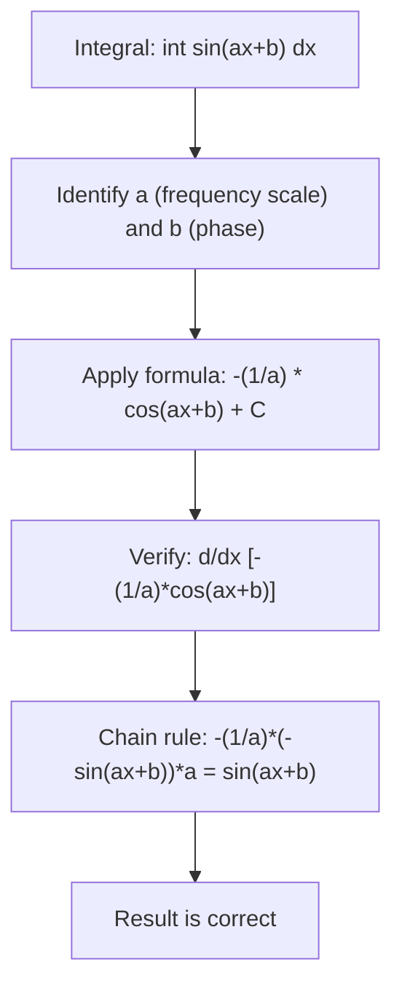

# Sine

$$
\int \sin(ax+b)\,dx = -\frac{1}{a}\cos(ax+b) + C
$$

## Deep Breakdown

What it tells me *(Situation Awareness)*:
The antiderivative of sine is negative cosine. The negation comes from the derivative relationship: $\frac{d}{dx}[-\cos x] = \sin x$. The $1/a$ factor comes from the chain rule when the argument is affine $ax+b$. In DA/DS, sine integrals appear in Fourier analysis (computing Fourier coefficients requires integrating $\sin(n\omega x)$), signal processing (band-pass filter energy calculation), modeling seasonal patterns (integrating sinusoidal revenue or demand models), and physics-informed ML (integrating oscillatory features in neural network inputs). Any model with cyclical features of the form $\sin(2\pi t/T)$ will require this formula when computing expected values or total accumulations.

## Flowchart



## Real-world use

### Where it is used

Fourier series: coefficients $a_n = \frac{2}{T}\int_0^T f(t)\sin(n\omega t)\,dt$ require integrating $f(t)\sin(n\omega t)$. Seasonal demand modeling: total demand over a period when demand follows $D(t) = D_0 + A\sin(2\pi t/12)$ (yearly seasonality). Energy of an oscillating signal: $E = \int_0^T A^2\sin^2(\omega t)\,dt$ (uses $\sin^2 = (1-\cos(2\omega t))/2$).

### Problem it solves

Integrating oscillatory functions analytically gives exact results without numerical approximation errors. This matters in Fourier decomposition where numerical integration of many coefficients would accumulate errors.

### How it solves the problem

Use the antiderivative chain: $\frac{d}{dx}[-\cos(ax+b)] = \sin(ax+b)\cdot a$, so $\frac{d}{dx}\!\left[-\frac{\cos(ax+b)}{a}\right] = \sin(ax+b)$. The antiderivative of $\sin(ax+b)$ is thus $-\frac{\cos(ax+b)}{a} + C$.

### Example in a business

A retail chain models weekly foot traffic as $F(t) = 500 + 120\sin\!\left(\frac{2\pi t}{7}\right)$ (visitors per day, $t$ in days). Total visitors in the first 14 days: $\int_0^{14} F(t)\,dt = 500\cdot 14 + 120\int_0^{14}\sin\!\left(\frac{2\pi t}{7}\right)\,dt$. The sine integral evaluates to $120\left[-\frac{7}{2\pi}\cos\!\left(\frac{2\pi t}{7}\right)\right]_0^{14} = 0$ (two full cycles cancel). Total = 7,000 visitors, exactly the mean times the period.

## The formula, piece by piece

$$
\int \sin(ax+b)\,dx = -\frac{1}{a}\cos(ax+b) + C
$$

Each symbol:
- $\sin(ax+b)$: the integrand, oscillating between $-1$ and $+1$
- $-$: the negation comes from the derivative relationship $(\cos)' = -\sin$
- $\frac{1}{a}$: chain rule compensation for the inner derivative of $ax+b$
- $\cos(ax+b)$: the cosine of the same argument; the integral shifts from sine to cosine
- $C$: constant of integration Special cases:
- $a=1, b=0$: $\int \sin x\,dx = -\cos x + C$
- $a=\omega, b=0$: $\int \sin(\omega t)\,dt = -\frac{1}{\omega}\cos(\omega t) + C$ (angular frequency)

## The formula in words

"The antiderivative of $\sin(ax+b)$ is the negative of $\cos(ax+b)$, divided by the coefficient $a$ of $x$ (the chain rule factor). The switch from sine to cosine and the negation come from the derivative cycle: $\sin \to \cos \to -\sin \to -\cos \to \sin$."

## Critical Concepts

- **Trig derivative cycle**: $\sin \xrightarrow{d/dx} \cos \xrightarrow{d/dx} -\sin \xrightarrow{d/dx} -\cos \xrightarrow{d/dx} \sin$. Integration reverses: $\sin \xrightarrow{\int} -\cos \xrightarrow{\int} -\sin \xrightarrow{\int} \cos \xrightarrow{\int} \sin$.
- **Chain rule compensation**: the $1/a$ is always present when the argument is $ax$ instead of $x$.
- **Integral over full period is zero**: $\int_0^{2\pi/a} \sin(ax)\,dx = 0$ because $\cos$ evaluated at start and end of a full period equals the same value.
- **Power of sine**: $\int \sin^2(x)\,dx = \frac{x}{2} - \frac{\sin(2x)}{4} + C$ (uses trig identity, not directly this formula).
- **Fourier coefficient**: $\int_0^T \sin(n\omega t)\sin(m\omega t)\,dt = 0$ for $n \neq m$ (orthogonality), $= T/2$ for $n = m$ (derived using this formula).

## Step-by-step calculation (tiny example)

Compute $\int \sin(2x+1)\,dx$ and $\int_0^{\pi/2} \sin(2x)\,dx$.

*Step 1: Identify a and b*
For $\sin(2x+1)$: $a = 2$, $b = 1$.

*Step 2: Apply the formula*
$\int \sin(2x+1)\,dx = -\frac{1}{2}\cos(2x+1) + C$.

*Step 3: Verify by differentiating*
$\frac{d}{dx}\!\left[-\frac{1}{2}\cos(2x+1)\right] = -\frac{1}{2}\cdot(-\sin(2x+1))\cdot 2 = \sin(2x+1)$ ✓

*Step 4: Evaluate the definite integral*
$\int_0^{\pi/2} \sin(2x)\,dx = \left[-\frac{1}{2}\cos(2x)\right]_0^{\pi/2}$
$= -\frac{1}{2}\cos(\pi) - \left(-\frac{1}{2}\cos(0)\right) = -\frac{1}{2}(-1) + \frac{1}{2}(1) = \frac{1}{2} + \frac{1}{2} = 1$

## Code examples

### Beginner example (Python)

```python
import numpy as np
from scipy import integrate

def sin_antiderivative(x: float, a: float, b: float) -> float:
    """F(x) = -(1/a)*cos(ax+b). Requires a != 0."""
    if abs(a) < 1e-12:
        raise ValueError("a = 0: integrand is constant sin(b).")
    return -(1.0 / a) * np.cos(a * x + b)

def sin_definite(lo: float, hi: float, a: float, b: float) -> float:
    return sin_antiderivative(hi, a, b) - sin_antiderivative(lo, a, b)   # Test cases
cases = [ (0.0, np.pi, 1.0, 0.0),   # int sin(x) from 0 to pi = 2
    (0.0, np.pi/2, 2.0, 0.0),   # int sin(2x) from 0 to pi/2 = 1
    (0.0, 2*np.pi, 1.0, 0.0),   # full cycle = 0
]
for lo, hi, a, b in cases:
    analytic = sin_definite(lo, hi, a, b)
numerical, _ = integrate.quad(lambda x, aa=a, bb=b: np.sin(aa*x+bb), lo, hi)
print(f"int_({lo:.3f},{hi:.3f}) sin({a}x+{b}): " f"analytic={analytic:.6f}, numerical={numerical:.6f}, " f"match={abs(analytic-numerical)<1e-8}")
```

### Beginner example (R)

```r
sin_antiderivative <- function(x, a, b) { if (abs(a) < 1e-12) stop("a = 0.") -(1 / a) * cos(a * x + b)
}
sin_definite <- function(lo, hi, a, b) { sin_antiderivative(hi, a, b) - sin_antiderivative(lo, a, b)
}
cases <- list(c(0, pi, 1, 0), c(0, pi/2, 2, 0), c(0, 2*pi, 1, 0))
for (tc in cases) { lo <- tc[1]; hi <- tc[2]; a <- tc[3]; b <- tc[4]
  analytic <- sin_definite(lo, hi, a, b)
  numerical <- integrate(function(x) sin(a*x+b), lower=lo, upper=hi)$value
  cat(sprintf("int_(%5.3f,%5.3f) sin(%gx+%g): analytic=% .6f, num=% .6f, match=%s\n", lo, hi, a, b, analytic, numerical, isTRUE(all.equal(analytic, numerical, tol=1e-7))))
}
```

### Professional example (Python)

```python
"""
Fourier sine coefficients
for seasonal demand decomposition. Monthly demand follows:
    D(t) = trend(t) + sum_k [b_k * sin(k*omega*t)]
where
omega = 2*pi/12 (annual period). Fourier sine
coefficient: b_k = (2/T) * int_0^T
D(t) * sin(k*omega*t) dt For a known
D(t), this integral evaluates using the sine antiderivative
formula, applying integration by parts when
D(t) is polynomial. We demonstrate: fit synthetic seasonal demand with sine components,
then recover coefficients analytically and numerically.
"""
import numpy as np
from scipy import integrate   # Synthetic monthly demand (2 years = 24 months)
OMEGA = 2.0 * np.pi / 12.0   # annual frequency
T_FULL = 24.0

def true_demand(t: np.ndarray) -> np.ndarray:
    """True model: 1000 + 200*sin(omega*t) + 80*sin(2*omega*t)."""
    return 1000.0 + 200.0 * np.sin(OMEGA * t) + 80.0 * np.sin(2 * OMEGA * t)

def fourier_sin_coefficient(demand_fn: object, k: int, period: float = 12.0) -> float:
    """ b_k = (2/T) * int_0^T f(t) * sin(k*omega*t) dt Computed numerically (analytic would use sine formula + IBP). """
    omega = 2.0 * np.pi / period
    result, _ = integrate.quad( lambda t: demand_fn(t) * np.sin(k * omega * t), 0, period )
    return 2.0 / period * result   # Recover coefficients
print("=== Fourier Sine Decomposition of Seasonal Demand ===")
print(f"True model: D(t) = 1000 + 200*sin(omega*t) + 80*sin(2*omega*t)")
print()
for k in range(1, 5):
    b_k = fourier_sin_coefficient(true_demand, k, period=12.0)
print(f"b_{k} = {b_k:+.4f} (expected: b_1=200, b_2=80, rest=0)")   # Demonstrate: integral of pure sine over integer multiple of
periods = 0
print("\n=== Orthogonality verification ===")
for k in range(1, 4):
    full_cycle_integral, _ = integrate.quad( lambda t: np.sin(k * OMEGA * t), 0, 12.0 )   # Analytic: [-(1/(k*omega)) * cos(k*omega*t)]_0^12 = 0 (full period) print(f"int_0^12 sin({k}*omega*t) dt = {full_cycle_integral:.10f} (should be ~0)")
```

---

*Source: 1300 p. 245*
