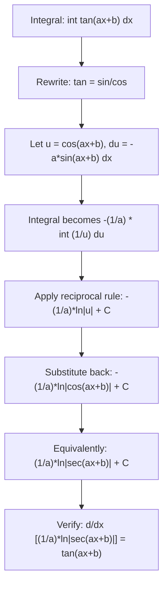

# Tangent

$$
\int \tan(ax+b)\,dx = \frac{1}{a}\ln|\sec(ax+b)| + C
$$

## Deep Breakdown

What it tells me *(Situation Awareness)*:
The tangent antiderivative is less intuitive than sine or cosine. It comes from rewriting $\tan\theta = \frac{\sin\theta}{\cos\theta}$ and applying the quotient-logarithm rule: $\int \frac{f'(u)}{f(u)}\,du = \ln|f(u)| + C$. The result is $\frac{1}{a}\ln|\sec(ax+b)| + C$ (equivalently, $-\frac{1}{a}\ln|\cos(ax+b)| + C$ since $\sec = 1/\cos$). In DA/DS, tangent integrals appear less frequently than sine/cosine, but they do appear in information-geometric calculations, certain entropy expressions, and when computing normalizing constants of distributions related to the Cauchy distribution (which is related to $\arctan$). They also appear as intermediate steps when solving differential equations for neural network activation landscapes.

## Flowchart



## Real-world use

### Where it is used

Intermediate steps in differential equations involving angular variables, information geometry (the Fisher metric on certain manifolds involves tangent integrals), deriving the hyperbolic tangent connection to natural logarithms, and verifying that $\tanh$ activation functions are related to $\ln|\cosh|$ via integration.

### Problem it solves

Tangent has no simple polynomial-style antiderivative. Without this formula, you would need to rediscover the $u$-substitution $u = \cos(\cdot)$ every time. Knowing the result ($\ln|\sec|$) enables quick computation of definite integrals over tangent functions.

### How it solves the problem

$\int \tan(ax+b)\,dx = \int \frac{\sin(ax+b)}{\cos(ax+b)}\,dx$.

Let $u = \cos(ax+b)$, $du = -a\sin(ax+b)\,dx$:

$$
= \int \frac{1}{u}\cdot\frac{-du}{a} = -\frac{1}{a}\ln|u| + C = -\frac{1}{a}\ln|\cos(ax+b)| + C = \frac{1}{a}\ln|\sec(ax+b)| + C
$$

(using $\ln|\sec\theta| = \ln\frac{1}{|\cos\theta|} = -\ln|\cos\theta|$).

### Example in a business

A Bayesian model uses a half-Cauchy prior on a scale parameter $\sigma$: $p(\sigma) \propto \frac{1}{1+\sigma^2/s^2}$, which after a change of variables $\sigma = s\tan\theta$ relates to $\int \tan(\theta)\,d\theta$. This appears in the normalizing constant of the half-Cauchy distribution, widely used as a weakly informative prior on variance parameters in hierarchical models (Stan's recommended default).

## The formula, piece by piece

$$
\int \tan(ax+b)\,dx = \frac{1}{a}\ln|\sec(ax+b)| + C
$$

Each symbol:
- $\tan(ax+b) = \frac{\sin(ax+b)}{\cos(ax+b)}$: a ratio, not directly integrable by power rules
- $\frac{1}{a}$: the universal chain rule compensation
- $\ln$: the natural logarithm; appears because $\tan$ is a quotient (triggers the quotient-log rule)
- $|\sec(ax+b)|$: secant $= 1/\cos$; absolute value ensures the log is defined; $|\sec\theta| \geq 1$ everywhere it is defined
- Equivalent form: $-\frac{1}{a}\ln|\cos(ax+b)| + C$

## The formula in words

"The antiderivative of tangent is the natural log of the absolute value of secant (or equivalently, the negative log of absolute cosine), divided by $a$. The logarithm appears because tangent is a ratio of sine over cosine, and integrating a ratio of a function over itself gives a logarithm."

## Critical Concepts

- **Domain**: $\tan$ is undefined at $x = (\pi/2 + n\pi)/a - b/a$; the antiderivative is only valid on intervals that avoid these poles.
- **Two equivalent forms**: $\frac{1}{a}\ln|\sec(\cdot)| = -\frac{1}{a}\ln|\cos(\cdot)|$. Both are correct; use whichever is more convenient.
- **Connection to $\ln\cosh$**: $\int \tanh(x)\,dx = \ln(\cosh(x)) + C$ (hyperbolic analogue; no absolute value needed since $\cosh > 0$ always).
- **Not from basic power rule**: tangent requires the substitution $u = \cos(\cdot)$ and the logarithmic integral $\int 1/u\,du = \ln|u|$.
- **Definite integral caution**: the integrand must not pass through a pole (where $\cos(ax+b) = 0$) within the integration range.

## Step-by-step calculation (tiny example)

Compute $\int \tan(2x)\,dx$ and $\int_0^{\pi/6} \tan(x)\,dx$.

*Step 1: Identify a and b*
For $\tan(2x)$: $a = 2$, $b = 0$.

*Step 2: Apply the formula*
$\int \tan(2x)\,dx = \frac{1}{2}\ln|\sec(2x)| + C$.

*Step 3: Verify by differentiating*
$\frac{d}{dx}\!\left[\frac{1}{2}\ln|\sec(2x)|\right] = \frac{1}{2}\cdot\frac{\sec(2x)\tan(2x)\cdot 2}{\sec(2x)} = \tan(2x)$ ✓

*Step 4: Evaluate a definite integral*
$\int_0^{\pi/6} \tan(x)\,dx = [\ln|\sec(x)|]_0^{\pi/6} = \ln|\sec(\pi/6)| - \ln|\sec(0)|$
$= \ln(2/\sqrt{3}) - \ln(1) = \ln(2/\sqrt{3}) \approx \ln(1.1547) \approx 0.1438$

## Code examples

### Beginner example (Python)

```python
import numpy as np
from scipy import integrate

def tan_antiderivative(x: float, a: float, b: float) -> float:
    """F(x) = (1/a)*ln|sec(ax+b)|. Undefined at cos(ax+b)=0."""
    if abs(a) < 1e-12:
        raise ValueError("a = 0.")
    cos_val = np.cos(a * x + b)
    if abs(cos_val) < 1e-12:
        raise ValueError("Pole: cos(ax+b) = 0 at this x.")
    return (1.0 / a) * np.log(abs(1.0 / cos_val))   # ln|sec| = -ln|cos|

def tan_definite(lo: float, hi: float, a: float, b: float) -> float:
    return tan_antiderivative(hi, a, b) - tan_antiderivative(lo, a, b)


# Test cases (avoid poles: tan(x) has poles at pi/2, 3pi/2, ...)
cases = [
    (0.0, np.pi/6, 1.0, 0.0),   # int tan(x) from 0 to pi/6
    (0.0, np.pi/4, 1.0, 0.0),   # int tan(x) from 0 to pi/4
    (0.0, np.pi/8, 2.0, 0.0),   # int tan(2x) from 0 to pi/8
]
for lo, hi, a, b in cases:
    analytic = tan_definite(lo, hi, a, b)
    numerical, _ = integrate.quad(lambda x, aa=a, bb=b: np.tan(aa*x+bb), lo, hi)
    print(f"int_({lo:.3f},{hi:.4f}) tan({a}x+{b:.2f}): "
          f"analytic={analytic:.6f}, numerical={numerical:.6f}, "
          f"match={abs(analytic-numerical)<1e-6}")

# tanh analogue: int tanh(x) dx = ln(cosh(x)) + C
print("\n=== Hyperbolic analogue: int tanh(x) dx ===")
tanh_antiderivative = lambda x: np.log(np.cosh(x))
lo, hi = -1.0, 2.0
tanh_analytic = tanh_antiderivative(hi) - tanh_antiderivative(lo)
tanh_numerical, _ = integrate.quad(np.tanh, lo, hi)
print(f"int_({lo},{hi}) tanh(x): analytic={tanh_analytic:.6f}, numerical={tanh_numerical:.6f}")
```

### Beginner example (R)

```r
tan_antiderivative <- function(x, a, b) {
  if (abs(a) < 1e-12) stop("a = 0.")
  (1 / a) * log(abs(1 / cos(a * x + b)))
}
tan_definite <- function(lo, hi, a, b) {
  tan_antiderivative(hi, a, b) - tan_antiderivative(lo, a, b)
}
cases <- list(c(0, pi/6, 1, 0), c(0, pi/4, 1, 0))
for (tc in cases) {
  lo <- tc[1]; hi <- tc[2]; a <- tc[3]; b <- tc[4]
  analytic <- tan_definite(lo, hi, a, b)
  numerical <- integrate(function(x) tan(a*x+b), lower=lo, upper=hi)$value
  cat(sprintf("int_(%5.3f,%5.3f) tan(%gx): analytic=%.6f, num=%.6f, match=%s\n", lo, hi, a, analytic, numerical, isTRUE(all.equal(analytic, numerical, tol=1e-7))))
}

# tanh analogue
tanh_analytic <- log(cosh(2)) - log(cosh(-1))
tanh_numerical <- integrate(tanh, lower=-1, upper=2)$value
cat(sprintf("\nint tanh(x) from -1 to 2: analytic=%.6f, num=%.6f\n", tanh_analytic, tanh_numerical))
```

### Professional example (Python)

```python
"""
tanh activation integral: int tanh(x) dx = ln(cosh(x)) + C.

The hyperbolic analogue of tan's formula. This matters because:
1. tanh is a standard neural network activation function.
2. The integral of tanh appears in the ELBO (Evidence Lower BOund)
   for variational autoencoders: computing int q(z)*ln p(x|z) dz often
   involves integrating over tanh-activated layers.
3. For regularization: the integral of |tanh(w)| w.r.t. w provides a
   smooth L1-like sparsity measure.

We demonstrate the formula and connect to activation-layer analysis.
"""
import numpy as np
from scipy import integrate

def tanh_antiderivative(x: np.ndarray) -> np.ndarray:
    """int tanh(x) dx = ln(cosh(x)) + C."""
    return np.log(np.cosh(x))

def tanh_energy(lo: float, hi: float) -> float:
    """int_lo^hi tanh(x) dx = ln(cosh(hi)) - ln(cosh(lo))."""
    return float(tanh_antiderivative(hi) - tanh_antiderivative(lo))


# Verify analytically vs numerically
test_ranges = [(-2.0, 2.0), (0.0, 3.0), (-1.0, 1.0)]
print("=== tanh integral verification ===")
for lo, hi in test_ranges:
    analytic = tanh_energy(lo, hi)
    numerical, _ = integrate.quad(np.tanh, lo, hi)
    print(f" int_({lo:+.1f},{hi:+.1f}) tanh: "
          f"analytic={analytic:.6f}, numerical={numerical:.6f}, "
          f"match={abs(analytic-numerical)<1e-8}")

# Pre-activation distribution: for a layer with weights w, input z ~ N(0,1),
# the mean absolute activation E[|tanh(w*z)|] is computed by integration.
print("\n=== Mean |tanh(w*z)| for z ~ N(0,1) ===")
from scipy.stats import norm

for w in [0.5, 1.0, 2.0, 5.0]:
    # Numerical: E[|tanh(w*z)|] = int |tanh(w*z)| * phi(z) dz
    mean_abs, _ = integrate.quad(lambda z, ww=w: abs(np.tanh(ww * z)) * norm.pdf(z), -10, 10)
    print(f" w={w:.1f}: E[|tanh(w*z)|] = {mean_abs:.4f}")
print("[As w increases, tanh saturates and E[|tanh|] -> 1]")
```

---

*Source: domain knowledge*
