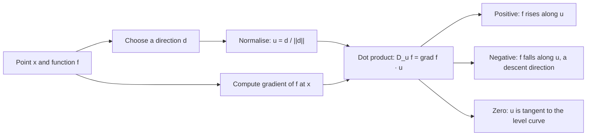

# Directional Derivative

$$
D_{\mathbf{u}} f(\mathbf{x}) = \lim_{h \to 0} \frac{f(\mathbf{x} + h\mathbf{u}) - f(\mathbf{x})}{h} = \nabla f(\mathbf{x})^\top \mathbf{u}
$$

, where $\mathbf{u}$ is a unit vector ($\|\mathbf{u}\| = 1$) and $f$ is differentiable at $\mathbf{x}$

## Deep Breakdown

What it tells me *(Situation Awareness)*:
The directional derivative answers "if I move away from this point in *this particular direction*, how fast does the function change?" Partial derivatives are the special case where the direction is a coordinate axis ($\mathbf{u} = \mathbf{e}_i$ gives $\partial f/\partial x_i$). For a differentiable function, the whole limit collapses to one dot product, $\nabla f(\mathbf{x})^\top \mathbf{u} = \|\nabla f\| \cos\theta$, which immediately explains why the gradient is the direction of steepest ascent ($\theta = 0$), why $-\nabla f$ is steepest descent ($\theta = \pi$), and why moving along a level curve changes nothing ($\theta = \pi/2$). It also tells me that any direction with a negative dot product with the gradient is a descent direction, which is all that SGD, momentum and Adam need to make progress. In DA/DS: sensitivity analysis of a model output to a *combined* change of inputs (raise price 3% while raising ad spend 4%), checking whether a proposed step reduces the loss (the Armijo line-search condition uses $\nabla f^\top \mathbf{d}$), Jacobian-vector products in forward-mode autodiff (which compute exactly $\nabla f^\top \mathbf{v}$ without forming the gradient), finite-difference gradient checks along random directions, and explainability methods that perturb an input along a chosen direction.

## Flowchart



## Real-world use

### Where it is used

Line search in gradient-based optimizers (sufficient-decrease test $f(\mathbf{x} + t\mathbf{d}) \le f(\mathbf{x}) + c\,t\,\nabla f^\top \mathbf{d}$); forward-mode automatic differentiation (JVPs); gradient checking in deep-learning code; what-if analysis in pricing and marketing-mix models; adversarial-example analysis (how fast does a classifier's score move along a perturbation); response-surface methodology in experimentation.

### Problem it solves

Partial derivatives only tell me what happens when one input moves while everything else is frozen. Real decisions move several levers at once, and optimizers move along arbitrary directions. I need the rate of change along any direction, not just along the axes.

### How it solves the problem

Linearise $f$ near $\mathbf{x}$: $f(\mathbf{x} + h\mathbf{u}) \approx f(\mathbf{x}) + h\,\nabla f(\mathbf{x})^\top \mathbf{u}$. The coefficient of $h$ is the directional derivative. So once the gradient is known, the rate along *every* direction is a single dot product — no new limits, no extra function evaluations.

### Example in a business

An e-commerce team models weekly revenue (in $k) as $R(p, a) = p^2 + 3pa$ around the current operating point, with $p$ = price index and $a$ = ad-spend index, currently at $(1, 2)$. Marketing proposes a joint move in the direction $(3, 4)$ (3 parts price, 4 parts ads). Normalised, $\mathbf{u} = (0.6, 0.8)$. The gradient is $\nabla R = (2p + 3a,\ 3p) = (8, 3)$, so $D_{\mathbf{u}} R = 8(0.6) + 3(0.8) = 7.2$: about $7.2k of extra revenue per unit of distance travelled in that direction. The steepest possible direction would give $\|\nabla R\| = \sqrt{73} \approx 8.544$, so the proposal captures $7.2 / 8.544 \approx 84\%$ of the best local improvement.

## The formula, piece by piece

- $f: \mathbb{R}^n \to \mathbb{R}$: a scalar function (loss, revenue, score)
- $\mathbf{x}$: the current point where I evaluate the rate of change
- $\mathbf{u}$: the direction of travel, a unit vector; normalising makes the answer "change per unit distance"
- $h$: a small step length along $\mathbf{u}$
- $\frac{f(\mathbf{x} + h\mathbf{u}) - f(\mathbf{x})}{h}$: the rise over run along the line through $\mathbf{x}$ in direction $\mathbf{u}$
- $\lim_{h \to 0}$: shrink the step to get the instantaneous rate
- $\nabla f(\mathbf{x})$: the gradient, vector of partial derivatives
- $\nabla f(\mathbf{x})^\top \mathbf{u}$: the shortcut valid for differentiable $f$; equals $\|\nabla f\|\cos\theta$, with $\theta$ the angle between gradient and direction
- Bounds: $-\|\nabla f\| \le D_{\mathbf{u}} f \le \|\nabla f\|$ (Cauchy–Schwarz)

## The formula in words

"The directional derivative is how steeply the function climbs if I walk from this point in direction $\mathbf{u}$; for a smooth function it is just the gradient projected onto that direction." Tiny example: $f(x, y) = x^2 + 3xy$ at $(1, 2)$, direction $(3, 4)$. Unit direction $(0.6, 0.8)$; gradient $(8, 3)$; $D_{\mathbf{u}} f = 4.8 + 2.4 = 7.2$.

## Critical Concepts

- **Normalise the direction:** using $\mathbf{d} = (3, 4)$ instead of $\mathbf{u} = (0.6, 0.8)$ gives $\nabla f^\top \mathbf{d} = 36$, which is 5 times larger only because $\|\mathbf{d}\| = 5$. Some texts define the derivative along an unnormalised vector (the "Gateaux" or JVP form); know which convention a library uses.
- **Steepest ascent follows:** $\max_{\|\mathbf{u}\|=1} \nabla f^\top \mathbf{u}$ is attained at $\mathbf{u} = \nabla f / \|\nabla f\|$ with value $\|\nabla f\|$. This is the formal reason gradient descent steps along $-\nabla f$.
- **Descent direction:** any $\mathbf{d}$ with $\nabla f^\top \mathbf{d} \lt 0$ decreases $f$ for a small enough step. Momentum, Adam and Newton steps are not along $-\nabla f$, but they are (usually) descent directions.
- **Differentiability matters:** the dot-product shortcut needs $f$ differentiable. For $f(x, y) = |x|$ at the origin, directional derivatives exist in every direction ($|u_1|$) but are not linear in $\mathbf{u}$, so no gradient exists. ReLU networks hit such kinks; frameworks pick a subgradient.
- **Second order:** the curvature along $\mathbf{u}$ is $\mathbf{u}^\top H \mathbf{u}$ (Hessian). Negative values along some direction at a stationary point reveal a saddle or maximum.
- **Forward-mode autodiff:** one forward pass with a tangent vector $\mathbf{v}$ returns $\nabla f^\top \mathbf{v}$ exactly — cheap when there are few directions, versus reverse mode which returns the whole gradient.

## Step-by-step calculation (tiny example)

*Compute the rate of change of $f(x, y) = x^2 + 3xy$ at $(1, 2)$ in the direction $(3, 4)$.*

*Step 1: Normalise the direction*
$\|(3, 4)\| = \sqrt{9 + 16} = 5$, so $\mathbf{u} = (0.6, 0.8)$.

*Step 2: Partial derivatives*
$\partial f/\partial x = 2x + 3y = 2 + 6 = 8$; $\partial f/\partial y = 3x = 3$. Gradient $= (8, 3)$.

*Step 3: Dot product*
$D_{\mathbf{u}} f = 8 \times 0.6 + 3 \times 0.8 = 4.8 + 2.4 = 7.2$.

*Step 4: Compare with the steepest slope*
$\|\nabla f\| = \sqrt{64 + 9} = \sqrt{73} \approx 8.544$; $\cos\theta = 7.2/8.544 \approx 0.843$. The chosen direction is about $32.6^\circ$ away from the steepest-ascent direction $(0.936, 0.351)$.

*Step 5: Check with a finite difference*
With $h = 10^{-6}$: $[f(1.0000006, 2.0000008) - f(1, 2)]/h \approx 7.2$. $\checkmark$

## Code examples

### Beginner example (Python)

```python
import numpy as np


def f(p):
    x, y = p
    return x**2 + 3 * x * y


def grad_f(p):
    x, y = p
    return np.array([2 * x + 3 * y, 3 * x])


x0 = np.array([1.0, 2.0])
d = np.array([3.0, 4.0])
u = d / np.linalg.norm(d)

analytic = grad_f(x0) @ u
h = 1e-6
numeric = (f(x0 + h * u) - f(x0)) / h

print(f"unit direction u   = {u}")                       # [0.6 0.8]
print(f"gradient           = {grad_f(x0)}")              # [8. 3.]
print(f"D_u f (analytic)   = {analytic:.4f}")            # 7.2000
print(f"D_u f (finite diff)= {numeric:.4f}")             # 7.2000
print(f"max slope ||grad|| = {np.linalg.norm(grad_f(x0)):.4f}")  # 8.5440
angle = np.degrees(np.arccos(analytic / np.linalg.norm(grad_f(x0))))
print(f"angle to steepest ascent = {angle:.1f} deg")     # 32.6 deg
```

### Beginner example (R)

```r
f <- function(p) p[1]^2 + 3 * p[1] * p[2]
grad_f <- function(p) c(2 * p[1] + 3 * p[2], 3 * p[1])

x0 <- c(1, 2)
d <- c(3, 4)
u <- d / sqrt(sum(d^2))

analytic <- sum(grad_f(x0) * u)
h <- 1e-6
numeric <- (f(x0 + h * u) - f(x0)) / h
cat(sprintf("D_u f analytic = %.4f, finite difference = %.4f\n", analytic, numeric))
cat(sprintf("steepest slope = %.4f\n", sqrt(sum(grad_f(x0)^2))))
```

### Professional example (Python)

```python
import numpy as np

rng = np.random.default_rng(0)

# Logistic-regression loss on synthetic churn data; use directional derivatives
# (a) to gradient-check the analytic gradient along random directions and
# (b) to run an Armijo backtracking line search along a candidate direction.
n, p = 500, 5
X = rng.normal(size=(n, p))
w_true = np.array([1.5, -2.0, 0.5, 0.0, 1.0])
y = (rng.random(n) < 1 / (1 + np.exp(-X @ w_true))).astype(float)


def loss(w):
    z = X @ w
    return float(np.mean(np.logaddexp(0.0, z) - y * z))


def grad(w):
    prob = 1 / (1 + np.exp(-(X @ w)))
    return X.T @ (prob - y) / n


w = np.zeros(p)
g = grad(w)

# (a) gradient check: compare grad . u with central differences along 5 random u
h = 1e-5
max_err = 0.0
for _ in range(5):
    u = rng.normal(size=p)
    u /= np.linalg.norm(u)
    fd = (loss(w + h * u) - loss(w - h * u)) / (2 * h)
    max_err = max(max_err, abs(fd - g @ u))
print(f"max |finite diff - grad.u| over 5 directions: {max_err:.2e}")

# (b) Armijo backtracking: accept t when f(w + t d) <= f(w) + c t grad.d
d = -g                       # steepest descent direction
slope = g @ d                # directional derivative along d (negative)
print(f"directional derivative along -grad: {slope:.4f} (negative = descent)")
t, c = 1.0, 1e-4
while loss(w + t * d) > loss(w) + c * t * slope:
    t *= 0.5
print(f"accepted step t = {t}, loss {loss(w):.4f} -> {loss(w + t * d):.4f}")

# a direction orthogonal to the gradient changes the loss only at second order
v = rng.normal(size=p)
v -= (v @ g) / (g @ g) * g
v /= np.linalg.norm(v)
print(f"directional derivative along a tangent direction: {g @ v:.2e}")
```

---

*Source: domain knowledge*
