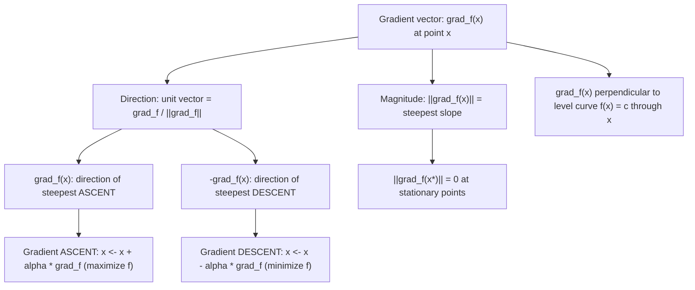

# Gradient Direction

$$
\nabla f(x)
$$

points in the direction of steepest ascent; $-\nabla f(x)$ points to steepest descent.

## Deep Breakdown

What it tells me *(Situation Awareness)*:
This is the geometric interpretation of the gradient. While the gradient formula ($\nabla f = [\partial f/\partial x_1, \ldots, \partial f/\partial x_n]$) tells you what to compute, the gradient direction property tells you what it means: among all possible unit-length directions in $\mathbb{R}^n$, the gradient $\nabla f(\mathbf{x})$ points in the direction where $f$ increases fastest, and $-\nabla f(\mathbf{x})$ points in the direction where $f$ decreases fastest. This fact, provable via the Cauchy-Schwarz inequality, is the entire theoretical justification for gradient descent. Every optimizer in ML (SGD, Adam, RMSProp, LBFGS) exploits this property. The magnitude $\|\nabla f(\mathbf{x})\|$ tells you the steepest slope. The gradient is zero at stationary points (minima, maxima, saddles). The gradient is perpendicular to level curves and level surfaces of $f$.

## Flowchart



## Real-world use

### Where it is used

The direction interpretation is the foundation of: all gradient-based optimization (gradient descent and its variants), convergence diagnostics (tracking $\|\nabla L\|$ during training), natural gradient methods (adjusting for the curvature of the parameter space), visualizing loss landscapes (gradient arrows on a contour plot), understanding why learning rates need to be small (the gradient direction is only locally valid for a step in that direction).

### Problem it solves

Knowing the gradient vector numerically (e.g., $\nabla L = [3.2, -1.1, 0.4, \ldots]$) is uninformative unless you know what it means geometrically. The direction property converts the abstract partial derivative vector into an actionable instruction: "move in the direction $-\nabla L$ to reduce the loss."

### How it solves the problem

The directional derivative in direction $\mathbf{v}$ is $D_\mathbf{v} f = \nabla f \cdot \hat{\mathbf{v}}$ (where $\hat{\mathbf{v}}$ is the unit vector). By Cauchy-Schwarz: $\nabla f \cdot \hat{\mathbf{v}} \leq \|\nabla f\|\|\hat{\mathbf{v}}\| = \|\nabla f\|$, with equality when $\hat{\mathbf{v}} = \nabla f / \|\nabla f\|$. So the maximum directional derivative (steepest ascent) is $\|\nabla f\|$, achieved in the gradient direction. Reversing: minimum directional derivative is $-\|\nabla f\|$, achieved in the $-\nabla f$ direction.

### Example in a business

Training a click-through-rate prediction model. After each batch, we compute the gradient of cross-entropy loss w.r.t. all weights: $\nabla_w L$. The gradient direction property tells us: the update $w \leftarrow w - \alpha \nabla_w L$ moves us in the direction of steepest loss decrease in weight space. Monitoring $\|\nabla_w L\|$ (gradient norm) tells us how steep the loss landscape is at the current point: large norm = far from a minimum, small norm = near a stationary point. This is the primary convergence diagnostic for gradient descent training.

## The formula, piece by piece

**Steepest ascent direction**: $\hat{\mathbf{u}}^* = \frac{\nabla f(\mathbf{x})}{\|\nabla f(\mathbf{x})\|}$ (unit vector pointing in the gradient direction) **Steepest slope (rate of fastest increase)**: $\max_{\|\hat{\mathbf{u}}\|=1} D_{\hat{\mathbf{u}}} f = \|\nabla f(\mathbf{x})\|$ **Directional derivative**: $D_{\hat{\mathbf{u}}} f(\mathbf{x}) = \nabla f(\mathbf{x}) \cdot \hat{\mathbf{u}} = \|\nabla f\| \cos\theta$ where $\theta$ is the angle between $\hat{\mathbf{u}}$ and $\nabla f$.

Each symbol:
- $\nabla f(\mathbf{x})$: the gradient vector at point $\mathbf{x}$ (computed from partial derivatives)
- $\hat{\mathbf{u}}$: a unit direction vector ($\|\hat{\mathbf{u}}\| = 1$) to move in
- $D_{\hat{\mathbf{u}}} f$: the directional derivative — rate of change of $f$ in direction $\hat{\mathbf{u}}$
- $\|\nabla f(\mathbf{x})\|$: the Euclidean norm — the actual steepest slope at $\mathbf{x}$
- $\cos\theta$: maximized (= 1) when $\hat{\mathbf{u}} \parallel \nabla f$ (same direction) **Gradient descent update** (step toward steepest descent):

$$
\mathbf{x}^{(t+1)} = \mathbf{x}^{(t)} - \alpha \nabla f(\mathbf{x}^{(t)})
$$

## The formula in words

"Imagine standing on a hillside (the surface $z = f(x, y)$). The gradient vector $\nabla f$ at your feet points horizontally in the direction you should walk to gain altitude as fast as possible. The length of that vector tells you how steep the hill is. Turning exactly opposite to the gradient and walking gives you the fastest way downhill. If you walk perpendicular to the gradient, you traverse a contour line (constant altitude)."

## Critical Concepts

- **Cauchy-Schwarz proof**: $\nabla f \cdot \hat{\mathbf{u}} \leq \|\nabla f\|\|\hat{\mathbf{u}}\| = \|\nabla f\|$, with equality iff $\hat{\mathbf{u}} = \nabla f / \|\nabla f\|$. This rigorously proves the steepest ascent claim.
- **Perpendicular to level curves**: on a level curve $f(\mathbf{x}) = c$, moving along the curve means $df = 0 = \nabla f \cdot d\mathbf{x}$, so $\nabla f \perp d\mathbf{x}$ for any tangential move. The gradient is always perpendicular to the level curve.
- **Gradient norm as convergence signal**: in training, plot $\|\nabla_w L\|$ vs. epoch. Decreasing gradient norm signals convergence toward a stationary point.
- **Vanishing gradients**: in deep networks, gradients can become very small ($\|\nabla f\| \approx 0$) due to repeated multiplication of small Jacobians (sigmoid saturation). ReLU activations mitigate this.
- **Exploding gradients**: in RNNs, gradients can become very large. Gradient clipping caps $\|\nabla f\|$ at a threshold: $\nabla f \leftarrow \nabla f \cdot \min(1, \text{clip\_norm}/\|\nabla f\|)$.
- **Step size matters**: the gradient only tells direction.

If $\alpha$ is too large, the step overshoots the minimum; if too small, convergence is slow. Line search or adaptive methods (Adam) address this.

## Step-by-step calculation (tiny example)

Let $f(x, y) = x^2 + 4y^2$ (an elliptic paraboloid).

At $(1, 1)$:

*Step 1: Compute the gradient*
$\nabla f = [2x, 8y]$
$\nabla f(1, 1) = [2, 8]$

*Step 2: Compute the steepest slope magnitude*
$\|\nabla f(1,1)\| = \sqrt{2^2 + 8^2} = \sqrt{4 + 64} = \sqrt{68} \approx 8.25$

*Step 3: Unit ascent direction*
$\hat{\mathbf{u}}^* = \frac{[2, 8]}{\sqrt{68}} \approx [0.243, 0.970]$

*Step 4: Gradient descent step (alpha = 0.05)*
$\mathbf{x}^{(1)} = [1, 1] - 0.05 \cdot [2, 8] = [0.9, 0.6]$

*Step 5: Check — does $f$ decrease?*
$f(1,1) = 1 + 4 = 5$
$f(0.9, 0.6) = 0.81 + 4(0.36) = 0.81 + 1.44 = 2.25$ (decreased significantly)

## Code examples

### Beginner example (Python)

```python
import numpy as np
import matplotlib.pyplot as plt


def f(x: np.ndarray) -> float:
    """f(x, y) = x^2 + 4y^2 (elliptic paraboloid, minimum at origin)."""
    return float(x[0]**2 + 4.0 * x[1]**2)


def grad_f(x: np.ndarray) -> np.ndarray:
    """Gradient: [2x, 8y]."""
    return np.array([2.0 * x[0], 8.0 * x[1]])


# At point (1, 1): steepest direction and magnitude
x0 = np.array([1.0, 1.0])
g = grad_f(x0)
magnitude = float(np.linalg.norm(g))
unit_ascent = g / magnitude
unit_descent = -unit_ascent
print(f"At x = {x0}:")
print(f" Gradient: {g}")
print(f" Steepest slope: {magnitude:.4f} (magnitude)")
print(f" Ascent direction: {unit_ascent}")
print(f" Descent direction: {unit_descent}")

# Directional derivative in a few directions
angles = [0, 30, 90, 180]  # degrees relative to x-axis
for angle_deg in angles:
    angle_rad = np.radians(angle_deg)
    u = np.array([np.cos(angle_rad), np.sin(angle_rad)])
    dir_deriv = float(np.dot(g, u))
    print(f" D_{angle_deg:>3}deg f = {dir_deriv:>8.4f}")

# Gradient descent trajectory
ALPHA = 0.05
x_path = [x0.copy()]
x_current = x0.copy()
for _ in range(30):
    x_current = x_current - ALPHA * grad_f(x_current)
    x_path.append(x_current.copy())
x_path = np.array(x_path)
print(f"\nGradient descent path (last 5 points):")
for pt in x_path[-5:]:
    print(f" x = {pt}, f(x) = {f(pt):.6f}")
print(f" Minimum at origin: f = 0")
```

### Beginner example (R)

```r
f <- function(x) x[1]^2 + 4 * x[2]^2
grad_f <- function(x) c(2 * x[1], 8 * x[2])
x0 <- c(1, 1)
g <- grad_f(x0)
magnitude <- sqrt(sum(g^2))
cat("Gradient at (1,1): ", g, "\n")  # 2 8
cat("Steepest slope mag: ", magnitude, "\n")  # ~8.25
cat("Ascent direction: ", g / magnitude, "\n")

# Gradient descent
alpha <- 0.05
x_current <- x0
for (i in 1:30) {
  x_current <- x_current - alpha * grad_f(x_current)
}
cat("After 30 GD steps: x =", x_current, "f =", f(x_current), "\n")
```

### Professional example (Python)

```python
"""
Gradient direction and gradient norm as training diagnostics.

We train a logistic regression model with vanilla gradient descent and
track: (1) loss, (2) gradient norm, (3) angle between consecutive gradients.

Key insights:
- Decreasing gradient norm -> approaching stationary point.
- Angle between consecutive gradients > 90 deg -> oscillation (LR too high).
- Gradient norm at convergence should be near 0.
"""
import numpy as np
from sklearn.datasets import make_classification
from sklearn.model_selection import train_test_split
from sklearn.preprocessing import StandardScaler
RANDOM_SEED = 42
rng = np.random.default_rng(RANDOM_SEED)


def sigmoid(z: np.ndarray) -> np.ndarray:
    return 1.0 / (1.0 + np.exp(-np.clip(z, -500, 500)))


def cross_entropy(w: np.ndarray, x: np.ndarray, y: np.ndarray) -> float:
    prob = np.clip(sigmoid(x @ w), 1e-12, 1 - 1e-12)
    return float(-np.mean(y * np.log(prob) + (1 - y) * np.log(1 - prob)))


def grad_ce(w: np.ndarray, x: np.ndarray, y: np.ndarray) -> np.ndarray:
    return x.T @ (sigmoid(x @ w) - y) / len(y)


# Data
x_raw, y_data = make_classification(n_samples=1000, n_features=8, n_informative=5, random_state=RANDOM_SEED)
x_train, x_test, y_train, y_test = train_test_split(x_raw, y_data, test_size=0.3, random_state=RANDOM_SEED)
scaler = StandardScaler()
x_train_s = scaler.fit_transform(x_train)

# Gradient descent with diagnostics
ALPHA = 0.3
N_EPOCHS = 200
w = rng.standard_normal(x_train_s.shape[1]) * 0.01
prev_grad = None
history = {"epoch": [], "loss": [], "grad_norm": [], "angle_deg": []}
for epoch in range(N_EPOCHS):
    loss = cross_entropy(w, x_train_s, y_train)
    g = grad_ce(w, x_train_s, y_train)
    grad_norm = float(np.linalg.norm(g))
    angle_deg = float("nan")
    if prev_grad is not None:
        cos_angle = float(np.dot(g, prev_grad) / (np.linalg.norm(g) * np.linalg.norm(prev_grad) + 1e-12))
        angle_deg = float(np.degrees(np.arccos(np.clip(cos_angle, -1, 1))))
    history["epoch"].append(epoch)
    history["loss"].append(loss)
    history["grad_norm"].append(grad_norm)
    history["angle_deg"].append(angle_deg)
    prev_grad = g.copy()
    w = w - ALPHA * g

print("Gradient direction diagnostics (selected epochs):")
print(f" {'Epoch':>6} | {'Loss':>10} | {'||grad||':>10} | {'Angle (deg)':>12}")
for idx in [0, 10, 50, 100, 199]:
    print(f" {history['epoch'][idx]:>6} | "
          f"{history['loss'][idx]:>10.6f} | "
          f"{history['grad_norm'][idx]:>10.6f} | "
          f"{str(round(history['angle_deg'][idx], 2)):>12}")
print(f"\nConvergence: ||grad|| at epoch 199 = {history['grad_norm'][-1]:.6f}")
print(f" (should be near 0 for well-converged model)")
print(f"\nNote: angle between consecutive gradients near 0 = consistent direction = stable convergence")
```

---

*Source: MML2*
