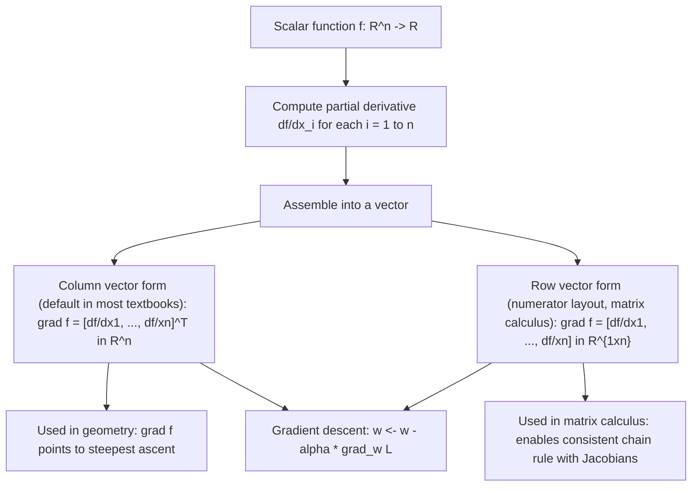

# Gradient (Row Vector Form)

$$
\nabla_x f = \left[ \frac{\partial f}{\partial x_1}, \frac{\partial f}{\partial x_2}, \dots, \frac{\partial f}{\partial x_n} \right] \in \mathbb{R}^{1 \times n}
$$

## Deep Breakdown

What it tells me *(Situation Awareness)*:
The gradient is the generalization of the derivative to multivariate scalar functions. For a function $f: \mathbb{R}^n \to \mathbb{R}$, the gradient $\nabla_x f$ collects all $n$ partial derivatives into a single vector (or row vector, in the numerator-layout convention). Each component $\frac{\partial f}{\partial x_i}$ measures the rate of change of $f$ in the direction of the $i$-th coordinate axis. Together, they give both the direction of steepest increase and the rate of that increase. In DA/DS and ML, the gradient is omnipresent: every gradient descent update step computes $\nabla_\mathbf{w} L$ (the gradient of the loss with respect to all weights simultaneously) and then takes a step in the negative gradient direction. The gradient is also the coefficient vector of the total differential ($df = \nabla f \cdot d\mathbf{x}$) and the foundation for Jacobians and Hessians. No gradient, no optimization; no optimization, no machine learning.

## Flowchart



## Real-world use

### Where it is used

Gradient descent and all its variants (SGD, Adam, RMSProp): the gradient of the loss w.r.t. all parameters. Backpropagation: gradients flowing backward through a neural network. Sensitivity analysis: $\nabla f$ at a point tells which input changes $f$ the most. Optimization theory: stationary points satisfy $\nabla f = \mathbf{0}$. Regularization: gradient of L2 penalty ($\nabla_w \|w\|^2 = 2w$) added to loss gradient. Natural language processing: word embeddings are found by gradient-based optimization of a word co-occurrence loss.

### Problem it solves

For a function of $n$ variables, there is no single "the derivative" — there are $n$ partial derivatives. The gradient bundles all $n$ partial derivatives into one structured object that can be manipulated with linear algebra. It answers: "If I want to maximize (or minimize) $f$, in which direction in $\mathbb{R}^n$ should I move?"

### How it solves the problem

The directional derivative of $f$ in direction $\mathbf{u}$ (unit vector) is $D_\mathbf{u} f = \nabla f \cdot \mathbf{u}$ (dot product). This is maximized when $\mathbf{u}$ is parallel to $\nabla f$ (Cauchy-Schwarz), confirming that the gradient points in the direction of steepest ascent. Moving opposite to the gradient ($-\nabla f$) gives the steepest descent — the basis of gradient descent.

### Example in a business

A revenue model is $R(p, q) = p \cdot D(p, q) - C(q)$ where $p$ is price, $q$ is quantity, $D$ is demand, and $C$ is cost. The gradient $\nabla R = [\partial R/\partial p, \partial R/\partial q]$ points toward the price-quantity combination that increases revenue the fastest. Setting $\nabla R = \mathbf{0}$ gives the revenue-maximizing equilibrium conditions. A gradient ascent algorithm would iteratively update $(p, q)$ along $+\nabla R$ to find the maximum.

## The formula, piece by piece

$$
\nabla_x f = \left[ \frac{\partial f}{\partial x_1},\; \frac{\partial f}{\partial x_2},\; \dots,\; \frac{\partial f}{\partial x_n} \right] \in \mathbb{R}^{1 \times n}
$$

Each symbol:
- $\nabla$: the "nabla" or "del" operator — signals "take all partial derivatives"
- $\nabla_x$: gradient with respect to the vector $\mathbf{x} = (x_1, \ldots, x_n)^T$
- $f$: the scalar-valued function being differentiated
- $\frac{\partial f}{\partial x_i}$: the $i$-th partial derivative (rate of change in the $x_i$-direction)
- $\mathbb{R}^{1 \times n}$: row vector convention (numerator layout / denominator layout distinction; column vector is equally common) **Column vector form** (more common in most ML textbooks):

$$
\nabla_x f = \begin{pmatrix} \frac{\partial f}{\partial x_1} \\ \vdots \\ \frac{\partial f}{\partial x_n} \end{pmatrix} \in \mathbb{R}^{n}
$$

**Gradient descent update**:

$$
\mathbf{w}^{(t+1)} = \mathbf{w}^{(t)} - \alpha \nabla_\mathbf{w} L(\mathbf{w}^{(t)})
$$

## The formula in words

"Compute the rate of change of $f$ in each of the $n$ coordinate directions independently. Stack those $n$ numbers into a vector. That vector is the gradient: it tells you both which direction to move (toward the steepest increase) and how steep the slope is (its magnitude is the steepest slope)."

## Critical Concepts

- **Gradient direction = steepest ascent**: the gradient points in the direction where $f$ increases most rapidly. The magnitude $\|\nabla f\|$ is the steepest slope.
- **Gradient descent**: subtract a scaled gradient from the current point: $\mathbf{x} \leftarrow \mathbf{x} - \alpha \nabla f(\mathbf{x})$ to minimize $f$.
- **Stationary points**: $\nabla f(\mathbf{x}^*) = \mathbf{0}$ is necessary (but not sufficient) for $\mathbf{x}^*$ to be a local minimum, maximum, or saddle point.
- **Layout convention warning**: some sources (physics, column-vector math) define the gradient as a column vector $\in \mathbb{R}^n$; others (numerator-layout matrix calculus) define it as a row vector $\in \mathbb{R}^{1\times n}$. Both contain the same information but lead to different transpose requirements in chain rules.
- **Chain rule for scalar composition**: if $g: \mathbb{R}^m \to \mathbb{R}$ and $\mathbf{u}: \mathbb{R}^n \to \mathbb{R}^m$, then $\nabla_\mathbf{x}(g \circ \mathbf{u}) = (\nabla_\mathbf{u} g) \cdot J_\mathbf{u}(\mathbf{x})$ where $J$ is the Jacobian.
- **Numerical gradient check**: $\frac{f(\mathbf{x} + h\mathbf{e}_i) - f(\mathbf{x} - h\mathbf{e}_i)}{2h} \approx \frac{\partial f}{\partial x_i}$ for small $h$.

## Step-by-step calculation (tiny example)

Let $f(x_1, x_2, x_3) = x_1^2 + 3x_1 x_2 - x_3$. Compute $\nabla f$ at $(1, 2, 0)$.

*Step 1: Compute each partial derivative*
$\frac{\partial f}{\partial x_1} = 2x_1 + 3x_2$
$\frac{\partial f}{\partial x_2} = 3x_1$
$\frac{\partial f}{\partial x_3} = -1$

*Step 2: Assemble the gradient vector*

$$
\nabla f = [2x_1 + 3x_2,\; 3x_1,\; -1]
$$

*Step 3: Evaluate at $(1, 2, 0)$*

$$
\nabla f(1, 2, 0) = [2(1) + 3(2),\; 3(1),\; -1] = [8,\; 3,\; -1]
$$

*Step 4: Interpret*
At $(1,2,0)$: the steepest ascent direction is approximately $(8/\|\cdot\|, 3/\|\cdot\|, -1/\|\cdot\|)$. The $x_1$ direction has the biggest effect (coefficient 8). Moving in the $-\nabla f = (-8, -3, 1)$ direction decreases $f$ most rapidly.

## Code examples

### Beginner example (Python)

```python
import numpy as np

def f(x: np.ndarray) -> float:
    """f(x1, x2, x3) = x1^2 + 3*x1*x2 - x3."""
    return float(x[0]**2 + 3.0 * x[0] * x[1] - x[2])

def analytic_gradient(x: np.ndarray) -> np.ndarray:
    """Gradient: [2*x1 + 3*x2, 3*x1, -1]."""
    return np.array([ 2.0 * x[0] + 3.0 * x[1], 3.0 * x[0], -1.0, ])

def numerical_gradient(fn, x: np.ndarray, h: float = 1e-5) -> np.ndarray:
    """Centered finite difference gradient."""
    grad = np.zeros_like(x)
    for i in range(len(x)):
        e_i = np.zeros_like(x)
    e_i[i] = 1.0
    grad[i] = (fn(x + h * e_i) - fn(x - h * e_i)) / (2 * h)
    return grad
x0 = np.array([1.0, 2.0, 0.0])
grad_analytic = analytic_gradient(x0)
grad_numerical = numerical_gradient(f, x0)
print(f"Gradient at {x0}:")
print(f" Analytic: {grad_analytic}")
print(f" Numerical: {grad_numerical}")
print(f" Max error: {np.abs(grad_analytic - grad_numerical).max():.2e}")   # Show steepest ascent/descent
magnitude = float(np.linalg.norm(grad_analytic))
unit_ascent = grad_analytic / magnitude
print(f"\nSteepest ascent direction: {unit_ascent}")
print(f"Steepest slope magnitude: {magnitude:.4f}")   # Gradient descent: minimize f starting at x0
ALPHA = 0.01
x_current = x0.copy()
for step in range(50):
    x_current = x_current - ALPHA * analytic_gradient(x_current)
print(f"\nGradient descent (50 steps, alpha={ALPHA}): x = {x_current}, f = {f(x_current):.4f}")
```

### Beginner example (R)

```r
f <- function(x) x[1]^2 + 3 * x[1] * x[2] - x[3]  # Analytic gradient
analytic_grad <- function(x) c(2*x[1] + 3*x[2], 3*x[1], -1)  # Numerical gradient
num_grad <- function(fn, x, h = 1e-5) { n <- length(x)
  grad <- numeric(n)
  for (i in seq_len(n)) { e_i <- rep(0, n); e_i[i] <- 1
    grad[i] <- (fn(x + h * e_i) - fn(x - h * e_i)) / (2 * h)
  } grad
}
x0 <- c(1, 2, 0)
g_analytic <- analytic_grad(x0)
g_numerical <- num_grad(f, x0)
cat("Analytic gradient: ", g_analytic, "\n")  # 8 3 -1
cat("Numerical gradient:", g_numerical, "\n")
cat("Max error:", max(abs(g_analytic - g_numerical)), "\n")
```

### Professional example (Python)

```python
"""
Gradient of the cross-entropy loss
with respect to logistic regression weights. L(w) = -(1/N) sum_i [y_i log(sigma(w^T x_i)) + (1-y_i) log(1 - sigma(w^T x_i))] Analytic gradient:
    grad_w
L = (1/N) X^T (sigma(Xw) - y) This is the core of logistic regression gradient descent / backpropagation.
We compute: (1) analytic gradient, (2) numerical gradient, (3) run gradient descent.
"""
import numpy as np
from sklearn.datasets import make_classification
from sklearn.model_selection import train_test_split
from sklearn.preprocessing import StandardScaler
RANDOM_SEED = 42
rng = np.random.default_rng(RANDOM_SEED)

def sigmoid(z: np.ndarray) -> np.ndarray:
    return 1.0 / (1.0 + np.exp(-np.clip(z, -500, 500)))

def cross_entropy_loss(w: np.ndarray, x: np.ndarray, y: np.ndarray) -> float:
    prob = np.clip(sigmoid(x @ w), 1e-12, 1.0 - 1e-12)
    return float(-np.mean(y * np.log(prob) + (1 - y) * np.log(1 - prob)))

def analytic_gradient_ce(w: np.ndarray, x: np.ndarray, y: np.ndarray) -> np.ndarray:
    """grad_w L = (1/N) * X^T * (sigma(Xw) - y)."""
    residual = sigmoid(x @ w) - y
    return x.T @ residual / len(y)

def numerical_gradient_ce(w: np.ndarray, x: np.ndarray, y: np.ndarray, h: float = 1e-5) -> np.ndarray:
    grad = np.zeros_like(w)
    for i in range(len(w)):
        e_i = np.zeros_like(w); e_i[i] = h
    grad[i] = (cross_entropy_loss(w + e_i, x, y) - cross_entropy_loss(w - e_i, x, y)) / (2 * h)
    return grad   # Dataset
x_raw, y_data = make_classification(n_samples=1000, n_features=6, n_informative=4, random_state=RANDOM_SEED)
x_train, x_test, y_train, y_test = train_test_split(x_raw, y_data, test_size=0.3, random_state=RANDOM_SEED)
scaler = StandardScaler()
x_train_s = scaler.fit_transform(x_train)
x_test_s = scaler.transform(x_test)   # Gradient check
w_init = rng.standard_normal(x_train_s.shape[1]) * 0.1
g_analytic = analytic_gradient_ce(w_init, x_train_s, y_train)
g_numerical = numerical_gradient_ce(w_init, x_train_s, y_train)
rel_error = np.abs(g_analytic - g_numerical) / (np.abs(g_analytic) + np.abs(g_numerical) + 1e-12)
print("Gradient check for logistic regression cross-entropy:")
print(f" Max relative error: {rel_error.max():.2e} (should be < 1e-4)")   # Gradient descent to convergence
ALPHA = 0.5
N_ITER = 500
w_gd = rng.standard_normal(x_train_s.shape[1]) * 0.01
loss_history = []
for iteration in range(N_ITER):
    loss = cross_entropy_loss(w_gd, x_train_s, y_train)
loss_history.append(loss)
grad = analytic_gradient_ce(w_gd, x_train_s, y_train)
w_gd = w_gd - ALPHA * grad
grad_norm_final = float(np.linalg.norm(analytic_gradient_ce(w_gd, x_train_s, y_train)))
accuracy = float(np.mean((sigmoid(x_test_s @ w_gd) >= 0.5) == y_test))
print(f"\nGradient descent ({N_ITER} steps, alpha={ALPHA}):")
print(f" Initial loss: {loss_history[0]:.4f}")
print(f" Final loss: {loss_history[-1]:.4f}")
print(f" ||grad|| final: {grad_norm_final:.6f} (near 0 = converged)")
print(f" Test accuracy: {accuracy:.4f}")
```

---

*Source: 1300 p. 233*
