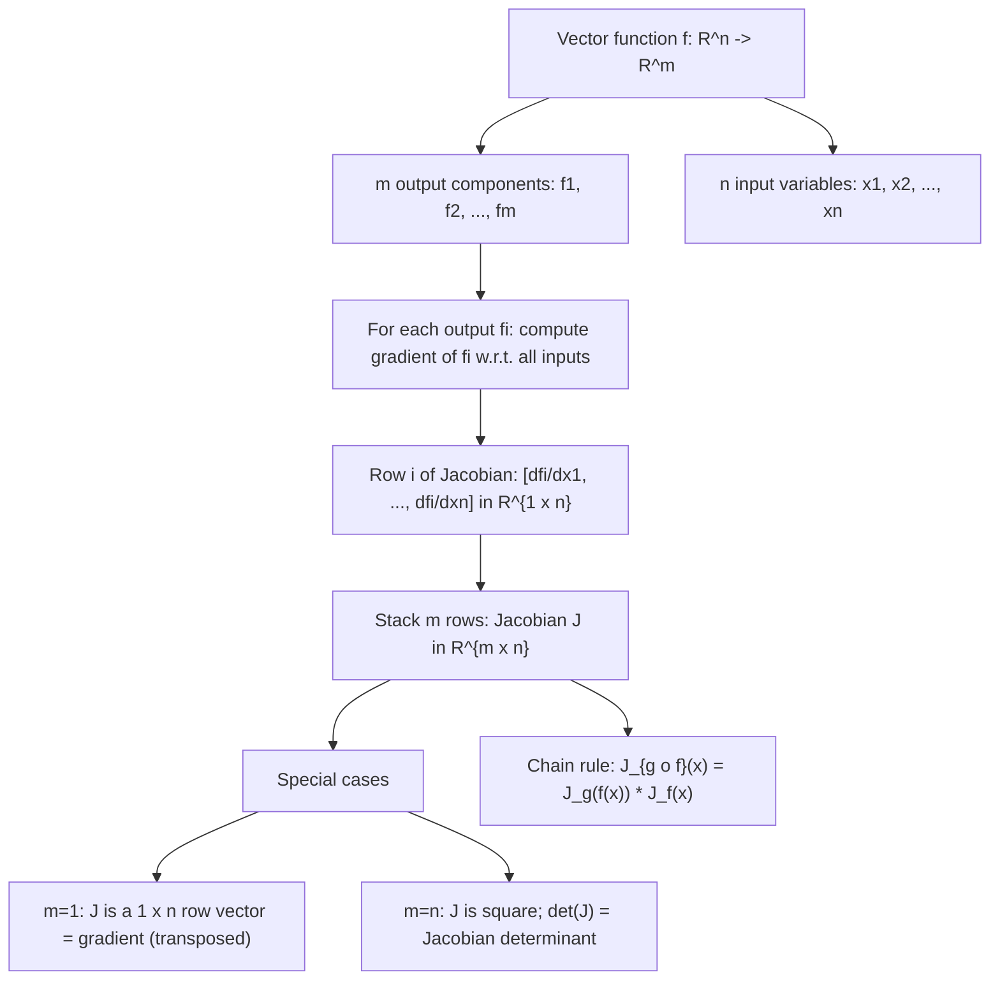

# Jacobian_matrix

Jacobian Matrix ($f:\mathbb{R}^n \to \mathbb{R}^m$)

$J_f = \begin{bmatrix} \frac{\partial f_1}{\partial x_1} & \dots & \frac{\partial f_1}{\partial x_n} \\ \vdots & \ddots & \vdots \\ \frac{\partial f_m}{\partial x_1} & \dots & \frac{\partial f_m}{\partial x_n} \end{bmatrix} \in \mathbb{R}^{m \times n}$

## Deep Breakdown

What it tells me *(Situation Awareness)*:
The Jacobian matrix generalizes the gradient to vector-valued functions. While the gradient covers scalar functions $f: \mathbb{R}^n \to \mathbb{R}$, the Jacobian covers the full vector case $f: \mathbb{R}^n \to \mathbb{R}^m$. The $(i,j)$ entry is $\frac{\partial f_i}{\partial x_j}$: how the $i$-th output changes when the $j$-th input is nudged. The Jacobian is an $m \times n$ matrix that captures all first-order sensitivities between inputs and outputs simultaneously. In DA/DS and ML, the Jacobian appears in: backpropagation through vector-to-vector layers (each layer maps a vector of activations to a new vector; the Jacobian is the derivative of that map), the multivariate chain rule in matrix form ($J_{g \circ f} = J_g \cdot J_f$), change-of-variables in probability (the Jacobian determinant appears in the PDF transformation formula), and sensitivity/influence analysis in multi-output regression models.

## Flowchart



## Real-world use

### Where it is used

Backpropagation: each layer $f: \mathbb{R}^n \to \mathbb{R}^m$ has a Jacobian; the chain rule in vector form is Jacobian matrix multiplication. Change-of-variables in probability: $p_Y(\mathbf{y}) = p_X(\mathbf{x}) / |\det J_f(\mathbf{x})|$ where $J_f$ is the Jacobian of the transformation. Normalizing flows (generative models): the Jacobian determinant must be computable. Sensitivity analysis: which inputs most affect which outputs? The Jacobian matrix answers this. Root finding (Newton's method for systems of equations): $\mathbf{x}^{(t+1)} = \mathbf{x}^{(t)} - J^{-1}_f \mathbf{f}(\mathbf{x}^{(t)})$.

### Problem it solves

When a function maps multiple inputs to multiple outputs, the standard derivative (a scalar) is insufficient. The Jacobian provides the complete first-order linear approximation: $f(\mathbf{x} + \mathbf{h}) \approx f(\mathbf{x}) + J_f(\mathbf{x})\,\mathbf{h}$. This generalizes both the gradient (scalar output, vector input) and the ordinary derivative (scalar to scalar).

### How it solves the problem

By computing all $m \times n$ partial derivatives and organizing them into a matrix. Each row $i$ is the gradient of the $i$-th output function $f_i$ with respect to all inputs. The matrix structure enables the multivariate chain rule to be expressed as matrix multiplication: if $g: \mathbb{R}^m \to \mathbb{R}^k$ and $f: \mathbb{R}^n \to \mathbb{R}^m$, then $J_{g \circ f}(\mathbf{x}) = J_g(f(\mathbf{x})) \cdot J_f(\mathbf{x}) \in \mathbb{R}^{k \times n}$.

### Example in a business

A multi-label email classifier outputs a probability vector $\mathbf{p} = \text{softmax}(\mathbf{z}) \in \mathbb{R}^K$ for $K$ categories. The Jacobian of softmax is $J_{\text{softmax}}(\mathbf{z}) = \text{diag}(\mathbf{p}) - \mathbf{p}\mathbf{p}^T \in \mathbb{R}^{K \times K}$. This Jacobian is multiplied by the upstream gradient during backpropagation to propagate errors through the softmax layer.

## The formula, piece by piece

$$
J_f = \begin{bmatrix} \frac{\partial f_1}{\partial x_1} & \cdots & \frac{\partial f_1}{\partial x_n} \\ \vdots & \ddots & \vdots \\ \frac{\partial f_m}{\partial x_1} & \cdots & \frac{\partial f_m}{\partial x_n} \end{bmatrix} \in \mathbb{R}^{m \times n}
$$

Each symbol:
- $J_f$ or $Df$: the Jacobian of $f$ — also called the "total derivative"
- $(i,j)$ entry: $[J_f]_{ij} = \frac{\partial f_i}{\partial x_j}$ — how output $i$ responds to input $j$
- $\mathbb{R}^{m \times n}$: $m$ rows (one per output), $n$ columns (one per input)
- Row $i$: the gradient of the scalar function $f_i$ w.r.t. $\mathbf{x}$ **Chain rule in Jacobian form** ($g: \mathbb{R}^m \to \mathbb{R}^k$, $f: \mathbb{R}^n \to \mathbb{R}^m$):

$$
J_{g \circ f}(\mathbf{x}) = J_g(f(\mathbf{x})) \cdot J_f(\mathbf{x}) \in \mathbb{R}^{k \times n}
$$

**Linear approximation**: $f(\mathbf{x} + \mathbf{h}) \approx f(\mathbf{x}) + J_f(\mathbf{x})\,\mathbf{h}$

## The formula in words

"For each of the $m$ outputs, compute its gradient (a row vector of $n$ partial derivatives). Stack these $m$ row-gradients vertically into a matrix. Row $i$ tells you how output $i$ responds to infinitesimal changes in all inputs. Column $j$ tells you how all outputs respond to a nudge in input $x_j$. The entire matrix is the best linear approximation of $f$ at $\mathbf{x}$."

## Critical Concepts

- **Linear approximation**: $f(\mathbf{x} + \mathbf{h}) \approx f(\mathbf{x}) + J_f(\mathbf{x})\,\mathbf{h}$ for small $\mathbf{h}$.
- **Jacobian in backprop (VJP)**: for a layer $f: \mathbb{R}^n \to \mathbb{R}^m$, the gradient of a scalar loss w.r.t. the input is $\nabla_\mathbf{x} L = J_f(\mathbf{x})^T \nabla_{\mathbf{y}} L$ — the vector-Jacobian product (VJP).
- **Jacobian determinant**: for square $J$ ($m = n$), $|\det J_f(\mathbf{x})|$ measures volume distortion. Used in change-of-variables: $p_Y(\mathbf{y}) = p_X(f^{-1}(\mathbf{y})) / |\det J_f(f^{-1}(\mathbf{y}))|$.
- **Softmax Jacobian**: $J_{\text{softmax}} = \text{diag}(\mathbf{p}) - \mathbf{p}\mathbf{p}^T$ — symmetric, rank-$(K-1)$.
- **Numerical check**: $[J_f]_{ij} \approx \frac{f_i(\mathbf{x}+h\mathbf{e}_j)-f_i(\mathbf{x}-h\mathbf{e}_j)}{2h}$ (centered difference).
- **Forward vs. reverse mode AD**: forward mode computes one column of $J$ per pass (efficient for few inputs).

Reverse mode (backprop) computes one row per pass (efficient for scalar output = VJP).

## Step-by-step calculation (tiny example)

Let $f: \mathbb{R}^2 \to \mathbb{R}^3$ with $f(x_1, x_2) = (x_1 x_2,\; x_1^2,\; x_1 + 3x_2)$.
Compute $J_f$ at $(2, 1)$.

*Step 1: List the three output functions*
$f_1 = x_1 x_2$, $f_2 = x_1^2$, $f_3 = x_1 + 3x_2$

*Step 2: Compute all 6 partial derivatives*
$\frac{\partial f_1}{\partial x_1} = x_2$, $\frac{\partial f_1}{\partial x_2} = x_1$;
$\frac{\partial f_2}{\partial x_1} = 2x_1$, $\frac{\partial f_2}{\partial x_2} = 0$;
$\frac{\partial f_3}{\partial x_1} = 1$, $\frac{\partial f_3}{\partial x_2} = 3$

*Step 3: Assemble the $3 \times 2$ Jacobian at $(2, 1)$*

$$
J_f(2,1) = \begin{bmatrix} 1 & 2 \\ 4 & 0 \\ 1 & 3 \end{bmatrix}
$$

*Step 4: Verify linear approximation for $\mathbf{h} = (0.01, 0.01)^T$*
$J_f \mathbf{h} = [0.03, 0.04, 0.04]^T$ vs. exact $f(2.01,1.01)-f(2,1) = [0.0301, 0.0401, 0.04]^T$ ✓

## Code examples

### Beginner example (Python)

```python
import numpy as np

def f(x: np.ndarray) -> np.ndarray:
    """f: R^2 -> R^3. f(x1, x2) = [x1*x2, x1^2, x1 + 3*x2]."""
    x1, x2 = x[0], x[1]
    return np.array([x1 * x2, x1**2, x1 + 3.0 * x2])

def analytic_jacobian(x: np.ndarray) -> np.ndarray:
    """Jacobian of f at x: 3 x 2 matrix."""
    x1, x2 = x[0], x[1]
    return np.array([ [x2, x1],   # row 1: grad of f1
        [2*x1, 0.0],   # row 2: grad of f2
        [1.0, 3.0],   # row 3: grad of f3
    ])

def numerical_jacobian(fn, x: np.ndarray, h: float = 1e-5) -> np.ndarray:
    """Numerical Jacobian via centered finite differences."""
    n = len(x)
    f0 = fn(x)
    m = len(f0)
    jac = np.zeros((m, n))
    for j in range(n):
        e_j = np.zeros(n); e_j[j] = 1.0
    jac[:, j] = (fn(x + h * e_j) - fn(x - h * e_j)) / (2 * h)
    return jac
x0 = np.array([2.0, 1.0])
j_analytic = analytic_jacobian(x0)
j_numerical = numerical_jacobian(f, x0)
print(f"Jacobian at {x0}:")
print("Analytic:")
print(j_analytic)
print("\nNumerical:")
print(j_numerical.round(6))
print(f"\nMax error: {np.abs(j_analytic - j_numerical).max():.2e}")   # Linear approximation test
h_vec = np.array([0.01, 0.01])
delta_f_approx = j_analytic @ h_vec
delta_f_exact = f(x0 + h_vec) - f(x0)
print(f"\nLinear approximation: {delta_f_approx}")
print(f"Exact change: {delta_f_exact}")
```

### Beginner example (R)

```r
f_fn <- function(x) c(x[1]*x[2], x[1]^2, x[1] + 3*x[2])  # R^2 -> R^3

# Analytic Jacobian at x
analytic_jac <- function(x) {
  matrix(c(x[2], 2*x[1], 1,  # column 1 (partial w.r.t. x1)
           x[1], 0, 3),      # column 2 (partial w.r.t. x2)
         nrow = 3, ncol = 2)
}

# Numerical Jacobian
num_jac <- function(fn, x, h = 1e-5) {
  n <- length(x); f0 <- fn(x); m <- length(f0)
  jac <- matrix(0, nrow = m, ncol = n)
  for (j in seq_len(n)) {
    e <- rep(0, n); e[j] <- 1
    jac[, j] <- (fn(x + h * e) - fn(x - h * e)) / (2 * h)
  }
  jac
}
x0 <- c(2, 1)
j_a <- analytic_jac(x0); j_n <- num_jac(f_fn, x0)
cat("Analytic Jacobian:\n"); print(j_a)
cat("\nNumerical Jacobian:\n"); print(round(j_n, 6))
cat("Max error:", max(abs(j_a - j_n)), "\n")

# Linear approximation
h_vec <- c(0.01, 0.01)
cat("Linear approx:", j_a %*% h_vec, "\n")
cat("Exact change: ", f_fn(x0 + h_vec) - f_fn(x0), "\n")
```

### Professional example (Python)

```python
"""
Jacobian of softmax: core derivative for multi-class classification backprop.

For z in R^K:
    softmax(z)_i = exp(z_i) / sum_j exp(z_j)

Jacobian: J_softmax[i,j] = p_i * (delta_{ij} - p_j) = diag(p) - p @ p^T
VJP (backprop): delta_z = J_softmax^T @ delta_p

We verify the analytic Jacobian against numerical differences and
demonstrate the VJP used in backward pass of multi-class softmax.
"""
import numpy as np
RANDOM_SEED = 42
rng = np.random.default_rng(RANDOM_SEED)

def softmax(z: np.ndarray) -> np.ndarray:
    """Numerically stable softmax."""
    z_stable = z - z.max()
    exp_z = np.exp(z_stable)
    return exp_z / exp_z.sum()

def softmax_jacobian(p: np.ndarray) -> np.ndarray:
    """Analytic Jacobian: diag(p) - p @ p.T."""
    return np.diag(p) - np.outer(p, p)

def numerical_jacobian_softmax(z: np.ndarray, h: float = 1e-5) -> np.ndarray:
    """Centered finite difference Jacobian."""
    k = len(z)
    jac = np.zeros((k, k))
    for j in range(k):
        e_j = np.zeros(k)
        e_j[j] = h
        jac[:, j] = (softmax(z + e_j) - softmax(z - e_j)) / (2 * h)
    return jac


K = 5
z_test = rng.standard_normal(K)
p_test = softmax(z_test)
j_analytic = softmax_jacobian(p_test)
j_numerical = numerical_jacobian_softmax(z_test)
print("=== Softmax Jacobian ===")
print(f"p = {p_test.round(4)}")
print(f"\nAnalytic J (5x5):\n{j_analytic.round(4)}")
print(f"\nNumerical J (5x5):\n{j_numerical.round(4)}")
print(f"\nMax error: {np.abs(j_analytic - j_numerical).max():.2e}")
print(f"Symmetric: {np.allclose(j_analytic, j_analytic.T)}")
print(f"Row sums (should all be ~0): {j_analytic.sum(axis=1).round(6)}")
print(f"Rank: {np.linalg.matrix_rank(j_analytic)} (= K-1 = {K-1}, one zero eigenvalue)")

# VJP: backprop through softmax layer
# Upstream: dL/dp from cross-entropy with true class = 2
y_onehot = np.zeros(K)
y_onehot[2] = 1.0
delta_p = -(y_onehot / np.clip(p_test, 1e-12, 1.0))   # dL/dp
delta_z = j_analytic.T @ delta_p                      # VJP: J^T @ upstream

# Efficient combined CE + softmax gradient: delta_z = p - y
delta_z_combined = p_test - y_onehot
print(f"\nVJP delta_z (J^T @ delta_p): {delta_z.round(4)}")
print(f"Combined CE+softmax gradient: {delta_z_combined.round(4)}")
print(f"Match: {np.allclose(delta_z, delta_z_combined, atol=1e-4)}")
```

---

*Source: MML2 p. 155*
