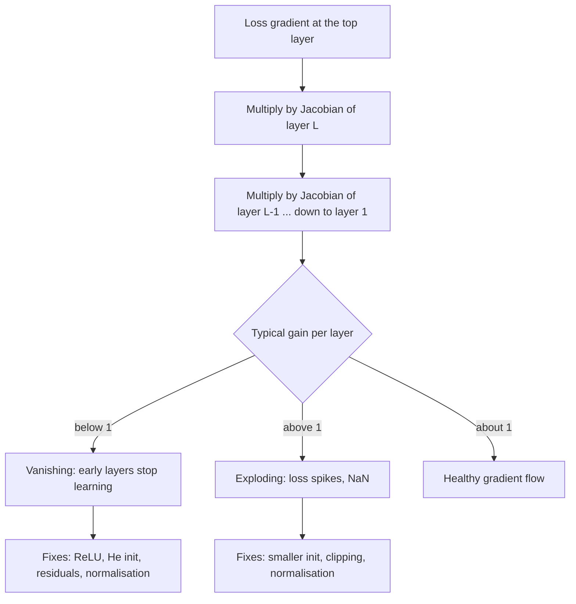

# Gradient Flow (vanishing and exploding gradients)

$$
\frac{\partial \mathcal{L}}{\partial \mathbf{h}_0} = J_1^\top J_2^\top \cdots J_L^\top \, \frac{\partial \mathcal{L}}{\partial \mathbf{h}_L}, \qquad J_l = \frac{\partial \mathbf{h}_l}{\partial \mathbf{h}_{l-1}} = \operatorname{diag}\big(\sigma'(\mathbf{z}_l)\big) W_l
$$

, where $\mathbf{h}_l = \sigma(\mathbf{z}_l)$, $\mathbf{z}_l = W_l \mathbf{h}_{l-1}$, and $\left\| \frac{\partial \mathcal{L}}{\partial \mathbf{h}_0} \right\| \le \prod_{l=1}^{L} \|W_l\| \, \max|\sigma'| \cdot \left\| \frac{\partial \mathcal{L}}{\partial \mathbf{h}_L} \right\|$

## Deep Breakdown

What it tells me *(Situation Awareness)*:
Backpropagation is the chain rule applied through depth, so the gradient that reaches an early layer is the loss gradient multiplied by one Jacobian per layer above it. A product of $L$ factors behaves like a power: if the typical factor has size below 1, the gradient shrinks geometrically (vanishing); above 1, it grows geometrically (exploding). The sigmoid makes vanishing almost guaranteed because $\sigma'(z) = \sigma(z)(1 - \sigma(z)) \le 0.25$, so ten sigmoid layers with unit weights shrink the signal by at least $0.25^{10} \approx 9.5 \times 10^{-7}$. Vanishing means early layers barely learn; exploding means loss spikes, NaNs and divergence. The modern fixes all aim to keep every Jacobian's "gain" near 1: ReLU-family activations (derivative exactly 1 on the active side), variance-preserving initialisation (Xavier/Glorot for tanh, He/Kaiming for ReLU), normalisation layers, residual connections ($\mathbf{h}_l = \mathbf{h}_{l-1} + F(\mathbf{h}_{l-1})$, whose Jacobian is $I + J_F$, so the identity path always carries gradient), gated RNN cells (LSTM/GRU), and gradient clipping as a safety net for explosions. In DA/DS: diagnosing a deep model that "won't train" (flat loss, first-layer gradient norms near zero), reading per-layer gradient-norm plots in TensorBoard or W&B, choosing activations and initialisation for tabular MLPs, sequence models for churn or demand forecasting, and understanding why transformers rely on residual streams and LayerNorm.

## Flowchart



## Real-world use

### Where it is used

Training any deep network: deep MLPs on tabular data, CNNs, RNN/LSTM sequence models (where depth = sequence length), and transformers with dozens of blocks. Gradient-norm monitoring is a standard training dashboard; architecture choices (ResNet skip connections, pre-LN transformers, LSTM gates) exist largely to protect gradient flow.

### Problem it solves

It explains *why* a deep model fails to train even though the code is correct: the update for early layers is the product of many small (or large) numbers, so it is effectively zero (or infinite). Without that diagnosis teams waste time tuning the learning rate, which only rescales the problem uniformly.

### How it solves the problem

By writing the gradient as a product of Jacobians it identifies the lever: control the size of each factor. Activation choice controls $\sigma'$; initialisation controls $\|W_l\|$ (He init sets $\operatorname{Var}(w) = 2/n_{\text{in}}$ so ReLU layers keep variance roughly constant); residual connections add an identity term so the product becomes $\prod (I + J_{F,l})$ instead of $\prod J_l$; normalisation re-centres activations so $\sigma'$ stays away from saturation; clipping caps whatever explosion remains.

### Example in a business

A subscription company trains a 20-layer sigmoid MLP to predict churn. Validation AUC is stuck at 0.5 and the gradient norm reaching the first layer is around $10^{-15}$ (the sigmoid row of the simulation below), many orders of magnitude below what the top layers receive. Switching to ReLU with He initialisation brings the first-layer gradient norm to the same order as the top layers (about $3 \times 10^{-2}$ in the simulation below) and the model starts learning within one epoch. A demand-forecasting LSTM on 365-day sequences shows the opposite symptom — occasional loss spikes to NaN — which is fixed by gradient clipping at norm 1.

## The formula, piece by piece

- $\mathcal{L}$: the scalar loss (cross-entropy, MSE)
- $\mathbf{h}_l$: activations after layer $l$; $\mathbf{h}_0$ is the input, $\mathbf{h}_L$ the top
- $\mathbf{z}_l = W_l \mathbf{h}_{l-1}$: pre-activations of layer $l$
- $\sigma$: the elementwise activation; $\sigma'$ its derivative
- $J_l = \partial \mathbf{h}_l / \partial \mathbf{h}_{l-1} = \operatorname{diag}(\sigma'(\mathbf{z}_l)) W_l$: the layer Jacobian
- $J_1^\top \cdots J_L^\top$: transposed Jacobians multiplied from the top down — this is exactly what reverse-mode autodiff computes, one vector-Jacobian product per layer
- $\|W_l\|$: spectral norm (largest singular value) of the weight matrix; upper-bounds how much layer $l$ can stretch a vector
- $\max|\sigma'|$: $0.25$ for sigmoid, $1$ for tanh (at 0 only), $1$ for ReLU on the active side
- The bound $\prod_l \|W_l\| \max|\sigma'|$: if every factor is $\gamma$, the gradient scales like $\gamma^L$

## The formula in words

"The gradient at layer 1 is the top gradient passed down through every layer's Jacobian; if each layer shrinks it a little the product vanishes, if each layer stretches it a little the product explodes." Tiny example: a scalar chain of 10 sigmoid units with weight 1 and pre-activation 0 has per-layer factor $0.25$, so the gradient shrinks by $0.25^{10} \approx 9.54 \times 10^{-7}$. A linear chain with weight 1.5 over 50 layers multiplies it by $1.5^{50} \approx 6.38 \times 10^{8}$.

## Critical Concepts

- **Sigmoid ceiling:** $\sigma'(z) = \sigma(z)(1-\sigma(z))$ peaks at $0.25$ when $z = 0$ and falls towards 0 when $|z|$ is large (saturation). Even in the best case a sigmoid layer needs weights with gain 4 to break even.
- **ReLU:** derivative is 1 for $z \gt 0$ and 0 otherwise, so active units pass gradient unchanged. The risk moves to "dead ReLUs" (always inactive); Leaky ReLU and GELU soften this.
- **Initialisation:** Xavier/Glorot ($\operatorname{Var}(w) = 1/n_{\text{in}}$ or $2/(n_{\text{in}} + n_{\text{out}})$) for tanh/sigmoid, He/Kaiming ($2/n_{\text{in}}$) for ReLU. Too small and gradients vanish, too large and they explode — even with ReLU.
- **Residual connections:** $\mathbf{h}_l = \mathbf{h}_{l-1} + F_l(\mathbf{h}_{l-1})$ gives $J_l = I + J_{F_l}$, so the backward product always contains the identity path. This is why 100+ layer ResNets and transformers train.
- **Exploding gradients in RNNs:** an RNN reuses the same $W$ at every time step, so the product is $\approx W^T$ over $T$ steps; the spectral radius of $W$ above 1 explodes, below 1 vanishes. LSTMs add an additive cell-state path (like a residual).
- **Learning rate is not a fix:** a global learning rate scales all layers equally; it cannot fix a gradient ratio of $10^{13}$ between top and bottom layers. Adaptive optimizers (Adam) partially compensate per parameter but not when gradients underflow to exactly 0.
- **Diagnose with norms:** log $\|\partial \mathcal{L}/\partial W_l\|$ per layer. A healthy network shows norms within one or two orders of magnitude across depth.

## Step-by-step calculation (tiny example)

*Scalar network: $h_l = \sigma(w\,h_{l-1})$ with $w = 1$ and all pre-activations at $z = 0$; depth $L = 5$.*

*Step 1: Local derivative per layer*
$\sigma(0) = 0.5$, so $\sigma'(0) = 0.5 \times 0.5 = 0.25$. Jacobian per layer $= \sigma'(0)\,w = 0.25$.

*Step 2: Multiply through 5 layers*
$0.25^5 = 0.0009765625 \approx 9.8 \times 10^{-4}$. A top gradient of 1 arrives at layer 1 as about $0.001$.

*Step 3: Make it deeper*
$L = 10$: $0.25^{10} \approx 9.54 \times 10^{-7}$. $L = 20$: $0.25^{20} \approx 9.1 \times 10^{-13}$.

*Step 4: Swap in ReLU with $w = 1$, $z \gt 0$*
Each factor $= 1 \times 1 = 1$, so $1^{20} = 1$: no vanishing.

*Step 5: Exploding case*
Linear layers with $w = 1.5$: $1.5^{50} \approx 637{,}621{,}500$. With $w = 0.9$: $0.9^{50} \approx 0.0052$. Small deviations from 1 compound brutally.

*Step 6: Residual version*
$h_l = h_{l-1} + 0.1\,h_{l-1}$ (branch gain 0.1): each factor $1.1$; even the "branch dies" case (factor of the branch 0) leaves a factor of exactly 1 from the skip path.

## Code examples

### Beginner example (Python)

```python
import numpy as np


def sigmoid(z):
    return 1 / (1 + np.exp(-z))


# Maximum of the sigmoid derivative
z = np.linspace(-6, 6, 1201)
ds = sigmoid(z) * (1 - sigmoid(z))
print(f"max sigmoid'(z) = {ds.max():.4f} at z = {z[ds.argmax()]:.1f}")   # 0.2500 at 0.0

# Gradient reaching layer 1 of a scalar chain, best case z = 0, w = 1
for depth in (5, 10, 20):
    print(f"sigmoid chain depth {depth:2d}: factor = {0.25 ** depth:.3e}")
# 9.766e-04, 9.537e-07, 9.095e-13

# Linear chains: gain slightly above or below 1
print(f"1.5^50 = {1.5 ** 50:,.0f}")   # 637,621,500
print(f"0.9^50 = {0.9 ** 50:.4f}")     # 0.0052
print(f"ReLU (active, w=1) depth 20: {1.0 ** 20}")
```

### Beginner example (R)

```r
sigmoid <- function(z) 1 / (1 + exp(-z))
z <- seq(-6, 6, by = 0.01)
ds <- sigmoid(z) * (1 - sigmoid(z))
cat(sprintf("max sigmoid'(z) = %.4f\n", max(ds)))

for (depth in c(5, 10, 20)) {
  cat(sprintf("sigmoid chain depth %d: factor = %.3e\n", depth, 0.25^depth))
}
cat(sprintf("1.5^50 = %.0f, 0.9^50 = %.4f\n", 1.5^50, 0.9^50))
```

### Professional example (Python)

```python
import numpy as np


def first_layer_grad_norm(depth, act, init, residual=False, width=64, seed=0):
    """Backprop a unit gradient from the top of a random MLP to its input layer."""
    rng = np.random.default_rng(seed)
    h = rng.normal(size=(256, width))           # a batch of 256 inputs
    Ws, pre = [], []
    for _ in range(depth):
        if init == "small":
            W = rng.normal(scale=0.01, size=(width, width))
        elif init == "xavier":
            W = rng.normal(scale=np.sqrt(1 / width), size=(width, width))
        elif init == "he":
            W = rng.normal(scale=np.sqrt(2 / width), size=(width, width))
        else:  # "large"
            W = rng.normal(scale=np.sqrt(4 / width), size=(width, width))
        z = h @ W
        a = 1 / (1 + np.exp(-z)) if act == "sigmoid" else np.maximum(z, 0)
        if residual:
            a = h + 0.1 * a
        Ws.append(W)
        pre.append(z)
        h = a
    g = np.ones_like(h) / h.size                # dL/dh_top for L = mean(h_top)
    for W, z in zip(reversed(Ws), reversed(pre)):
        if act == "sigmoid":
            s = 1 / (1 + np.exp(-z))
            local = s * (1 - s)                 # sigmoid'(z) <= 0.25
        else:
            local = (z > 0).astype(float)       # ReLU'(z) in {0, 1}
        g_branch = (g * (0.1 if residual else 1.0) * local) @ W.T
        g = g + g_branch if residual else g_branch
    return float(np.linalg.norm(g))


configs = [
    ("sigmoid + xavier", "sigmoid", "xavier", False),
    ("relu + small init", "relu", "small", False),
    ("relu + he init", "relu", "he", False),
    ("relu + too-large init", "relu", "large", False),
    ("residual relu + he", "relu", "he", True),
]
print(f"{'configuration':24s}" + "".join(f"{f'depth {d}':>13s}" for d in (5, 20, 50)))
for name, act, init, res in configs:
    norms = [first_layer_grad_norm(d, act, init, res) for d in (5, 20, 50)]
    print(f"{name:24s}" + "".join(f"{v:13.2e}" for v in norms))
# sigmoid and small init collapse towards 0 (about 1e-15 and 1e-27 at depth 20),
# too-large init blows up (about 8e5 at depth 50),
# He init and residual stay in the 1e-2 to 1e-1 range at every depth.
```

---

*Source: domain knowledge*
