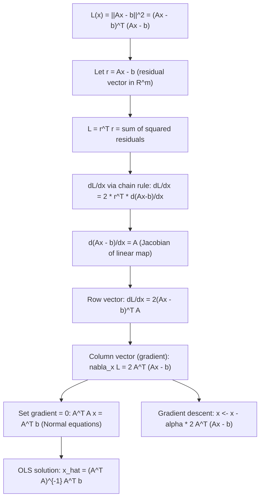

# Gradient of Squared Error

$$
\nabla_\mathbf{x} \|A\mathbf{x} - \mathbf{b}\|^2 = 2A^T(A\mathbf{x} - \mathbf{b})
$$

## Deep Breakdown

What it tells me *(Situation Awareness)*:
This is the single most important gradient formula in applied machine learning and statistics. It gives the gradient of a squared residual objective $L(\mathbf{x}) = \|A\mathbf{x} - \mathbf{b}\|^2 = (A\mathbf{x} - \mathbf{b})^T(A\mathbf{x} - \mathbf{b})$ with respect to the parameter vector $\mathbf{x}$. Setting this gradient to zero yields the normal equations $A^TA\mathbf{x} = A^T\mathbf{b}$, whose solution is the OLS estimator $\hat{\mathbf{x}} = (A^TA)^{-1}A^T\mathbf{b}$. In ML notation: $A$ is the design matrix $X \in \mathbb{R}^{n \times d}$, $\mathbf{x}$ is the weight vector $\mathbf{w} \in \mathbb{R}^d$, and $\mathbf{b}$ is the target vector $\mathbf{y} \in \mathbb{R}^n$. The gradient $2X^T(X\mathbf{w} - \mathbf{y})$ is the cornerstone of linear regression, ridge regression, least squares, and any gradient descent optimization of a quadratic loss. Understanding this gradient from first principles is essential before moving to logistic regression, neural networks, or any nonlinear variant. Note: the file header uses row-vector (numerator-layout) form $2(Ax-b)^TA$; this file uses the equivalent column-vector form $2A^T(Ax-b)$, which is what most ML frameworks and textbooks report as the gradient. Both contain the same information.

## Flowchart



## Real-world use

### Where it is used

Ordinary least squares (OLS) regression: minimize $\|X\mathbf{w} - \mathbf{y}\|^2$ over $\mathbf{w}$. Ridge regression: add L2 penalty, gradient becomes $2X^T(X\mathbf{w} - \mathbf{y}) + 2\lambda\mathbf{w}$. Gradient descent for large-scale linear regression: update $\mathbf{w} \leftarrow \mathbf{w} - \alpha \cdot \frac{2}{n}X^T(X\mathbf{w} - \mathbf{y})$. Deriving the normal equations analytically. Weighted least squares, where the objective is $\|W^{1/2}(X\mathbf{w} - \mathbf{y})\|^2$. Output layer gradient of a neural network with MSE loss.

### Problem it solves

When you want to minimize a sum-of-squared-errors objective over a vector parameter $\mathbf{x}$, you need its gradient to either solve analytically (set gradient = 0) or to run gradient descent. Without this formula, you would have to compute $d$ partial derivatives individually, which is both inefficient and error-prone for high-dimensional parameter spaces.

### How it solves the problem

Expand $L = (A\mathbf{x} - \mathbf{b})^T(A\mathbf{x} - \mathbf{b}) = \mathbf{x}^TA^TA\mathbf{x} - 2\mathbf{b}^TA\mathbf{x} + \mathbf{b}^T\mathbf{b}$. Differentiate term by term: $\nabla_\mathbf{x}(\mathbf{x}^TA^TA\mathbf{x}) = 2A^TA\mathbf{x}$ (symmetric matrix quadratic form), $\nabla_\mathbf{x}(-2\mathbf{b}^TA\mathbf{x}) = -2A^T\mathbf{b}$, $\nabla_\mathbf{x}(\mathbf{b}^T\mathbf{b}) = 0$. Sum: $\nabla_\mathbf{x} L = 2A^TA\mathbf{x} - 2A^T\mathbf{b} = 2A^T(A\mathbf{x} - \mathbf{b})$.

### Example in a business

A pricing analyst fits a linear model to predict sales volume from price, promotion indicator, and day-of-week dummies. The design matrix $X \in \mathbb{R}^{n \times d}$ holds all features; $\mathbf{y} \in \mathbb{R}^n$ holds observed sales. The OLS estimator $\hat{\mathbf{w}} = (X^TX)^{-1}X^T\mathbf{y}$ follows directly from setting $\nabla_\mathbf{w} \|X\mathbf{w} - \mathbf{y}\|^2 = 2X^T(X\mathbf{w} - \mathbf{y}) = \mathbf{0}$. For ridge regularization to prevent overfitting on correlated features: $\hat{\mathbf{w}}_\lambda = (X^TX + \lambda I)^{-1}X^T\mathbf{y}$.

## The formula, piece by piece

$$
\nabla_\mathbf{x} \|A\mathbf{x} - \mathbf{b}\|^2 = 2A^T(A\mathbf{x} - \mathbf{b})
$$

Each symbol:
- $A$: a constant matrix $\in \mathbb{R}^{m \times n}$ (e.g., design matrix $X$)
- $\mathbf{x}$: the variable vector $\in \mathbb{R}^n$ (e.g., weight vector $\mathbf{w}$)
- $\mathbf{b}$: a constant vector $\in \mathbb{R}^m$ (e.g., target vector $\mathbf{y}$)
- $A\mathbf{x} - \mathbf{b}$: the residual vector $\mathbf{r} \in \mathbb{R}^m$
- $\|\cdot\|^2$: squared Euclidean norm (sum of squared components)
- $\nabla_\mathbf{x}$: gradient with respect to $\mathbf{x}$, result is a column vector $\in \mathbb{R}^n$
- $A^T$: transpose of $A$, shape $n \times m$ — "pulls back" the residual to parameter space **Normal equations** (set gradient to zero):

$$
A^TA\mathbf{x} = A^T\mathbf{b} \implies \hat{\mathbf{x}} = (A^TA)^{-1}A^T\mathbf{b}
$$

**Row vector form** (numerator layout, equivalent):

$$
\frac{d}{d\mathbf{x}}\|A\mathbf{x} - \mathbf{b}\|^2 = 2(A\mathbf{x} - \mathbf{b})^TA
$$

**Ridge variant** (L2-regularized):

$$
\nabla_\mathbf{x}\left(\|A\mathbf{x} - \mathbf{b}\|^2 + \lambda\|\mathbf{x}\|^2\right) = 2A^T(A\mathbf{x} - \mathbf{b}) + 2\lambda\mathbf{x}
$$

**MSE version** (normalized by $n$):

$$
\nabla_\mathbf{w}\left(\frac{1}{n}\|X\mathbf{w} - \mathbf{y}\|^2\right) = \frac{2}{n}X^T(X\mathbf{w} - \mathbf{y})
$$

## The formula in words

"The squared error $\|A\mathbf{x} - \mathbf{b}\|^2$ measures how far the prediction $A\mathbf{x}$ is from the target $\mathbf{b}$. Its gradient with respect to $\mathbf{x}$ is $2A^T$ times the residual vector $(A\mathbf{x} - \mathbf{b})$. Intuitively: the residual tells you how wrong you are in output space; multiplying by $A^T$ maps that error back into parameter space, telling you in which direction to nudge $\mathbf{x}$ to reduce the error. The factor of 2 comes from differentiating a square."

## Critical Concepts

- **Normal equations**: setting $\nabla L = 0$ gives $A^TA\hat{\mathbf{x}} = A^T\mathbf{b}$. The OLS solution minimizes the squared error exactly (no iteration needed when $A^TA$ is invertible).
- **Gradient descent update**: $\mathbf{x}^{(t+1)} = \mathbf{x}^{(t)} - \alpha \cdot 2A^T(A\mathbf{x}^{(t)} - \mathbf{b})$. Used when $n$ or $d$ is too large to solve the normal equations directly.
- **Shape check**: $A \in \mathbb{R}^{m \times n}$, $A^T \in \mathbb{R}^{n \times m}$, $(A\mathbf{x} - \mathbf{b}) \in \mathbb{R}^m$. Product $A^T(A\mathbf{x} - \mathbf{b}) \in \mathbb{R}^n$ — same shape as $\mathbf{x}$. Always verify shapes.
- **$A^TA$ is PSD**: the Gram matrix $A^TA$ is always positive semidefinite. If $A$ has full column rank, $A^TA$ is positive definite and the OLS solution is unique.
- **Ridge adds stability**: $(A^TA + \lambda I)$ is always positive definite for $\lambda > 0$, making the regularized problem always uniquely solvable regardless of $A$'s rank.
- **Companion**: $\nabla_A \|A\mathbf{x} - \mathbf{b}\|^2 = 2(A\mathbf{x} - \mathbf{b})\mathbf{x}^T$ — gradient with respect to the matrix $A$ itself.
- **Layout warning**: some textbooks (including the original heading) write $2(Ax-b)^T A$ (row vector, numerator layout).

The column vector form $2A^T(Ax-b)$ is what most ML code expects. Same values, transposed arrangement.

## Step-by-step calculation (tiny example)

Let $A = \begin{bmatrix}1 & 2 \\ 3 & 4\end{bmatrix}$, $\mathbf{x} = (x_1, x_2)^T$, $\mathbf{b} = (1, 1)^T$. Compute $\nabla_\mathbf{x} \|A\mathbf{x} - \mathbf{b}\|^2$.

*Step 1: Compute the residual symbolically*

$$
A\mathbf{x} - \mathbf{b} = \begin{bmatrix}x_1 + 2x_2 - 1 \\ 3x_1 + 4x_2 - 1\end{bmatrix} = \begin{bmatrix}r_1 \\ r_2\end{bmatrix}
$$

*Step 2: Expand the squared norm and differentiate*

$$
L = r_1^2 + r_2^2 = (x_1 + 2x_2 - 1)^2 + (3x_1 + 4x_2 - 1)^2
$$

$$
\frac{\partial L}{\partial x_1} = 2r_1(1) + 2r_2(3) = 2r_1 + 6r_2
$$

$$
\frac{\partial L}{\partial x_2} = 2r_1(2) + 2r_2(4) = 4r_1 + 8r_2
$$

*Step 3: Verify against $2A^T\mathbf{r}$*

$$
2A^T\mathbf{r} = 2\begin{bmatrix}1 & 3 \\ 2 & 4\end{bmatrix}\begin{bmatrix}r_1 \\ r_2\end{bmatrix} = \begin{bmatrix}2r_1 + 6r_2 \\ 4r_1 + 8r_2\end{bmatrix} \checkmark
$$

*Step 4: Find the minimum (normal equations)*
Set $A^TA\mathbf{x} = A^T\mathbf{b}$: $A^TA = \begin{bmatrix}10 & 14 \\ 14 & 20\end{bmatrix}$, $A^T\mathbf{b} = \begin{bmatrix}4 \\ 6\end{bmatrix}$. Solve: $\hat{\mathbf{x}} = (A^TA)^{-1}A^T\mathbf{b}$.

## Code examples

### Beginner example (Python)

```python
import numpy as np   # A is the design matrix (observations x features), b is the target
A = np.array([[1.0, 2.0], [3.0, 4.0], [5.0, 6.0]])   # 3 data points, 2 features
b = np.array([1.0, 3.0, 5.0])   # targets
x0 = np.array([0.5, 0.5])   # initial guess

def squared_error(x: np.ndarray) -> float:
    """L(x) = ||Ax - b||^2."""
    r = A @ x - b
    return float(r @ r)

def analytic_gradient(x: np.ndarray) -> np.ndarray:
    """nabla_x ||Ax - b||^2 = 2 A^T (Ax - b)."""
    return 2.0 * A.T @ (A @ x - b)

def numerical_gradient(x: np.ndarray, h: float = 1e-5) -> np.ndarray:
    """Centered finite difference."""
    grad = np.zeros_like(x)
    for i in range(len(x)):
        e_i = np.zeros_like(x)
    e_i[i] = h
    grad[i] = (squared_error(x + e_i) - squared_error(x - e_i)) / (2 * h)
    return grad
g_analytic = analytic_gradient(x0)
g_numerical = numerical_gradient(x0)
print("Gradient check at x0:")
print(f" Analytic: {g_analytic}")
print(f" Numerical: {g_numerical}")
print(f" Max error: {np.abs(g_analytic - g_numerical).max():.2e}")   # OLS solution via normal equations: x_hat = (A^T A)^{-1} A^T b
x_hat_ols = np.linalg.solve(A.T @ A, A.T @ b)
print(f"\nOLS solution (normal equations): {x_hat_ols}")
print(f"Gradient at OLS (should be ~0): {analytic_gradient(x_hat_ols)}")   # Compare to numpy lstsq
x_hat_lstsq, _, _, _ = np.linalg.lstsq(A, b, rcond=None)
print(f"np.linalg.lstsq solution: {x_hat_lstsq}")
print(f"Max diff: {np.abs(x_hat_ols - x_hat_lstsq).max():.2e}")   # Gradient descent from x0
ALPHA = 0.01
N_ITER = 200
x_gd = x0.copy()
for _ in range(N_ITER):
    x_gd -= ALPHA * analytic_gradient(x_gd)
print(f"\nGradient descent ({N_ITER} steps): {x_gd}")
print(f"Loss at GD solution: {squared_error(x_gd):.6f}")
print(f"Loss at OLS: {squared_error(x_hat_ols):.6f}")
```

### Beginner example (R)

```r
# nabla_x ||Ax - b||^2 = 2 A^T (Ax - b)
A <- matrix(c(1, 3, 5, 2, 4, 6), nrow = 3, ncol = 2)  # column-major
b <- c(1, 3, 5)
x0 <- c(0.5, 0.5)
squared_error <- function(x) sum((A %*% x - b)^2)
analytic_grad <- function(x) 2 * t(A) %*% (A %*% x - b)  # Numerical gradient check
h <- 1e-5
num_grad <- sapply(1:2, function(i) { e_i <- rep(0, 2); e_i[i] <- h (squared_error(x0 + e_i) - squared_error(x0 - e_i)) / (2 * h)
}) cat("Analytic gradient: ", as.vector(analytic_grad(x0)), "\n")
cat("Numerical gradient:", num_grad, "\n")  # OLS normal equations: (A^T A)
x = A^T b
x_hat <- solve(t(A) %*% A, t(A) %*% b)
cat("OLS solution: ", as.vector(x_hat), "\n")
cat("Gradient at OLS (should be ~0):", as.vector(analytic_grad(x_hat)), "\n")  # Ridge regression: (A^T A + lambda I)
x = A^T b
lambda <- 0.1
x_ridge <- solve(t(A) %*% A + lambda * diag(2), t(A) %*% b)
cat("Ridge solution (lambda=0.1): ", as.vector(x_ridge), "\n")
```

### Professional example (Python)

```python
"""
Linear regression: OLS vs. gradient descent vs. ridge.
All three methods use nabla_w ||Xw - y||^2 = 2 X^T (Xw - y). Business context: pricing analyst fits weekly_sales as a linear function
of (price, is_promoted, competitor_price, day_of_week encoding).
"""
import numpy as np
from sklearn.datasets import make_regression
from sklearn.model_selection import train_test_split
from sklearn.preprocessing import StandardScaler
RANDOM_SEED = 42
rng = np.random.default_rng(RANDOM_SEED)   # Synthetic marketing data
x_raw, y_data = make_regression( n_samples=500, n_features=8, n_informative=5, noise=20.0, random_state=RANDOM_SEED )[:2]
x_train, x_test, y_train, y_test = train_test_split( x_raw, y_data, test_size=0.2, random_state=RANDOM_SEED )
scaler = StandardScaler()
x_train_s = scaler.fit_transform(x_train)
x_test_s = scaler.transform(x_test)   # Add intercept column
x_train_aug = np.hstack([x_train_s, np.ones((len(x_train_s), 1))])
x_test_aug = np.hstack([x_test_s, np.ones((len(x_test_s), 1))])
n, d = x_train_aug.shape

def mse_loss(w: np.ndarray) -> float:
    """MSE loss: (1/n) ||Xw - y||^2."""
    return float(np.mean((x_train_aug @ w - y_train) ** 2))

def mse_gradient(w: np.ndarray) -> np.ndarray:
    """Gradient: (2/n) X^T (Xw - y)."""
    return (2.0 / n) * x_train_aug.T @ (x_train_aug @ w - y_train)   # 1. OLS via normal equations
w_ols = np.linalg.solve(x_train_aug.T @ x_train_aug, x_train_aug.T @ y_train)
mse_ols_test = float(np.mean((x_test_aug @ w_ols - y_test) ** 2))   # 2. Gradient descent
ALPHA = 0.1
N_ITER = 1000
w_gd = rng.standard_normal(d) * 0.01
for _ in range(N_ITER):
    w_gd = w_gd - ALPHA * mse_gradient(w_gd)
mse_gd_test = float(np.mean((x_test_aug @ w_gd - y_test) ** 2))   # 3. Ridge: gradient = 2X^T(Xw-y) + 2*lambda*w -> normal eqs: (X^T X + lambda I) w = X^T y
LAMBDA_RIDGE = 1.0
w_ridge = np.linalg.solve( x_train_aug.T @ x_train_aug + LAMBDA_RIDGE * np.eye(d), x_train_aug.T @ y_train,
)
mse_ridge_test = float(np.mean((x_test_aug @ w_ridge - y_test) ** 2))
grad_norm_ols = float(np.linalg.norm(mse_gradient(w_ols)))
grad_norm_gd = float(np.linalg.norm(mse_gradient(w_gd)))
print("=== Linear Regression: Gradient of Squared Error ===")
print(f" Formula: nabla_w ||Xw - y||^2 = 2 X^T (Xw - y)")
print()
print(f" {'Method':<22} {'Test MSE':>10} {'Grad Norm':>12}")
print(f" {'-'*46}")
print(f" {'OLS (normal eqs)':<22} {mse_ols_test:>10.4f} {grad_norm_ols:>12.2e}")
print(f" {'GD (1000 steps)':<22} {mse_gd_test:>10.4f} {grad_norm_gd:>12.2e}")
print(f" {'Ridge (lambda=1.0)':<22} {mse_ridge_test:>10.4f} {'N/A':>12}")
print()
print(f" Max coef diff OLS vs GD: {np.abs(w_ols - w_gd).max():.4f}")
```

---

*Source: MML1 p. 237*
