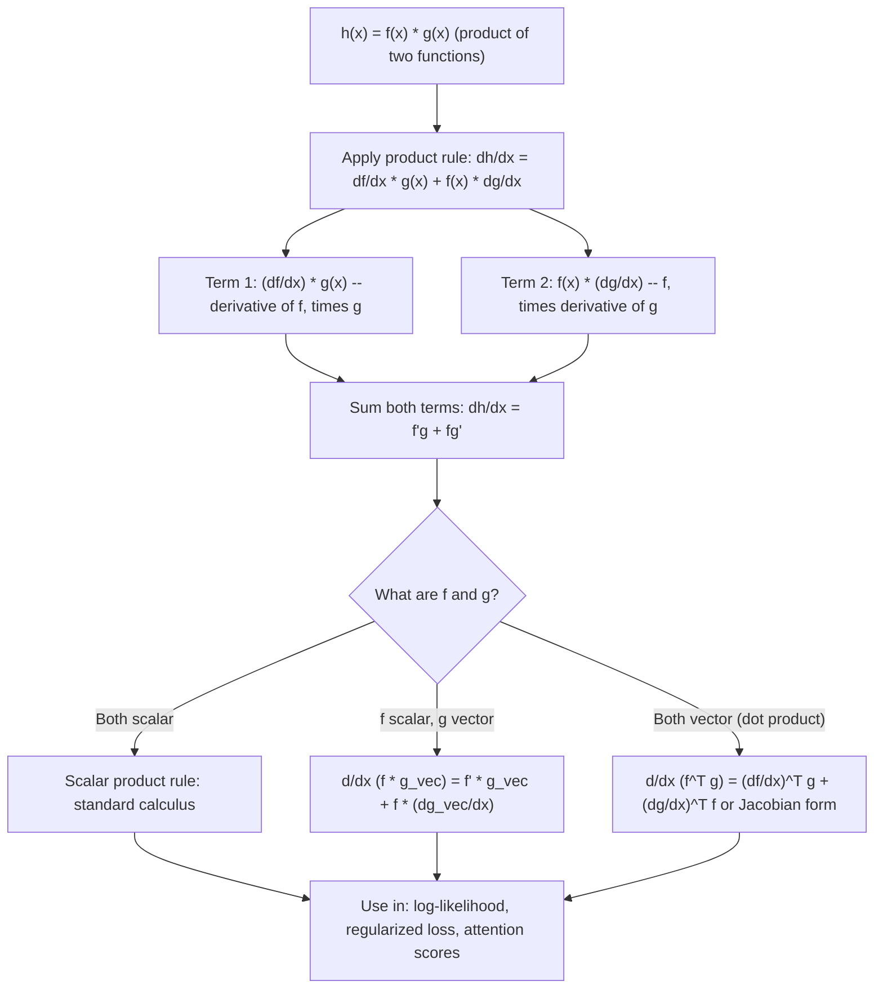

# Product Rule

$$
\frac{\partial}{\partial x}(f(x)g(x)) = \frac{\partial f}{\partial x}g(x) + f(x)\frac{\partial g}{\partial x}
$$

## Deep Breakdown

What it tells me *(Situation Awareness)*:
The product rule extends the familiar scalar derivative rule $\frac{d}{dx}(fg) = f'g + fg'$ to matrix calculus settings where $f$ and $g$ may be scalar functions, vector functions, or matrix functions of a vector variable $\mathbf{x}$. It is one of the foundational differentiation identities: any expression that can be factored into a product of two pieces requires this rule. In DA/DS and ML, the product rule appears constantly in: deriving the gradient of the likelihood function (which is a product of individual data likelihoods), backpropagating through gated units (LSTM cells, attention mechanisms), differentiating regularized objectives (loss $\times$ penalty, or loss $+$ penalty where one term depends on another), and computing Jacobians of composed transformations. It is also the engine behind the quotient rule ($\frac{d}{dx}(f/g) = (f'g - fg')/g^2$), since $1/g$ is itself a function with a derivative. Without the product rule, you cannot break apart complex gradient computations into simpler parts.

## Flowchart



## Real-world use

### Where it is used

Log-likelihood gradient for products of probabilities: $\frac{d}{d\theta}\prod_i p(x_i|\theta) = \sum_i \frac{d}{d\theta}\log p(x_i|\theta)$ (log converts product to sum, avoiding repeated product rule). Gated activations in LSTMs: output $= \sigma(g) \odot \tanh(c)$, gradient requires product rule on the element-wise product. Attention mechanism: attention output $= \text{softmax}(QK^T/\sqrt{d}) \cdot V$, backprop through this product. Regularization: $L_{total} = L_{data} + \lambda R(\mathbf{w})$, where $L_{data}$ depends on predictions which depend on $\mathbf{w}$. Quotient rule (derived from product rule): deriving the sigmoid derivative $\sigma'(x) = \sigma(x)(1 - \sigma(x))$.

### Problem it solves

When a loss or activation is structured as a product of two functions that both depend on the parameters, you cannot differentiate each independently and just multiply. You must apply the product rule to correctly account for the interaction between the two factors. Without it, gradients computed for gated units, attention weights, or likelihood functions would be wrong.

### How it solves the problem

The product rule tracks how a small change $\Delta x$ in the input ripples through both factors simultaneously. When $x$ changes by $\Delta x$: $h(x + \Delta x) = f(x+\Delta x)g(x+\Delta x) \approx (f + f'\Delta x)(g + g'\Delta x) \approx fg + f'g\Delta x + fg'\Delta x + O(\Delta x^2)$. Dividing by $\Delta x$ and taking the limit: $h' = f'g + fg'$.

### Example in a business

Deriving the derivative of the sigmoid function, which is the activation used in logistic regression and binary classification. $\sigma(x) = \frac{1}{1+e^{-x}}$. Write as a product: $\sigma(x) = 1 \cdot (1 + e^{-x})^{-1}$. Apply the chain and product rules (or equivalently the quotient rule): $\sigma'(x) = \sigma(x)(1 - \sigma(x))$. This identity is used in every logistic regression gradient computation and is derived using the product/quotient rule. Similarly, in an LSTM gate: $\mathbf{o}_t = \sigma(\mathbf{W}_o \mathbf{h}_{t-1} + \mathbf{b}_o) \odot \tanh(\mathbf{c}_t)$ — backpropagation through this output gate uses the element-wise product rule.

## The formula, piece by piece

$$
\frac{\partial}{\partial x}(f(x)g(x)) = \frac{\partial f}{\partial x}g(x) + f(x)\frac{\partial g}{\partial x}
$$

Each symbol:
- $f(x)$: the first factor (scalar, vector, or matrix-valued function of $x$)
- $g(x)$: the second factor (scalar, vector, or matrix-valued function of $x$)
- $\frac{\partial f}{\partial x}$: the derivative (or Jacobian) of $f$ with respect to $x$
- $\frac{\partial g}{\partial x}$: the derivative (or Jacobian) of $g$ with respect to $x$
- Note: the shapes and ordering of $f$, $g$ matter when they are matrices or vectors **Vector form** (scalar $f$, vector $\mathbf{g}$):

$$
\frac{\partial}{\partial x}(f(x)\,\mathbf{g}(x)) = \mathbf{g}(x)\frac{\partial f}{\partial x} + f(x)\frac{\partial \mathbf{g}}{\partial x}
$$

**Dot product form** (vectors $\mathbf{f}, \mathbf{g}$ of the same length):

$$
\frac{\partial}{\partial x}(\mathbf{f}(x)^T\mathbf{g}(x)) = \mathbf{f}(x)^T\frac{\partial \mathbf{g}}{\partial x} + \mathbf{g}(x)^T\frac{\partial \mathbf{f}}{\partial x}
$$

**Quotient rule** (derived from product rule, treating $1/g$ via chain rule):

$$
\frac{\partial}{\partial x}\left(\frac{f(x)}{g(x)}\right) = \frac{\frac{\partial f}{\partial x}g(x) - f(x)\frac{\partial g}{\partial x}}{[g(x)]^2}
$$

**Sigmoid derivative** (canonical application):

$$
\sigma'(x) = \sigma(x)(1 - \sigma(x))
$$

## The formula in words

"If your function is a product of two pieces, the derivative of the whole is: (derivative of the first piece) times (the second piece) plus (the first piece) times (derivative of the second piece). Think of it as: each piece gets to be the one that changes while the other stays fixed, and you add up both contributions."

## Critical Concepts

- **Order matters for non-commutative products**: for matrix products $F(x)G(x)$, the product rule gives $\frac{d}{dx}(FG) = \frac{dF}{dx}G + F\frac{dG}{dx}$, and in general $FG \neq GF$. Do not commute matrix factors.
- **Log trick for products of likelihoods**: if $L(\theta) = \prod_i p_i(\theta)$, taking the log converts to a sum $\log L = \sum_i \log p_i$, and $\frac{d}{d\theta}\log L = \sum_i \frac{d}{d\theta}\log p_i$ — no product rule needed. This is why MLE is typically solved in log-space.
- **Element-wise products (Hadamard)**: for $\mathbf{h} = \mathbf{f} \odot \mathbf{g}$, the product rule applies element-wise: $\frac{\partial h_i}{\partial x} = \frac{\partial f_i}{\partial x}g_i + f_i\frac{\partial g_i}{\partial x}$.
- **Sigmoid derivative derivation**: $\sigma(x) = (1 + e^{-x})^{-1}$. By quotient rule: $\sigma'(x) = e^{-x}/(1+e^{-x})^2 = \sigma(x)(1-\sigma(x))$. This is a fundamental building block in backpropagation.
- **LSTM gates**: the output $\mathbf{o}_t = \sigma(\cdot) \odot \tanh(\mathbf{c}_t)$ is an element-wise product; its gradient via the product rule yields separate gradient terms flowing through each factor.
- **Relation to chain rule**: product rule and chain rule together cover all differentiation.

Chain rule handles composition $f(g(x))$; product rule handles multiplication $f(x) \cdot g(x)$.

## Step-by-step calculation (tiny example)

Derive $\sigma'(x)$ using the product rule / quotient rule. Sigmoid: $\sigma(x) = \frac{1}{1+e^{-x}}$.

*Step 1: Write as a product (set up for quotient rule)*

$$
\sigma(x) = \frac{f(x)}{g(x)}, \quad f(x) = 1, \quad g(x) = 1 + e^{-x}
$$

*Step 2: Compute derivatives of each factor*

$$
f'(x) = 0, \quad g'(x) = -e^{-x}
$$

*Step 3: Apply quotient rule*

$$
\sigma'(x) = \frac{f'g - fg'}{g^2} = \frac{0 \cdot (1+e^{-x}) - 1 \cdot (-e^{-x})}{(1+e^{-x})^2} = \frac{e^{-x}}{(1+e^{-x})^2}
$$

*Step 4: Simplify to the elegant form*

$$
\sigma'(x) = \frac{e^{-x}}{(1+e^{-x})^2} = \frac{1}{1+e^{-x}} \cdot \frac{e^{-x}}{1+e^{-x}} = \sigma(x) \cdot (1 - \sigma(x)) \checkmark
$$

At $x = 0$: $\sigma(0) = 0.5$, $\sigma'(0) = 0.5 \times 0.5 = 0.25$.

## Code examples

### Beginner example (Python)

```python
import numpy as np


def sigmoid(x: np.ndarray) -> np.ndarray:
    """Numerically stable sigmoid."""
    return 1.0 / (1.0 + np.exp(-np.clip(x, -500, 500)))


def sigmoid_derivative_product_rule(x: np.ndarray) -> np.ndarray:
    """sigma'(x) = sigma(x) * (1 - sigma(x)) -- derived via product/quotient rule."""
    s = sigmoid(x)
    return s * (1.0 - s)


def numerical_derivative(fn, x: np.ndarray, h: float = 1e-5) -> np.ndarray:
    """Centered finite difference."""
    return (fn(x + h) - fn(x - h)) / (2 * h)


x_test = np.array([-2.0, -1.0, 0.0, 1.0, 2.0])
sig_vals = sigmoid(x_test)
sig_prime_analytic = sigmoid_derivative_product_rule(x_test)
sig_prime_numerical = numerical_derivative(sigmoid, x_test)
print("Sigmoid derivative via product rule: sigma'(x) = sigma(x) * (1 - sigma(x))")
print(f"{'x':>6} | {'sigma(x)':>10} | {'Analytic':>12} | {'Numerical':>12} | {'Error':>10}")
print("-" * 58)
for xi, s, a, n in zip(x_test, sig_vals, sig_prime_analytic, sig_prime_numerical):
    print(f"{xi:>6.1f} | {s:>10.6f} | {a:>12.8f} | {n:>12.8f} | {abs(a-n):>10.2e}")


# Product rule example: h(x) = x^2 * sin(x)
# h'(x) = 2x * sin(x) + x^2 * cos(x)
def h_fn(x: np.ndarray) -> np.ndarray:
    return x**2 * np.sin(x)


def h_prime_analytic(x: np.ndarray) -> np.ndarray:
    """Product rule: d/dx(x^2 * sin(x)) = 2x*sin(x) + x^2*cos(x)."""
    return 2.0 * x * np.sin(x) + x**2 * np.cos(x)


x2 = np.linspace(-3, 3, 5)
h_ana = h_prime_analytic(x2)
h_num = numerical_derivative(h_fn, x2)
print(f"\nProduct rule: d/dx(x^2 * sin(x)) = 2x*sin(x) + x^2*cos(x)")
print(f"Max error: {np.abs(h_ana - h_num).max():.2e}")
```

### Beginner example (R)

```r
# Product rule: d/dx(f(x)*g(x)) = f'(x)*g(x) + f(x)*g'(x)
sigmoid <- function(x) 1 / (1 + exp(-x))

# sigma'(x) = sigma(x) * (1 - sigma(x))
sigmoid_deriv <- function(x) sigmoid(x) * (1 - sigmoid(x))

# Numerical check
num_deriv <- function(fn, x, h = 1e-5) (fn(x + h) - fn(x - h)) / (2 * h)
x_test <- c(-2, -1, 0, 1, 2)
analytic <- sigmoid_deriv(x_test)
numerical <- num_deriv(sigmoid, x_test)
cat("Sigmoid derivative via product rule:\n")
cat(sprintf(" x = %5.1f: analytic = %.6f, numerical = %.6f\n", x_test, analytic, numerical))

# Product rule: h(x) = x^2 * sin(x), h'(x) = 2x*sin(x) + x^2*cos(x)
h_fn <- function(x) x^2 * sin(x)
h_prime <- function(x) 2 * x * sin(x) + x^2 * cos(x)  # product rule
x2 <- seq(-pi, pi, length.out = 5)
cat("\nd/dx(x^2 * sin(x)) = 2x*sin(x) + x^2*cos(x):\n")
cat(sprintf(" Max error: %.2e\n", max(abs(h_prime(x2) - num_deriv(h_fn, x2)))))
```

### Professional example (Python)

```python
"""
Product rule in ML: sigmoid gate derivative and LSTM output gate backprop.

In an LSTM output gate:
    h_t = o_t * tanh(c_t), with o_t = sigma(z_o)
  - z_o = W_o h_{t-1} + b_o (linear pre-activation)
  - The product rule governs how gradients split across sigma(z_o) and tanh(c_t)

We demonstrate:
  1. Sigmoid derivative via product/quotient rule
  2. Gradient through element-wise product (product rule applied element-wise)
  3. Numerical verification
"""
import numpy as np

RANDOM_SEED = 42
rng = np.random.default_rng(RANDOM_SEED)


def sigmoid(z: np.ndarray) -> np.ndarray:
    return 1.0 / (1.0 + np.exp(-np.clip(z, -500, 500)))


def tanh_fn(c: np.ndarray) -> np.ndarray:
    return np.tanh(c)


# Simulated LSTM output gate: h_t = o_t * tanh(c_t)
HIDDEN_DIM = 4
z_o = rng.standard_normal(HIDDEN_DIM)  # pre-activation of output gate
c_t = rng.standard_normal(HIDDEN_DIM)  # cell state
o_t = sigmoid(z_o)                     # output gate activations
tanh_c = tanh_fn(c_t)                  # tanh of cell state
h_t = o_t * tanh_c                     # LSTM output: element-wise product

# Upstream gradient (dL/d h_t)
upstream_grad = rng.standard_normal(HIDDEN_DIM)

# Product rule: d/dz_o (o_t * tanh_c) applied element-wise
# dL/d z_o[i] = upstream[i] * tanh_c[i] * sigma'(z_o[i])
sigma_prime_z = sigmoid(z_o) * (1.0 - sigmoid(z_o))  # product/quotient rule
grad_z_o_analytic = upstream_grad * tanh_c * sigma_prime_z

# dL/d c_t[i] = upstream[i] * o_t[i] * (1 - tanh(c_t[i])^2)
tanh_prime_c = 1.0 - tanh_c**2  # d/dc tanh(c) = 1 - tanh^2(c)
grad_c_t_analytic = upstream_grad * o_t * tanh_prime_c

# Numerical verification via finite differences
h = 1e-5


def output_gate_loss(z_o_in: np.ndarray, c_t_in: np.ndarray) -> float:
    return float(np.dot(upstream_grad, sigmoid(z_o_in) * tanh_fn(c_t_in)))


grad_z_o_numerical = np.zeros(HIDDEN_DIM)
grad_c_t_numerical = np.zeros(HIDDEN_DIM)
for i in range(HIDDEN_DIM):
    e_i = np.zeros(HIDDEN_DIM)
    e_i[i] = h
    grad_z_o_numerical[i] = (output_gate_loss(z_o + e_i, c_t) - output_gate_loss(z_o - e_i, c_t)) / (2 * h)
    grad_c_t_numerical[i] = (output_gate_loss(z_o, c_t + e_i) - output_gate_loss(z_o, c_t - e_i)) / (2 * h)
print("=== LSTM Output Gate: Product Rule Backpropagation ===")
print(f" h_t = sigma(z_o) * tanh(c_t) (element-wise product)")
print()
print(f" dL/d z_o — analytic: {grad_z_o_analytic.round(6)}")
print(f" dL/d z_o — numerical:{grad_z_o_numerical.round(6)}")
print(f" Max error: {np.abs(grad_z_o_analytic - grad_z_o_numerical).max():.2e}")
print()
print(f" dL/d c_t — analytic: {grad_c_t_analytic.round(6)}")
print(f" dL/d c_t — numerical:{grad_c_t_numerical.round(6)}")
print(f" Max error: {np.abs(grad_c_t_analytic - grad_c_t_numerical).max():.2e}")
print()
print(" Interpretation: product rule splits gradient between both factors")
print(" sigma'(z_o[i]) = sigma(z_o[i]) * (1 - sigma(z_o[i])) [quotient rule]")
```

---

*Source: domain knowledge*
