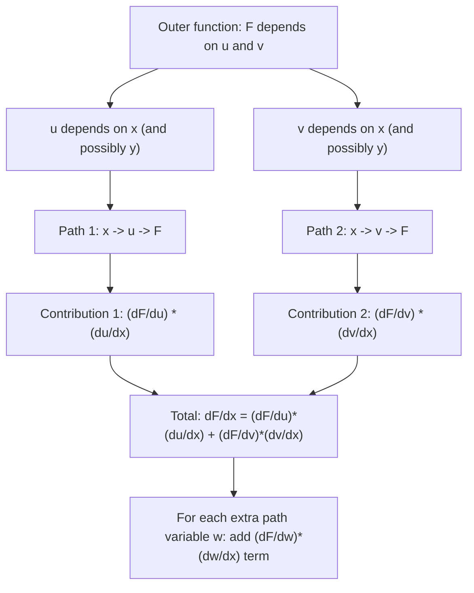

# Multivariate Chain Rule (Case

$$
F(u,v)
$$

, $u(x,y)$, $v(x,y)$): $\frac{\partial F}{\partial x} = \frac{\partial F}{\partial u}\frac{\partial u}{\partial x} + \frac{\partial F}{\partial v}\frac{\partial v}{\partial x}$

## Deep Breakdown

What it tells me *(Situation Awareness)*:
The multivariate chain rule tells you how to differentiate a composite function where the outer function $F$ depends on intermediate variables $u$ and $v$, each of which depends on the base variable $x$ (and possibly $y$). It says: to find how $F$ changes with $x$, sum up all the paths through which $x$ can influence $F$ — through $u$, and through $v$. Each path contributes a product of two partial derivatives: how much the path variable changes per unit change in $x$ (the "local" rate), times how much $F$ changes per unit change in the path variable (the "outer" rate). This is the mathematical backbone of backpropagation in neural networks: the gradient of the loss with respect to any weight is computed by chaining partial derivatives through every layer, exactly following this rule. Without the multivariate chain rule, there is no backpropagation, no gradient descent, and no deep learning.

## Flowchart



## Real-world use

### Where it is used

Backpropagation in neural networks: gradients are chained through layers using the multivariate chain rule. Applying the product rule to vector-valued functions. Computing gradients of composed loss functions (e.g., cross-entropy applied to sigmoid applied to linear combination applied to raw features). Change-of-variables in probability (how does a PDF transform under a nonlinear map?). Sensitivity analysis through multi-stage business models (revenue depends on conversion, which depends on CTR and impressions, both of which depend on bid).

### Problem it solves

When a function is defined through a chain of compositions (output depends on hidden layer, which depends on input features), you cannot directly differentiate with respect to the original inputs. The multivariate chain rule decomposes the complex differentiation into a product of simpler partial derivatives, making it computable.

### How it solves the problem

By summing the contributions of every "path" from the independent variable to the dependent variable through the intermediate variables. For each path $x \to u_k \to F$, multiply the local sensitivities: $\frac{\partial F}{\partial u_k} \cdot \frac{\partial u_k}{\partial x}$. Then sum all path contributions. This is exact (no approximation) for any differentiable composition.

### Example in a business

A two-stage marketing funnel: Conversions $C = F(\text{CTR}, \text{quality})$ where $\text{CTR} = u(\text{bid}, \text{targeting})$ and $\text{quality} = v(\text{creative}, \text{targeting})$. How do conversions change with targeting? By the multivariate chain rule: $\frac{\partial C}{\partial \text{targeting}} = \frac{\partial C}{\partial \text{CTR}} \cdot \frac{\partial \text{CTR}}{\partial \text{targeting}} + \frac{\partial C}{\partial \text{quality}} \cdot \frac{\partial \text{quality}}{\partial \text{targeting}}$. Both paths (via CTR and via quality) must be summed.

## The formula, piece by piece

$$
\frac{\partial F}{\partial x} = \frac{\partial F}{\partial u}\frac{\partial u}{\partial x} + \frac{\partial F}{\partial v}\frac{\partial v}{\partial x}
$$

Each symbol:
- $F$: the outer function — it does not depend directly on $x$, only through $u$ and $v$
- $u, v$: intermediate (hidden) variables — functions of $x$ (and possibly $y$)
- $\frac{\partial F}{\partial u}$: how $F$ responds to a change in $u$ (outer sensitivity, "upstream" gradient)
- $\frac{\partial u}{\partial x}$: how $u$ responds to a change in $x$ (inner sensitivity, "downstream" gradient)
- $\frac{\partial F}{\partial v}\frac{\partial v}{\partial x}$: the parallel path through $v$
- The sum: because $x$ influences $F$ through multiple channels, all contributions add up **General form with $k$ intermediate variables**:

$$
\frac{\partial F}{\partial x} = \sum_{i=1}^k \frac{\partial F}{\partial u_i}\frac{\partial u_i}{\partial x}
$$

**For the other variable $y$**:

$$
\frac{\partial F}{\partial y} = \frac{\partial F}{\partial u}\frac{\partial u}{\partial y} + \frac{\partial F}{\partial v}\frac{\partial v}{\partial y}
$$

## The formula in words

"$F$ depends on $x$ only indirectly: $x$ changes $u$ and $v$, which in turn change $F$. To find the total effect of $x$ on $F$, trace every path. Path 1: $x$ changes $u$ (at rate $\partial u/\partial x$), and $u$ changes $F$ (at rate $\partial F/\partial u$). Path 2: $x$ changes $v$ (at rate $\partial v/\partial x$), and $v$ changes $F$ (at rate $\partial F/\partial v$). Add all paths: that is $\partial F/\partial x$."

## Critical Concepts

- **Backpropagation = multivariate chain rule**: in a neural network, the loss $L$ depends on outputs $\hat{y}$, which depend on hidden layer activations, which depend on weights $w$. The gradient $\partial L/\partial w$ is computed by chaining partial derivatives backward through the network — the multivariate chain rule applied repeatedly.
- **Path counting**: the number of terms equals the number of distinct paths from $x$ to $F$ through intermediate variables. Each term is a product of local derivatives along one path.
- **Jacobian multiplication**: in vector form, the multivariate chain rule becomes $\frac{\partial \mathbf{F}}{\partial \mathbf{x}} = J_{\mathbf{u}} J_{\mathbf{x}}$ where $J$ denotes the Jacobian matrix. Matrix multiplication replaces the sum of products.
- **Forward vs. reverse mode**: automatic differentiation (AD) implements the chain rule in two directions. Forward mode computes $\partial F/\partial x$ for all $F$ simultaneously for one $x$. Reverse mode (backprop) computes $\partial L/\partial x_i$ for all $x_i$ simultaneously for one scalar $L$ — much more efficient for many-input, one-output losses.
- **No cancellation**: the chain rule does NOT cancel $\partial u$ in $\frac{\partial F}{\partial u}\frac{\partial u}{\partial x}$ like a fraction.

It is a product of two separate derivatives, not fraction cancellation.

## Step-by-step calculation (tiny example)

Let $F(u, v) = u^2 + 3v$, $u(x,y) = xy$, $v(x,y) = x + y$.
Compute $\frac{\partial F}{\partial x}$ at $(x, y) = (2, 3)$.

*Step 1: Compute outer partial derivatives*
$\frac{\partial F}{\partial u} = 2u$, $\frac{\partial F}{\partial v} = 3$

*Step 2: Compute inner partial derivatives with respect to $x$*
$\frac{\partial u}{\partial x} = y$, $\frac{\partial v}{\partial x} = 1$

*Step 3: Evaluate at $(x, y) = (2, 3)$ → $(u, v) = (6, 5)$*
$\frac{\partial F}{\partial u}\big|_{u=6} = 2 \cdot 6 = 12$, $\frac{\partial u}{\partial x}\big|_{(2,3)} = 3$
$\frac{\partial F}{\partial v}\big|_{v=5} = 3$, $\frac{\partial v}{\partial x}\big|_{(2,3)} = 1$

*Step 4: Apply chain rule formula*
$\frac{\partial F}{\partial x} = 12 \cdot 3 + 3 \cdot 1 = 36 + 3 = 39$ *Verification: direct substitution*
$F(x,y) = (xy)^2 + 3(x+y) = x^2y^2 + 3x + 3y$
$\frac{\partial F}{\partial x} = 2xy^2 + 3$
At $(2,3)$: $2 \cdot 2 \cdot 9 + 3 = 36 + 3 = 39$ ✓

## Code examples

### Beginner example (Python)

```python
import numpy as np

# F(u, v) = u^2 + 3v, u = x*y, v = x + y


def f_outer(u: float, v: float) -> float:
    return u**2 + 3.0 * v


def u_fn(x: float, y: float) -> float:
    return x * y


def v_fn(x: float, y: float) -> float:
    return x + y


# Outer partials
def df_du(u: float) -> float:
    return 2.0 * u


def df_dv() -> float:
    return 3.0


# Inner partials w.r.t. x
def du_dx(y: float) -> float:
    return y


def dv_dx() -> float:
    return 1.0


def multivariate_chain_rule_dfdx(x: float, y: float) -> float:
    """dF/dx = (dF/du)*(du/dx) + (dF/dv)*(dv/dx)."""
    u = u_fn(x, y)
    v = v_fn(x, y)
    return df_du(u) * du_dx(y) + df_dv() * dv_dx()


# Direct (collapsed) formula: F(x,y) = x^2*y^2 + 3x + 3y -> dF/dx = 2*x*y^2 + 3
def direct_dfdx(x: float, y: float) -> float:
    return 2.0 * x * y**2 + 3.0


# Numerical (finite difference) check
def f_composed(x: float, y: float) -> float:
    return f_outer(u_fn(x, y), v_fn(x, y))


H = 1e-7
x0, y0 = 2.0, 3.0
numerical_dfdx = (f_composed(x0 + H, y0) - f_composed(x0 - H, y0)) / (2 * H)
print(f"Multivariate chain rule dF/dx at ({x0},{y0}): {multivariate_chain_rule_dfdx(x0, y0)}")
print(f"Direct formula dF/dx: {direct_dfdx(x0, y0)}")
print(f"Numerical (finite diff): {numerical_dfdx:.6f}")
print(f"All agree: {abs(multivariate_chain_rule_dfdx(x0, y0) - numerical_dfdx) < 1e-4}")
```

### Beginner example (R)

```r
u_fn <- function(x, y) x * y
v_fn <- function(x, y) x + y
f_outer <- function(u, v) u^2 + 3 * v
f_composed <- function(x, y) f_outer(u_fn(x, y), v_fn(x, y))

# Chain rule
chain_rule_dfdx <- function(x, y) {
  u <- u_fn(x, y); v <- v_fn(x, y)
  df_du <- 2 * u; du_dx <- y
  df_dv <- 3; dv_dx <- 1
  df_du * du_dx + df_dv * dv_dx
}

# Numerical check
h <- 1e-7
x0 <- 2; y0 <- 3
num_dfdx <- (f_composed(x0 + h, y0) - f_composed(x0 - h, y0)) / (2 * h)
cat("Chain rule dF/dx at (2,3):", chain_rule_dfdx(x0, y0), "\n")  # 39
cat("Numerical dF/dx: ", num_dfdx, "\n")  # ~39
```

### Professional example (Python)

```python
"""
Multivariate chain rule in backpropagation: two-layer neural network.

Architecture:
    z1 = W1 @ x + b1         (linear)
    a1 = sigmoid(z1)         (nonlinearity, intermediate variable)
    z2 = W2 @ a1 + b2        (linear, outer)
    L = cross_entropy(z2, y) (loss, outermost)

Gradient of L w.r.t. W1 (chain rule, two paths):
    dL/dW1 = (dL/dz2) * (dz2/da1) * (da1/dz1) * (dz1/dW1)

Each arrow = a Jacobian or partial; the product = backpropagation.
We verify that manually computed gradients match numerical finite differences.
"""
import numpy as np
from sklearn.datasets import make_classification
from sklearn.model_selection import train_test_split
from sklearn.preprocessing import StandardScaler
RANDOM_SEED = 42
rng = np.random.default_rng(RANDOM_SEED)

def sigmoid(z: np.ndarray) -> np.ndarray:
    return 1.0 / (1.0 + np.exp(-np.clip(z, -500, 500)))

def sigmoid_deriv(a: np.ndarray) -> np.ndarray:
    """Derivative of sigmoid: sigma'(z) = sigma(z)*(1-sigma(z))."""
    return a * (1.0 - a)

def cross_entropy(logits: np.ndarray, y: np.ndarray) -> float:
    prob = sigmoid(logits.ravel())
    prob = np.clip(prob, 1e-12, 1 - 1e-12)
    return float(-np.mean(y * np.log(prob) + (1 - y) * np.log(1 - prob)))


# Data
x_data, y_data = make_classification(n_samples=200, n_features=4, n_informative=3, n_redundant=1, random_state=RANDOM_SEED)
x_sc, _, y_sc, _ = train_test_split(
    StandardScaler().fit_transform(x_data), y_data, test_size=0.3, random_state=RANDOM_SEED
)

# Random 2-layer net: input_dim=4, hidden=3, output=1
n_in, n_hidden = x_sc.shape[1], 3
w1 = rng.standard_normal((n_hidden, n_in)) * 0.1
b1 = np.zeros(n_hidden)
w2 = rng.standard_normal((1, n_hidden)) * 0.1
b2 = np.zeros(1)

def forward_loss(w1, b1, w2, b2, x, y):
    z1 = x @ w1.T + b1   # (N, hidden)
    a1 = sigmoid(z1)     # (N, hidden)
    z2 = a1 @ w2.T + b2  # (N, 1)
    return cross_entropy(z2, y), z1, a1, z2


loss, z1, a1, z2 = forward_loss(w1, b1, w2, b2, x_sc, y_sc)

# Backward pass (chain rule)
n = len(y_sc)
prob2 = sigmoid(z2.ravel())       # (N,)
delta2 = (prob2 - y_sc) / n       # dL/dz2, shape (N,)
dL_dw2 = delta2[:, None].T @ a1   # (1, hidden): dL/dz2 * dz2/dw2

# Chain through hidden layer: multivariate chain rule
# dL/da1 = dL/dz2 * dz2/da1 = delta2 * w2
delta_a1 = delta2[:, None] * w2        # (N, hidden): upstream from output
delta1 = delta_a1 * sigmoid_deriv(a1)  # (N, hidden): through sigmoid
dL_dw1 = delta1.T @ x_sc               # (hidden, in): dL/dz1 * dz1/dW1

# Numerical gradient for W1 (finite differences)
h = 1e-4
dL_dw1_num = np.zeros_like(w1)
for i in range(w1.shape[0]):
    for j in range(w1.shape[1]):
        w1_plus = w1.copy()
        w1_plus[i, j] += h
        w1_minus = w1.copy()
        w1_minus[i, j] -= h
        l_plus, *_ = forward_loss(w1_plus, b1, w2, b2, x_sc, y_sc)
        l_minus, *_ = forward_loss(w1_minus, b1, w2, b2, x_sc, y_sc)
        dL_dw1_num[i, j] = (l_plus - l_minus) / (2 * h)
rel_err = np.abs(dL_dw1 - dL_dw1_num) / (np.abs(dL_dw1) + np.abs(dL_dw1_num) + 1e-12)
print("Chain rule gradient check for W1:")
print(f" Max relative error: {rel_err.max():.2e} (should be < 1e-3)")
print(f" All elements match: {(rel_err < 1e-3).all()}")
print(f"\n Analytic dL/dW1:\n{dL_dw1}")
print(f"\n Numerical dL/dW1:\n{dL_dw1_num}")
```

---

*Source: domain knowledge*
