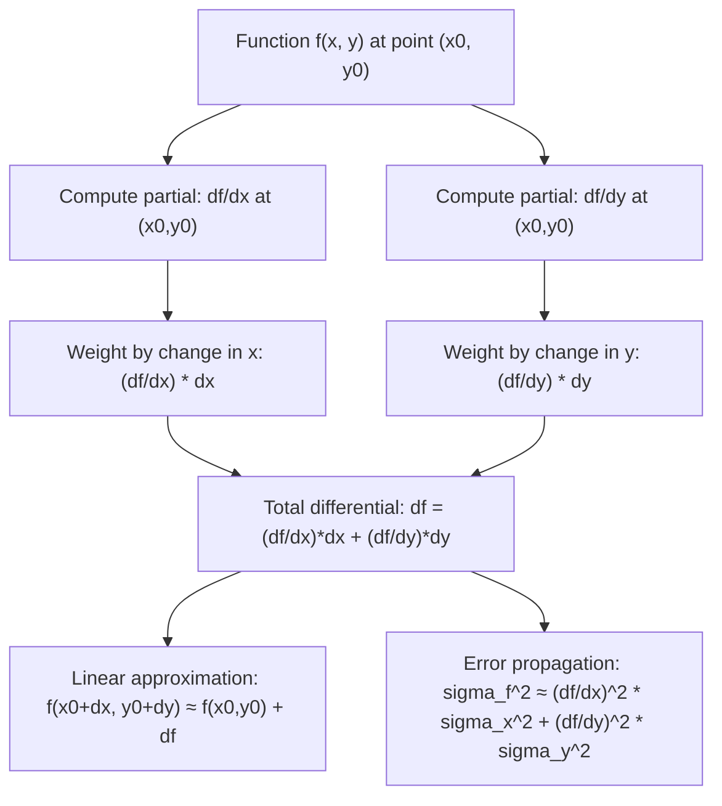

# Total Differential

$$
df = \frac{\partial f}{\partial x}dx + \frac{\partial f}{\partial y}dy
$$

## Deep Breakdown

What it tells me *(Situation Awareness)*:
The total differential $df$ captures the complete infinitesimal change in a multivariate function $f(x, y)$ when both inputs change simultaneously by $dx$ and $dy$. While a partial derivative answers "how does $f$ change if only $x$ moves?", the total differential answers "how does $f$ change if both $x$ and $y$ move by small amounts at once?" It is the multivariate analogue of $dy = f'(x)\,dx$ for single-variable calculus. In DA/DS, the total differential is the foundation of: error propagation (how does measurement uncertainty in inputs translate to uncertainty in a computed output?), sensitivity analysis in financial and business models, the derivation of the gradient vector as the vector of coefficients in the total differential, and first-order approximations of complex loss surfaces near a point (the linear approximation of a function in multiple variables).

## Flowchart



## Real-world use

### Where it is used

Error propagation in measurement: if $f = f(x_1, \ldots, x_n)$ is a derived quantity and each input has uncertainty $\sigma_{x_i}$, the uncertainty in $f$ is $\sigma_f^2 \approx \sum_i \left(\frac{\partial f}{\partial x_i}\right)^2 \sigma_{x_i}^2$ (law of propagation of uncertainty, assuming independence). Sensitivity analysis: which input has the biggest effect on the output? First-order Taylor approximation of loss functions around the current weights in ML. In gradient-based optimization, the gradient is the coefficient vector of the total differential, giving the direction of steepest ascent.

### Problem it solves

When multiple inputs change simultaneously, partial derivatives alone are insufficient because they only account for one direction at a time. The total differential combines all partial effects into a single expression that approximates the total change in $f$. It is the exact analogue of the single-variable formula $\Delta f \approx f'(x)\,\Delta x$ extended to multiple variables.

### How it solves the problem

By the linear (first-order Taylor) approximation: for small changes $dx, dy$ from the point $(x_0, y_0)$:

$$
f(x_0 + dx,\, y_0 + dy) \approx f(x_0, y_0) + \frac{\partial f}{\partial x}dx + \frac{\partial f}{\partial y}dy
$$

The right-hand side minus $f(x_0, y_0)$ is the total differential $df$. It is exact in the limit of infinitesimal $dx, dy$, and a good approximation for small finite changes.

### Example in a business

A business analyst computes ROI = Revenue / Cost. If Revenue has 5% relative uncertainty and Cost has 3% relative uncertainty, the uncertainty in ROI via error propagation (total differential) is:
$\sigma_{\text{ROI}}^2 \approx \left(\frac{\partial \text{ROI}}{\partial R}\right)^2\sigma_R^2 + \left(\frac{\partial \text{ROI}}{\partial C}\right)^2\sigma_C^2 = \frac{\sigma_R^2}{C^2} + \frac{R^2\sigma_C^2}{C^4}$.
For $R = 100K$, $C = 50K$, $\sigma_R = 5K$, $\sigma_C = 1.5K$: the relative uncertainty in ROI $\approx \sqrt{0.05^2 + 0.03^2} \approx 5.8\%$.

## The formula, piece by piece

$$
df = \frac{\partial f}{\partial x}\,dx + \frac{\partial f}{\partial y}\,dy
$$

Each symbol:
- $df$: the total differential — the infinitesimal change in $f$ due to simultaneous changes in all inputs
- $\frac{\partial f}{\partial x}$: partial derivative with respect to $x$ (rate of change in $x$-direction)
- $dx$: infinitesimal change in $x$ (the "perturbation" in $x$)
- $\frac{\partial f}{\partial y}$: partial derivative with respect to $y$ (rate of change in $y$-direction)
- $dy$: infinitesimal change in $y$ **General $n$-variable form**:

$$
df = \sum_{i=1}^n \frac{\partial f}{\partial x_i}\,dx_i = \nabla f \cdot d\mathbf{x}
$$

This is exactly the **gradient** $\nabla f$ dotted with the displacement vector $d\mathbf{x}$. The total differential and the gradient are two faces of the same object. **Error propagation formula** (finite, independent uncertainties):

$$
\sigma_f^2 \approx \left(\frac{\partial f}{\partial x}\right)^2\!\sigma_x^2 + \left(\frac{\partial f}{\partial y}\right)^2\!\sigma_y^2
$$

## The formula in words

"A small simultaneous nudge of $dx$ in $x$ and $dy$ in $y$ causes $f$ to change by approximately $\frac{\partial f}{\partial x}$ times $dx$ (the $x$-contribution) plus $\frac{\partial f}{\partial y}$ times $dy$ (the $y$-contribution). Each partial derivative acts as a 'sensitivity coefficient': it tells how much weight to give each input's nudge."

## Critical Concepts

- **Linear approximation**: the total differential is a first-order (linear) approximation. The exact change also includes second-order terms ($\frac{1}{2}\frac{\partial^2 f}{\partial x^2}dx^2 + \ldots$), captured by the Hessian. The total differential keeps only the linear term.
- **Gradient as coefficient vector**: $df = \nabla f \cdot d\mathbf{x}$. The gradient $\nabla f$ is the vector of partial derivatives; the total differential is the dot product of the gradient with the displacement.
- **Independence assumption in error propagation**: $\sigma_f^2 \approx \sum_i (\partial f/\partial x_i)^2 \sigma_{x_i}^2$ holds when inputs are independent. For correlated inputs: $\sigma_f^2 \approx \nabla f^T \Sigma \nabla f$ where $\Sigma$ is the covariance matrix of inputs.
- **Exact vs. approximate**: for affine (linear) functions $f = ax + by + c$, the total differential is exact: $df = a\,dx + b\,dy$. For nonlinear functions, it is an approximation valid for small $dx, dy$.
- **Chain rule connection**: if $x = x(t)$ and $y = y(t)$, dividing $df$ by $dt$ gives the multivariable chain rule: $\frac{df}{dt} = \frac{\partial f}{\partial x}\frac{dx}{dt} + \frac{\partial f}{\partial y}\frac{dy}{dt}$.

## Step-by-step calculation (tiny example)

Let $f(x, y) = x^2 y$. Compute the total differential and use it to approximate $f(2.01, 3.02) - f(2, 3)$.

*Step 1: Compute partial derivatives*
$\frac{\partial f}{\partial x} = 2xy$, $\frac{\partial f}{\partial y} = x^2$

*Step 2: Evaluate partials at $(x_0, y_0) = (2, 3)$*
$\frac{\partial f}{\partial x}\big|_{(2,3)} = 2 \cdot 2 \cdot 3 = 12$
$\frac{\partial f}{\partial y}\big|_{(2,3)} = 2^2 = 4$

*Step 3: Identify the perturbations*
$dx = 2.01 - 2 = 0.01$, $dy = 3.02 - 3 = 0.02$

*Step 4: Total differential (approximate change)*
$df \approx 12 \cdot 0.01 + 4 \cdot 0.02 = 0.12 + 0.08 = 0.20$

*Step 5: Compare to exact change*
$f(2.01, 3.02) = (2.01)^2 \times 3.02 = 4.0401 \times 3.02 = 12.201102$
$f(2, 3) = 4 \times 3 = 12$
Exact change: $12.201102 - 12 = 0.201102$
Linear approximation: $0.20$ — error $\approx 0.001$ (the second-order terms).

## Code examples

### Beginner example (Python)

```python
import numpy as np

def f(x: float, y: float) -> float:
    """f(x, y) = x^2 * y."""
    return x**2 * y

def partial_x(x: float, y: float) -> float:
    """df/dx = 2xy."""
    return 2.0 * x * y

def partial_y(x: float, y: float) -> float:
    """df/dy = x^2."""
    return x**2
x0, y0 = 2.0, 3.0
dx, dy = 0.01, 0.02   # Total differential (linear approximation)
df_approx = partial_x(x0, y0) * dx + partial_y(x0, y0) * dy   # Exact change
df_exact = f(x0 + dx, y0 + dy) - f(x0, y0)
print(f"f({x0}, {y0}) = {f(x0, y0)}")
print(f"df/dx at ({x0},{y0}) = {partial_x(x0, y0)}")
print(f"df/dy at ({x0},{y0}) = {partial_y(x0, y0)}")
print(f"\ndx = {dx}, dy = {dy}")
print(f"Total differential df ≈ {df_approx:.6f}")
print(f"Exact change df = {df_exact:.6f}")
print(f"Approximation error: {abs(df_approx - df_exact):.6f}")   # Error propagation: sigma_f^2 = (df/dx)^2 * sigma_x^2 + (df/dy)^2 * sigma_y^2
sigma_x = 0.05   # uncertainty in x
sigma_y = 0.10   # uncertainty in y
sigma_f = np.sqrt(partial_x(x0, y0)**2 * sigma_x**2 + partial_y(x0, y0)**2 * sigma_y**2)
print(f"\nError propagation at ({x0},{y0}):")
print(f" sigma_x = {sigma_x}, sigma_y = {sigma_y}")
print(f" sigma_f ≈ {sigma_f:.4f} (uncertainty in f)")
```

### Beginner example (R)

```r
f <- function(x, y) x^2 * y
partial_x <- function(x, y) 2 * x * y  # df/dx
partial_y <- function(x, y) x^2  # df/dy
x0 <- 2; y0 <- 3
dx <- 0.01; dy <- 0.02  # Total differential
df_approx <- partial_x(x0, y0) * dx + partial_y(x0, y0) * dy
df_exact <- f(x0 + dx, y0 + dy) - f(x0, y0)
cat("df/dx at (2,3):", partial_x(x0, y0), "\n")  # 12
cat("df/dy at (2,3):", partial_y(x0, y0), "\n")  # 4
cat("Total differential df ≈", df_approx, "\n")  # 0.20
cat("Exact change df = ", df_exact, "\n")  # 0.2011 # Error propagation
sigma_x <- 0.05; sigma_y <- 0.10
sigma_f <- sqrt(partial_x(x0, y0)^2 * sigma_x^2 + partial_y(x0, y0)^2 * sigma_y^2)
cat("Uncertainty sigma_f ≈", round(sigma_f, 4), "\n")
```

### Professional example (Python)

```python
"""
Error propagation via total differential
for a derived business metric. Metric:
    Customer Lifetime Value (LTV) = ARPU / churn_rate
where
ARPU = average_revenue / active_users We
have: LTV = revenue / (users * churn) dLTV/d(revenue) = 1 / (users * churn) dLTV/d(users) = -revenue / (users^2 * churn) dLTV/d(churn) = -revenue / (users * churn^2) Inputs (with measurement uncertainty): revenue ~ Normal(500K, sigma_r=20K) users ~ Normal(10000, sigma_u=300) churn ~ Normal(0.05, sigma_c=0.005) Propagate uncertainty into LTV via total differential / delta method.
"""
import numpy as np
from scipy import stats
RANDOM_SEED = 42
rng = np.random.default_rng(RANDOM_SEED)   # Point estimates
revenue = 500_000.0   # EUR/month
users = 10_000.0
churn = 0.05   # 5% monthly churn # Uncertainties (1 standard deviation)
sigma_r = 20_000.0
sigma_u = 300.0
sigma_c = 0.005   # LTV formula

def compute_ltv(r: float, u: float, c: float) -> float:
    """LTV = (r / u) / c = r / (u * c)."""
    return r / (u * c)
ltv_point = compute_ltv(revenue, users, churn)   # Partial derivatives (analytic)
dltv_dr = 1.0 / (users * churn)
dltv_du = -revenue / (users**2 * churn)
dltv_dc = -revenue / (users * churn**2)   # Error propagation (assuming independence): sigma_LTV^2 = sum (partial_i)^2 * sigma_i^2
sigma_ltv_delta = np.sqrt( dltv_dr**2 * sigma_r**2 + dltv_du**2 * sigma_u**2 + dltv_dc**2 * sigma_c**2 )   # Monte Carlo verification (compare to delta method)
n_mc = 500_000
r_mc = rng.normal(revenue, sigma_r, n_mc)
u_mc = rng.normal(users, sigma_u, n_mc)
c_mc = rng.normal(churn, sigma_c, n_mc)
# Mask invalid samples (negative or zero churn)
valid = (r_mc > 0) & (u_mc > 0) & (c_mc > 0.001)
ltv_mc = compute_ltv(r_mc[valid], u_mc[valid], c_mc[valid])
print("=== LTV Uncertainty Analysis (Total Differential / Delta Method) ===")
print(f" LTV point estimate: EUR {ltv_point:,.2f}")
print()
print(f" Partial derivatives (sensitivities):")
print(f" dLTV/d(revenue): {dltv_dr:.4f} EUR LTV per EUR revenue")
print(f" dLTV/d(users): {dltv_du:.4f} EUR LTV per user")
print(f" dLTV/d(churn): {dltv_dc:,.0f} EUR LTV per unit churn")
print()
print(f" Contribution to variance:")
print(f" Revenue: {(dltv_dr * sigma_r)**2:.2f} EUR^2")
print(f" Users: {(dltv_du * sigma_u)**2:.2f} EUR^2")
print(f" Churn: {(dltv_dc * sigma_c)**2:.2f} EUR^2")
print()
print(f" Delta method sigma_LTV: EUR {sigma_ltv_delta:,.2f}")
print(f" Monte Carlo sigma_LTV: EUR {ltv_mc.std():,.2f} (N={valid.sum():,})")
print(f" Relative uncertainty: {sigma_ltv_delta / ltv_point:.1%}")
print()
print(f" 95% CI (delta method): EUR [{ltv_point - 1.96*sigma_ltv_delta:,.0f}, {ltv_point + 1.96*sigma_ltv_delta:,.0f}]")
```

---

*Source: 1300 p. 229*
