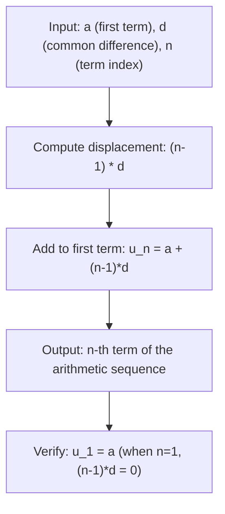

# Arithmetic n-th term

$$
u_n = a + (n-1)d
$$

## Deep Breakdown

What it tells me *(Situation Awareness)*:
This formula gives the **n-th term of an arithmetic sequence** — a sequence where each step adds the same constant difference d. In DA/DS it appears wherever values are evenly spaced: feature indices, time steps, learning rate schedules with linear decay, straight-line depreciation in financial modelling, building evenly-spaced grids for numerical integration, and constructing regular cohort offsets in retention analysis.

## Flowchart



## Real-world use

### Where it is used

Any setting where values increase (or decrease) by a fixed amount at each step. Examples: evenly-spaced time steps in a simulation, calculating the value of an asset under straight-line depreciation, generating a regularized feature grid, computing linear learning rate schedules, and indexing cohort acquisition dates.

### Problem it solves

Rather than listing all n terms manually or using a loop, the closed-form formula gives any term directly in O(1) time. This matters when n is large or when you're optimizing over the sequence parameters a and d.

### How it solves the problem

The pattern is simple: u_1 = a, u_2 = a+d, u_3 = a+2d, ..., u_n = a+(n-1)d. Each step adds exactly d, so after (n-1) steps you've added (n-1)×d to the starting value a.

### Example in a business

**Straight-line asset depreciation**: An asset costs €50,000 and depreciates by €4,000/year. After n years, book value = 50000 + (n-1)×(-4000). At n=5: book value = 50000 - 16000 = €34,000. The formula directly answers "what is this asset worth in year n?" without iterating.

## The formula, piece by piece

$u_n = a + (n-1)d$ - **$u_n$** — The value of the n-th term.
- **$a$** — First term ($u_1$). The starting value of the sequence.
- **$d$** — Common difference. The constant added at each step. Can be negative (decreasing sequence).
- **$n$** — The term index (starts at 1). The n-th position in the sequence.
- **$(n-1)$** — Number of steps taken from the first term. When n=1, zero steps → $u_1 = a$.
- **$(n-1)d$** — Total displacement: the accumulated sum of (n-1) equal steps of size d.
- **Alternative form**: $u_n = u_m + (n-m)d$ — generalization: jump from the m-th to n-th term directly.

## The formula in words

"The n-th term of an arithmetic sequence equals the first term plus (n minus 1) times the common difference." Analogy: if you start at position a on a number line and take (n-1) equal steps of size d, you land at a + (n-1)d. An arithmetic sequence is just repeated equal-step walking on the number line.

## Critical Concepts

1. **d = 0**: constant sequence ($u_n = a$ for all n).
2. **d > 0**: increasing sequence (counting up, depreciation of a liability, cumulative growth).
3. **d < 0**: decreasing sequence (straight-line depreciation of an asset, countdown).
4. **Continuous analog**: Linear function $f(t) = a + d \cdot t$ — the arithmetic sequence is the discrete sample of a straight line.
5. **NumPy equivalent**: `np.arange(a, a + n*d, d)` or `np.linspace(a, a + (n-1)*d, n)` generate arithmetic sequences; the n-th element (0-indexed) = a + n*d.
6. **Relation to arithmetic sum**: $S_n = \frac{n}{2}(u_1 + u_n) = \frac{n}{2}(2a + (n-1)d)$ — the sum formula builds on knowing u_n.

## Step-by-step calculation (tiny example)

Sequence: a = 3, d = 5 (terms: 3, 8, 13, 18, 23, ...)

*Step 1: Verify the pattern*
u_1 = 3, u_2 = 3+5 = 8, u_3 = 8+5 = 13, u_4 = 13+5 = 18

*Step 2: Find u_7 directly*
$u_7 = 3 + (7-1) \times 5 = 3 + 30 = \mathbf{33}$

*Step 3: Verify by counting*
3, 8, 13, 18, 23, 28, 33 → 7th term = 33

*Step 4: What if we want the n-th term for n=100?*
$u_{100} = 3 + 99 \times 5 = 3 + 495 = \mathbf{498}$
No loop needed — O(1) computation.

## Code examples

### Beginner example (Python)

```python
"""
Arithmetic n-th term: u_n = a + (n-1)*d

Applied to straight-line asset depreciation and learning rate linear decay.
"""
import numpy as np


def arithmetic_nth_term(first_term: float, common_diff: float, term_index: int) -> float:
    """Return the n-th term of an arithmetic sequence.

    Parameters
    ----------
    first_term : value of u_1 (starting value)
    common_diff : common difference d (step size; negative for decreasing)
    term_index : position n (1-based)

    Returns
    -------
    float: u_n = first_term + (term_index - 1) * common_diff
    """
    return first_term + (term_index - 1) * common_diff


# Straight-line depreciation: asset worth €50,000 losing €4,000/year
INITIAL_VALUE = 50_000.0
ANNUAL_DEPRECIATION = -4_000.0
print("Asset value under straight-line depreciation:")
for year in [1, 2, 5, 10, 13]:
    book_value = arithmetic_nth_term(INITIAL_VALUE, ANNUAL_DEPRECIATION, year)
    print(f" Year {year:2d}: €{book_value:,.0f}")

# Verify with numpy
years = np.arange(1, 14)
book_values_np = INITIAL_VALUE + (years - 1) * ANNUAL_DEPRECIATION
print(f"\nFully depreciated at year: {np.argmin(book_values_np >= 0) + 1}")

# Linear learning rate decay: eta_n = 0.1 - (n-1)*0.005
INITIAL_LR = 0.10
LR_DECAY = -0.005
print("\nLinear learning rate schedule:")
for epoch in [1, 5, 10, 15, 20]:
    lr = arithmetic_nth_term(INITIAL_LR, LR_DECAY, epoch)
    print(f" Epoch {epoch:2d}: lr = {lr:.4f}")
```

### Beginner example (R)

```r
# Arithmetic n-th term: u_n = a + (n-1)*d
# Applied to generating cohort acquisition schedules
arithmetic_nth_term <- function(first_term, common_diff, term_index) {
  # n-th term of arithmetic sequence
  # Args:
  #   first_term : starting value (u_1)
  #   common_diff : constant step added each term (d)
  #   term_index : position in sequence (1-based integer)
  # Returns: u_n
  first_term + (term_index - 1) * common_diff
}

# Cohort schedule: first cohort acquired in Jan 2023,
# new cohort every 30 days
FIRST_COHORT_DAY <- 1  # day 1 from reference date
COHORT_INTERVAL <- 30  # days between cohorts
cat("Cohort acquisition schedule (days from launch):\n")
for (cohort_num in 1:8) {
  acq_day <- arithmetic_nth_term(FIRST_COHORT_DAY, COHORT_INTERVAL, cohort_num)
  cat(sprintf(" Cohort %d: day %d\n", cohort_num, acq_day))
}

# General: generate the full sequence via vectorization
cohort_indices <- seq_len(12)
cohort_days <- arithmetic_nth_term(FIRST_COHORT_DAY, COHORT_INTERVAL, cohort_indices)
cat(sprintf("\nAll 12 cohort acquisition days: %s\n", paste(cohort_days, collapse=", ")))
```

### Professional example (Python)

```python
"""
Arithmetic sequence for building a regularized feature index grid
in a regression model with polynomial features.

Business context:
    A demand forecasting team needs to test how adding polynomial terms up to
    degree N affects model accuracy. They generate evenly-spaced test points for
    model evaluation, and also build a linear depreciation schedule for modeling
    asset values in their financial features.
"""
import numpy as np
import pandas as pd

FIRST_VALUE: float = 0.0
STEP_SIZE: float = 0.1
NUM_POINTS: int = 50
POLY_DEGREE: int = 4
RNG_SEED: int = 42


def arithmetic_sequence(
    first_term: float, common_diff: float, num_terms: int,
) -> np.ndarray:
    """Generate arithmetic sequence: u_n = a + (n-1)*d for n = 1, ..., num_terms."""
    term_indices = np.arange(1, num_terms + 1, dtype=float)
    return first_term + (term_indices - 1) * common_diff


def build_polynomial_features(
    x_values: np.ndarray, max_degree: int,
) -> np.ndarray:
    """Build polynomial feature matrix [1, x, x^2, ..., x^degree]."""
    return np.column_stack([x_values**deg for deg in range(max_degree + 1)])


# Generate evenly spaced evaluation grid using arithmetic sequence
eval_grid = arithmetic_sequence(FIRST_VALUE, STEP_SIZE, NUM_POINTS)

# Build polynomial features on the grid
poly_features = build_polynomial_features(eval_grid, POLY_DEGREE)

# Verify: each row uses x from the arithmetic sequence
rng = np.random.default_rng(RNG_SEED)
true_coeffs = rng.normal(0, 1, POLY_DEGREE + 1)
target_values = poly_features @ true_coeffs + rng.normal(0, 0.1, NUM_POINTS)
summary_df = pd.DataFrame({
    "grid_point_x": eval_grid[:5],
    "x_squared": poly_features[:5, 2],
    "x_cubed": poly_features[:5, 3],
    "target_y": target_values[:5],
})
print("First 5 evaluation points:")
print(summary_df.to_string(index=False))
print(f"\nGrid step size d = {STEP_SIZE}")
print(f"u_n formula confirms: u_10 = {arithmetic_sequence(FIRST_VALUE, STEP_SIZE, 10)[-1]:.1f}")
```

---

*Source: MFB p. 160*
