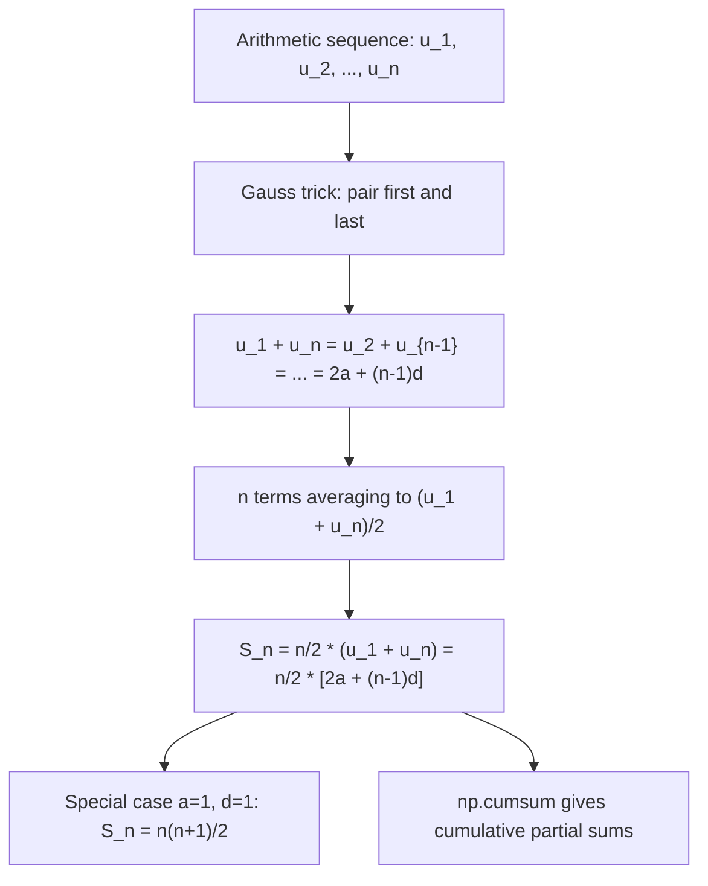

# Arithmetic Sum to $n$

$$
S_n = \frac{n}{2}[2a + (n-1)d] = \frac{n}{2}(u_1 + u_n)
$$

## Deep Breakdown

What it tells me *(Situation Awareness)*:
The sum of the first $n$ terms of an arithmetic sequence is $S_n = \frac{n}{2}(u_1 + u_n)$: the number of terms times the average of the first and last term. This is Gauss's formula. In DA/DS: cumulative linear growth (DAU growing by a fixed amount per day), total straight-line depreciation over an asset's life, summing equally spaced values, and the ubiquitous identity $\sum_{k=1}^n k = \frac{n(n+1)}{2}$ which appears in $O(n^2)$ algorithm analysis and combinatorics. The formula enables $O(1)$ computation of what would otherwise require an $O(n)$ loop.

## Flowchart



## Real-world use

### Where it is used

Total depreciation over $n$ years. Cumulative user-months when DAU grows linearly. Sum $1+2+\cdots+n = n(n+1)/2$ in algorithm complexity. Sum of linearly spaced values (e.g., total score across graded levels). Partial sums of arithmetic revenue projections.

### Problem it solves

Sum $n$ arithmetic terms in $O(1)$ without looping.

### How it solves the problem

Gauss's insight: write the sum forward and backward, pair terms. Each pair sums to $u_1 + u_n$. There are $n/2$ pairs, so $S_n = \frac{n}{2}(u_1 + u_n)$.

### Example in a business

SaaS company: month-1 DAU = 10,000, growing by 500/month. Total user-months over 12 months: $S_{12} = \frac{12}{2}(10{,}000 + (10{,}000 + 11 \times 500)) = 6(10{,}000 + 15{,}500) = 6 \times 25{,}500 = 153{,}000$ user-months. This is the area under the linear DAU curve — used for capacity planning and infrastructure cost.

## The formula, piece by piece

$$
S_n = \frac{n}{2}[2a + (n-1)d] = \frac{n}{2}(u_1 + u_n)
$$

Each symbol:
- $S_n$: sum of first $n$ terms
- $n$: number of terms
- $a = u_1$: first term
- $d$: common difference
- $u_n = a + (n-1)d$: the $n$-th term **Special cases**:

$$
\sum_{k=1}^n k = \frac{n(n+1)}{2} \quad (a=1,\, d=1)
$$

**Partial sum**: $\sum_{k=m+1}^n u_k = S_n - S_m$

## The formula in words

"The sum of $n$ arithmetic terms equals the number of terms multiplied by the average of the first and last term. Since terms are equally spaced, their average is exactly the midpoint between the smallest and largest."

## Critical Concepts

- **$O(1)$ vs $O(n)$**: formula gives an exact result in constant time.
- **Both forms equivalent**: $\frac{n}{2}(u_1 + u_n) = \frac{n}{2}[2a + (n-1)d]$ since $u_n = a + (n-1)d$.
- **Gauss sum**: $1+2+\cdots+n = \frac{n(n+1)}{2}$ — appears in nested loop complexity $O(n^2)$, triangular numbers, $\binom{n+1}{2}$.
- **np.cumsum**: `np.cumsum(sequence)` gives the vector $[S_1, S_2, \ldots, S_n]$ in $O(n)$.
- **Partial sum**: $S_n - S_m$ gives the sum from term $m+1$ to $n$.
- **Area interpretation**: $S_n \cdot \Delta t$ approximates $\int_0^T f(t)\,dt$ for a linearly growing function $f$.

## Step-by-step calculation (tiny example)

Sequence: 3, 7, 11, 15, 19. Sum all 5 terms.

*Step 1: Identify parameters*
$a = 3$, $d = 4$, $n = 5$, $u_5 = 3 + 4(4) = 19$

*Step 2: Apply formula*
$S_5 = \frac{5}{2}(3 + 19) = \frac{5}{2}(22) = 55$

*Step 3: Verify by direct addition*
$3 + 7 + 11 + 15 + 19 = 55$ ✓

## Code examples

### Beginner example (Python)

```python
import numpy as np

def arithmetic_sum_n(a: float, d: float, n: int | np.ndarray) -> float | np.ndarray:
    """Sum of first n terms: S_n = n/2 * (2a + (n-1)*d)."""
    return n / 2.0 * (2.0 * a + (n - 1) * d)

def arithmetic_nth_term(a: float, d: float, n: int | np.ndarray) -> float | np.ndarray:
    return a + (n - 1) * d


# Sequence 3, 7, 11, ...
a_val, d_val = 3.0, 4.0
print("Arithmetic sums (a=3, d=4):")
for n in [5, 10, 20, 100]:
    s_formula = arithmetic_sum_n(a_val, d_val, n)
    s_brute = sum(a_val + (k - 1) * d_val for k in range(1, n + 1))
    print(f" S_{n:3d} = {s_formula:>10.1f} (brute: {s_brute:>10.1f})")

# Gauss sum 1+2+...+n
n_gauss = 100
print(f"\nGauss sum 1+...+{n_gauss}: {n_gauss*(n_gauss+1)/2} (brute: {sum(range(1,n_gauss+1))})")

# Cumulative user-months (a=10000, d=500/month)
a_dau, d_dau = 10_000.0, 500.0
n_months = np.arange(1, 13)
s_months = arithmetic_sum_n(a_dau, d_dau, n_months)
u_n_months = arithmetic_nth_term(a_dau, d_dau, n_months)
print("\nCumulative user-months (a=10000, d=500):")
for n, s, u in zip(n_months[[0, 2, 5, 11]], s_months[[0, 2, 5, 11]], u_n_months[[0, 2, 5, 11]]):
    print(f" Month {n:2d}: S={s:>8,.0f} u_n={u:>7,.0f}")
```

### Beginner example (R)

```r
arithmetic_sum_n <- function(a, d, n) n / 2 * (2 * a + (n - 1) * d)
a_val <- 3; d_val <- 4
cat("Arithmetic sums (a=3, d=4):\n")
for (n in c(5, 10, 20, 100)) {
  s_formula <- arithmetic_sum_n(a_val, d_val, n)
  s_brute <- sum(a_val + (seq_len(n) - 1) * d_val)
  cat(sprintf(" S_%d = %10.1f (brute: %10.1f)\n", n, s_formula, s_brute))
}
n_g <- 100
cat(sprintf("\nGauss sum: %d\n", n_g * (n_g + 1) / 2))
```

### Professional example (Python)

```python
"""
Arithmetic sum in DA/DS: cumulative DAU, total depreciation, loop complexity.
"""
import numpy as np
import pandas as pd

def arithmetic_sum_n(a: float, d: float, n: int | np.ndarray) -> float | np.ndarray:
    """S_n = n/2 * (2a + (n-1)*d)."""
    return n / 2.0 * (2.0 * a + (n - 1) * d)

def arithmetic_nth_term(a: float, d: float, n: int | np.ndarray) -> float | np.ndarray:
    return a + (n - 1) * d


# 1. Cumulative DAU and infrastructure cost
a_dau, d_dau, cost_per_user_month = 10_000.0, 500.0, 0.02   # EUR per user per month
n_months = np.arange(1, 13)
s_months = arithmetic_sum_n(a_dau, d_dau, n_months)
infra_cost = s_months * cost_per_user_month
df = pd.DataFrame({
    "month": n_months,
    "dau": arithmetic_nth_term(a_dau, d_dau, n_months).astype(int),
    "cum_user_months": s_months.astype(int),
    "infra_cost_eur": infra_cost.round(0),
})
print("=== Cumulative DAU and Infrastructure Cost ===")
print(df[df["month"].isin([1, 3, 6, 12])].to_string(index=False))

# 2. Total depreciation: S_n with d = annual depreciation
print("\n=== Total Depreciation Over Asset Life ===")
for name, a_asset, d_dep, life in [("Server", 80_000, -8_000, 10), ("Office", 120_000, -10_000, 12)]:
    total = arithmetic_sum_n(a_asset, d_dep, life)   # sum of book values
    total_written = a_asset - arithmetic_nth_term(a_asset, d_dep, life)
    print(f" {name}: total depreciation taken = EUR {total_written:>9,.0f}")

# 3. Loop complexity: nested loop over n items
n_items = 1000
total_comparisons = n_items * (n_items + 1) // 2   # Gauss sum
print(f"\n=== Algorithm Complexity ===")
print(f" Pairwise comparisons for n={n_items}: {total_comparisons:,} = n(n+1)/2")
```

---

*Source: 1300 p. 312*
