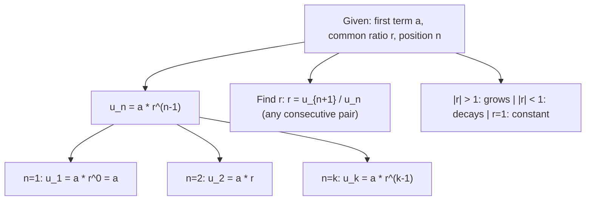

# Geometric $n$-th term

$$
u_n = a r^{n-1}
$$

## Deep Breakdown

What it tells me *(Situation Awareness)*:
A geometric sequence multiplies each term by a constant ratio $r$. The $n$-th term $u_n = a r^{n-1}$ grows (or decays) exponentially in $n$. In DA/DS: compound interest, exponential growth of users/revenue, geometric decay of learning rates in schedules, discount factors $r = \frac{1}{1+i}$ in NPV calculations, and geometric distributions in probability (waiting for first success). The ratio $r$ is the multiplicative analogue of the additive $d$ in arithmetic sequences. For $|r| > 1$: exponential growth; $|r| < 1$: exponential decay; $r = 1$: constant; $r = -1$: alternating signs.

## Flowchart



## Real-world use

### Where it is used

Compound interest: balance after $n$ periods at rate $i$ per period is $u_n = P(1+i)^{n-1}$ (geometric, $r = 1+i$). Exponential user growth models. Geometric learning rate schedule: $\eta_n = \eta_0 \cdot \gamma^{n-1}$ (decay factor $\gamma < 1$). NPV discount factors: $\frac{1}{(1+i)^{n-1}}$. Geometric distribution PMF: $P(X=n) = (1-p)^{n-1}p$.

### Problem it solves

Find the value at position $n$ in an exponentially growing or decaying sequence without multiplying through all prior terms.

### How it solves the problem

Multiply $a$ by $r$ exactly $(n-1)$ times: $u_n = a \cdot \underbrace{r \cdot r \cdots r}_{n-1} = ar^{n-1}$.

### Example in a business

A startup's monthly revenue doubles each month (100% MoM growth, $r = 2$). Starting at EUR 10,000 ($a = 10{,}000$). Revenue in month $n$: $u_n = 10{,}000 \cdot 2^{n-1}$. Month 12: $u_{12} = 10{,}000 \cdot 2^{11} = 20{,}480{,}000$.

## The formula, piece by piece

$$
u_n = a r^{n-1}
$$

Each symbol:
- $u_n$: the $n$-th term
- $a$: the first term ($u_1 = a \cdot r^0 = a$)
- $r$: the common ratio; $r = u_{k+1}/u_k$ for any $k$
- $n-1$: the number of multiplications by $r$ from the first term **Find $r$**: $r = \left(\dfrac{u_n}{a}\right)^{1/(n-1)}$ given $u_n$ **Log form**: $\log u_n = \log a + (n-1)\log r$ — linear in $n$ on a log scale **Learning rate decay** ($\gamma$ decay factor, $n$ starting at 0): $\eta_n = \eta_0 \cdot \gamma^n$

## The formula in words

"Start at $a$. Multiply by $r$ a total of $(n-1)$ times. You land on $u_n = ar^{n-1}$."

## Critical Concepts

- **Verify constant ratio**: `np.ratio = sequence[1:] / sequence[:-1]`; all should be equal.
- **Log-linear**: plot $\log u_n$ vs. $n$ — straight line with slope $\log r$.
- **$r = 1+i$ for compound interest**: percentage growth per period $i$ gives ratio $r = 1+i$.
- **$|r| < 1$**: exponential decay; terms approach 0. Learning rate schedule, discount factors.
- **$r < 0$**: alternating signs — uncommon in business but appears in oscillating models.
- **Geometric vs. arithmetic**: geometric means divide at constant ratio; arithmetic means differ by constant addend.

Geometric is appropriate for multiplicative processes.

## Step-by-step calculation (tiny example)

Sequence: 2, 6, 18, 54, ... Find $u_7$.

*Step 1: Identify parameters*
$a = 2$, $r = 6/2 = 3$ (check: $18/6=3$, $54/18=3$ ✓)

*Step 2: Apply formula*
$u_7 = 2 \cdot 3^{7-1} = 2 \cdot 3^6 = 2 \cdot 729 = 1{,}458$

*Step 3: Verify*
$u_7 / u_6 = 1{,}458/486 = 3 = r$ ✓

## Code examples

### Beginner example (Python)

```python
import numpy as np

def geometric_nth_term(a: float, r: float, n: int | np.ndarray) -> float | np.ndarray:
    """n-th term of geometric sequence: u_n = a * r^(n-1)."""
    return a * r ** (n - 1)


# Sequence 2, 6, 18, 54, ...
a_val, r_val = 2.0, 3.0
print("Geometric sequence (a=2, r=3):")
for n in [1, 2, 3, 5, 7]:
    print(f" u_{n} = {geometric_nth_term(a_val, r_val, n):.1f}")

# Verify constant ratio
terms = geometric_nth_term(a_val, r_val, np.arange(1, 8))
ratios = terms[1:] / terms[:-1]
print(f"\nRatios (all should be {r_val}): {ratios}")

# Compound interest: P=1000, r=1.05 (5% per period)
P, r_rate = 1_000.0, 1.05
print("\nCompound interest (P=1000, 5%/period):")
for n in [1, 5, 10, 20]:
    print(f" Period {n:2d}: EUR {geometric_nth_term(P, r_rate, n):>9,.2f}")

# Learning rate schedule: eta_0=0.1, gamma=0.9
eta_0, gamma = 0.1, 0.9
print("\nLearning rate decay (eta_0=0.1, gamma=0.9):")
for epoch in [1, 5, 10, 20, 50]:
    print(f" Epoch {epoch:2d}: eta = {geometric_nth_term(eta_0, gamma, epoch):.6f}")
```

### Beginner example (R)

```r
geometric_nth_term <- function(a, r, n) a * r^(n - 1)

# Sequence 2, 6, 18, ...
a_val <- 2; r_val <- 3
cat("Geometric sequence (a=2, r=3):\n")
for (n in c(1, 2, 3, 5, 7)) {
  cat(sprintf(" u_%d = %.1f\n", n, geometric_nth_term(a_val, r_val, n)))
}

# Compound interest
P <- 1000; r_rate <- 1.05
cat("\nCompound interest (P=1000, 5%/period):\n")
for (n in c(1, 5, 10, 20)) {
  cat(sprintf(" Period %2d: EUR %9.2f\n", n, geometric_nth_term(P, r_rate, n)))
}
```

### Professional example (Python)

```python
"""
Geometric sequence in DA/DS: compound growth, learning rate schedule, revenue model.
"""
import numpy as np
import pandas as pd

def geometric_nth_term(a: float, r: float, n: int | np.ndarray) -> float | np.ndarray:
    """u_n = a * r^(n-1)."""
    return a * r ** (n - 1)


# 1. Monthly revenue with geometric growth (r = 1.15: 15% MoM)
a_rev, r_rev = 100_000.0, 1.15
months = np.arange(1, 25)
revenue = geometric_nth_term(a_rev, r_rev, months)
print("=== Monthly Revenue (15% MoM Growth) ===")
df_rev = pd.DataFrame({"month": months, "revenue_eur": revenue.round(0)})
print(df_rev[df_rev["month"].isin([1, 6, 12, 18, 24])].to_string(index=False))
print(f"MoM growth: {r_rev-1:.0%} | Year-2 ARR: EUR {revenue[23]*12:,.0f}")

# 2. Learning rate schedule for ML training
eta_0, gamma = 0.01, 0.95
n_epochs = np.arange(1, 51)
lr_schedule = geometric_nth_term(eta_0, gamma, n_epochs)
print(f"\n=== LR Schedule (eta_0={eta_0}, gamma={gamma}) ===")
for ep in [1, 10, 25, 50]:
    print(f" Epoch {ep:2d}: eta = {lr_schedule[ep-1]:.6f}")

# 3. NPV discount factors
i_rate = 0.08  # 8% discount rate
r_npv = 1.0 / (1.0 + i_rate)  # discount factor r < 1
n_years = np.arange(1, 11)
discount_factors = geometric_nth_term(1.0, r_npv, n_years)
print(f"\n=== NPV Discount Factors (r={r_npv:.4f}) ===")
for yr, df_val in zip(n_years[[0, 4, 9]], discount_factors[[0, 4, 9]]):
    print(f" Year {yr:2d}: factor = {df_val:.4f}")
```

---

*Source: MFB p. 160*
