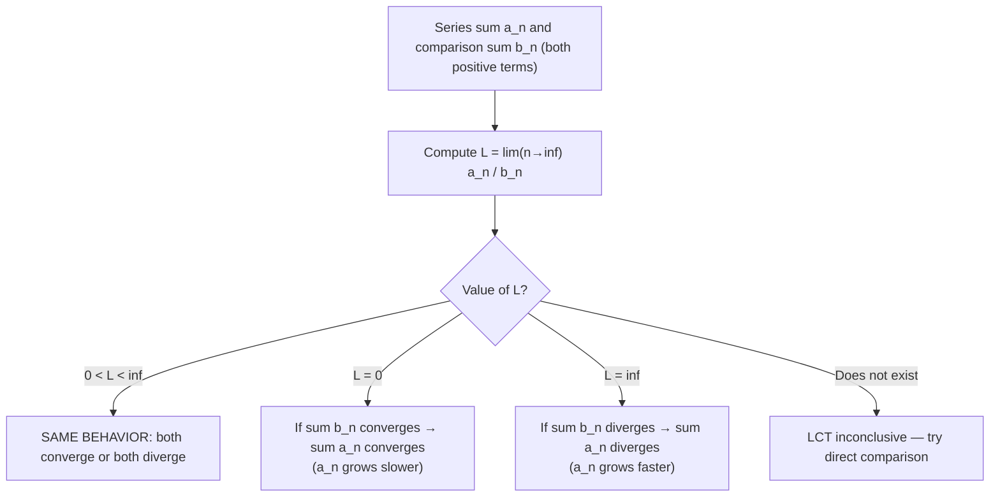

# Limit Comparison Test

$$
\lim_{n \to \infty} \frac{a_n}{b_n} = L \in (0, \infty) \Rightarrow \sum a_n \text{ and } \sum b_n \text{ behave the same}
$$

## Deep Breakdown

What it tells me *(Situation Awareness)*:
The Limit Comparison Test (LCT) is more powerful and often easier to apply than the direct comparison test. Instead of requiring a termwise inequality, it only needs the ratio of terms to converge to a finite positive number. When $a_n \sim C \cdot b_n$ for large n (they grow/shrink proportionally), both series either converge or both diverge. In DA/DS: comparing asymptotic complexity of algorithms, checking whether two error sequences have the same convergence behavior, and simplifying complicated series by comparing to standard p-series.

## Flowchart



## Real-world use

### Where it is used

When the direct comparison inequality is hard to establish but you can recognize that two series are "asymptotically proportional." Most useful when a_n is a rational function of n (ratio of polynomials) — compare to the dominant term.

### Problem it solves

Direct comparison requires finding a series with every term larger (or smaller) than yours. LCT only needs the ratio to stabilize — much easier when terms involve polynomial fractions like $\frac{n^2 + 3n}{n^4 - 2}$.

### How it solves the problem

If $a_n/b_n \to L$ with $0 < L < \infty$, then eventually $L/2 \cdot b_n \leq a_n \leq 2L \cdot b_n$ (by definition of limit). So by direct comparison, $\sum a_n$ and $\sum b_n$ share the same convergence status.

### Example in a business

**Algorithm complexity analysis**: You have two different feature selection algorithms. Algorithm A runs in O(n²+n) time, Algorithm B in O(n²). The limit of their time ratio: (n²+n)/n² → 1 as n→∞. By LCT with a comparison to p-series, if one's total computation over all dataset sizes converges, so does the other's. In practice: $\sum (n^2+n)/(n^4)$ compared to $\sum 1/n^2$ — limit = 1, so both converge.

## The formula, piece by piece

$\lim_{n \to \infty} \frac{a_n}{b_n} = L$ - **$a_n$** — Terms of the series under investigation (positive).
- **$b_n$** — Terms of the comparison series (positive, with known behavior).
- **$L \in (0, \infty)$** — Finite, strictly positive limit. This is the "clean" case where both series behave identically.
- **$L = 0$**: $a_n$ grows slower than $b_n$. If $\sum b_n$ converges → $\sum a_n$ converges (weaker). If $\sum b_n$ diverges → inconclusive.
- **$L = \infty$**: $a_n$ grows faster than $b_n$. If $\sum b_n$ diverges → $\sum a_n$ diverges (stronger). If $\sum b_n$ converges → inconclusive.
- **Standard comparisons**: Use $b_n = 1/n^p$ (p-series).

Degree matching: if $a_n$ is a ratio of polynomials of degree p in numerator and q in denominator, compare to $1/n^{q-p}$.

## The formula in words

"If the ratio of corresponding terms from two positive series converges to a finite, nonzero constant, then the two series have identical convergence behavior." Analogy: two functions "look the same" asymptotically (same big-O class). If one converges/diverges, so does the other.

## Critical Concepts

1. **Both series must have positive terms**: LCT only works for positive term series.
2. **The standard strategy**: For rational functions, compare to $1/n^k$ where k = (degree of denominator) - (degree of numerator).
3. **L must be strictly between 0 and infinity for the "same behavior" conclusion**: The edge cases L=0 and L=∞ require extra care.
4. **LCT vs. direct comparison**: LCT is generally easier (just compute a limit). Direct comparison gives you an actual bound on the sum value; LCT only gives convergence/divergence.
5. **Choosing a good b_n**: Always simplify a_n for large n first.

For $a_n = (n^2+5)/(n^4-3n)$, the dominant behavior is $n^2/n^4 = 1/n^2$. Use $b_n = 1/n^2$.

## Step-by-step calculation (tiny example)

Test: $\sum_{n=1}^\infty \frac{n^2 + 1}{n^4 + 3}$

*Step 1: Identify dominant behavior*
For large n: numerator ≈ n², denominator ≈ n⁴ → $a_n \approx n^2/n^4 = 1/n^2$
Choose $b_n = 1/n^2$.

*Step 2: Compute the limit*
$L = \lim_{n \to \infty} \frac{a_n}{b_n} = \lim_{n \to \infty} \frac{(n^2+1)/( n^4+3)}{1/n^2} = \lim_{n \to \infty} \frac{n^2(n^2+1)}{n^4+3}$
$= \lim_{n \to \infty} \frac{n^4 + n^2}{n^4 + 3} = \lim_{n \to \infty} \frac{1 + 1/n^2}{1 + 3/n^4} = \frac{1+0}{1+0} = 1$

*Step 3: Check comparison series*
$\sum 1/n^2$ is a p-series with p=2 > 1 → **converges**.

*Step 4: Conclude*
L = 1 ∈ (0,∞) and $\sum b_n$ converges → $\sum \frac{n^2+1}{n^4+3}$ **CONVERGES**.

## Code examples

### Beginner example (Python)

```python
"""
Limit Comparison Test: lim(a_n / b_n) = L in (0, inf)
→ sum a_n and sum b_n have same convergence behavior.
"""
import numpy as np
from typing import Callable


def limit_comparison_test(
    series_a: Callable[[np.ndarray], np.ndarray],
    series_b: Callable[[np.ndarray], np.ndarray],
    series_b_converges: bool,
    num_terms: int = 100_000,
) -> dict:
    """Apply limit comparison test numerically.

    Parameters
    ----------
    series_a : terms a_n
    series_b : terms b_n (comparison, positive)
    series_b_converges : whether sum b_n is known to converge
    num_terms : how many terms to use for limit estimate

    Returns
    -------
    dict with limit, conclusion
    """
    large_indices = np.array([1e4, 1e5, 1e6])
    ratios = series_a(large_indices) / series_b(large_indices)
    limiting_ratio = ratios[-1]
    if 0 < limiting_ratio < np.inf:
        conclusion = (
            "CONVERGES" if series_b_converges else "DIVERGES"
        ) + f" (same as b_n, L = {limiting_ratio:.6f})"
    elif limiting_ratio == 0:
        conclusion = f"CONVERGES if sum b_n converges (L=0, a_n grows slower)"
    else:
        conclusion = f"DIVERGES if sum b_n diverges (L=inf, a_n grows faster)"
    partial_sum_a = float(np.sum(series_a(np.arange(1, num_terms + 1, dtype=float))))
    return {
        "limiting_ratio": limiting_ratio,
        "conclusion": conclusion,
        "partial_sum_a": partial_sum_a,
    }


# Test: (n^2+1)/(n^4+3) compared to 1/n^2 (converges)
result = limit_comparison_test(
    series_a=lambda n: (n**2 + 1.0) / (n**4 + 3.0),
    series_b=lambda n: 1.0 / n**2,
    series_b_converges=True,
)
print(f"(n^2+1)/(n^4+3): {result['conclusion']}")
print(f" Partial sum (100k): {result['partial_sum_a']:.6f}")

# Test: (2n+1)/(n^2+n) compared to 1/n (harmonic, diverges)
result2 = limit_comparison_test(
    series_a=lambda n: (2.0 * n + 1.0) / (n**2 + n),
    series_b=lambda n: 1.0 / n,
    series_b_converges=False,
)
print(f"(2n+1)/(n^2+n): {result2['conclusion']}")
```

### Beginner example (R)

```r
# Limit Comparison Test for rational series
limit_comparison_test <- function(a_func, b_func, b_converges, series_name) {
  # Estimate limit of a_n / b_n at large n
  large_n <- c(1e4, 1e5, 1e6)
  ratios <- a_func(large_n) / b_func(large_n)
  limiting_ratio <- tail(ratios, 1)
  if (is.finite(limiting_ratio) && limiting_ratio > 0) {
    verdict <- ifelse(b_converges, "CONVERGES", "DIVERGES")
    verdict <- paste0(verdict, sprintf(" (L = %.4f)", limiting_ratio))
  } else if (limiting_ratio == 0) {
    verdict <- "CONVERGES if b_n converges (L=0)"
  } else {
    verdict <- "DIVERGES if b_n diverges (L=Inf)"
  }
  partial_sum_a <- sum(a_func(1:100000))
  cat(sprintf("%-35s → %s | partial_sum=%.6f\n", series_name, verdict, partial_sum_a))
}
limit_comparison_test(
  function(n) (n^2 + 1) / (n^4 + 3), function(n) 1 / n^2,
  b_converges = TRUE, series_name = "(n^2+1)/(n^4+3)"
)
limit_comparison_test(
  function(n) (2*n + 1) / (n^2 + n), function(n) 1 / n,
  b_converges = FALSE, series_name = "(2n+1)/(n^2+n)"
)
```

### Professional example (Python)

```python
"""
Limit Comparison Test for analyzing convergence of custom KL-divergence approximations.

Business context:
    A variational inference pipeline uses truncated series to approximate KL(q||p).
    The analyst needs to confirm the error terms form a converging series
    so the approximation is valid.
"""
import numpy as np

NUM_TERMS: int = 50_000


def kl_error_term(n: np.ndarray) -> np.ndarray:
    """Approximate error term for KL series expansion.

    The true term is complex; this models the dominant behavior as
    ~(1/n + 1/n^2) * epsilon^n for fixed 0 < epsilon < 1.
    """
    epsilon = 0.8
    return (1.0 / n + 1.0 / n**2) * epsilon**n


def geometric_comparison(n: np.ndarray) -> np.ndarray:
    """Comparison to geometric series: epsilon^n."""
    return 0.8**n


indices = np.arange(1, NUM_TERMS + 1, dtype=float)
a_vals = kl_error_term(indices)
b_vals = geometric_comparison(indices)

# Compute limit of ratio at large n
large_n = np.array([1e4, 1e5, 1e6])
ratios = kl_error_term(large_n) / geometric_comparison(large_n)
limiting_ratio = ratios[-1]
partial_sum_a = np.sum(a_vals)
partial_sum_b = np.sum(b_vals)   # geometric series = epsilon / (1 - epsilon) = 4.0
print("KL Error Term Series Analysis:")
print(f" Limiting ratio L = lim(a_n/b_n) = {limiting_ratio:.6f}")
print(f" 0 < L < inf: {0 < limiting_ratio < np.inf}")
print(f" Geometric series (sum b_n) converges: True (|r|=0.8 < 1)")
print(f" Conclusion: KL error series CONVERGES by LCT")
print(f" Partial sum a (50k): {partial_sum_a:.8f}")
print(f" Geometric bound b : {partial_sum_b:.8f}")
```

---

*Source: 1300 p. 316*
