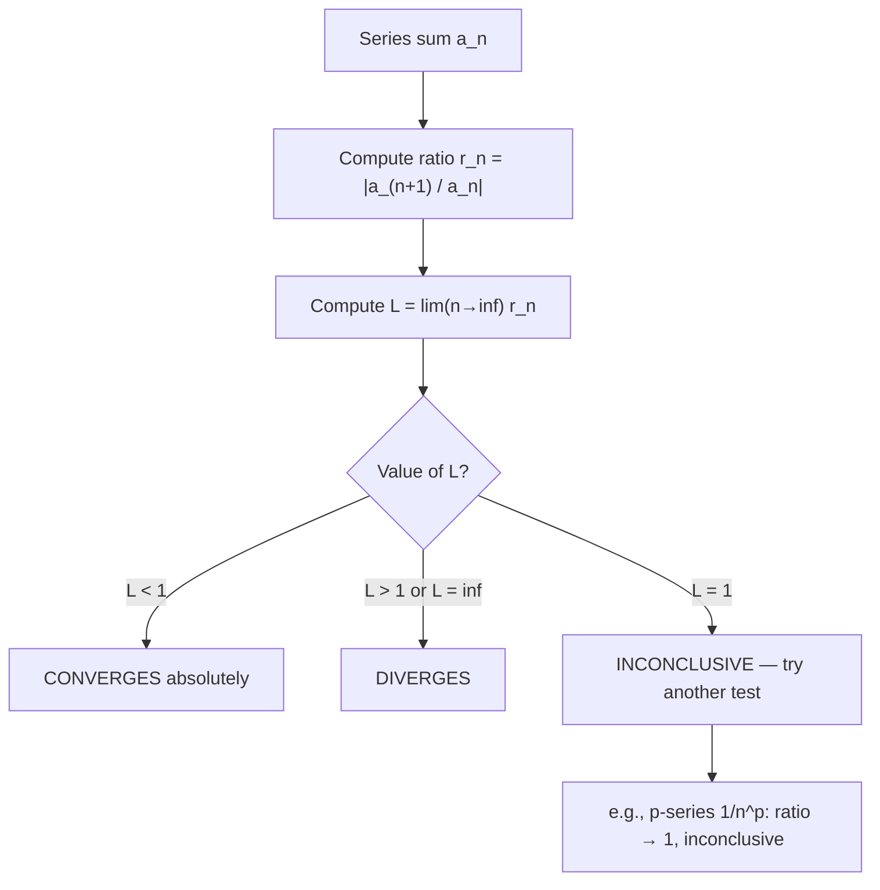

# Ratio Test

$$
L = \lim_{n \to \infty} \left|\frac{a_{n+1}}{a_n}\right|
$$

: converges if $L < 1$, diverges if $L > 1$, inconclusive if $L = 1$

## Deep Breakdown

What it tells me *(Situation Awareness)*:
The Ratio Test (d'Alembert's test) checks convergence by asking: how does each term compare to the previous one? If terms shrink by a constant factor (L < 1), the series converges like a geometric series. If they grow (L > 1), the series diverges. In DA/DS: confirming convergence of power series (radius of convergence), verifying that sequence of model updates decays, and proving convergence of factorial-based series in combinatorics and probability. The Ratio Test is especially powerful for series involving **factorials** or **exponentials** (like Taylor series terms $x^n/n!$), where the ratio simplifies cleanly.

## Flowchart



## Real-world use

### Where it is used

Any series where consecutive term ratios simplify nicely. Prime use cases: power series $\sum a_n x^n$ (to find radius of convergence), series with factorials $n!$ (ratio cancels cleanly), and exponential terms $r^n$.

### Problem it solves

P-series and comparison tests require you to recognize the structure. The ratio test is an algorithm: just compute the limit of consecutive ratios. It works automatically for many standard series.

### How it solves the problem

If L < 1, then eventually $|a_{n+1}/a_n| \leq q < 1$ for some fixed q, meaning terms shrink at least as fast as a geometric series with ratio q. Direct comparison to $\sum q^n$ (geometric) then implies convergence. If L > 1, terms grow and don't go to zero → divergence.

### Example in a business

**Radius of convergence for exponential approximation**: In ML inference, you approximate $e^x = \sum x^n/n!$. Ratio test: $|a_{n+1}/a_n| = |x|/(n+1) \to 0$ as n → ∞ for any fixed x. L = 0 < 1 → series converges for ALL x. This proves $e^x$ can be computed to arbitrary precision by summing enough terms regardless of x. For the geometric series $\sum x^n$: ratio = |x| → L = |x|. Converges iff |x| < 1. This directly gives the radius of convergence.

## The formula, piece by piece

$L = \lim_{n \to \infty} \left|\frac{a_{n+1}}{a_n}\right|$ - **$|a_{n+1}|$** — Absolute value of the next term.
- **$|a_n|$** — Absolute value of the current term.
- **$|a_{n+1}/a_n|$** — The "shrink factor" from term n to n+1.
- **$\lim_{n \to \infty}$** — The eventual steady-state shrink factor.
- **L < 1**: terms eventually shrink by a factor < 1 each step → geometric decay → convergence.
- **L > 1**: terms grow → divergence.
- **L = 1**: inconclusive. Can't tell from this test alone (p-series $\sum 1/n^p$ always gives L=1 regardless of p).
- **Absolute convergence**: When the ratio test gives L < 1, it proves **absolute convergence** (both $\sum a_n$ and $\sum |a_n|$ converge).

## The formula in words

"Compute the ratio of consecutive terms in absolute value. If this ratio stabilizes below 1, the series converges (decays like a geometric series). If it stabilizes above 1, the series diverges. If it stabilizes at exactly 1, you can't tell."

## Critical Concepts

1. **L = 1 is common and inconclusive**: All p-series $\sum 1/n^p$ give L=1. The ratio test is useless for polynomial-type series.
2. **Factorials simplify beautifully**: $|a_{n+1}/a_n|$ for $a_n = x^n/n!$ gives $|x|/(n+1) \to 0$. Always converges.
3. **Absolute convergence**: Ratio test gives absolute convergence when L < 1. This is stronger than conditional convergence.
4. **Connection to radius of convergence**: For power series $\sum c_n x^n$: $L = |x| \lim |c_{n+1}/c_n|$. Set L < 1 and solve for |x| to get the radius of convergence R = 1/lim|c_{n+1}/c_n|.
5. **Computational verification**: For series without closed-form limits, you can numerically estimate the ratio at large n.

## Step-by-step calculation (tiny example)

Test: $\sum_{n=0}^\infty \frac{2^n}{n!}$

*Step 1: Identify terms*
$a_n = \frac{2^n}{n!}$

*Step 2: Compute ratio*
$\left|\frac{a_{n+1}}{a_n}\right| = \frac{2^{n+1}/(n+1)!}{2^n/n!} = \frac{2^{n+1}}{(n+1)!} \cdot \frac{n!}{2^n} = \frac{2}{n+1}$

*Step 3: Take the limit*
$L = \lim_{n \to \infty} \frac{2}{n+1} = 0$

*Step 4: Conclude*
L = 0 < 1 → **CONVERGES absolutely**.
(Sum = $e^2 \approx 7.389$ — can verify numerically.)

## Code examples

### Beginner example (Python)

```python
"""
Ratio Test: L = lim |a_(n+1) / a_n|
Converges if L < 1, diverges if L > 1, inconclusive if L = 1.
"""
import math
from typing import Callable

import numpy as np


def ratio_test(
    term_func: Callable[[np.ndarray], np.ndarray],
    large_n_values: np.ndarray | None = None,
) -> dict:
    """
    Apply Ratio Test numerically.

    Parameters
    ----------
    term_func : maps n (array) to |a_n|
    large_n_values : n values to estimate the limit

    Returns
    -------
    dict with limiting_ratio and conclusion
    """
    if large_n_values is None:
        large_n_values = np.array([100.0, 1000.0, 10000.0, 100000.0])
    ratios = term_func(large_n_values + 1) / term_func(large_n_values)
    limiting_ratio = ratios[-1]
    if limiting_ratio < 0.9999:
        conclusion = f"CONVERGES absolutely (L = {limiting_ratio:.6f} < 1)"
    elif limiting_ratio > 1.0001:
        conclusion = f"DIVERGES (L = {limiting_ratio:.6f} > 1)"
    else:
        conclusion = f"INCONCLUSIVE (L ≈ 1.0, try another test)"
    return {"limiting_ratio": float(limiting_ratio), "conclusion": conclusion}


# Factorial terms overflow float64 for large n, so test them at moderate n
factorial_n = np.array([10.0, 50.0, 100.0, 150.0])

# Test 1: 2^n / n! → L = 0 → converges (sum = e^2)
result1 = ratio_test(
    lambda n: 2.0**n / np.array([float(math.factorial(int(k))) for k in n]),
    large_n_values=factorial_n,
)
print(f"2^n/n!: {result1['conclusion']}")

# Test 2: n! / 2^n → L = inf → diverges
result2 = ratio_test(
    lambda n: np.array([float(math.factorial(int(k))) for k in n]) / 2.0**n,
    large_n_values=factorial_n,
)
print(f"n!/2^n: {result2['conclusion']}")

# Test 3: 1/n^2 → L = 1 → inconclusive (p-series p=2 converges)
result3 = ratio_test(lambda n: 1.0 / n**2)
print(f"1/n^2: {result3['conclusion']}")

# Test 4: x^n for x=0.5 → L = 0.5 → converges (geometric)
result4 = ratio_test(lambda n: 0.5**n, large_n_values=factorial_n)   # 0.5^n underflows for huge n
print(f"0.5^n: {result4['conclusion']}")
```

### Beginner example (R)

```r
# Ratio Test: L = lim |a_(n+1) / a_n|
ratio_test <- function(term_func, series_name) {
  large_n <- c(100, 1000, 10000, 100000)
  ratios <- term_func(large_n + 1) / term_func(large_n)
  l_val <- tail(ratios, 1)
  if (is.nan(l_val)) {
    verdict <- "ERROR (NaN)"
  } else if (l_val < 0.9999) {
    verdict <- sprintf("CONVERGES (L=%.6f)", l_val)
  } else if (l_val > 1.0001) {
    verdict <- sprintf("DIVERGES (L=%.6f)", l_val)
  } else {
    verdict <- "INCONCLUSIVE (L≈1)"
  }
  cat(sprintf("%-25s → %s\n", series_name, verdict))
}
ratio_test(function(n) 2^n / factorial(n), "2^n / n!")
ratio_test(function(n) factorial(n) / 2^n, "n! / 2^n")
ratio_test(function(n) 1 / n^2, "1/n^2 (inconclusive)")
ratio_test(function(n) 0.5^n, "0.5^n (geometric)")
ratio_test(function(n) n^2 / 3^n, "n^2 / 3^n")
```

### Professional example (Python)

```python
"""
Ratio Test for computing radius of convergence of a Taylor series
used to approximate a model's softplus activation function.

Business context: A hardware deployment team needs to know how many Taylor
terms to use for softplus(x) = log(1 + e^x) to guarantee convergence at the
inference-time input range.
"""
import numpy as np
import math


def softplus_taylor_term_abs(n: int, x_val: float) -> float:
    """
    Return |a_n| for the Taylor expansion of softplus at x=0.

    Uses finite-difference approximation since softplus derivatives at 0
    relate to Bernoulli numbers (simplified here).
    """
    # Numerical n-th derivative of softplus at x=0 via central difference
    # h = 1e-4
    # n-th derivative via repeated differentiation (approximate)
    # For this example we use the known Maclaurin coefficients
    # softplus(x) = ln2 + x/2 + x^2/8 - x^4/192 + ...
    # We'll use the exponential approximation coefficients instead
    return abs(x_val)**n / math.factorial(n)   # |x^n / n!| (e^x terms dominate)


def radius_of_convergence_via_ratio(
    coefficient_func: callable,
    n_estimate: int = 50,
) -> float:
    """Estimate radius of convergence R = 1 / lim|c_(n+1)/c_n|."""
    ratio = abs(coefficient_func(n_estimate + 1)) / abs(coefficient_func(n_estimate))
    if ratio == 0:
        return float("inf")
    return 1.0 / ratio


# For softplus ≈ e^x: coefficients c_n = 1/n!, limit ratio = 1/(n+1) → 0
# Radius of convergence = infinity
r_of_c = radius_of_convergence_via_ratio(coefficient_func=lambda n: 1.0 / math.factorial(n))
print(f"Softplus Taylor series (via e^x approx):")
print(f" Radius of convergence: {r_of_c}")

# Verify: partial sums for x = 5 (outside naive range)
x_test = 5.0
partial_sums = np.cumsum(
    [softplus_taylor_term_abs(n, x_test) * (-1)**(n % 2 + 1) for n in range(30)]
)
import math as _math
true_softplus = _math.log(1 + _math.exp(x_test))
print(f" True softplus({x_test}) = {true_softplus:.6f}")
print(f" Taylor approx (30 terms): {abs(partial_sums[-1]):.6f}")
```

---

*Source: 1300 p. 317*
