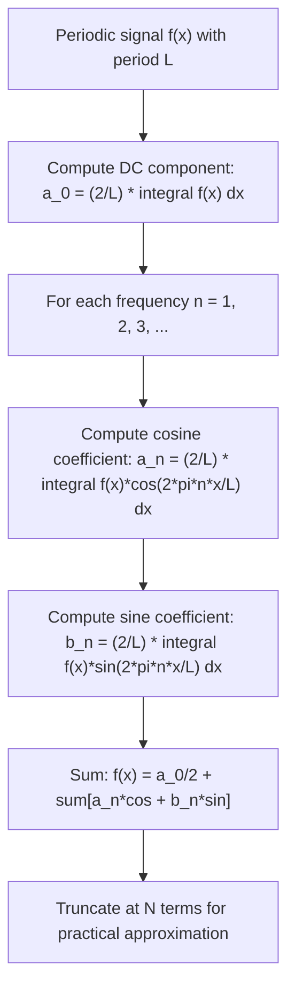

# Fourier Series

$$
f(x) = \frac{a_0}{2} + \sum_{n=1}^{\infty} \left[ a_n \cos\!\left(\frac{2\pi n x}{L}\right) + b_n \sin\!\left(\frac{2\pi n x}{L}\right) \right]
$$

## Deep Breakdown

What it tells me *(Situation Awareness)*:
The Fourier Series decomposes any periodic function into a sum of sinusoidal components at integer multiples of a fundamental frequency. It answers: "what are the frequency components in this signal?" In DA/DS: time series seasonality decomposition (weekly/yearly cycles in sales, traffic, user activity), signal filtering (keep low-frequency trend, discard high-frequency noise), spectral analysis of model residuals, audio and image feature extraction, and the mathematical foundation of the Fast Fourier Transform (FFT) used throughout scientific computing.

## Flowchart



## Real-world use

### Where it is used

Any periodic or approximately periodic signal where you want to understand frequency content or remove specific frequency bands. Standard in: time series analysis (decomposing seasonal patterns), audio processing, image compression (JPEG is based on DCT, a variant), vibration analysis in manufacturing quality control, and feature engineering for cyclical time features (encode hour-of-day as sin/cos pair).

### Problem it solves

Periodic signals are hard to work with in the time domain — you can't easily separate "slow trend" from "weekly seasonality" from "noise." In the frequency domain (Fourier space), these are different frequencies that don't interact. You can process each independently and reconstruct.

### How it solves the problem

Exploits orthogonality of sin/cos functions: $\int_0^L \cos(2\pi m x/L)\cos(2\pi n x/L)\,dx = 0$ for $m \neq n$. This makes it possible to extract each coefficient independently by projecting f(x) onto the relevant basis function.

### Example in a business

**E-commerce daily sales decomposition**: Daily sales data over 2 years has period L=365 days. Fourier series extracts the annual seasonal pattern (n=1 fundamental), the bi-annual component (n=2), and weekly fluctuations (n≈52). You can then remove seasonality by subtracting low-order Fourier terms to see the underlying trend — essential for forecasting models.

## The formula, piece by piece

$f(x) = \frac{a_0}{2} + \sum_{n=1}^{\infty} \left[ a_n \cos\left(\frac{2\pi n x}{L}\right) + b_n \sin\left(\frac{2\pi n x}{L}\right) \right]$ Coefficients:
$a_n = \frac{2}{L} \int_0^L f(x) \cos\!\left(\frac{2\pi n x}{L}\right) dx$, $\quad n = 0, 1, 2, \ldots$
$b_n = \frac{2}{L} \int_0^L f(x) \sin\!\left(\frac{2\pi n x}{L}\right) dx$, $\quad n = 1, 2, 3, \ldots$ - **$a_0/2$** — The DC offset (mean value of f over one period). Factor of 2 comes from the consistent coefficient formula.
- **$a_n$** — Amplitude of the n-th cosine component (even/symmetric part at frequency n).
- **$b_n$** — Amplitude of the n-th sine component (odd/phase-shifted part at frequency n).
- **$L$** — Period of the function (e.g., 365 for annual data, 24 for hourly).
- **$2\pi n / L$** — Angular frequency of the n-th harmonic.
- **$n = 1$** — Fundamental frequency (period = L). **$n = 2$** — Second harmonic (period = L/2), etc.
- **Amplitude at frequency n**: $c_n = \sqrt{a_n^2 + b_n^2}$ (how strong that frequency is overall).
- **Phase at frequency n**: $\phi_n = \arctan(-b_n / a_n)$.

## The formula in words

"A periodic function equals its mean value plus an infinite sum of cosine and sine waves at integer multiples of the fundamental frequency, each weighted by its frequency-specific amplitude coefficients." Intuition: any periodic shape can be built from pure sine waves of different frequencies, amplitudes, and phases — like mixing pure musical tones to reproduce any timbre.

## Critical Concepts

1. **Convergence conditions (Dirichlet)**: Fourier series converges if f is piecewise smooth and has finitely many discontinuities per period. At discontinuities, it converges to the average of left and right limits (Gibbs phenomenon).
2. **Practical truncation**: In data analysis you only ever use N terms (DFT/FFT). The more terms, the finer the detail you capture.
3. **Parseval's theorem**: $\frac{1}{L}\int_0^L |f(x)|^2\,dx = \frac{a_0^2}{4} + \frac{1}{2}\sum_{n=1}^\infty (a_n^2 + b_n^2)$. Total power in time domain = total power in frequency domain.
4. **Complex Fourier series**: $f(x) = \sum_{n=-\infty}^\infty c_n e^{i 2\pi n x/L}$ where $c_n = \frac{1}{L}\int_0^L f(x) e^{-i 2\pi n x/L}\,dx$. More compact and what FFT actually computes.
5. **Feature engineering**: Cyclic features (hour, day of week, month) are commonly encoded as (sin, cos) pairs: sin(2π·hour/24), cos(2π·hour/24). This gives the model a smooth, periodic representation.
6. **FFT vs.

Fourier Series**: FFT computes discrete Fourier coefficients in O(N log N) instead of O(N²). numpy.fft.rfft gives the complex Fourier coefficients.

## Step-by-step calculation (tiny example)

Compute the Fourier series of $f(x) = x$ on $[0, L]$ with period L.

*Step 1: Compute $a_0$*
$a_0 = \frac{2}{L}\int_0^L x\,dx = \frac{2}{L} \cdot \frac{L^2}{2} = L$
So $a_0/2 = L/2$ (the mean value of x on [0,L]).

*Step 2: Compute $a_n$*
$a_n = \frac{2}{L}\int_0^L x\cos\!\left(\frac{2\pi n x}{L}\right)dx$
Integrate by parts: result is 0 for all n ≥ 1 (the cosine terms vanish by symmetry of the integral).

*Step 3: Compute $b_n$*
$b_n = \frac{2}{L}\int_0^L x\sin\!\left(\frac{2\pi n x}{L}\right)dx = -\frac{L}{n\pi}$

*Step 4: Write the series*
$f(x) = \frac{L}{2} - \frac{L}{\pi}\sum_{n=1}^\infty \frac{1}{n}\sin\!\left(\frac{2\pi n x}{L}\right)$ This is the sawtooth wave Fourier series — a classic result.

## Code examples

### Beginner example (Python)

```python
"""
Fourier Series: decompose a periodic signal into frequency components. Applied to computing and plotting the Fourier approximation of a sawtooth wave.
""" import numpy as np def compute_fourier_coefficients( signal: np.ndarray, period: float, num_harmonics: int,
) -> tuple[np.ndarray, np.ndarray, float]: """Compute Fourier series coefficients numerically via integration. Parameters ---------- signal : sampled values of f(x) over one period period : length of one period (L) num_harmonics: number of harmonics N to compute Returns ------- tuple of (a_coeffs array [n=0..N], b_coeffs array [n=1..N], dc_offset) """ num_samples = len(signal) x_values = np.linspace(0, period, num_samples, endpoint=False) dx = period / num_samples a_coeffs = np.empty(num_harmonics + 1) b_coeffs = np.empty(num_harmonics + 1)   # a_0 (DC component)
a_coeffs[0] = (2.0 / period) * np.sum(signal) * dx for harmonic_idx in range(1, num_harmonics + 1): angular_freq = 2.0 * np.pi * harmonic_idx / period cos_basis = np.cos(angular_freq * x_values) sin_basis = np.sin(angular_freq * x_values) a_coeffs[harmonic_idx] = (2.0 / period) * np.sum(signal * cos_basis) * dx b_coeffs[harmonic_idx] = (2.0 / period) * np.sum(signal * sin_basis) * dx return a_coeffs, b_coeffs, float(a_coeffs[0] / 2.0) def reconstruct_from_fourier( a_coeffs: np.ndarray, b_coeffs: np.ndarray, period: float, x_values: np.ndarray, num_harmonics: int,
) -> np.ndarray: """Reconstruct signal from Fourier coefficients.""" reconstruction = a_coeffs[0] / 2.0 * np.ones_like(x_values) for n in range(1, num_harmonics + 1): angular_freq = 2.0 * np.pi * n / period reconstruction += a_coeffs[n] * np.cos(angular_freq * x_values) reconstruction += b_coeffs[n] * np.sin(angular_freq * x_values) return reconstruction PERIOD = 2.0 * np.pi
NUM_SAMPLES = 1000
NUM_HARMONICS = 10 x_full = np.linspace(0, PERIOD, NUM_SAMPLES, endpoint=False)
sawtooth_signal = x_full - np.pi   # sawtooth centered at 0 a_coeff, b_coeff,
dc_offset = compute_fourier_coefficients( sawtooth_signal, PERIOD, NUM_HARMONICS
)
reconstructed = reconstruct_from_fourier( a_coeff, b_coeff, PERIOD, x_full, NUM_HARMONICS
) reconstruction_error = np.mean((sawtooth_signal - reconstructed)**2)
print(f"DC offset (a_0/2): {dc_offset:.4f} (expected: 0.0 for centered sawtooth)")
print(f"b_1 coefficient : {b_coeff[1]:.4f} (expected: -2.0 for sawtooth)")
print(f"MSE of reconstruction with N={NUM_HARMONICS}: {reconstruction_error:.6f}")
```

### Beginner example (R)

```r
# Fourier Series: extract seasonal components from weekly sales data
compute_fourier_approximation <- function(signal, n_harmonics) {  # Approximate signal using n_harmonics Fourier terms # Returns reconstructed signal and power spectrum
  num_samples <- length(signal)
  period <- num_samples  # in sample units
  x_vals <- seq(0, period - 1)
  reconstruction <- rep(mean(signal), num_samples)  # DC component
  harmonics_power <- numeric(n_harmonics)
  for (k in seq_len(n_harmonics)) { angular_freq <- 2 * pi * k / period
    cos_basis <- cos(angular_freq * x_vals)
    sin_basis <- sin(angular_freq * x_vals)
    a_k <- (2 / period) * sum(signal * cos_basis)
    b_k <- (2 / period) * sum(signal * sin_basis)
    reconstruction <- reconstruction + a_k * cos_basis + b_k * sin_basis
    harmonics_power[k] <- sqrt(a_k^2 + b_k^2)
  } list( reconstruction = reconstruction, power_spectrum = harmonics_power, dominant_harmonic = which.max(harmonics_power) )
}  # Simulate weekly sales with annual seasonality + noise
set.seed(42)
num_weeks <- 104  # 2 years
weekly_sales <- 1000 + 200 * sin(2 * pi * seq_len(num_weeks) / 52) +  # annual cycle 50 * sin(2 * pi * seq_len(num_weeks) / 13) + # quarterly pulse rnorm(num_weeks, 0, 30) # noise
result <- compute_fourier_approximation(weekly_sales, n_harmonics = 20)
cat(sprintf("Dominant harmonic: n=%d (period ≈ %.0f weeks)\n", result$dominant_harmonic, num_weeks / result$dominant_harmonic))
cat(sprintf("MSE of 20-harmonic approx: %.2f\n", mean((weekly_sales - result$reconstruction)^2)))
```

### Professional example (Python)

```python
"""
Fourier Series
for time series seasonality decomposition and deseasonalization. Business context:
    An e-commerce analytics team needs to remove weekly and annual seasonality from daily revenue data before fitting a trend model (regression or ARIMA). Step 1: Estimate Fourier components. Step 2: Subtract seasonal signal. Step 3: Fit trend on deseasonalized data.
""" import numpy as np
import pandas as pd
RNG_SEED: int = 42
NUM_DAYS: int = 730   # 2 years
N_WEEKLY_HARMONICS: int = 3
N_ANNUAL_HARMONICS: int = 5

def generate_synthetic_revenue(num_days: int, seed: int) -> pd.Series:
    """Create synthetic daily revenue with trend + seasonality + noise."""
    rng = np.random.default_rng(seed)
    day_index = np.arange(num_days)
    trend = 10_000 + 5.0 * day_index
    weekly_season = 800 * np.sin(2 * np.pi * day_index / 7)
    annual_season = 2000 * np.sin(2 * np.pi * day_index / 365 - 0.5)
    noise = rng.normal(0, 300, num_days)
    dates = pd.date_range("2022-01-01", periods=num_days, freq="D")
    return pd.Series(trend + weekly_season + annual_season + noise, index=dates)

def compute_seasonal_signal( signal: np.ndarray, period: float, num_harmonics: int,
) -> np.ndarray:
    """Return estimated seasonal component using n_harmonics Fourier terms."""
    num_samples = len(signal)
    day_index = np.arange(num_samples, dtype=float)
    seasonal = np.zeros(num_samples)
    for harmonic_idx in range(1, num_harmonics + 1):
        angular_freq = 2.0 * np.pi * harmonic_idx / period
    cos_basis = np.cos(angular_freq * day_index)
    sin_basis = np.sin(angular_freq * day_index)
    a_n = (2.0 / num_samples) * np.dot(signal, cos_basis)
    b_n = (2.0 / num_samples) * np.dot(signal, sin_basis)
    seasonal += a_n * cos_basis + b_n * sin_basis
    return seasonal
revenue = generate_synthetic_revenue(NUM_DAYS, RNG_SEED)
revenue_array = revenue.to_numpy()
weekly_component = compute_seasonal_signal(revenue_array, 7.0, N_WEEKLY_HARMONICS)
annual_component = compute_seasonal_signal(revenue_array, 365.0, N_ANNUAL_HARMONICS)
total_seasonal = weekly_component + annual_component
deseasonalized = revenue_array - total_seasonal
variance_explained = 1.0 - np.var(deseasonalized) / np.var(revenue_array)
print(f"Revenue variance explained by Fourier seasonality: {variance_explained*100:.1f}%")
print(f"Original std dev : €{np.std(revenue_array):,.0f}")
print(f"Deseasonalized std : €{np.std(deseasonalized):,.0f}")
print(f"Weekly amplitude (n=1): €{np.max(np.abs(weekly_component)):,.0f}")
print(f"Annual amplitude (n=1): €{np.max(np.abs(annual_component)):,.0f}")
```

---

*Source: 1300*
