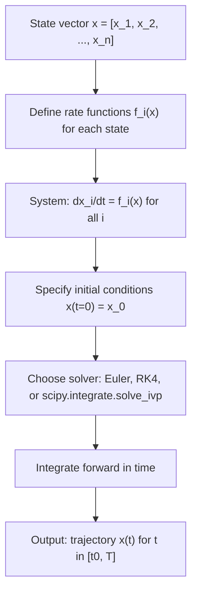

# General ODE format

$$
\frac{dx_i}{dt} = f_i(\mathbf{x}), \quad i = 1, \ldots, n
$$

## Deep Breakdown

What it tells me *(Situation Awareness)*:
This is the general form of a **system of first-order ordinary differential equations** (ODEs). Any higher-order ODE (e.g., $d^2y/dt^2 = \ldots$) can be rewritten as a first-order system by introducing auxiliary state variables. This form is the universal input format for all ODE solvers (scipy, deSolve in R, etc.) and the foundation of dynamical systems theory. In DA/DS: it describes any time-evolving system where the rate of change of each state variable depends on all current states — SIR models, predator-prey, neural ODEs, chemical kinetics, and any state-space model.

## Flowchart



## Real-world use

### Where it is used

Any system where multiple quantities evolve simultaneously and influence each other. Standard models: SIR epidemics (S, I, R are the states), Lotka-Volterra predator-prey (prey and predator populations), Lorenz system (3D chaos), compartment models in pharmacokinetics, state-space models in control theory, and Neural ODEs in deep learning.

### Problem it solves

Captures the full dynamics of multi-variable systems where variables are coupled. A single-variable ODE $dy/dt = f(t,y)$ is a special case (n=1). The general form handles any n.

### How it solves the problem

By defining the rate of change of each state variable as a function of all current states, you fully specify how the system evolves from any initial condition. Numerical solvers then integrate forward in time using methods like Euler, RK4, or Dormand-Prince.

### Example in a business

**Customer lifecycle model**: Let x_1 = prospects, x_2 = active users, x_3 = churned users.
$dx_1/dt = -r_{convert} \cdot x_1$ (prospects convert to active at rate r_convert)
$dx_2/dt = r_{convert} \cdot x_1 - r_{churn} \cdot x_2$ (active users gained from conversion, lost to churn)
$dx_3/dt = r_{churn} \cdot x_2$ (churned users accumulate)
This ODE system predicts the full customer lifecycle under different conversion/churn rate assumptions.

## The formula, piece by piece

$\frac{dx_i}{dt} = f_i(\mathbf{x}), \quad i = 1, \ldots, n$ Or in vector form: $\dot{\mathbf{x}} = \mathbf{f}(\mathbf{x})$ - **$x_i$** — The i-th state variable (a scalar component of the state vector).
- **$\mathbf{x}$** — The full state vector $[x_1, x_2, \ldots, x_n]^T$.
- **$dx_i/dt$** — Rate of change of x_i with respect to time (or whatever the independent variable is).
- **$f_i(\mathbf{x})$** — The governing function for x_i: how fast x_i changes, given the full current state.
- **$f_i$ can also depend on t**: written $f_i(t, \mathbf{x})$ for non-autonomous systems (time-varying dynamics).
- **$n$** — Dimension of the state space. Any n-th order ODE can be converted to this form with n=order.
- **Linear case**: if $\mathbf{f}(\mathbf{x}) = A\mathbf{x}$ (matrix-vector product), the system is linear and has exact solution $\mathbf{x}(t) = e^{At}\mathbf{x}_0$.

## The formula in words

"Each state variable changes at a rate that is some function of all current state variables simultaneously." Analogy: in a company, each department's growth rate depends on all other departments' current sizes. The ODE system captures all these interdependencies at once.

## Critical Concepts

1. **Reduction to first-order**: Any nth-order ODE can be rewritten as n first-order ODEs. E.g., $d^2y/dt^2 + y = 0$ becomes: $x_1 = y$, $x_2 = dy/dt$ → $dx_1/dt = x_2$, $dx_2/dt = -x_1$.
2. **Autonomous vs. non-autonomous**: Autonomous systems have $\mathbf{f}(\mathbf{x})$ (no explicit t). Non-autonomous have $\mathbf{f}(t, \mathbf{x})$. Non-autonomous can always be made autonomous by adding t as a state variable: $dx_{n+1}/dt = 1$.
3. **Equilibrium points**: Where $\mathbf{f}(\mathbf{x}^*) = \mathbf{0}$. Stability analysis: if Jacobian $\partial \mathbf{f}/\partial \mathbf{x}$ at $\mathbf{x}^*$ has all negative real eigenvalues → stable equilibrium.
4. **Neural ODEs**: Define $d\mathbf{h}/dt = f_\theta(\mathbf{h}, t)$ where f_θ is a neural network. This allows infinite-depth networks with adaptive compute. The forward pass is an ODE integration.
5. **Stiffness**: If eigenvalues of the Jacobian span many orders of magnitude, the system is "stiff" and requires implicit solvers (e.g., scipy's Radau or BDF methods) for stability.

## Step-by-step calculation (tiny example)

System: Lotka-Volterra predator-prey with 2 state variables.
$dx_1/dt = \alpha x_1 - \beta x_1 x_2$ (prey: grows at α, killed by predators at β)
$dx_2/dt = \delta x_1 x_2 - \gamma x_2$ (predators: grow from prey at δ, die at γ) Parameters: α=1, β=0.1, δ=0.075, γ=1.5
Initial: x_1(0) = 10 (prey), x_2(0) = 5 (predators)
Step size h=0.1, one Euler step:

*Step 1: Evaluate rates at t=0*
f_1 = 1×10 - 0.1×10×5 = 10 - 5 = 5
f_2 = 0.075×10×5 - 1.5×5 = 3.75 - 7.5 = -3.75

*Step 2: Update states*
x_1(0.1) = 10 + 0.1×5 = **10.5** (prey growing)
x_2(0.1) = 5 + 0.1×(-3.75) = **4.625** (predators declining)

## Code examples

### Beginner example (Python)

```python
"""
General ODE system: dx_i/dt = f_i(x) Applied to a Lotka-Volterra predator-prey model with 2 state variables.
Uses scipy.integrate.solve_ivp for accurate integration.
""" import numpy as np
from scipy.integrate import solve_ivp
ALPHA_PREY_GROWTH: float = 1.0
BETA_PREDATION: float = 0.1
DELTA_PREDATOR_GROWTH: float = 0.075
GAMMA_PREDATOR_DEATH: float = 1.5
INITIAL_PREY: float = 10.0
INITIAL_PREDATORS: float = 5.0
TIME_SPAN = (0.0, 50.0)

def lotka_volterra(time: float, state: np.ndarray) -> list[float]:
    """Right-hand side of Lotka-Volterra ODE system. Parameters ---------- time : current time (not used in autonomous system, but required by solver) state : [prey, predators] current population sizes Returns ------- list of [d_prey/dt, d_predators/dt] """
    prey, predators = state
    d_prey = ALPHA_PREY_GROWTH * prey - BETA_PREDATION * prey * predators
    d_predators = DELTA_PREDATOR_GROWTH * prey * predators - GAMMA_PREDATOR_DEATH * predators
    return [d_prey, d_predators]
solution = solve_ivp( fun=lotka_volterra, t_span=TIME_SPAN, y0=[INITIAL_PREY, INITIAL_PREDATORS], method="RK45", dense_output=True, rtol=1e-8, atol=1e-8,
)
time_points = np.linspace(*TIME_SPAN, 500)
state_values = solution.sol(time_points)
print(f"Peak prey population : {state_values[0].max():.2f}")
print(f"Peak predator population: {state_values[1].max():.2f}")
print(f"Prey at t=50 : {state_values[0, -1]:.2f}")
print(f"Predators at t=50 : {state_values[1, -1]:.2f}")
```

### Beginner example (R)

```r
# General ODE system: dx_i/dt = f_i(x)
# Customer lifecycle model: prospects → active → churned
library(deSolve)  # Transition rates
CONVERSION_RATE <- 0.1  # prospects → active per day
CHURN_RATE <- 0.02  # active users → churned per day
customer_lifecycle_ode <- function(time, state, parameters) {  # ODE system for customer compartment model # State: [prospects, active, churned] with(as.list(c(state, parameters)), {
    d_prospects <- -conversion_rate * prospects
    d_active <- conversion_rate * prospects - churn_rate * active
    d_churned <- churn_rate * active list(c(d_prospects, d_active, d_churned))
  })
}
initial_state <- c(prospects = 10000, active = 500, churned = 0)
params <- c(conversion_rate = CONVERSION_RATE, churn_rate = CHURN_RATE)
time_points <- seq(0, 100, by = 1)
solution <- ode( y = initial_state, times = time_points, func = customer_lifecycle_ode, parms = params, method = "rk4"
) solution_df <- as.data.frame(solution)
peak_active_time <- solution_df$time[which.max(solution_df$active)]
cat(sprintf("Peak active users: %.0f at day %.0f\n", max(solution_df$active), peak_active_time))
cat(sprintf("Active at day 100: %.0f\n", tail(solution_df$active, 1)))
cat(sprintf("Churned at day 100: %.0f\n", tail(solution_df$churned, 1)))
```

### Professional example (Python)

```python
"""
General ODE system
for Neural ODE implementation concept. Business context:
    A deep learning team wants to build a continuous-depth model (Neural ODE)
for time series forecasting. The hidden state evolves according to a learned ODE:
    dh/dt = f_theta(h, t). This code demonstrates the ODE integration forward
pass and sensitivity to the learnable parameters theta.
""" import numpy as np
from scipy.integrate import solve_ivp
HIDDEN_DIM: int = 4
TIME_SPAN = (0.0, 1.0)
RNG_SEED: int = 42

def neural_ode_dynamics( time: float, hidden_state: np.ndarray, weight_matrix: np.ndarray, bias_vector: np.ndarray,
) -> np.ndarray:
    """ODE dynamics: dh/dt = tanh(W @ h + b). Parameters ---------- time : current time (not used here: autonomous system) hidden_state : current hidden state vector h weight_matrix: learned weight matrix W bias_vector : learned bias vector b Returns ------- np.ndarray : dh/dt """
    return np.tanh(weight_matrix @ hidden_state + bias_vector)
rng = np.random.default_rng(RNG_SEED)
weight_mat = rng.normal(0.0, 0.3, (HIDDEN_DIM, HIDDEN_DIM))
bias_vec = rng.normal(0.0, 0.1, HIDDEN_DIM)
initial_hidden = rng.normal(0.0, 1.0, HIDDEN_DIM)
solution = solve_ivp( fun=lambda t, h: neural_ode_dynamics(t, h, weight_mat, bias_vec), t_span=TIME_SPAN, y0=initial_hidden, method="RK45", rtol=1e-6, atol=1e-6,
)
print("Neural ODE forward pass:")
print(f" Initial hidden state : {initial_hidden.round(4)}")
print(f" Final hidden state : {solution.y[:, -1].round(4)}")
print(f" Integration succeeded: {solution.success}")
print(f" Number of ODE evaluations: {solution.nfev}")
```

---
