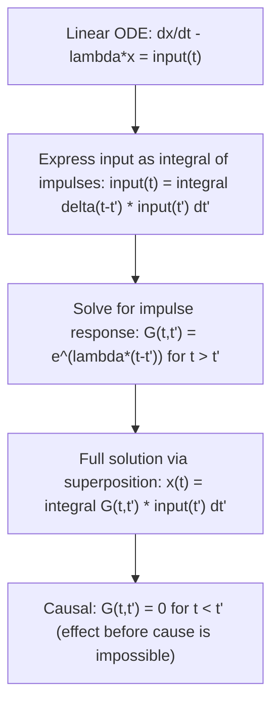

# Green's Function/Delta Mapping (system behavior jump at t')

$$
G(t, t') = e^{\lambda(t - t')} \Theta(t - t')
$$

## Deep Breakdown

What it tells me *(Situation Awareness)*:
The Green's Function $G(t, t')$ describes how a linear system **responds to an instantaneous impulse** applied at time $t'$. For the first-order linear ODE $\dot{x} - \lambda x = \delta(t - t')$, the Green's function is $G(t,t') = e^{\lambda(t-t')}$ for $t > t'$ and 0 otherwise (causal). In DA/DS: modeling the persistent effect of a marketing campaign launched at time t', pricing the impact of a news event on stock price, modeling the impulse response of a recommendation system to a click event, and understanding how perturbations in an input propagate through a time-series model. The Heaviside step function $\Theta(t - t') = 1$ if $t > t'$, else 0 enforces **causality** — the system only responds after the impulse.

## Flowchart



## Real-world use

### Where it is used

Whenever a linear system receives an impulse (one-off event) and you want to trace the **full temporal effect** of that impulse on the system state. Key uses: customer lifetime value modeling (a single acquisition event at t' generates revenue G(t,t') for all t > t'), impulse-response analysis in econometrics (VAR models), signal processing (filter design), and marketing mix modeling (adstock decay after a campaign).

### Problem it solves

Computing the full response to an arbitrary input by breaking it into individual impulses, computing each impulse response via G, and summing via superposition (convolution). This turns a differential equation into a convolution integral.

### How it solves the problem

For any linear ODE $Lx = f(t)$ (where L is a linear differential operator), the solution is:
$x(t) = \int_{-\infty}^{\infty} G(t, t') f(t') \, dt'$ This works because $L\,G(t,t') = \delta(t - t')$, so summing over all impulses at all times t' reconstructs the full solution. For the simple case $\dot{x} = \lambda x + f(t)$: $G(t,t') = e^{\lambda(t-t')}$ gives the exponential decay (if λ < 0) or growth (if λ > 0) from each impulse.

### Example in a business

**Adstock model**: Marketing mix modeling uses an adstock (advertising carryover) model where a TV ad spend S at time t' creates awareness that decays exponentially: $G(t, t') = e^{-\mu(t-t')}$ for $t > t'$. Total brand awareness at time t = $\int_0^t S(t') e^{-\mu(t-t')}\,dt'$ (a convolution). Different λ values model different media decay rates (TV: slow decay, social media: fast decay).

## The formula, piece by piece

$G(t, t') = e^{\lambda(t - t')} \Theta(t - t')$ - **$G(t, t')$** — The Green's function: response at time t due to unit impulse at time t'.
- **$e^{\lambda(t - t')}$** — Exponential evolution from t' to t with growth/decay rate λ.
- **$\lambda$** — System eigenvalue. λ < 0: stable (exponential decay). λ > 0: unstable (exponential growth). λ = 0: constant (unit step response).
- **$(t - t')$** — Time elapsed since the impulse. Always ≥ 0 for causal systems.
- **$\Theta(t - t')$** — Heaviside step function: 1 if $t > t'$, 0 if $t < t'$. Enforces causality.
- **Impulse at t' = 0**: $G(t, 0) = e^{\lambda t}$ — the familiar free-response of the ODE.
- **For system $\dot{x} = Ax$** (vector case): $G(t, t') = e^{A(t-t')}$ — the matrix exponential.

## The formula in words

"The Green's function tells you: if you tap the system with a unit impulse at time t', how much signal remains at any later time t? The answer is e^{λ(t-t')} — exponential decay or growth depending on the sign of λ, with zero effect before the impulse (causality)."

## Critical Concepts

1. **Causality**: $G(t,t') = 0$ for $t < t'$ — physical systems can't respond before the cause arrives.
2. **Superposition principle**: The solution for any input f(t) is $x(t) = \int G(t,t') f(t') dt'$ — a convolution. This only works for **linear** ODEs.
3. **Stability condition**: For stable systems, G must decay: need Re(λ) < 0. Otherwise impulse responses grow without bound.
4. **Time-invariant case**: When the ODE coefficients don't depend on t, $G(t, t') = G(t - t', 0)$, a function of (t-t') only. This is the **impulse response function** used in signal processing (convolution theorem).
5. **Discrete-time analog**: In DSP, the impulse response h[n] is the output to a Kronecker delta input δ[n]. Convolution: y[n] = Σ h[k] x[n-k].
6. **Marketing mix models**: Adstock = convolution of spend series with exponential impulse response.

Python: `scipy.signal.lfilter` implements this efficiently.

## Step-by-step calculation (tiny example)

ODE: $\dot{x} - (-0.5)x = \delta(t - 1)$ (stable system, λ = -0.5, impulse at t' = 1)

*Step 1: Green's function for this system*
$G(t, 1) = e^{-0.5(t-1)}$ for $t > 1$, else 0.

*Step 2: Evaluate at several times after the impulse*
t = 1.0: G = e^0 = 1.000 (immediately after impulse)
t = 1.5: G = e^{-0.25} ≈ 0.779
t = 2.0: G = e^{-0.5} ≈ 0.607
t = 3.0: G = e^{-1.0} ≈ 0.368
t = 5.0: G = e^{-2.0} ≈ 0.135

*Step 3: Interpret*
The impulse at t=1 injects 1 unit of signal. By t=5 (4 seconds later), only 13.5% remains. The half-life is t_{1/2} = ln(2)/0.5 ≈ 1.39 seconds.

## Code examples

### Beginner example (Python)

```python
"""
Green's Function G(t, t') = exp(lambda*(t-t')) * Heaviside(t-t')
Applied to modeling the time-decaying effect of a marketing event.
"""
import numpy as np


def greens_function(
    time: float | np.ndarray, impulse_time: float, decay_rate: float,
) -> float | np.ndarray:
    """
    Evaluate Green's function for first-order linear ODE dx/dt = lambda*x.

    G(t, t') = exp(lambda*(t-t')) for t > t', else 0

    Parameters
    ----------
    time : evaluation time(s) t
    impulse_time : time of impulse t'
    decay_rate : system parameter lambda (negative = stable decay)

    Returns
    -------
    float or np.ndarray: Green's function value(s)
    """
    delta_t = np.asarray(time, dtype=float) - impulse_time
    response = np.where(
        delta_t >= 0,
        np.exp(decay_rate * delta_t),
        0.0,
    )
    return float(response) if np.ndim(time) == 0 else response


def compute_adstock(
    spend_series: np.ndarray, decay_rate: float,
) -> np.ndarray:
    """
    Compute adstock (convolution of spend with exponential impulse response).

    adstock[t] = sum_{t'=0}^{t} spend[t'] * G(t, t')
               = sum_{t'=0}^{t} spend[t'] * exp(decay_rate*(t-t'))

    This is the discrete convolution with an exponential kernel.
    """
    num_steps = len(spend_series)
    adstock = np.zeros(num_steps)
    for current_time in range(num_steps):
        for past_time in range(current_time + 1):
            adstock[current_time] += (
                spend_series[past_time] * greens_function(current_time, past_time, decay_rate)
            )
    return adstock


DECAY_RATE_TV = -0.1       # TV ad: slow decay (lambda = -0.1 per week)
DECAY_RATE_SOCIAL = -0.5   # Social media: fast decay

# Weekly ad spend: burst in weeks 3 and 7
weekly_spend = np.zeros(12)
weekly_spend[3] = 100_000   # €100k TV campaign in week 3
weekly_spend[7] = 50_000    # €50k social campaign in week 7
adstock_tv = compute_adstock(weekly_spend, DECAY_RATE_TV)
adstock_social = compute_adstock(weekly_spend, DECAY_RATE_SOCIAL)

print("Week | Spend (€) | TV adstock | Social adstock")
for week_idx in range(12):
    print(f" {week_idx:2d} | {weekly_spend[week_idx]:9,.0f} "
          f"| {adstock_tv[week_idx]:10,.0f} | {adstock_social[week_idx]:14,.0f}")
```

### Beginner example (R)

```r
# Green's Function for impulse response analysis
# Applied to customer lifetime value with exponential decay
greens_function <- function(t, t_prime, decay_rate) {
  # G(t, t') = exp(decay_rate * (t - t')) for t >= t', else 0
  delta_t <- t - t_prime
  ifelse(delta_t >= 0, exp(decay_rate * delta_t), 0)
}
compute_clv_from_acquisition <- function(
  acquisition_times, acquisition_values, decay_rate, eval_times
) {
  # Compute CLV at each eval time via superposition of Green's function responses
  sapply(eval_times, function(t_eval) {
    sum(acquisition_values * greens_function(t_eval, acquisition_times, decay_rate))
  })
}

# 3 acquisition events: 100 customers at t=0, 50 at t=2, 80 at t=5
acq_times <- c(0, 2, 5)
acq_values <- c(100, 50, 80)  # customer LTV units
DECAY_RATE <- -0.2  # 20% decay per time unit
eval_times <- seq(0, 20, by = 1)
total_value <- compute_clv_from_acquisition(
  acq_times, acq_values, DECAY_RATE, eval_times
)
cat("Time | Total CLV contribution\n")
cat("-" , rep("-", 30), "\n")
for (i in seq_along(eval_times)) {
  cat(sprintf("t=%2d | %.2f\n", eval_times[i], total_value[i]))
}
```

### Professional example (Python)

```python
"""
Green's Function for marketing mix modeling: adstock via convolution.

Business context: A media planning team models the persistent brand awareness
effect of TV, digital, and OOH advertising. Each channel has a different decay
rate (lambda). Total awareness at any time is the sum of convolutions of each
channel's spend with its Green's function.
"""
import numpy as np
import pandas as pd
from scipy.signal import lfilter

NUM_WEEKS: int = 52
RNG_SEED: int = 42
CHANNEL_PARAMS: dict[str, dict] = {
    "tv": {"weekly_budget_eur": 150_000, "decay_lambda": -0.10},
    "digital": {"weekly_budget_eur": 80_000, "decay_lambda": -0.40},
    "ooh": {"weekly_budget_eur": 50_000, "decay_lambda": -0.15},
}


def exponential_adstock(
    spend_series: np.ndarray, decay_lambda: float, num_lags: int = 52,
) -> np.ndarray:
    """
    Compute adstock via exponential Green's function convolution.

    Uses discrete convolution:
        adstock[t] = sum_{k=0}^{num_lags} spend[t-k] * exp(lambda*k)
    Implemented efficiently via lfilter for O(N) computation.
    """
    # IIR filter coefficient: a[0]*y[t] = b[0]*x[t] + a[1]*y[t-1]
    # y[t] = x[t] + exp(lambda)*y[t-1] matches exponential kernel
    decay_per_step = float(np.exp(decay_lambda))
    # lfilter: b = [1], a = [1, -decay] → y[t] = x[t] + decay*y[t-1]
    return lfilter([1.0], [1.0, -decay_per_step], spend_series)


rng = np.random.default_rng(RNG_SEED)
weeks = np.arange(NUM_WEEKS)
channel_results = {}
for channel_name, params in CHANNEL_PARAMS.items():
    base_spend = params["weekly_budget_eur"]
    noise = rng.normal(0, base_spend * 0.1, NUM_WEEKS)
    spend = np.maximum(base_spend + noise, 0.0)
    adstock = exponential_adstock(spend, params["decay_lambda"])
    channel_results[channel_name] = {
        "spend": spend,
        "adstock": adstock,
        "peak_adstock_week": int(np.argmax(adstock)),
        "total_spend_eur": float(spend.sum()),
    }

total_adstock = sum(res["adstock"] for res in channel_results.values())
print("Channel Mix Model Summary:")
for ch, res in channel_results.items():
    print(f" {ch.upper():<10}: total spend €{res['total_spend_eur']:>12,.0f} "
          f"| peak adstock week {res['peak_adstock_week']:2d} "
          f"| lambda={CHANNEL_PARAMS[ch]['decay_lambda']:.2f}")
print(f"\nTotal awareness index range: [{total_adstock.min():.0f}, {total_adstock.max():.0f}]")
```

---

*Source: MYLA*
