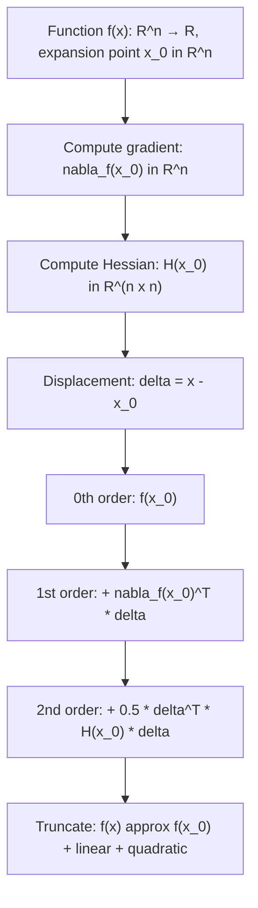

# Multivariate Taylor Series

$$
f(\mathbf{x}) \approx f(\mathbf{x}_0) + \nabla f(\mathbf{x}_0)^T \boldsymbol{\delta} + \frac{1}{2} \boldsymbol{\delta}^T \mathbf{H}(\mathbf{x}_0) \boldsymbol{\delta} + \ldots
$$

## Deep Breakdown

What it tells me *(Situation Awareness)*:
The Multivariate Taylor Series extends the 1D Taylor expansion to functions of multiple variables. The expansion around $\mathbf{x}_0$ gives: constant term (function value), linear term (gradient dot product), quadratic term (Hessian), and higher-order tensors. In DA/DS: this is the foundation of all second-order optimization (Newton's method, BFGS, trust-region methods), the Laplace approximation for Bayesian posteriors, Fisher information matrix derivations, and sensitivity analysis in multivariate models. The gradient is the 1st-order Taylor coefficient; the Hessian is the 2nd-order Taylor coefficient.

## Flowchart



## Real-world use

### Where it is used

Any optimization problem where you need to approximate a multivariate objective function locally. Newton's method minimizes the 2nd-order Taylor approximation. The Laplace approximation fits a Gaussian to the 2nd-order Taylor of log p(θ|data) around the MAP estimate. Sensitivity analysis uses the gradient (1st order) and Hessian (2nd order) to understand how the output changes with each input.

### Problem it solves

Multivariate nonlinear functions are intractable to optimize directly. The Taylor approximation reduces the local optimization problem to a quadratic (which has a closed-form solution: the Newton step).

### How it solves the problem

At any point $\mathbf{x}_0$, the quadratic approximation $\hat{f}(\mathbf{x}) = f(\mathbf{x}_0) + \nabla f^T\boldsymbol{\delta} + \frac{1}{2}\boldsymbol{\delta}^T H \boldsymbol{\delta}$ is a parabola (or paraboloid). Its minimum is at $\boldsymbol{\delta}^* = -H^{-1}\nabla f$, giving the Newton step.

### Example in a business

**Logistic regression Newton step**: Loss L(w) = cross-entropy. Gradient: $\nabla L = X^T(p - y)$. Hessian: $H = X^T D X$ where D is diagonal with sigmoid variance terms. Newton step: $\Delta w = -H^{-1}\nabla L = -(X^T D X)^{-1} X^T(p-y)$. This is exactly the IRLS (Iteratively Reweighted Least Squares) algorithm — it converges in far fewer steps than gradient descent because it uses the full curvature information.

## The formula, piece by piece

$f(\mathbf{x}) = f(\mathbf{x}_0) + \nabla f(\mathbf{x}_0)^T \boldsymbol{\delta} + \frac{1}{2} \boldsymbol{\delta}^T H(\mathbf{x}_0) \boldsymbol{\delta} + O(\|\boldsymbol{\delta}\|^3)$ where $\boldsymbol{\delta} = \mathbf{x} - \mathbf{x}_0$ - **$f(\mathbf{x}_0)$** — Scalar: function value at the expansion point.
- **$\nabla f(\mathbf{x}_0)$** — Gradient vector (n×1): partial derivatives $[\partial f/\partial x_1, \ldots, \partial f/\partial x_n]^T$ at $\mathbf{x}_0$.
- **$\nabla f(\mathbf{x}_0)^T \boldsymbol{\delta}$** — Dot product: scalar, the linear prediction of change from $\mathbf{x}_0$ to $\mathbf{x}$.
- **$H(\mathbf{x}_0)$** — Hessian matrix (n×n): second-order partial derivatives $[\partial^2 f / \partial x_i \partial x_j]$ at $\mathbf{x}_0$. Symmetric.
- **$\boldsymbol{\delta}^T H \boldsymbol{\delta}$** — Quadratic form: scalar capturing curvature in the direction $\boldsymbol{\delta}$.
- **$\frac{1}{2}$** — Required normalization (from $k=2$ term in Taylor series: $\frac{1}{2!} = \frac{1}{2}$).
- **$O(\|\boldsymbol{\delta}\|^3)$** — Remainder: cubic and higher terms, small when $\boldsymbol{\delta}$ is small.
- **General k-th order term**: involves the k-th order derivative tensor $\mathcal{D}^k f$ contracted with $\boldsymbol{\delta}^{\otimes k}$.

## The formula in words

"Near a base point, a multivariate function can be approximated by: (1) its current value, (2) a linear term pointing in the gradient direction, (3) a quadratic correction using the Hessian curvature. The approximation is accurate for small displacements from the base point."

## Critical Concepts

1. **Gradient descent uses only the 1st-order term**: $\mathbf{x}_{t+1} = \mathbf{x}_t - \eta \nabla f(\mathbf{x}_t)$. This ignores curvature information.
2. **Newton's method uses 1st + 2nd order**: Minimizes the quadratic approximation exactly, giving $\boldsymbol{\delta} = -H^{-1}\nabla f$. Quadratic convergence near the optimum.
3. **Positive definite Hessian**: If $H \succ 0$, the quadratic approximation is a bowl (convex) with a unique minimum. The Newton step is well-defined. At saddle points, H has mixed signs.
4. **Laplace approximation**: In Bayesian inference, approximate the posterior $\log p(\theta|D) \approx \log p(\theta^*|D) - \frac{1}{2}(\theta-\theta^*)^T (-H_{\log p})(\theta-\theta^*)$. This gives a Gaussian approximation with covariance $(-H)^{-1}$.
5. **Fisher information = Hessian of log-likelihood**: $I(\theta) = -E[\nabla^2 \log p(X|\theta)]$. The Cramér-Rao bound uses this. Key in MLE efficiency.
6. **Computing the Hessian**: For n parameters, the Hessian has n² entries.

Expensive for large models. Quasi-Newton methods (BFGS, L-BFGS) approximate H^{-1} iteratively.

## Step-by-step calculation (tiny example)

Function: $f(x_1, x_2) = x_1^2 + x_1 x_2 + x_2^2$, expand around $\mathbf{x}_0 = (1, 1)^T$.

*Step 1: Compute function value*
$f(1, 1) = 1 + 1 + 1 = 3$

*Step 2: Compute gradient at (1,1)*
$\partial f/\partial x_1 = 2x_1 + x_2 = 2(1) + 1 = 3$
$\partial f/\partial x_2 = x_1 + 2x_2 = 1 + 2(1) = 3$
$\nabla f(1,1) = [3, 3]^T$

*Step 3: Compute Hessian (constant for quadratic f)*
$H = \begin{bmatrix} \partial^2 f/\partial x_1^2 & \partial^2 f/\partial x_1 \partial x_2 \\ \partial^2 f/\partial x_2 \partial x_1 & \partial^2 f/\partial x_2^2 \end{bmatrix} = \begin{bmatrix} 2 & 1 \\ 1 & 2 \end{bmatrix}$

*Step 4: Evaluate at x = (1.1, 0.9), δ = (0.1, -0.1)*
Linear term: $[3, 3] \cdot [0.1, -0.1] = 0.3 - 0.3 = 0$
Quadratic term: $\frac{1}{2}[0.1, -0.1] \begin{bmatrix}2&1\\1&2\end{bmatrix}[0.1,-0.1]^T = \frac{1}{2}[0.1, -0.1][0.1, -0.1]^T \cdot ...$
$= \frac{1}{2}(2(0.01) + 2(1)(0.1)(-0.1) + 2(0.01)) = \frac{1}{2}(0.02 - 0.02 + 0.02) = 0.01$
Taylor approx: 3 + 0 + 0.01 = **3.01**
True value: $1.21 + 0.99 + 0.81 = 3.01$ ✓ (exact for quadratic f)

## Code examples

### Beginner example (Python)

```python
"""
Multivariate Taylor Series: 2nd-order approximation.

f(x) approx f(x0) + grad(x0)^T * delta + 0.5 * delta^T * H(x0) * delta

Applied to approximating a multivariate function near a base point
and implementing one step of Newton's method.
"""
import numpy as np


def quadratic_loss(weights: np.ndarray) -> float:
    """Example loss: L(w) = 0.5 * ||Aw - b||^2."""
    a_matrix = np.array([[2.0, 1.0], [1.0, 3.0]])
    b_vector = np.array([1.0, 2.0])
    residual = a_matrix @ weights - b_vector
    return 0.5 * float(residual @ residual)


def gradient(weights: np.ndarray) -> np.ndarray:
    """Gradient: dL/dw = A^T(Aw - b)."""
    a_matrix = np.array([[2.0, 1.0], [1.0, 3.0]])
    b_vector = np.array([1.0, 2.0])
    return a_matrix.T @ (a_matrix @ weights - b_vector)


def hessian() -> np.ndarray:
    """Hessian: d^2L/dw^2 = A^T A (constant for quadratic loss)."""
    a_matrix = np.array([[2.0, 1.0], [1.0, 3.0]])
    return a_matrix.T @ a_matrix


def taylor_second_order_approx(
    weights: np.ndarray,
    weights_0: np.ndarray,
    grad_at_0: np.ndarray,
    hess_at_0: np.ndarray,
    function_val_at_0: float,
) -> float:
    """Evaluate 2nd-order Taylor approximation at weights given expansion at weights_0."""
    delta = weights - weights_0
    return (
        function_val_at_0
        + grad_at_0 @ delta
        + 0.5 * delta @ hess_at_0 @ delta
    )


weights_0 = np.array([0.5, 0.5])
grad_0 = gradient(weights_0)
hess_0 = hessian()
loss_0 = quadratic_loss(weights_0)

# Newton step: delta = -H^{-1} * grad
newton_delta = -np.linalg.solve(hess_0, grad_0)
weights_newton = weights_0 + newton_delta

# Taylor approximation along the Newton direction
delta_eval = np.array([0.05, 0.05])
weights_eval = weights_0 + delta_eval
true_loss = quadratic_loss(weights_eval)
taylor_loss = taylor_second_order_approx(weights_eval, weights_0, grad_0, hess_0, loss_0)

print(f"Base point : {weights_0} → loss = {loss_0:.6f}")
print(f"Gradient : {grad_0}")
print(f"Newton step : {newton_delta.round(6)}")
print(f"Newton point: {weights_newton.round(6)} → loss = {quadratic_loss(weights_newton):.8f}")
print(f"\nTaylor approx at {weights_eval}: {taylor_loss:.6f}")
print(f"True loss at {weights_eval}: {true_loss:.6f} (exact for quadratic)")
```

### Beginner example (R)

```r
# Multivariate Taylor Series: 2nd-order approximation
# Applied to sensitivity analysis of a business revenue model

# Revenue function: R(price, units) = price * units - 0.1*price^2 - 0.5*units^2
revenue_func <- function(price, units) {
  price * units - 0.1 * price^2 - 0.5 * units^2
}

# Gradient: [dR/d_price, dR/d_units]
revenue_gradient <- function(price, units) {
  d_price <- units - 0.2 * price
  d_units <- price - units
  c(d_price, d_units)
}

# Hessian matrix (constant for this quadratic function)
revenue_hessian <- matrix(c(-0.2, 1, 1, -1), nrow = 2, ncol = 2)

# Taylor 2nd-order approximation around (p_0, u_0)
taylor_approx_2nd <- function(price, units, p_0, u_0) {
  delta <- c(price - p_0, units - u_0)
  grad <- revenue_gradient(p_0, u_0)
  r_0 <- revenue_func(p_0, u_0)
  as.numeric(r_0 + sum(grad * delta) + 0.5 * t(delta) %*% revenue_hessian %*% delta)
}

# Base point
P_0 <- 30.0
U_0 <- 20.0
cat(sprintf("Revenue at (%.0f, %.0f): €%.2f\n", P_0, U_0, revenue_func(P_0, U_0)))
cat(sprintf("Gradient: price_sensitivity=%.2f, units_sensitivity=%.2f\n", revenue_gradient(P_0, U_0)[1], revenue_gradient(P_0, U_0)[2]))

# Sensitivity analysis via Taylor
price_variations <- seq(25, 35, by = 2)
cat("\nPrice sensitivity (units=20 fixed):\n")
for (p in price_variations) {
  true_r <- revenue_func(p, U_0)
  approx_r <- taylor_approx_2nd(p, U_0, P_0, U_0)
  cat(sprintf(" p=%2.0f: true=€%.2f, taylor=€%.2f, error=€%.4f\n", p, true_r, approx_r, abs(true_r - approx_r)))
}
```

### Professional example (Python)

```python
"""
Multivariate Taylor Series for the Laplace approximation
of a Bayesian posterior in logistic regression.

Business context: A churn prediction team wants uncertainty estimates for
their model weights. The Laplace approximation gives a Gaussian approximation
to the posterior p(w|data), using the MAP estimate and the Hessian of the
log-posterior at that point.
"""
import numpy as np
from scipy.optimize import minimize
from scipy.special import expit   # sigmoid function
RNG_SEED: int = 42
NUM_SAMPLES: int = 200
NUM_FEATURES: int = 3
PRIOR_PRECISION: float = 1.0   # prior p(w) = N(0, I/prior_precision)

def log_likelihood(weights: np.ndarray, x_data: np.ndarray, y_labels: np.ndarray) -> float:
    """Log-likelihood for logistic regression: sum y*log(p) + (1-y)*log(1-p)."""
    log_probs = np.log(expit(x_data @ weights) + 1e-12)
    log_one_minus_probs = np.log(1.0 - expit(x_data @ weights) + 1e-12)
    return float(np.sum(y_labels * log_probs + (1 - y_labels) * log_one_minus_probs))

def log_posterior(weights: np.ndarray, x_data: np.ndarray, y_labels: np.ndarray) -> float:
    """Log-posterior = log-likelihood + log-prior (Gaussian prior)."""
    log_prior = -0.5 * PRIOR_PRECISION * float(weights @ weights)
    return log_likelihood(weights, x_data, y_labels) + log_prior

def hessian_log_posterior(weights: np.ndarray, x_data: np.ndarray) -> np.ndarray:
    """Hessian of log-posterior: H = -X^T D X - prior_precision * I.

    D is diagonal matrix with sigmoid(Xw)*(1-sigmoid(Xw)) on diagonal.
    """
    probs = expit(x_data @ weights)
    diag_weights = probs * (1.0 - probs)
    hess_likelihood = -(x_data.T * diag_weights) @ x_data
    hess_prior = -PRIOR_PRECISION * np.eye(len(weights))
    return hess_likelihood + hess_prior


rng = np.random.default_rng(RNG_SEED)
x_data = rng.normal(0.0, 1.0, (NUM_SAMPLES, NUM_FEATURES))
true_weights = np.array([1.0, -0.5, 0.8])
y_labels = (expit(x_data @ true_weights) > rng.uniform(0, 1, NUM_SAMPLES)).astype(float)

# Find MAP estimate (2nd-order Taylor approximation is centered here)
result = minimize(
    fun=lambda w: -log_posterior(w, x_data, y_labels),
    x0=np.zeros(NUM_FEATURES),
    jac="2-point",
    method="BFGS",
)
map_weights = result.x

# Laplace approximation: Gaussian N(w_map, (-H)^{-1})
hess_at_map = hessian_log_posterior(map_weights, x_data)
covariance_laplace = -np.linalg.inv(hess_at_map)   # 2nd-order Taylor gives covariance
print("Laplace Approximation (Multivariate 2nd-Order Taylor):")
print(f" MAP weights: {map_weights.round(4)}")
print(f" True weights: {true_weights}")
print(f" Posterior std (Laplace):")
for feature_idx in range(NUM_FEATURES):
    std = np.sqrt(covariance_laplace[feature_idx, feature_idx])
    print(f" w_{feature_idx+1}: MAP={map_weights[feature_idx]:.4f}, std={std:.4f}, "
          f"95%CI=[{map_weights[feature_idx]-1.96*std:.4f}, "
          f"{map_weights[feature_idx]+1.96*std:.4f}]")
```

---

*Source: MML1 p. 181*
