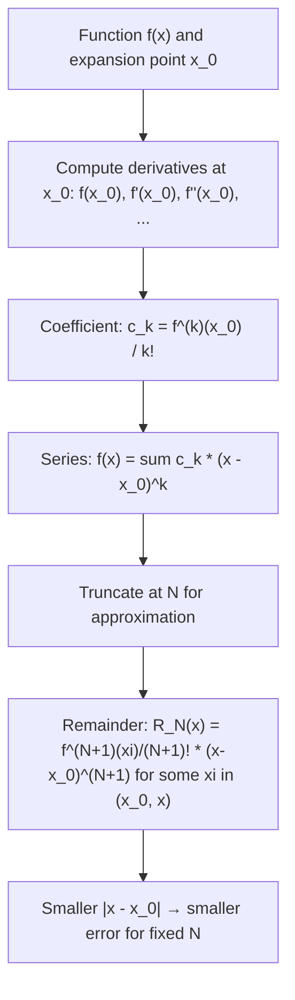

# Taylor Series Expansion (1D)

$$
f(x) = \sum_{k=0}^{\infty} \frac{f^{(k)}(x_0)}{k!} (x - x_0)^k
$$

## Deep Breakdown

What it tells me *(Situation Awareness)*:
The Taylor Series expands a smooth function around any chosen base point $x_0$, expressing it as an infinite polynomial in $(x - x_0)$. It is the foundation of nearly all local approximations in analysis and numerical methods. In DA/DS: gradient descent is the k=1 truncation; Newton's method uses k=1 and k=2 terms; all activation function approximations are Taylor expansions around a relevant operating point; and the Laplace approximation in Bayesian inference uses the k=2 term (Hessian) around the posterior mode.

## Flowchart



## Real-world use

### Where it is used

Whenever you need a polynomial approximation of f near a specific operating point $x_0$ that is not necessarily zero. Key uses: linearizing a nonlinear model around an equilibrium (control theory, sensitivity analysis), Newton-Raphson root finding (uses the first-order expansion), second-order optimization (uses gradient + Hessian), and deriving finite-difference formulas for numerical differentiation.

### Problem it solves

Exact functions are often intractable analytically. Taylor series provides locally accurate polynomial approximations with explicit error bounds, enabling closed-form optimization, sensitivity analysis, and numerical computation.

### How it solves the problem

Matches not just the value but all derivatives of f at x_0. The polynomial that matches k derivatives has k+1 free parameters, and the Taylor series gives the unique such polynomial. The further from x_0, the more terms needed for the same accuracy.

### Example in a business

**Gradient descent as first-order Taylor**: The update step $w_{t+1} = w_t - \eta \nabla L(w_t)$ is exactly minimizing the first-order Taylor approximation of L around $w_t$: $L(w) \approx L(w_t) + \nabla L(w_t)^T(w - w_t)$. Newton's method adds the second-order term: minimizes $L(w_t) + \nabla L^T \delta + \frac{1}{2}\delta^T H \delta$ exactly, giving step $\delta = -H^{-1}\nabla L$.

## The formula, piece by piece

$f(x) = \sum_{k=0}^{\infty} \frac{f^{(k)}(x_0)}{k!} (x - x_0)^k$
$= f(x_0) + f'(x_0)(x-x_0) + \frac{f''(x_0)}{2!}(x-x_0)^2 + \frac{f'''(x_0)}{3!}(x-x_0)^3 + \ldots$ - **$f^{(k)}(x_0)$** — k-th derivative of f at the expansion point $x_0$.
- **$k!$** — Factorial normalization.
- **$(x - x_0)^k$** — Displacement from the expansion point, raised to the k-th power.
- **$x_0$** — Expansion point (center of approximation). Choose $x_0$ close to where you'll evaluate.
- **$k=0$**: constant term $f(x_0)$ — the function value.
- **$k=1$**: linear term $f'(x_0)(x-x_0)$ — tangent line at $x_0$.
- **$k=2$**: quadratic term $\frac{f''(x_0)}{2}(x-x_0)^2$ — curvature correction.
- **Lagrange remainder**: $R_N = \frac{f^{(N+1)}(\xi)}{(N+1)!}(x-x_0)^{N+1}$ for some $\xi \in (x_0, x)$.
- **Maclaurin as special case**: Set $x_0 = 0$.

## The formula in words

"Approximate f(x) near a chosen base point x_0 by matching its value, slope, curvature, and all higher derivatives at that base point. Each higher-order term adds a more refined correction based on how x deviates from x_0." Analogy: GPS navigation approximates your future position by: constant (where you are), first order (your speed and direction), second order (your acceleration), etc. Taylor series does the same for any mathematical function.

## Critical Concepts

1. **Choice of x_0 matters**: The expansion is most accurate close to x_0. Choose x_0 at or near the evaluation point.
2. **First-order approximation (linearization)**: $f(x) \approx f(x_0) + f'(x_0)(x-x_0)$ — a tangent line. Used in gradient descent, first-order sensitivity, linear regression of nonlinear models.
3. **Second-order approximation**: $f(x) \approx f(x_0) + f'(x_0)(x-x_0) + \frac{f''(x_0)}{2}(x-x_0)^2$ — a parabola. Used in Newton's method, trust-region methods, Fisher information.
4. **Numerical differentiation via Taylor**: $f'(x_0) \approx [f(x_0+h) - f(x_0-h)]/(2h)$ — central difference comes directly from the Taylor expansion.
5. **Machine precision**: For very small (x - x_0), numerical cancellation can occur. Use double precision and careful implementation.
6. **Taylor vs.

Maclaurin**: Same concept, different base point. Maclaurin is x_0=0, Taylor is general.

## Step-by-step calculation (tiny example)

Expand $f(x) = \ln(x)$ around $x_0 = 1$ up to the cubic term.

*Step 1: Derivatives at x_0 = 1*
$f(x) = \ln(x)$ → $f(1) = 0$
$f'(x) = 1/x$ → $f'(1) = 1$
$f''(x) = -1/x^2$ → $f''(1) = -1$
$f'''(x) = 2/x^3$ → $f'''(1) = 2$

*Step 2: Compute coefficients*
$c_0 = 0/0! = 0$
$c_1 = 1/1! = 1$
$c_2 = -1/2! = -0.5$
$c_3 = 2/3! = 1/3$

*Step 3: Write the expansion*
$\ln(x) \approx (x-1) - \frac{(x-1)^2}{2} + \frac{(x-1)^3}{3}$

*Step 4: Evaluate at x = 1.5 (so x-1 = 0.5)*
$\ln(1.5) \approx 0.5 - 0.5(0.25) + (0.333)(0.125) = 0.5 - 0.125 + 0.0417 = 0.4167$
True: ln(1.5) ≈ 0.4055. Error ≈ 0.011. Good for 3 terms.

## Code examples

### Beginner example (Python)

```python
"""
Taylor Series Expansion: f(x) = sum f^(k)(x_0)/k! * (x-x_0)^k

Applied to approximating ln(x) around x_0=1 and analyzing
how truncation error grows with distance from x_0.
"""
import numpy as np
import math
from typing import Callable


def taylor_approximation(
    deriv_values_at_x0: list[float],
    x_val: float,
    x_0: float,
) -> float:
    """
    Compute Taylor approximation given precomputed derivatives at x_0.

    Parameters
    ----------
    deriv_values_at_x0 : list of f(x_0), f'(x_0), f''(x_0), ...
    x_val : evaluation point x
    x_0 : expansion point

    Returns
    -------
    float: sum_{k=0}^{N} f^(k)(x_0)/k! * (x-x_0)^k
    """
    displacement = x_val - x_0
    return sum(
        deriv / math.factorial(k) * displacement**k
        for k, deriv in enumerate(deriv_values_at_x0)
    )


# Derivatives of ln(x) at x_0 = 1: d^k/dx^k ln(x) = (-1)^(k+1) * (k-1)! / x^k for k>=1
# At x_0=1: derivative of order k = (-1)^(k+1) * (k-1)!
def ln_derivatives_at_1(num_derivs: int) -> list[float]:
    """Return f(1), f'(1), f''(1), ..., f^(n)(1) for f(x) = ln(x)."""
    derivs = [0.0]   # f(1) = ln(1) = 0
    for k in range(1, num_derivs + 1):
        deriv = (-1)**(k + 1) * math.factorial(k - 1)
        derivs.append(float(deriv))
    return derivs


x0 = 1.0
derivs = ln_derivatives_at_1(num_derivs=5)
print("Taylor expansion of ln(x) around x_0=1:")
print(f"{'x':>6} | {'true ln(x)':>12} | {'N=2 approx':>12} | {'N=5 approx':>12}")
for x_test in [1.1, 1.25, 1.5, 1.75, 2.0]:
    true_val = math.log(x_test)
    approx_2 = taylor_approximation(derivs[:3], x_test, x0)
    approx_5 = taylor_approximation(derivs[:6], x_test, x0)
    print(f"{x_test:>6.2f} | {true_val:>12.8f} | {approx_2:>12.8f} | {approx_5:>12.8f}")
```

### Beginner example (R)

```r
# Taylor Series for linearization of a nonlinear cost function
# Used in sensitivity analysis: how much does cost change per unit parameter change?

# Quadratic cost function: C(q) = a*q^2 + b*q + c
PARAM_A <- 0.5
PARAM_B <- 10.0
PARAM_C <- 100.0
cost_func <- function(q) PARAM_A * q^2 + PARAM_B * q + PARAM_C
cost_deriv <- function(q) 2 * PARAM_A * q + PARAM_B  # C'(q)
cost_second <- function(q) 2 * PARAM_A  # C''(q) = constant

# Taylor expansion around q_0 = 20
q_0 <- 20
C_0 <- cost_func(q_0)
C_prime_0 <- cost_deriv(q_0)
C_double_prime_0 <- cost_second(q_0)
taylor_approx <- function(q) {
  delta <- q - q_0
  C_0 + C_prime_0 * delta + (C_double_prime_0 / 2) * delta^2
}
q_test <- c(18, 19, 20, 21, 22, 25)
cat("q | True C(q) | Taylor (order 2) | Error\n")
cat(paste(rep("-", 55), collapse=""), "\n")
for (q in q_test) {
  true_c <- cost_func(q)
  approx_c <- taylor_approx(q)
  cat(sprintf("%4.0f | %10.4f | %16.4f | %.6f\n", q, true_c, approx_c, abs(true_c - approx_c)))
}
```

### Professional example (Python)

```python
"""
Taylor Series for Newton's Method optimization.

Business context: A pricing team minimizes total revenue loss function L(p) —
a nonlinear function of price p. Newton's method uses the second-order Taylor
expansion around the current price estimate to find the optimal price
analytically at each step, converging much faster than gradient descent.
"""
import numpy as np

# Revenue loss as function of price: L(p) = (p - p_opt)^4 + (p - p_opt)^2
# Optimal price = p_opt, but assume we don't know it
P_OPT: float = 25.0   # true optimal price (€)
P_INIT: float = 15.0   # initial guess
MAX_ITERATIONS: int = 20
CONVERGENCE_TOL: float = 1e-8

def loss_function(price: float) -> float:
    """Revenue loss function (quartic + quadratic well around p_opt)."""
    delta = price - P_OPT
    return delta**4 + delta**2

def loss_gradient(price: float) -> float:
    """First derivative: dL/dp = 4*(p-p_opt)^3 + 2*(p-p_opt)."""
    delta = price - P_OPT
    return 4.0 * delta**3 + 2.0 * delta

def loss_hessian(price: float) -> float:
    """Second derivative: d^2L/dp^2 = 12*(p-p_opt)^2 + 2."""
    delta = price - P_OPT
    return 12.0 * delta**2 + 2.0

def newton_step(price: float) -> float:
    """Newton's method step via 2nd-order Taylor: p_new = p - L'(p)/L''(p)."""
    grad = loss_gradient(price)
    hess = loss_hessian(price)
    if abs(hess) < 1e-12:
        return price   # avoid division by near-zero Hessian
    return price - grad / hess


print(f"Newton's Method for optimal pricing (true p_opt = €{P_OPT:.2f}):")
print(f"{'Iter':>5} | {'Price':>10} | {'Loss':>12} | {'|Gradient|':>12}")
current_price = P_INIT
for iteration in range(MAX_ITERATIONS):
    current_loss = loss_function(current_price)
    current_grad = abs(loss_gradient(current_price))
    print(f"{iteration:>5} | €{current_price:>9.6f} | {current_loss:>12.8f} | {current_grad:>12.2e}")
    if current_grad < CONVERGENCE_TOL:
        print(f"\nConverged at iteration {iteration}!")
        break
    current_price = newton_step(current_price)
print(f"\nFound optimal price: €{current_price:.6f} (true: €{P_OPT:.6f})")
```

---

*Source: 1300 p. 321*
