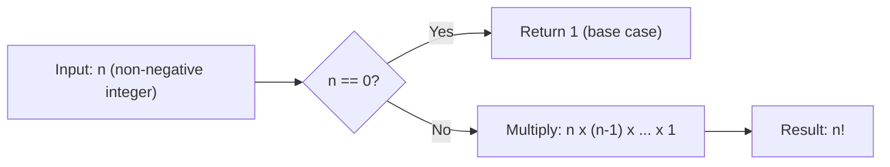

# Definition

$$
n! = n \cdot (n-1) \cdot (n-2) \dots 2 \cdot 1
$$

## Deep Breakdown

What it tells me *(Situation Awareness)*:
The factorial of $n$ counts the total number of ways to arrange $n$ distinct objects in a sequence. It appears whenever you need to count ordered arrangements, scale combinatorial formulas, or express the denominators of Taylor series coefficients. In DA/DS it shows up in probability calculations, combinatorics for feature selection counts, and as a building block for binomial/Poisson distributions.

## Flowchart



## Real-world use

### Where it is used

Computing the number of ways to order items: rank lists, schedules, permutation counts, and Taylor/Maclaurin series denominators.

### Problem it solves

How many distinct orderings exist for a set of $n$ distinct items? Or: what is the scaling factor in combinatorial probability formulas?

### How it solves the problem

By multiplying all positive integers from 1 to $n$, it produces the exact count of distinct ordered sequences of $n$ objects, following from the multiplication principle of counting.

### Example in a business

A/B test prioritization: you have 5 campaigns to schedule in sequence. The number of distinct ordering schedules is $5! = 120$. Used to assess whether an exhaustive search is feasible or a heuristic is needed.

## The formula, piece by piece

$n!$: "n factorial" — the product of all positive integers from 1 to $n$.
- $n$: the number of distinct objects to arrange.
- $!$: the factorial operator, shorthand for the product $n \cdot (n-1) \cdot \ldots \cdot 1$.
- Recursively: $n! = n \cdot (n-1)!$ with base case $0! = 1$.

## The formula in words

"The factorial of $n$ equals $n$ multiplied by every positive integer below it, down to 1." $5! = 5 \times 4 \times 3 \times 2 \times 1 = 120$

## Critical Concepts

- Factorials grow super-exponentially: $10! = 3{,}628{,}800$; $20! \approx 2.4 \times 10^{18}$.
- They appear in denominators of Taylor series: $e^x = \sum x^k / k!$.
- In code: use `math.factorial(n)` (Python) or `factorial(n)` (R). Never compute naively for large $n$; use log-factorial (`lgamma(n+1)`) for numerical stability.
- $0! = 1$ by convention (empty product).

## Step-by-step calculation (tiny example)

*Step 1: Identify n*
$n = 4$

*Step 2: Write out the product*
$4! = 4 \times 3 \times 2 \times 1$

*Step 3: Multiply left to right*
$4 \times 3 = 12$, then $12 \times 2 = 24$, then $24 \times 1 = 24$

*Step 4: Result*
$4! = 24$

## Code examples

### Beginner example (Python)

```python
import math   # How many ways can 4 campaign variants be ordered in a test sequence?
num_variants = 4
orderings = math.factorial(num_variants)
print(f"Number of orderings: {orderings}")   # 24
```

### Beginner example (R)

```r
# How many ways can 4 campaign variants be ordered?
num_variants <- 4
orderings <- factorial(num_variants)
cat("Number of orderings:", orderings, "\n")  # 24
```

### Professional example (Python)

```python
import math
import numpy as np

def log_factorial(n: int) -> float:
    """Return log(n!) using Stirling-safe lgamma for large n. Uses math.lgamma(n+1) which equals log(n!) exactly for integer n. Avoids overflow when computing ratios of factorials. Args: n: Non-negative integer. Returns: Natural log of n!. """
    if n < 0:
        raise ValueError(f"Factorial undefined for negative n={n}")
    return math.lgamma(n + 1)

def log_binomial_coefficient(n: int, k: int) -> float:
    """Compute log(C(n,k)) = log(n!) - log(k!) - log((n-k)!) stably."""
    return log_factorial(n) - log_factorial(k) - log_factorial(n - k)   # Feasibility check: can we exhaustively enumerate orderings?
MAX_FEASIBLE_ORDERINGS = 1_000_000
campaign_counts = [3, 4, 5, 6, 7, 8, 10]
print(f"{'n':>5} {'n!':>15} {'Feasible?':>10}")
for n_campaigns in campaign_counts:
    n_fact = math.factorial(n_campaigns)
feasible = "YES" if n_fact <= MAX_FEASIBLE_ORDERINGS else "NO"
print(f"{n_campaigns:>5} {n_fact:>15,} {feasible:>10}")
```

---

*Source: 1300 p. 326*
