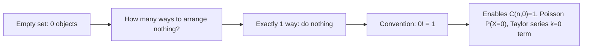

# Zero Factorial

$$
0! = 1
$$

## Deep Breakdown

What it tells me *(Situation Awareness)*:
$0! = 1$ is the conventional base case that makes all combinatorial formulas consistent. Without it, $\binom{n}{0}$ and $\binom{n}{n}$ would be undefined. It appears everywhere factorials appear: binomial coefficients, Poisson PMF, Taylor series, and probability mass functions for distributions defined at 0.

## Flowchart



## Real-world use

### Where it is used

Any time a combinatorial formula evaluates at the boundary condition $k=0$ or $k=n$: choosing 0 items from a set, computing $\binom{n}{0}=1$, evaluating $P(X=0)$ in Poisson/Binomial distributions, or initializing the $k=0$ term in a Taylor expansion.

### Problem it solves

Prevents division by zero in formulas like $\binom{n}{r} = n! / (r!(n-r)!)$ when $r=0$ or $r=n$.

### How it solves the problem

By defining the empty product as 1 (the multiplicative identity), it ensures the convention $0! = 1$ is mathematically consistent with the recursive definition $n! = n \cdot (n-1)!$.

### Example in a business

Poisson model for rare events (e.g., customer support tickets per hour): $P(X=0 \mid \lambda) = e^{-\lambda} \lambda^0 / 0! = e^{-\lambda}$. Without $0! = 1$, the probability of zero events is undefined.

## The formula, piece by piece

$0! = 1$: the empty product convention.
- Comes from the recursive identity: $n! = n \cdot (n-1)!$
- Setting $n=1$: $1! = 1 \cdot 0!$ so $0! = 1!/1 = 1$.

## The formula in words

"There is exactly one way to arrange zero objects: do nothing."

## Critical Concepts

- This is a definition, not something derived from multiplication.
- Ensures $\binom{n}{0} = 1$ (there is exactly 1 way to choose nothing).
- Enables the $k=0$ term in Taylor series: $f^{(0)}(x_0)/0! = f(x_0)$.
- Python: `math.factorial(0)` returns 1. R: `factorial(0)` returns 1.

## Step-by-step calculation (tiny example)

*Step 1: Recognize the edge case*
We need $0!$ to evaluate $\binom{5}{0}$.

*Step 2: Apply the definition*
$0! = 1$ by convention.

*Step 3: Use it*
$\binom{5}{0} = \frac{5!}{0! \cdot 5!} = \frac{120}{1 \cdot 120} = 1$. There is exactly 1 way to choose 0 items from 5.

## Code examples

### Beginner example (Python)

```python
import math   # Validate that 0! = 1
print(math.factorial(0))   # 1 # Poisson P(X=0)
import math as m
lam = 3.0   # avg 3 events per hour
prob_zero = (m.e ** (-lam)) * (lam ** 0) / m.factorial(0)
print(f"P(X=0 | lambda=3) = {prob_zero:.4f}")   # ~0.0498
```

### Beginner example (R)

```r
# Validate 0! = 1
cat(factorial(0), "\n")  # 1 # Poisson P(X=0)
lam <- 3.0
prob_zero <- exp(-lam) * lam^0 / factorial(0)
cat("P(X=0 | lambda=3) =", round(prob_zero, 4), "\n")  # 0.0498
```

### Professional example (Python)

```python
import math
import numpy as np
from scipy.stats import poisson
LAMBDA_VALUES = [0.5, 1.0, 2.0, 3.0, 5.0]
print("Poisson P(X=0) using 0! = 1 convention:")
print(f"{'lambda':>10} {'manual':>12} {'scipy':>12} {'match':>8}")
for lam in LAMBDA_VALUES:
    # Manual: relies on 0! = 1
    manual = (math.e ** (-lam)) * (lam ** 0) / math.factorial(0)   # scipy reference
scipy_val = poisson.pmf(0, lam)
match = abs(manual - scipy_val) < 1e-12
print(f"{lam:>10.1f} {manual:>12.6f} {scipy_val:>12.6f} {str(match):>8}")
```

---

*Source: AIO p. 83*
