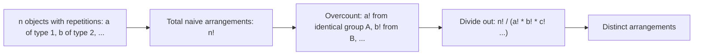

# Permutations (With repeats Grouping)

$$
\frac{n!}{a! \cdot b! \cdot c! \dots}
$$

(where $a, b, c$ are sizes of indistinguishable groups)

## Deep Breakdown

What it tells me *(Situation Awareness)*:
This formula counts distinct arrangements of $n$ objects where some objects are identical. If you have $n$ items in groups of $a$ identical, $b$ identical, $c$ identical, etc., the raw $n!$ overcounts by $a! \cdot b! \cdot c! \cdots$ because swapping identical items produces the same arrangement. Used in NLP (word anagrams), feature combination counting, and any arrangement with repeated categories.

## Flowchart



## Real-world use

### Where it is used

Counting distinct sequences when categories repeat: arranging tokens in a bag-of-words, distributing $n$ identical coupons across buckets, or multi-set permutations in combinatorial optimization.

### Problem it solves

How many visually distinct arrangements of $n$ objects exist when some objects are indistinguishable from each other?

### How it solves the problem

Divides $n!$ by the product of factorials of each group size, since permuting within an identical group produces no new arrangement.

### Example in a business

NLP: how many distinct orderings of the word "STATISTICS" (S×3, T×3, A×1, I×2, C×1) exist? $= 10!/(3! \cdot 3! \cdot 1! \cdot 2! \cdot 1!) = 50{,}400$. Relevant for anagram detection and vocabulary analysis.

## The formula, piece by piece

$\frac{n!}{a! \cdot b! \cdot c! \cdots}$
- $n$: total number of objects.
- $a, b, c, \ldots$: sizes of identical groups (must sum to $n$).
- $a! \cdot b! \cdot c! \cdots$: total overcounting factor from identical swaps.
- This is also called a **multinomial coefficient**: $\binom{n}{a, b, c, \ldots}$.

## The formula in words

"Divide $n$ factorial by the product of the factorials of each identical group's size to get the number of distinct arrangements." For AABB: $4!/(2! \cdot 2!) = 24/4 = 6$ distinct sequences.

## Critical Concepts

- When all groups have size 1: reduces to $n!$ (all objects distinct).
- Multinomial coefficient: $\binom{n}{a,b,c} = n!/(a!b!c!)$ — same formula.
- Special case: $\binom{n}{k} = n!/(k!(n-k)!)$ is the binomial coefficient when there are 2 groups.
- Python: `math.factorial(n) // (math.factorial(a) * math.factorial(b))` or `scipy.special.multinomial`.

## Step-by-step calculation (tiny example)

*Step 1: Objects*
AABBC — 5 objects: A×2, B×2, C×1.

*Step 2: Apply formula*
$\frac{5!}{2! \cdot 2! \cdot 1!} = \frac{120}{2 \cdot 2 \cdot 1} = \frac{120}{4} = 30$

*Step 3: Interpretation*
There are 30 distinct orderings of the string AABBC.

## Code examples

### Beginner example (Python)

```python
import math
from functools import reduce
import operator

def multiset_permutations(group_sizes: list[int]) -> int:
    """Count distinct arrangements of a multiset."""
    n_total = sum(group_sizes)
    denominator = reduce(operator.mul, (math.factorial(g) for g in group_sizes), 1)
    return math.factorial(n_total) // denominator   # "STATISTICS": S=3, T=3, A=1, I=2,
C=1
result = multiset_permutations([3, 3, 1, 2, 1])
print(f"Distinct arrangements of STATISTICS: {result:,}")   # 50,400
```

### Beginner example (R)

```r
multiset_permutations <- function(group_sizes) { n_total <- sum(group_sizes)
  denominator <- prod(sapply(group_sizes, factorial)) factorial(n_total) / denominator
}
result <- multiset_permutations(c(3, 3, 1, 2, 1))
cat("Distinct arrangements of STATISTICS:", format(result, big.mark=","), "\n")
```

### Professional example (Python)

```python
import math
from functools import reduce
import operator
from collections import Counter

def multiset_permutations_from_string(word: str) -> int:
    """Count distinct anagrams of a word, treating identical letters as same. Args: word: Input string (letters only). Returns: Number of distinct arrangements = n! / prod(count_i!) """
    char_counts = Counter(word.upper())
    n_total = len(word)
    denominator = reduce( operator.mul, (math.factorial(count) for count in char_counts.values()), 1 )
    return math.factorial(n_total) // denominator   # Vocabulary analysis: anagram complexity of key terms
TERMS = ["STATISTICS", "ALGORITHM", "REGRESSION", "BAYES", "CLUSTER"]
print(f"{'Term':<15} {'Length':>8} {'Distinct Arrangements':>25}")
for term in TERMS:
    arrangements = multiset_permutations_from_string(term)
print(f"{term:<15} {len(term):>8} {arrangements:>25,}")
```

---

*Source: AIO p. 60*
