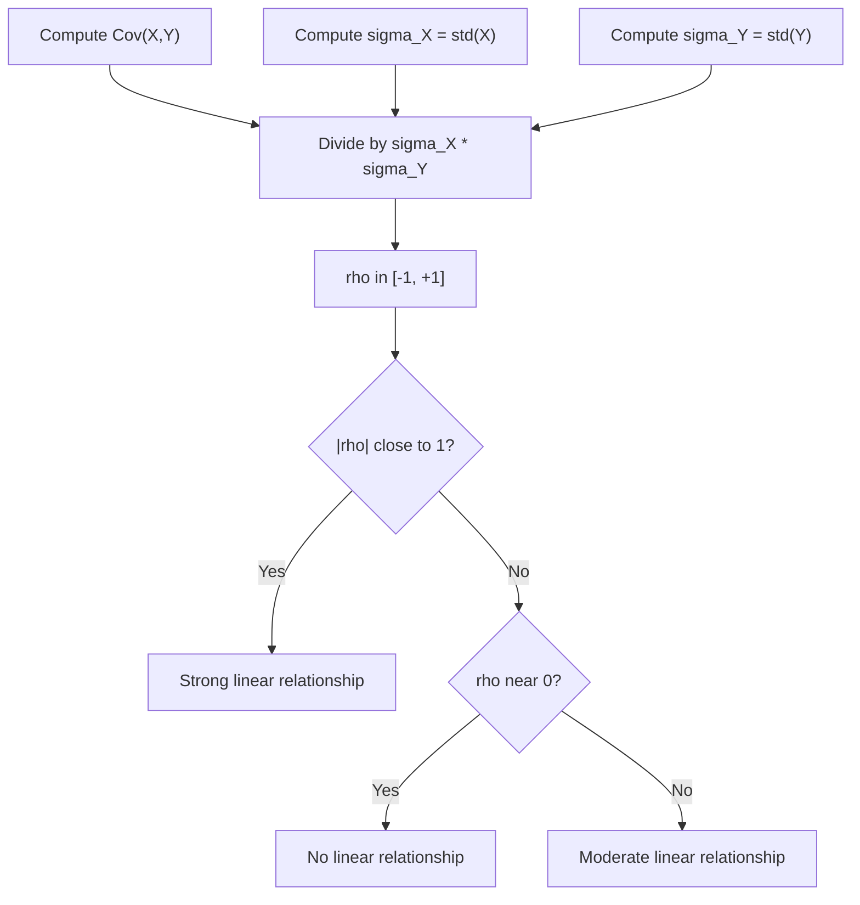

# Correlation Coefficient (Pearson's $rho$)

$$
\rho_{X,Y} = \frac{Cov(X,Y)}{\sigma_X \sigma_Y}
$$

## Deep Breakdown

What it tells me *(Situation Awareness)*:
Pearson's $\rho$ standardises the covariance by the product of the two standard deviations, producing a dimensionless value in $[-1, 1]$. It measures the strength and direction of the linear relationship between two variables. In DA/DS it is the most commonly used measure of linear association: feature-target correlation EDA, multicollinearity detection before regression, pairwise heatmaps, and portfolio beta estimation.

## Flowchart



## Real-world use

### Where it is used

EDA on feature matrices, multicollinearity checks before fitting regression, correlation heatmaps for feature selection, and measuring how closely two financial instruments co-move.

### Problem it solves

Covariance is scale-dependent (units = X·Y), making it impossible to compare relationships across different variable pairs. Pearson's $\rho$ gives a standardised, interpretable measure bounded in $[-1,1]$.

### How it solves the problem

Dividing by $\sigma_X \sigma_Y$ makes the result unit-free. This allows direct comparisons: "revenue vs ad spend ($\rho=0.87$) is more correlated than clicks vs bounce rate ($\rho=-0.42$)".

### Example in a business

A DS team builds a correlation heatmap of 20 marketing metrics before fitting a multivariate regression. Feature pairs with $|\rho| > 0.9$ are flagged as highly collinear and candidates for removal or PCA compression.

## The formula, piece by piece

| Symbol | Meaning |
|--------|---------|
| $\rho_{X,Y}$ | Pearson correlation coefficient |
| $Cov(X,Y)$ | Covariance of X and Y |
| $\sigma_X$ | Standard deviation of X |
| $\sigma_Y$ | Standard deviation of Y |
| $\sigma_X \sigma_Y$ | Product of standard deviations (normalisation factor) |

Full formula: $\rho_{X,Y} = \dfrac{Cov(X,Y)}{\sigma_X \sigma_Y}$

## The formula in words

"Pearson's rho equals the covariance of X and Y, divided by the product of their standard deviations." This rescales covariance so $\rho = +1$ means perfect positive linear relationship, $\rho = -1$ means perfect negative, and $\rho = 0$ means no linear relationship.

## Critical Concepts

- **Range**: $-1 \le \rho \le 1$ always.
- **Linearity only**: a perfect quadratic relationship gives $\rho \approx 0$. Always visualise (Anscombe's quartet warning).
- **Causation vs correlation**: $\rho \ne 0$ does not imply causality.
- **Outlier sensitivity**: Pearson's $\rho$ is not robust. Use Spearman's $\rho$ (rank-based) for heavy-tailed data.
- **Sample version**: $r = \frac{\sum (x_i - \bar{x})(y_i - \bar{y})}{\sqrt{\sum(x_i-\bar{x})^2 \cdot \sum(y_i-\bar{y})^2}}$.

## Step-by-step calculation (tiny example)

Data: $(X,Y)$: $(1,2),(3,4),(5,6)$.

*Step 1: Compute means*
$\bar{x}=3$, $\bar{y}=4$

*Step 2: Compute Cov(X,Y)*
Deviations: $(-2,-2),(0,0),(2,2)$; products: $4,0,4$; $Cov = 8/3$

*Step 3: Compute standard deviations*
$\sigma_X = \sqrt{(4+0+4)/3} = \sqrt{8/3} \approx 1.633$
$\sigma_Y = \sqrt{(4+0+4)/3} \approx 1.633$

*Step 4: Apply formula*
$\rho = (8/3) \div (1.633 \times 1.633) = (8/3) \div (8/3) = 1.0$

*Step 5: Interpret*
$\rho = 1.0$: perfect positive linear relationship, as expected ($Y = X + 1$).

## Code examples

### Beginner example (Python)

```python
import numpy as np
ad_spend = [100, 200, 300, 400, 500]
revenue = [210, 420, 590, 810, 1005]

# Manual Pearson r
mean_ad = sum(ad_spend) / len(ad_spend)
mean_rev = sum(revenue) / len(revenue)
numerator = sum((a - mean_ad) * (r - mean_rev) for a, r in zip(ad_spend, revenue))
denom_ad = sum((a - mean_ad) ** 2 for a in ad_spend) ** 0.5
denom_rev = sum((r - mean_rev) ** 2 for r in revenue) ** 0.5
pearson_r = numerator / (denom_ad * denom_rev)
print(f"Pearson r (manual): {pearson_r:.4f}")
print(f"numpy corrcoef: {np.corrcoef(ad_spend, revenue)[0, 1]:.4f}")
```

### Beginner example (R)

```r
ad_spend <- c(100, 200, 300, 400, 500)
revenue <- c(210, 420, 590, 810, 1005)
pearson_r <- cor(ad_spend, revenue, method = "pearson")
test_result <- cor.test(ad_spend, revenue)
cat("Pearson r:", round(pearson_r, 4), "\n")
cat("p-value: ", round(test_result$p.value, 6), "\n")
```

### Professional example (Python)

```python
import numpy as np
import pandas as pd
from scipy import stats


def flag_multicollinear_features(
    df: pd.DataFrame, threshold: float = 0.85
) -> list[tuple[str, str, float]]:
    # Identify feature pairs with |r| > threshold for multicollinearity review.
    # Returns list of (feature_a, feature_b, pearson_r) sorted by |r| descending.
    corr_matrix = df.corr(method="pearson")
    flagged: list[tuple[str, str, float]] = []
    cols = list(corr_matrix.columns)
    for i, col_i in enumerate(cols):
        for col_j in cols[i + 1:]:
            r_val = float(corr_matrix.loc[col_i, col_j])
            if abs(r_val) > threshold:
                flagged.append((col_i, col_j, round(r_val, 4)))
    return sorted(flagged, key=lambda t: abs(t[2]), reverse=True)


def pearson_with_significance(
    x: np.ndarray, y: np.ndarray, alpha: float = 0.05
) -> dict[str, float | bool]:
    # Return Pearson r, p-value, and significance flag.
    r_val, p_val = stats.pearsonr(x, y)
    return {"r": round(float(r_val), 4), "p_value": round(float(p_val), 6), "significant": p_val < alpha}


if __name__ == "__main__":
    rng = np.random.default_rng(seed=42)
    n = 200
    base_spend = rng.normal(5000, 800, n)
    feature_df = pd.DataFrame({
        "ad_spend": base_spend,
        "clicks": 0.9 * base_spend + rng.normal(0, 200, n),   # highly collinear
        "ctr": rng.uniform(0.01, 0.05, n),
        "revenue": rng.normal(15000, 2000, n),
    })
    print("Flagged multicollinear pairs (|r| > 0.85):")
    for pair in flag_multicollinear_features(feature_df, threshold=0.85):
        print(f" {pair[0]} vs {pair[1]}: r = {pair[2]}")
    result = pearson_with_significance(feature_df["ad_spend"].values, feature_df["revenue"].values)
    print(f"\nad_spend vs revenue: r={result['r']}, p={result['p_value']}, sig={result['significant']}")
```

---

*Source: AIO p. 86` `MML2 p. 197*
