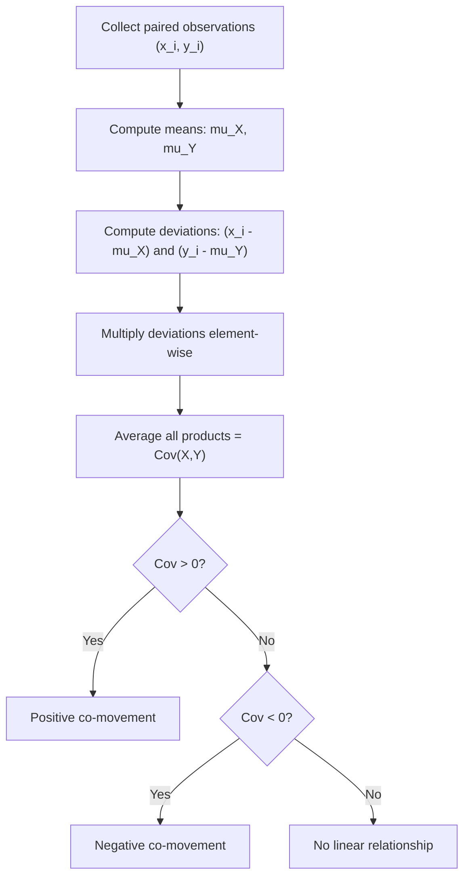

# Covariance Definition

$$
Cov(X,Y) = E[(X - E[X])(Y - E[Y])]
$$

## Deep Breakdown

What it tells me *(Situation Awareness)*:
Covariance measures the direction of the linear relationship between two random variables. A positive value means X and Y tend to move together (when X is above its mean, Y tends to be above its mean). A negative value means they move in opposite directions. Zero covariance does not guarantee independence, but for jointly Gaussian variables it does. In DA/DS it appears in PCA (the covariance matrix), portfolio risk, feature correlation analysis, and multivariate regression diagnostics.

## Flowchart



## Real-world use

### Where it is used

You have two variables measured on the same subjects: e.g., ad spend and revenue, session length and purchases, or two asset daily returns.

### Problem it solves

You need to quantify whether the two variables move together or against each other in raw units. Portfolio risk analysis, PCA decomposition, and multivariate model diagnostics all require the covariance.

### How it solves the problem

It multiplies each pair of mean-centered observations and averages the products. If both simultaneously exceed or fall below their means the product is positive; when they diverge the product is negative.

### Example in a business

A marketing analyst computes the covariance between daily ad spend and daily revenue. A positive covariance justifies further investigation via regression and attribution modelling. A near-zero covariance suggests these two metrics are not linearly related and more complex modelling is needed.

## The formula, piece by piece

| Symbol | Meaning |
|--------|---------|
| $Cov(X,Y)$ | Covariance of random variables X and Y |
| $E[\cdot]$ | Expected value operator |
| $X - E[X]$ | Deviation of X from its mean |
| $Y - E[Y]$ | Deviation of Y from its mean |
| $(X-E[X])(Y-E[Y])$ | Product of simultaneous deviations |

Full formula: $Cov(X,Y) = E[(X - E[X])(Y - E[Y])]$

## The formula in words

"The covariance of X and Y equals the expected value of the product of (X minus X's mean) and (Y minus Y's mean)." In other words: on average, how much do X and Y deviate from their means simultaneously and in the same direction?

## Critical Concepts

- **Sign**: positive = same-direction movement; negative = opposite-direction movement.
- **Scale dependency**: the value is in units(X) x units(Y), making cross-pair comparisons meaningless without standardisation.
- **Symmetry**: $Cov(X,Y) = Cov(Y,X)$.
- **Self-covariance**: $Cov(X,X) = Var(X)$.
- **Zero does not imply independence** except for jointly Gaussian pairs.

## Step-by-step calculation (tiny example)

Data: $(X, Y)$ pairs: $(1,2), (3,4), (5,6)$.

*Step 1: Compute means*
$\mu_X = (1+3+5)/3 = 3$, $\mu_Y = (2+4+6)/3 = 4$

*Step 2: Compute deviations and products*

| $x_i$ | $y_i$ | $x_i - \mu_X$ | $y_i - \mu_Y$ | product |
|-------|-------|--------------|--------------|---------|
| 1 | 2 | -2 | -2 | 4 |
| 3 | 4 | 0 | 0 | 0 |
| 5 | 6 | 2 | 2 | 4 |

*Step 3: Average the products*
$Cov(X,Y) = (4+0+4)/3 = 8/3 \approx 2.67$

*Step 4: Interpret*
Positive covariance confirms X and Y increase together (as expected: $Y = X + 1$).

## Code examples

### Beginner example (Python)

```python
import numpy as np
x_values = [1, 3, 5, 7, 9]
y_values = [2, 4, 6, 8, 10]

# Manual population covariance (ddof=0)
mean_x = sum(x_values) / len(x_values)
mean_y = sum(y_values) / len(y_values)
deviations = [(x - mean_x) * (y - mean_y) for x, y in zip(x_values, y_values)]
covariance_pop = sum(deviations) / len(deviations)
print(f"Mean X: {mean_x}, Mean Y: {mean_y}")
print(f"Population covariance (manual): {covariance_pop:.4f}")

# numpy cov() uses sample (ddof=1) by default; pass ddof=0 for population
cov_matrix = np.cov(x_values, y_values, ddof=0)
print(f"numpy population cov: {cov_matrix[0, 1]:.4f}")
```

### Beginner example (R)

```r
x_values <- c(1, 3, 5, 7, 9)
y_values <- c(2, 4, 6, 8, 10)

# R's cov() uses sample (n-1) by default
sample_cov <- cov(x_values, y_values)
cat("Sample covariance (n-1):", sample_cov, "\n")

# Population covariance (n)
n <- length(x_values)
pop_cov <- sum((x_values - mean(x_values)) * (y_values - mean(y_values))) / n
cat("Population covariance (n):", pop_cov, "\n")
```

### Professional example (Python)

```python
import numpy as np
import pandas as pd
from dataclasses import dataclass


@dataclass
class CovarianceAnalysis:
    # Pairwise covariance analysis for marketing channel metrics.
    data: pd.DataFrame

    def population_covariance_matrix(self) -> pd.DataFrame:
        # Return population covariance matrix (ddof=0).
        return self.data.cov(ddof=0)

    def top_covarying_pairs(self, top_n: int = 5) -> pd.Series:
        # Return the top-n off-diagonal covariance pairs by absolute value.
        cov_matrix = self.population_covariance_matrix()
        upper_triangle = np.triu(np.ones(cov_matrix.shape, dtype=bool), k=1)
        pairs = (
            cov_matrix
            .where(upper_triangle)
            .stack()
            .abs()
            .sort_values(ascending=False)
        )
        return pairs.head(top_n)


def build_marketing_covariance_report(df: pd.DataFrame) -> None:
    analysis = CovarianceAnalysis(data=df)
    print("Population Covariance Matrix:")
    print(analysis.population_covariance_matrix().round(2))
    print("\nTop covarying metric pairs (absolute value):")
    print(analysis.top_covarying_pairs())


if __name__ == "__main__":
    rng = np.random.default_rng(seed=42)
    n_days = 90
    marketing_df = pd.DataFrame({
        "ad_spend": rng.normal(loc=5000, scale=800, size=n_days),
        "clicks": rng.normal(loc=2000, scale=300, size=n_days),
        "conversions": rng.normal(loc=120, scale=20, size=n_days),
        "revenue": rng.normal(loc=15000, scale=2000, size=n_days),
    })
    build_marketing_covariance_report(marketing_df)
```

---

*Source: AIO p. 86` `MML2 p. 196*
