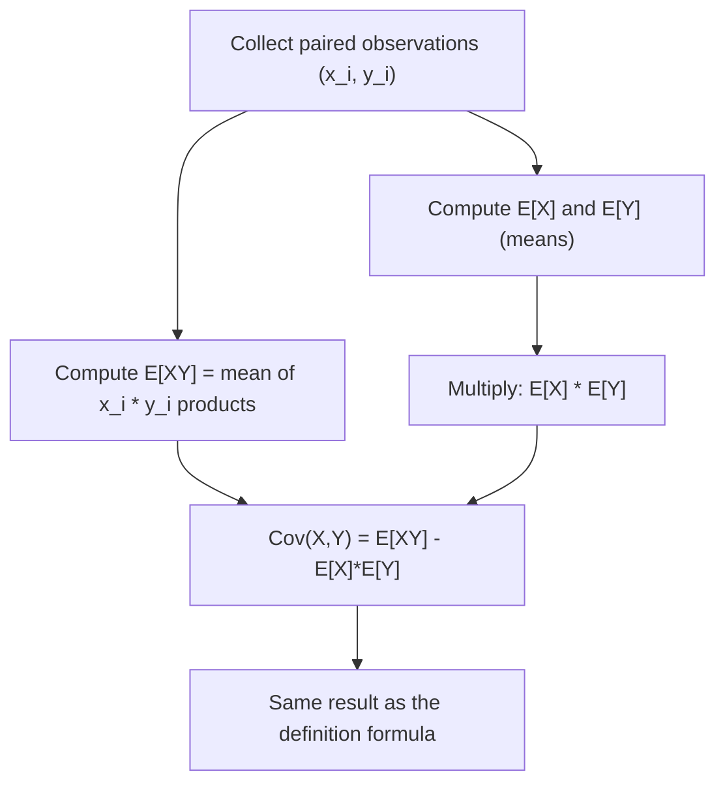

# Covariance Identity

$$
Cov(X,Y) = E[XY] - E[X]E[Y]
$$

## Deep Breakdown

What it tells me *(Situation Awareness)*:
This is the computational shortcut for covariance. Instead of mean-centering first, you compute the expected product $E[XY]$ and subtract the product of individual means. This form is algebraically equivalent to the definition and is the standard form used in ML proofs: bias-variance decomposition, OLS normal equations, and deriving the variance of a sum. It also enables single-pass streaming covariance without buffering all observations.

## Flowchart



## Real-world use

### Where it is used

Deriving closed-form estimators, proving statistical identities in lecture notes and papers, and implementing incremental covariance in streaming data pipelines where you want to accumulate running sums rather than storing all pairs.

### Problem it solves

The definition formula requires computing the mean first, then a second pass over the data for mean-centered deviations. This identity enables single-pass streaming computation and provides a cleaner algebraic form for mathematical proofs.

### How it solves the problem

Expand $E[(X-E[X])(Y-E[Y])]$ algebraically: $= E[XY - XE[Y] - YE[X] + E[X]E[Y]] = E[XY] - E[X]E[Y] - E[Y]E[X] + E[X]E[Y] = E[XY] - E[X]E[Y]$.

### Example in a business

A real-time analytics pipeline computes running covariance between scroll depth and session time using accumulators for $\sum x_i y_i$, $\sum x_i$, $\sum y_i$, and $n$. No buffer of individual records is needed, enabling constant-memory streaming stats.

## The formula, piece by piece

| Symbol | Meaning |
|--------|---------|
| $Cov(X,Y)$ | Covariance of X and Y |
| $E[XY]$ | Expected value of the product $X \cdot Y$ |
| $E[X]$ | Expected value (mean) of X |
| $E[Y]$ | Expected value (mean) of Y |
| $E[X]E[Y]$ | Product of individual means |

Full formula: $Cov(X,Y) = E[XY] - E[X]E[Y]$

## The formula in words

"The covariance equals the mean of the products minus the product of the means." If X and Y were independent, $E[XY] = E[X]E[Y]$, so the covariance would be zero. This confirms that independence implies zero covariance (but not vice versa in general).

## Critical Concepts

- **Algebraic equivalence**: this is a rearrangement of the definition, not a new concept.
- **Independence check**: $Cov(X,Y) = 0 \iff E[XY] = E[X]E[Y]$ is necessary but not sufficient for independence in general.
- **Variance as special case**: $Cov(X,X) = E[X^2] - (E[X])^2 = Var(X)$.
- **Streaming sufficient statistics**: accumulate $S_{xy} = \sum x_i y_i$, $S_x = \sum x_i$, $S_y = \sum y_i$, $n$; then $Cov = S_{xy}/n - (S_x/n)(S_y/n)$.

## Step-by-step calculation (tiny example)

Data: $(X, Y)$: $(1,3), (2,5), (3,7)$.

*Step 1: Compute E[X] and E[Y]*
$E[X] = (1+2+3)/3 = 2$, $E[Y] = (3+5+7)/3 = 5$

*Step 2: Compute E[XY]*
Products: $1 \cdot 3=3$, $2 \cdot 5=10$, $3 \cdot 7=21$
$E[XY] = (3+10+21)/3 = 34/3 \approx 11.33$

*Step 3: Apply identity*
$Cov(X,Y) = 34/3 - 2 \times 5 = 34/3 - 10 = 4/3 \approx 1.33$

*Step 4: Verify with definition*
Deviations: $(-1,-2),(0,0),(1,2)$; products: $2,0,2$; mean $= 4/3$

## Code examples

### Beginner example (Python)

```python
import numpy as np
x_values = [1, 2, 3, 4, 5]
y_values = [3, 5, 7, 9, 11]

# Cov = E[XY] - E[X] * E[Y]
e_xy = np.mean([x * y for x, y in zip(x_values, y_values)])
e_x = np.mean(x_values)
e_y = np.mean(y_values)
cov_identity = e_xy - e_x * e_y
print(f"E[XY] = {e_xy:.4f}")
print(f"E[X] * E[Y] = {e_x * e_y:.4f}")
print(f"Cov(X,Y) identity = {cov_identity:.4f}")
print(f"numpy cov (ddof=0) = {np.cov(x_values, y_values, ddof=0)[0, 1]:.4f}")
```

### Beginner example (R)

```r
x_values <- c(1, 2, 3, 4, 5)
y_values <- c(3, 5, 7, 9, 11)
e_xy <- mean(x_values * y_values)
e_x <- mean(x_values)
e_y <- mean(y_values)
cov_identity <- e_xy - e_x * e_y
cat("Cov(X,Y) via identity:", cov_identity, "\n")
```

### Professional example (Python)

```python
import numpy as np


class StreamingCovariance:
    # Online single-pass covariance estimator using the identity formula.
    # Accumulates sufficient statistics without storing observations,
    # suitable for large-scale or real-time data pipelines.

    def __init__(self) -> None:
        self._n: int = 0
        self._sum_x: float = 0.0
        self._sum_y: float = 0.0
        self._sum_xy: float = 0.0

    def update(self, x: float, y: float) -> None:
        self._n += 1
        self._sum_x += x
        self._sum_y += y
        self._sum_xy += x * y

    def covariance(self) -> float:
        # Population covariance via identity: E[XY] - E[X]*E[Y]
        if self._n < 2:
            raise ValueError("Need at least 2 observations.")
        mean_x = self._sum_x / self._n
        mean_y = self._sum_y / self._n
        mean_xy = self._sum_xy / self._n
        return mean_xy - mean_x * mean_y

    def sample_covariance(self) -> float:
        # Bessel-corrected sample covariance (ddof=1)
        return self.covariance() * self._n / (self._n - 1)


if __name__ == "__main__":
    rng = np.random.default_rng(seed=42)
    n_obs = 10_000
    x_stream = rng.normal(loc=100, scale=15, size=n_obs)
    y_stream = 0.6 * x_stream + rng.normal(loc=0, scale=10, size=n_obs)
    estimator = StreamingCovariance()
    for x_val, y_val in zip(x_stream, y_stream):
        estimator.update(x_val, y_val)
    print(f"Streaming population cov: {estimator.covariance():.4f}")
    print(f"Streaming sample cov: {estimator.sample_covariance():.4f}")
    print(f"numpy reference (sample): {np.cov(x_stream, y_stream)[0, 1]:.4f}")
```

---

*Source: AIO p. 86` `MML2 p. 196*
